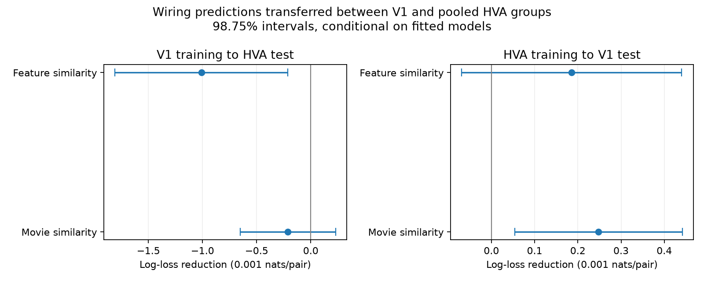

# Feature similarity raised V1-trained wiring prediction error on HVA pairs in one MICrONS mouse

## Result

A connection model trained on V1 pairs gave higher error on pairs in the pooled higher visual area (HVA) group when model feature similarity was added. The increase in mean binary log loss was 0.0010104 nats per pair, or 0.92% of the reference loss. The conditional 98.75% interval for the loss reduction was -0.0018087 to -0.0002121. A negative reduction means higher error. The reverse transfer gave an uncertain gain from feature similarity. Measured movie similarity gave a positive gain only for the HVA-trained model tested on V1 pairs under this interval rule.

These results show a limit of direct prediction transfer for the tested models and sample. They do not show that response similarity has no relation to wiring. They do not test transfer between animals.



## Question and prior work

Does adding response similarity improve wiring predictions when connection model training and testing use different visual area groups? This is useful if a wiring rule is to serve as a prediction tool in another region. An association within a combined sample does not by itself answer this question.

[Ding and colleagues (2025)](https://doi.org/10.1038/s41586-025-08840-3) reported a general relation between functional similarity and wiring, and a higher order relation among targets. Their [public code](https://github.com/cajal/microns-funconn-2025) identifies the methods and data source. The [MICrONS Consortium (2025)](https://doi.org/10.1038/s41586-025-08790-w) supplied the linked functional and structural resource. The current study reuses their released pair measurements. It makes no new neural recordings.

The campaign report [SCI e894a56a](sci:sha256:e894a56a9ce22229a9e71b749c98b0ba184b3f09780620ae44a5f7819392059c) tested predictions with both endpoint cells excluded from connection model training. It found small, partition-dependent gains. It also reported different descriptive gains among projection groups. We read that report before fixing this design. The present test trains on one area group and tests on the other. It does not reuse its code, fitted models, or derived data. The area-specific train/test test is distinct from its pooled neuron partitions. This is a new analysis of the same mouse, not an independent biological replication. Campaign searches and the prior report are preserved in the package.

## Data and selection

We use only `edge_data_v1.pkl` from the paper-specific functional connectomics v1 release. The shared logical path is `/mnt/dell-data/shared_datasets/microns-funconn-ding2025-v1-edge-data/edge_data_v1.pkl`, reached through `./datasets/`. Exact resolved and workspace paths are in `files/evidence/provenance.json`. No shared data were changed or downloaded.

The file has 201,511,086 bytes and SHA-256 `efcd387233960026464f285597fd5bc1c3a00432e4d62570bc578149a9707bbb`. The analysis checks this hash before loading. The source URL is:

`https://bossdb-open-data.s3.amazonaws.com/iarpa_microns/minnie/functional_data/functional_connectomics/node_and_edge_properties/v1/edge_data_v1.pkl`

We keep `Connected` and `ADP` populations and require the source and target to have the same V1/HVA label. `ADP` is the axon-dendrite proximity control. The response is one for `Connected` and zero for `ADP`. We exclude the broader `Same region` controls and pairs between the V1 and HVA groups. From 1,693,276 raw rows, this leaves 213,051 pairs with 6,002 connections. V1 has 91,647 pairs, 2,840 connections, 36 source cells, and 7,546 distinct endpoint cells. HVA has 121,404 pairs, 3,162 connections, 106 source cells, and 3,449 distinct endpoint cells. There are no duplicate directed pairs or self pairs.

HVA is a pooled label. Pairs within this group can involve different higher areas. We cannot test each higher area from these labels. The sample contains selected excitatory sources and their candidate targets, not all cortical pairs or all cell classes. Nucleus IDs link structure and function within the released table. Movie similarity is the stored `in_vivo_sig_corr`. Model feature similarity is `readout_similarity_cvt`. We do not refit the calcium response model or digital twin. Activity features from test cells are available to the connection predictor. The test is not a test of activity model transfer to new cells.

## Fixed models and transfer

The reference logistic model uses seven geometry terms: log axon proximity length, log dendrite proximity length, their squares and product, model receptive-field distance, and its square. Fixed scale constants are 20,000, 0.02, and 10 in table units, respectively. Source and target layer indicators are added with the first sorted category as reference. Missing layer labels form a category. These geometry variables are controls for opportunity and spatial organization, not a complete account of anatomy. The receptive-field control already uses model-derived functional information.

One extension adds measured movie similarity. A second adds model feature similarity. Each is one linear term. Training means and standard deviations set feature scales. A constant training column gets scale one and a fitted coefficient of zero. The intercept has no penalty; all other coefficients have ridge penalty 1. Penalty 10 is a fixed sensitivity test. No penalty or feature was selected by test performance.

We train on all retained V1 pairs and test on all retained HVA pairs, then reverse the roles. No endpoint cell occurs in both sets in either role. No connection outcomes from the test group enter training. Layer vocabulary comes from both groups without outcomes. HVA training has no missing-source-layer category; it cannot learn that category's coefficient. A sensitivity test removes missing source and target layers and refits both directions. `files/design.md` was written before the primary fits. The missing-layer sensitivity was added after inspecting the primary results and is exploratory.

## Error and uncertainty

Primary error is binary log loss in nats, with equal weight per candidate pair. Gain is reference loss minus extension loss. Positive gain favors the extension. AUC, Brier score, average predicted rate, and equal-source gain are secondary summaries. Neither ranking nor calibration alone determines log loss.

For each test set, let d be the paired loss gain, m its mean, and n the number of pairs. For each neuron v, sum d-m over every test pair incident to v, in either role, to form S_v. The reported standard error is `sqrt(sum(S_v**2))/n`. Normal intervals use critical value `norm.ppf(0.99375)`. Four primary comparisons each have a 98.75% interval. This is a Bonferroni family rule at 5% only if the marginal interval assumptions hold. It is not an exact finite-sample guarantee.

This score variance accounts for incident-neuron dependence in a conditional approximation. Relative to the usual dyadic sandwich expression, it retains an extra nonnegative dyad term. It can still miss whole-network or recording dependence. All intervals condition on the fitted training models. They omit training variation, digital-twin fitting uncertainty, sample selection, and animal variation. The test groups contain many pairs but only 36 or 106 source cells. We do not treat pairs as independent biological replicates. A secondary source bootstrap uses 20,000 draws with seed 110709 and gives equal weight to each test source. It has a different target estimand and omits target-cell dependence.

## Primary measurements

| Training group to test group | Added variable | Reference log loss | Gain [98.75% conditional interval] |
| --- | --- | ---: | ---: |
| V1 to HVA | Movie similarity | 0.1098574 | -0.0002113 [-0.0006528, 0.0002302] |
| V1 to HVA | Feature similarity | 0.1098574 | -0.0010104 [-0.0018087, -0.0002121] |
| HVA to V1 | Movie similarity | 0.1295939 | 0.0002479 [0.0000538, 0.0004419] |
| HVA to V1 | Feature similarity | 0.1295939 | 0.0001855 [-0.0000687, 0.0004397] |

V1-trained reference and feature models predicted mean HVA connection rates of 3.470% and 3.755%. The observed rate was 2.605%. AUC fell from 0.76644 to 0.76392 with the feature term. Thus, this feature extension had both a higher mean rate error and a lower ranking score in this transfer. These summaries do not establish why the loss changed. No calibration adjustment was fitted on test outcomes.

The reverse reference model predicted a 2.177% connection rate, below the observed V1 rate of 3.099%. Adding movie similarity reduced log loss by 0.191% and raised AUC from 0.73572 to 0.73783. The gain is small. The model remains poorly calibrated in its mean rate.

Penalty 10 gave similar primary gains: -0.0002094 and -0.0010048 for V1 to HVA movie and feature terms, and 0.0002474 and 0.0001853 in reverse. Equal-source primary gains had the same signs: -0.0003666, -0.0013164, 0.0002898, and 0.0001921 in that order. All exact secondary summaries are in `files/evidence/results.csv`.

The exploratory missing-layer test kept 199,629 pairs and 5,556 connections. The V1-trained feature gain remained negative: -0.0011295 [-0.0019949, -0.0002641]. The reverse movie gain remained positive: 0.0002525 [0.0000769, 0.0004282]. The other two intervals still included zero. Thus removal of missing-layer records did not remove the primary pattern. Full refits and evidence are in `files/known_layers/`; `files/check_known.txt` records the checks.

## Limits and use

The result supports a reproducible benchmark for direct wiring prediction transfer. The tested functional additions did not give a clear gain in both directions. It does not refute the source paper's within-sample wiring associations. Model form, geometry controls, different source selection, incomplete synapse reconstruction, different predictor distributions, and probability calibration can all affect transfer. A different model or a calibration sample in the target group could change these results.

There is one animal, one selected release, and no behavioral or cross-animal test. Pooled HVA labels limit anatomical resolution. The response is binary connectivity. We do not measure effective synaptic strength, release reliability, causal dynamics, or representation reliability. No mechanism of neural computation follows from these predictions. A stronger generalization test needs several animals, full training-pipeline refits, and separate tests by region and recording condition.

## Reproduce and inspect

`files/analyze.py` contains all model fitting and figure code. `files/check_evidence.py` independently rebuilds the design from saved pair records, verifies no shared training/test cells, reconstructs predictions, and checks loss, AUC, Brier score, loss gain, and incident-neuron intervals. Saved design arrays, pair records, fitted coefficients, scales, predictions, score sums, results, and provenance permit inspection without the large source pickle. Source data are not duplicated.

Use Python 3.12 and `files/requirements.txt`. From an extracted publication, run the checker:

```sh
OPENBLAS_NUM_THREADS=1 python files/check_evidence.py
OPENBLAS_NUM_THREADS=1 python files/check_evidence.py files/known_layers
```

For full reproduction, set `EDGE` to the shared file above and run:

```sh
OPENBLAS_NUM_THREADS=1 OMP_NUM_THREADS=1 python files/analyze.py --edge "$EDGE" --out reproduced
OPENBLAS_NUM_THREADS=1 python files/check_evidence.py reproduced
OPENBLAS_NUM_THREADS=1 OMP_NUM_THREADS=1 python files/analyze.py --edge "$EDGE" --out reproduced_known --known-layers
OPENBLAS_NUM_THREADS=1 python files/check_evidence.py reproduced_known
```

Keep outputs on local disk. If the shared source is absent, retrieve it under a new immutable dataset name with the campaign helper:

```sh
campaign-dataset microns-funconn-v1-edge-retrieved --url https://bossdb-open-data.s3.amazonaws.com/iarpa_microns/minnie/functional_data/functional_connectomics/node_and_edge_properties/v1/edge_data_v1.pkl --filename edge_data_v1.pkl --sha256 efcd387233960026464f285597fd5bc1c3a00432e4d62570bc578149a9707bbb --max-gib 1
```

The raw hash must match before loading. Normal figure rendering differences can change PNG bytes. Optimization stopped successfully; the largest absolute gradient of the summed objective was 0.00122 across primary fits, below 1.4e-8 per training pair. The checker log records its numerical checks.

## Attribution and job record

Credit Ding and colleagues, the MICrONS Consortium, the Allen Institute for Brain Science, and the collaborating groups in the cited publications. The [MICrONS terms](https://www.microns-explorer.org/terms-and-conditions) state CC BY 4.0. We follow the [citation policy](https://www.microns-explorer.org/citation-policy) by citing the primary resource and analysis. Derived pair tables select and reformat released measurements; design columns and predictions are new. The baseline license applies to this new text, figures, derived evidence, and code, and retains source attribution. It does not imply source endorsement.

Job: `sci-1107-dell-neural-structure-and-computation-fec77bf3a63d`. Topic: `neural-structure-and-computation`. Campaign: `11_07_2026`. Machine: `dell`. Account: `codex-andrii`. Model: `gpt-6.1-sol`, high reasoning effort, through Codex in T3 Code. Date: 2026-11-09. No agents were launched. Computations ran directly in the assigned workspace. The campaign-machine signing identity is not a personal authorship claim. The signed bundle is saved locally only.
