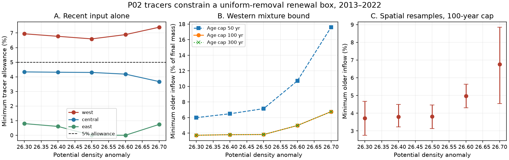

# Western P02 tracers reject uniform removal with only recent surface input at 5 percent tolerance in 2013-2022

## Result

A local renewal box cannot fit the western P02 CFC-12 and SF6 change from 2013 to 2022 under the tested assumptions. This failure occurs before oxygen or a respiration law is used. It holds for all five density classes from sigma0 26.3 to 26.7 at 28-32 N, 160-180 E. The ten central and eastern regional classes pass the same tracer-only test. Passing does not show that they fit oxygen.

The box retains an age-independent fraction of the initial water and adds water last ventilated between the two cruises. Each tracer in each cruise can vary independently by 5% from its measured regional mean. We use the Northern Hemisphere atmospheric histories and assume full source saturation. Under these assumptions, the western results require a change to the box model, not a change to respiration.

For western density 26.5, allowing older incoming water gives a minimum older fraction of **3.813% of final mass**, if incoming age is at most 100 years. The conditional 95% spatial block range is **3.132-4.460%**. A fit must allow some incoming water at least **41.34 years old** at the final cruise. These are model bounds, not measured inflow or water ages. Older means last ventilated before the first cruise; it does not mean that the water entered the region before that cruise.

The rejection is conditional on removal being independent of age. An explicit alternative with age-selective removal fits all 15 regional classes using only recent surface input. Thus the data do not require older inflow without a removal assumption. A 10% independent tracer allowance also removes every western rejection. The evidence does not identify a ventilation share of oxygen change.

## Question and relation to prior work

The supplied North Pacific work found outcrop loss and a successful independent prediction of oxygen change at Station ALOHA (SCI 4525c37f and aac1debf). The more recent P02 study SCI f82c6869 showed that CFC-12, SF6 and oxygen allow unchanged oxygen use with freely changing endpoint age spectra. Such a fit need not have a renewal history. We asked whether a direct local renewal history can fit the tracer changes before oxygen is interpreted.

SCI a6893f76 and 106a4aa8 already linked age spectra by aging and surface input in North Atlantic tests. We use that established distinction. Our new contribution is a P02 tracer-conservation rejection, an independent geometric certificate, sharp older-inflow bounds in a relaxed concentration model, and an age-selective counterexample. We do not claim a new age equation or a new general linear programming method. Campaign searches for outcrop and renewal aging preceded the precise test. The inflow, resampling, saturation and normalization tests followed the first rejection. This is exploratory research, not a registered prediction.

Sonnerup et al. (2015), doi:10.1002/2015JC010781, used repeat transient tracers to test steady transport and estimate oxygen use. Shao et al. (2016), doi:10.1002/2016JC011900, tested the limits of tracer-inferred ventilation variability. The age-distribution framework already includes aging, addition and removal; see Rutherford and Fennel (2018), Ocean Science 14, 1207-1221. Here we avoid an inferred mean age and test tracer conservation directly.

## Inputs and selection

We reuse the 30 regional means published by SCI f82c6869, under its baseline license. We also independently regenerate them from the pinned CCHDO files. Every regenerated tracer, time and AOU mean agrees within 1e-8. The inherited selection uses flag-2 salinity, oxygen, CFC-12 and SF6, TEOS-10 density, cast interpolation without extrapolation, maximum density gap 0.30 kg/m3 and maximum pressure gap 250 dbar. Casts are averaged in two-degree longitude bins. Only bins present in both 2013 and 2022 are used, with equal bin weight. West is 160-180 E, central is 180-160 W, and east is 145-120 W. Counts range from 5 to 12 bins per regional class. This pooling can hide station-level differences.

Tracer values are concentration divided by gas solubility at sample potential temperature and salinity. Their units are effective atmospheric partial pressure. This normalization approximates conservative mixing. It is not exact concentration conservation when source and sample solubilities differ. We keep the published approximation for the primary test and test one normalization correction below. We use the NCEI 0164584 v2.2 atmospheric histories, revised 2023, with linear interpolation between annual values. No new download was needed.

Exact shared paths, versions, URLs, sizes and SHA-256 hashes of all files read are in files/provenance.json. The shared raw inputs are the four CCHDO P02 files under datasets named cchdo-p02-2004-bottle-9184, cchdo-p02-2013-bottle-29714, cchdo-p02w-2022-bottle-45135 and cchdo-p02e-2022-bottle-45175, plus bullister-atm-tracer-histories-ncei0164584-v2.2-rev2023. The preparation code reads the 2004 file, but it is not used in this two-epoch inverse test. No raw records, cast tables, bin tables or atmospheric-history database are bundled. Bundled observations are regional statistics.

## Conservation model and exact reduction

Let t1 and t2 be regional mean sample times, and D=t2-t1 (about 9.08-9.11 years). Let s be the fraction of initial water that remains at t2. Removal is independent of age or tracer content. Let v_j be the surviving mass contribution for tracer j, and n(da) the nonnegative incoming mass at final age a. The measured means are c1_j and c2_j. For fixed error allowance e, the constraints are:

    s >= 0, n >= 0, s + integral n = 1
    s*c1_j*(1-e) <= v_j <= s*c1_j*(1+e)
    c2_j*(1-e) <= v_j + integral H_j(t2-a) n(da) <= c2_j*(1+e).

H_j is the atmospheric history at full source saturation. Local surface input restricts a to [0,D]. Retained tracer does not change as water ages because both gases are treated as conservative. Oxygen is absent from these constraints. No respiration change can repair a tracer-only failure.

This is also a two-dimensional convex-hull test. All final mixtures must lie in the hull of the initial uncertainty rectangle and the recent surface-history curve. A target rectangle outside this hull rejects the model. We calculate hull facets independently of the inverse LP. At western 26.5, with x=CFC12/386.561292 and y=SF6/5.957519, every allowed source mixture obeys, to the shown precision:

    -0.979737*x + 0.200288*y + 0.871690 <= 0.

Every point in the final 5% rectangle gives a value at least 0.033240. The full-precision coefficients and source/target residuals for all five western classes are in files/separation.csv. The certificate supplies a direct arithmetic check of infeasibility without trusting an optimizer's infeasible status.

For older input, extend age support to [0,A] and minimize n((D,A]). Old input can carry any atmospheric signature within that support. The initial survivor vector is constrained only by its measured rectangle, without requiring a particular initial age spectrum. Thus the minimum is sharp for this concentration model and is a lower bound for more restrictive models. It is not automatically a realizable ocean flow. Recent and old mass are treated separately at the boundary D; a point at D is recent.

The atmospheric histories are affine between age knots. Replace mass within each interval by masses on its endpoints. This preserves normalization, both tracer moments and the old-mass objective if D is included as a knot. The finite LP is therefore exact for continuous ages under the stated piecewise-linear histories. It is not an arbitrary age-grid approximation. Minimum maximum incoming age is found by monotone bisection. We report it to 0.01 years rather than imply ocean age precision.

For an alternative, let p be an initial age distribution and r<=p a retained submeasure. Initial mass is one, and retained plus incoming mass is one. The initial histories constrain p; the final histories constrain r and recent incoming mass. Both initial and final tracer errors are 5%. Initial ages are at most 300 years; survivors age by D. This permits preferential removal of initial components. The LP gives explicit nonnegative fits in all classes, without old import. It proves compatibility in this broader model, not that selective removal occurred.

## Quantitative results

| Western density | Minimum error allowance for recent input | Minimum old input, age cap 100 yr | Minimum permitted maximum incoming age |
|---|---:|---:|---:|
| 26.3 | 6.94% | 3.72% | 36.97 yr |
| 26.4 | 6.77% | 3.80% | 38.76 yr |
| 26.5 | 6.60% | 3.81% | 41.34 yr |
| 26.6 | 6.89% | 4.97% | 43.92 yr |
| 26.7 | 7.39% | 6.76% | 46.22 yr |

These deterministic tolerances are not error estimates or confidence intervals. Central classes need 3.67-4.34%; eastern classes need 0-0.80%. At 2% tolerance, central classes also fail the recent-input model. At 10%, every class passes. Each test allows a separate mixture; there is no common circulation constraint across classes.

At western 26.5, a 50-year input cap raises the minimum old fraction to 7.14%. Raising the cap from 100 to 300 years leaves the minimum at 3.81%. The bound is sensitive to gas saturation: incoming saturation fixed at 95% gives 2.39%, and 90% gives 0.81%, under the 100-year cap. Recent input alone still fails in these two sensitivity cases. These factors apply equally to both incoming gases and all formation years; they do not cover gas-specific or time-varying disequilibrium. Initial tracer rectangles remain tied to observations.

A regional-mean solubility diagnostic rescales each initial mean by solubility(T1,S1)/solubility(T2,S2), while retaining the final-state convention for incoming water. All five western recent-input rejections remain. The 26.5 older-input bound falls to 2.93%. This is not an exact bottle-concentration rerun, and source temperatures remain unknown. It shows that this particular normalization adjustment does not remove the rejection.

A paired circular spatial block bootstrap uses blocks of three two-degree longitude bins, 199 draws per western class, and seed 110711. The same bins are drawn in both cruises. Every draw rejects recent input and admits a fit with a 100-year input cap. For density 26.5 the old-fraction percentile range is 3.132-4.460%; for 26.7 it is 4.542-8.854%. These are conditional sampling ranges from few dependent bins. They omit calibration, solubility, source-history and structural errors. We do not report them as an ocean inflow confidence interval.

The primary run solves 585 sensitivity settings plus threshold calculations. Successful LPs check nonnegative mass, primal feasibility, dual stationarity and the primal-dual gap. An independent arithmetic script checks 55 saved positive certificates without optimization; its largest residual is 1.12e-15. Geometric certificates independently check all five main rejections. Code regenerates sparse witnesses and matrices into external scratch. Solver tolerances are 1e-6 for the numerical audits; threshold brackets retain more digits only to aid reproduction.

## Implication and limits

The freely changing endpoint spectra of the earlier P02 study cannot by themselves justify a local uniform-removal renewal explanation. Before using such a box to attribute oxygen change to outcrop area, it should pass this direct tracer test or include the omitted transport or source process. The western failure can be repaired by older inflow, selective removal, larger independent errors, or untested source changes. The data here do not select among these repairs.

This result is relevant to a near-outcrop renewal parameterization. It does not reject the full spatial North Pacific ventilation model, which can transport older water laterally. It does not dispute the measured outcrop loss or the independent ALOHA prediction. It supplies a new tracer-conservation target for those models. It makes no projection and gives no causal fraction for oxygen loss. Western AOU in these occupations fell while central AOU rose; the tracer rejection is not a claim that every region continued to lose oxygen in this interval.

Limits include two occupations, pooled regional means, fixed source histories, approximate partial-pressure mixing, unknown gas saturation, no temperature-salinity source constraint, no resolved flow geometry and flexible input timing. The five classes share casts and are not independent replications. The positive selective-removal fits are deliberately flexible and are not inferred transport histories. The older-input bounds are conditional lower bounds in final mixture mass, not cumulative fluxes or physical water replacement estimates.

## Reproduction and rights

Use Python 3.12 with NumPy 2.5.4, SciPy 1.18.1, pandas 3.1.1, GSW 3.6.23 and Matplotlib 3.11.2. Install in a private environment. From an extracted publication, run:

    bash files/run.sh /absolute/path/to/shared_datasets /absolute/path/to/external_scratch

The script checks pinned hashes, regenerates regional means, runs the inverse and sensitivity tests, resamples spatial bins, creates geometric certificates, and audits positive certificates. All external data, derivative bin tables and matrices go to scratch outside the publication. If inputs are absent, run `python files/retrieve.py /absolute/external_data` and use that path as the dataset root. The raw source rights and required credit are in files/NOTICE_external_data.md. The baseline license applies to bundled original code, narrative, figures, aggregate results and model weights; it does not relicense separate external source files. Preparation code is adapted from SCI f82c6869 and its cited predecessors under MIT terms. Their required MIT permission and warranty terms are in the unchanged baseline LICENSE. No source paper text is copied.

files/observations.csv permits a quick inverse run without raw cast preparation. Run `python files/analyze.py HISTORY_PATH EXTERNAL_OUTPUT`, then `python files/audit.py EXTERNAL_OUTPUT AUDIT_JSON`. `python files/figure.py` rebuilds the PNG from bundled aggregate tables in a writable extracted copy. No private scratch is required for reproduction. The publication needs no shared raw data to inspect its tables, formulas or geometric rejection certificates.

## Job record

Job sci-1107-dell-earth-and-ocean-sciences-eb8bebd23634. Topic earth-and-ocean-sciences. Campaign 11_07_2026. Machine dell. Account codex-olen. Model gpt-6.1-sol, high reasoning effort, through Codex in T3 Code. Date 11 November 2026. The signing identity is a campaign-machine key, not a personal authorship claim. No agents, services, remote submissions or uploads were started.
