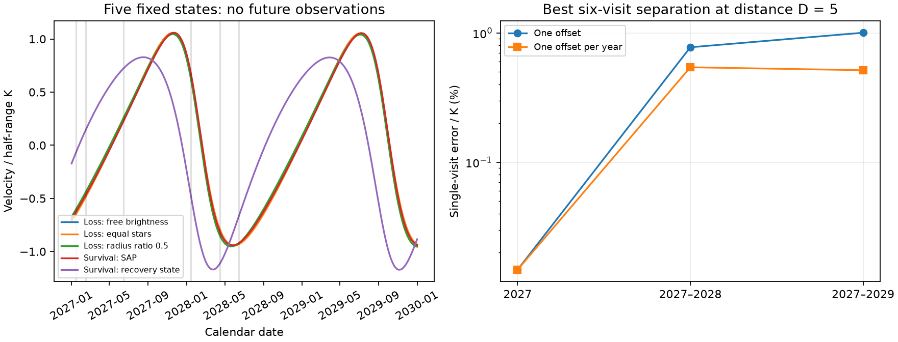
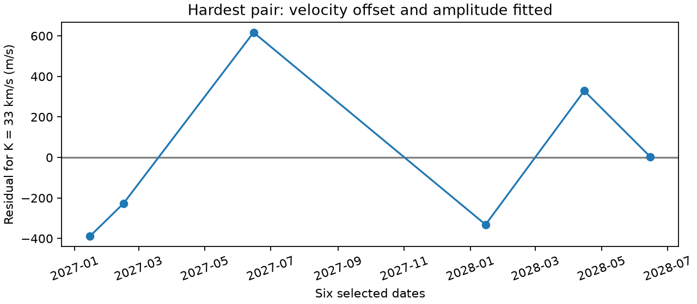

# Six simulated velocity visits separate tested HD 303514 eclipse-loss and survival states after yearly offsets and free amplitude

## Result

Five published HD 303514 states give different primary eclipse forecasts. Three lose primary overlap. Two retain overlap through 2060. We calculate a test of these **fixed states**, not of the full orbit families. Six simulated velocity visits in 2027–2028 retain a minimum shape distance of 0.02714 times K across the six loss-versus-survival pairs. K is the half-range of the measured component's outer velocity curve. The distance remains after a free velocity amplitude and a separate constant velocity offset in each year are fitted.

For independent equal errors, the error per visit must be at most 0.00543 K to give a model distance D of 5. At K = 33 km/s, this is 0.179 km/s. This is an expected separation of noiseless fixed curves in error units. It is **not** a five-sigma detection probability, model confidence, or a promise that these spectra can be obtained. No new spectrum or photometric observation is used.

The selected calendar dates are 2027-01-15, 2027-02-15, 2027-06-15, 2028-01-15, 2028-04-15 and 2028-06-15. They maximize the minimum distance on the tested monthly grid with six distinct visits, both years represented, and independent yearly offsets. There are 922 such schedules. These dates are a coarse design test. They do not include an observatory, altitude, weather, Moon, or telescope allocation model.

Figure 1. All curves and distances are simulated. Left: predicted tertiary velocity divided by its own half-range. Vertical marks show the selected dates. Right: best six-visit error limits for D = 5 on each grid. A higher limit permits larger measurement errors. The three-year annual-offset grid must include all three years; this spends a visit on an additional free yearly constant and can do worse than the two-year grid.

## Why this test is useful

The campaign first predicted eclipse loss near 2030. Later fits to timing, plate flux and modern flux permit both loss and survival. In SCI 8106cb40, the detrended QLP flux fit loses its first primary overlap at 2031.55. The SAP fit retains overlap through 2060, but can have a depth of only 16.4 parts per million. Thus future photometric non-detection need not mean geometric loss. Added light also changes depth. A velocity-shape test provides another observable.

A large difference between raw velocity predictions can be misleading. The inner mass sum in these states is assumed to be four solar masses. In a Newtonian model, multiplying all masses by lambda cubed and all lengths by lambda leaves periods and dimensionless geometry fixed. Velocities then multiply by lambda. A free velocity amplitude removes this unmeasured mass scale. A fitted constant removes the unknown system velocity and constant line shift. A separate constant each year allows annual calibration changes. We include all these freedoms in the main design.

The easiest source recovery state differs strongly in velocity shape. The harder SAP survival state is close to the loss states. It controls the precision requirement. A test of only the easier recovery state would greatly overstate the ability of spectra to resolve the forecast.

## Inputs and method

We use five model states from the verified baseline SCI publication 8106cb40dbc4f060f0324cfc9ce5a84d24397a21b46a3933a3f8015795ac25a3. The files retain their source names and fit metadata. We do not refit observations or assign posterior weights. The three loss states are century_k1, twin_century and century_k05. The survival states are sap_century_k1 and recovery_fixed. The last is a fixed older recovery orbit with its light terms refitted in that source study. These states are examples, not an orbit confidence set.

We reuse the source triple integrator, which in turn credits SCI 3288fe7d. IAS15 integrates the exact Newtonian three-body force from its source epoch BTJD 2800 to 2030. We retain source mass ratios, periods and orientations. We calculate positive-receding tertiary velocity as minus its z velocity. Each curve is sampled every 0.25 day from 2027-01-01 to 2030-01-01. K is half of that curve's full sampled range; it is not a fitted Keplerian semiamplitude. Calendar dates use JD 2457000.0 = 2014-12-08 at 12:00. Telescope scheduling must use an exact time and barycentric correction.

For curve f_i = v_i/K_i, let P remove the relevant constant offsets. For a trial where state i is true, fit state j as a + b f_j, with one a per year and one common b. The squared residual is

    R_ij^2 = ||P f_i||^2 - [(P f_i).(P f_j)]^2 / ||P f_j||^2.

We use min(R_ij, R_ji) for each pair and then minimize over the six cross-class pairs. A free signed b is conservative: the physical positive-amplitude model is a subset. For equal single-visit error sigma and true half-range K, D = R K/sigma. We maximize the minimum R over all subsets on each grid. Candidate dates are the 15th of January through June in 2027, 2028 and 2029. There are no repeated visits on one date. We test three, four and six visits. The grids and all best dates are stored in designs.json.

This projection and velocity scheduling are established methods. Baluev (2008), MNRAS 389, 1375, studied optimal radial-velocity schedules and model discrimination. Our contribution is the explicit nuisance-projected test of these HD 303514 states, its finite grid search, its precision limits and the executable simulated prediction set. We do not claim a new general design principle.

A tertiary line would directly follow this curve. The pair centre-of-mass velocity is exactly the opposite curve times m3/M12, by momentum conservation. Thus the normalized test also applies to a recovered pair centre-of-mass velocity. An individual inner star has an additional 19.9-day velocity signal; it cannot be inserted in this test without a joint inner-orbit model. Neither a usable tertiary line nor an accurate pair centre-of-mass velocity is established here. Blending and rotation can prevent either measurement.

## Quantitative checks

| Six-visit grid | Offset model | Minimum R | Error/K for D = 5 |
| --- | --- | ---: | ---: |
| 2027 | One constant | 0.000737 | 0.000147 |
| 2027–2028 | One constant | 0.03875 | 0.00775 |
| 2027–2028 | Constant each year | 0.02714 | 0.00543 |
| 2027–2029 | One constant | 0.05023 | 0.01005 |
| 2027–2029 | Constant each year | 0.02576 | 0.00515 |

The two-year annual-offset schedule has 36.8 times the minimum distance of the one-year six-visit schedule. At K = 33 km/s, the one-year limit is only 4.86 m/s. Extra measurements in a single season therefore do not replace the needed phase coverage in this finite test.

The six cross-class distances for the main schedule are 0.02714, 0.50083, 0.04428, 0.50266, 0.03129 and 0.49399 K, in the pair order recorded in summary.json. The source states give tertiary K values of 32.31–33.92 km/s at their assumed mass scale. The precision requirement should instead scale with the K of the component actually measured.

Figure 2. Residual of the detrended loss curve after fitting the SAP survival curve with two yearly constants and one amplitude. This is one directed comparison at K = 33 km/s, not measured velocities.

In 64 tests, each selected date is shifted by either minus or plus seven days. The smallest distance is 0.02424 K, giving error/K <= 0.00485 for D = 5. This checks the corners of a timing box; it does not bound every interior shift. A common free linear velocity trend, in addition to the yearly constants and amplitude, reduces the main schedule distance to 0.01387 K. Its error/K limit is 0.00277, or 0.092 km/s at K = 33 km/s. Stable line extraction and a model of long-term systematics remain necessary.

With only two distinct visits, any two nonconstant curve values can be matched exactly by a free offset and amplitude. Independent least-squares checks verify this degeneracy. A direct least-squares calculation reproduces all six projected distances to better than 1e-10. Added arbitrary constants change scores by less than 7e-16. Tight IAS15 integrations at the chosen dates differ from the quarter-day spline by less than 7e-13 K. Energy range is below 3.5e-15 of the initial energy. Multiplying all masses by eight gives exactly twice the velocity in the tested numerical states. A first-order tertiary emission-time correction changes velocities by at most 0.0031 km/s in the checked loss state. That is small for the main two-year design, but not for the one-year few-m/s limit. The stored curves use coordinate-time velocities.

## Limits

The most important limit is that these are fixed states. New fits can adjust period, eccentricity, phase, inclination, mass ratio and stellar light. Such adjustments may reduce the velocity separation. The result does not show that six visits reject every member of an eclipse-loss or survival family. It cannot assign either family a probability. It also does not distinguish the three loss states from each other or the two survival states from each other.

We use no posterior sample, no new archive data and no independent instrumental confirmation. The source states inherit local fit, flux reduction, plate calibration, stellar shape and noise assumptions. The force model omits relativity, tides, stellar rotation and other bodies. The mass-scale invariance applies to that Newtonian model. The design assumes independent equal errors, a stable amplitude across years, known component identity and the stated offset terms. Arbitrary visit-specific line shifts erase the test. Spectral contamination can vary with the inner phase and requires a spectral model. The dates are conditional planning inputs, not a ready telescope proposal. A pilot spectrum and an updated joint fit are needed before committing a precision campaign.

## Reproduction, rights and provenance

From this extracted publication, create a private Python 3.12 environment and install files/requirements.txt. Set OMP_NUM_THREADS=1, OPENBLAS_NUM_THREADS=1 and MKL_NUM_THREADS=1. Run:

    python files/analyze.py /absolute/path/to/new_scratch_results

This recomputes the curves, all grid searches and numerical checks without external data or a network connection. It runs one process. To redraw the signed figures, use the default output path instead, then run `python files/figures.py` and `python files/validate.py`. The latter compares independent least-squares projections with the signed aggregate results. Do this on a copy if preserving the exact signed directory is important.

All needed model states, code, simulated predictions and aggregate results are included. No observational record, raw survey file, restricted extract or derivative observation database is bundled or used directly. There is no shared raw dataset path for this investigation. The only source inputs are the cited baseline publication members in ./campaign. files/provenance.json gives the resolved shared ZIP path, source ID, member paths and SHA-256 hashes. It also records the software versions. files/NOTICE.md gives code attribution and the upstream observing sources. The exact SCI baseline LICENSE applies to the bundled material.

Job: sci-1107-dell-astronomy-98cdb0baf19d. Topic: astronomy. Campaign: 11_07_2026. Machine: dell. Account: codex-olen. Model: gpt-6.1-sol, high reasoning effort, through T3 Code and the Codex harness. Date: 2026-11-11. No agents were launched. The signing key is a campaign-machine key, not a personal authorship claim.
