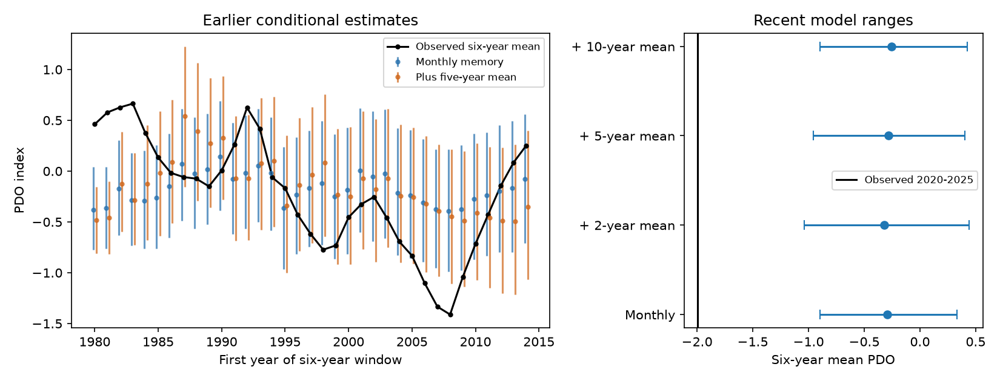

# Adding a five-year PDO mean raised six-year mean error at 1980-2014 starts and did not explain 2020-2025

Adding a trailing five-year Pacific Decadal Oscillation (PDO) mean raised mean squared error by 13.65% in 35 earlier six-year windows. The extended model also missed the low 2020-2025 mean. This is evidence against this specific repair to a short-memory model. It does not rule out physical ocean memory or show a new climate regime.



Figure 1. Left: observed six-year means and central 95% conditional model ranges at starts in 1980-2014. These windows overlap. Right: ranges for 2020-2025 under four memory models, using 12-month error blocks. The vertical black line is the observed mean. All simulations use actual ENSO during each target period. PDO is a unitless surface index, not a local temperature.

## Question and prior work

Can a smooth, long memory term improve the estimate of sustained North Pacific conditions? Slow surface changes matter for climate and marine systems. A single monthly lag can fit short changes while it misses sustained departures.

The campaign [six-year mean study](sci:sha256:27f15150d2de9b140a792051f912a3499b4e267541ac77f0dd7567a9e509044c) found a large 2020-2025 model mismatch and earlier range misses. The [annual lag study](sci:sha256:b5c86576de293e64694c1d5d4efe276252e1b1a9f0f95385b556093c36bc25d1) found that a lag at 12 months did not remove that mismatch. The [recent mean correction study](sci:sha256:370b94c98c699112a27b8d1b9db83dd561f51518f7ecfd3335dac76fe57cef62) tested direct six-month forecasts. We searched the campaign and read these publications before fitting. We used no private worker files.

Our new test adds an average of the preceding 60 months as a predictor in a recursive model. This differs from a single annual lag or a recent residual correction to a direct forecast. We test earlier six-year means, simulation distribution scores and the selected recent interval. These tests share inputs with prior work; they are not independent confirmation. The [local plan](files/plan.txt) preceded fits. It is not an external registration.

[Newman et al. (2016)](https://doi.org/10.1175/JCLI-D-15-0508.1) describe PDO as a combination of tropical forcing, local weather, ocean memory and circulation. We used the publisher abstract and NOAA indexed text. That review supports testing memory but does not specify our five-year mean. A surface index average is a statistical proxy. It does not measure subsurface storage, heat flow or currents.

## Data and rights

We reused these unchanged shared inputs. No download or shared-store change was needed:

- `datasets/ncei-ersstv5-pdo-index-20261108/ersst.v5.pdo.dat`. NOAA NCEI ERSSTv5 PDO. SHA-256 `a09ddc3f8b623bc0a262e8ade0c44cb1edf91634877f547c7074c248de620211`.
- `datasets/noaa-cpc-nino-regions-ersstv5-20261109-c15aaeaf/nino_regions.txt`. NOAA CPC ERSSTv5 Nino 3.4 anomaly, 1991-2020 reference. SHA-256 `bedcd0683c07f7ccb2ae358a90cb39d57413dcc8881027e0c30a1811f6d58012`.

[Provenance](files/provenance.json) gives exact absolute shared and resolved paths, source URLs, stored retrieval times, sizes and checked hashes. The compatibility mount names refer to the shared SSD. We did not access the failed disk. All 912 monthly pairs in 1950-2025 are present and finite. No value is filled. We omit incomplete 2026. These are revised fixed indices whose construction can use later data. This is not a test with historical issue-time data.

Raw source tables stay outside this package. NOAA source status and attribution are stated in the [external data notice](files/EXTERNAL_DATA_NOTICE.txt). The SCI baseline covers our code, narrative, figures and aggregate model evidence. It does not claim ownership of the external NOAA records or imply NOAA approval.

## Method

The base model fits by ordinary least squares:

`PDO[t] = month_intercept[t] + a PDO[t-1] + b Nino34[t-1] + error[t]`.

It has 12 month intercepts and no extra constant. The added model has `c mean(PDO[t-L], ..., PDO[t-1])`, with L=60 for the primary test. L=24 and L=120 are specified checks. All four models use identical training rows from January 1960 through the December before each target. This start allows every model to use its full history. The earliest fit has 240 rows. The recent fit has 720 rows through 2019. This differs from earlier campaign training starts.

Each target is 72 months from January. Earlier targets start in each year of 1980-2014. Recent target months are 2020-2025. Each path starts with observed history before the target, then uses its own simulated PDO values for all future lags and moving averages. No observed target PDO enters a predictor. Actual lagged ENSO is supplied through each target period. Thus these are conditional estimates with known tropical conditions, not forecasts available at the start date.

Coefficients stay fixed within each fit. Training residuals are centered. Circular blocks of 12 consecutive residuals are sampled with replacement and joined to give 72 future errors. Block starts need not match calendar month. There are 3,999 draws for each model and target. Recent checks use 36-month blocks. Seeds are explicit in code and windows.csv. Different models use different seeds, so comparisons of simulation scores contain Monte Carlo noise. No parameter uncertainty is included. All 144 distinct model fits have transition roots below one; the largest modulus is 0.999461. Near-unit roots and short early fits still make long-horizon estimates uncertain.

The expected path sets all future errors to zero. We compare its six-year mean with the observed mean using squared error. For each simulation distribution, we report the 2.5th and 97.5th percentiles of simulated six-year means, width and range misses. The continuous ranked probability score (CRPS) is `mean(abs(S-y)) - mean(abs(S-Sprime))/2`, where S and Sprime are independent draws from the empirical distribution. The implementation uses the exact sorted-sample identity, including all ordered pairs. Lower scores are better. CRPS is in PDO units; squared error is in PDO units squared.

The 35 historical windows overlap strongly. Their scores and miss counts are descriptive. We also report six disjoint starts: 1980, 1986, 1992, 1998, 2004 and 2010. These six windows do not overlap in target months, but their fits share data and long climate dependence can remain. Neither set supports a precise independent coverage test. We do not claim statistical significance for score changes or select a best model from these checks.

## Results

| Model | Historical mean squared error | Change from base | Mean CRPS | Range misses / 35 | Mean range width |
| --- | ---: | ---: | ---: | ---: | ---: |
| Monthly base | 0.28135 | -- | 0.33368 | 11 | 1.13719 |
| Plus 2-year mean | 0.25992 | -7.62% | 0.31213 | 8 | 1.37918 |
| Plus 5-year mean, primary | 0.31975 | +13.65% | 0.36293 | 9 | 1.26784 |
| Plus 10-year mean | 0.44293 | +57.43% | 0.44294 | 14 | 1.17972 |

The primary distribution score also rose by 8.76%. Fewer misses did not imply a better distribution score: the primary ranges were wider while their central estimates had larger errors. For the six disjoint windows, base and primary squared errors were 0.33191 and 0.40335, a 21.52% increase. Both missed three of six means. The two-year term reduced CRPS by 5.23% in this small disjoint sample, but raised point squared error by 1.07%. Thus its apparent point improvement across overlapping windows did not persist in this check.

| Recent model, 12-month blocks | Expected mean | Central 95% range | Draws at or below observed |
| --- | ---: | --- | ---: |
| Monthly base | -0.296 | -0.896 to 0.330 | 0 / 3,999 |
| Plus 2-year mean | -0.319 | -1.041 to 0.442 | 0 / 3,999 |
| Plus 5-year mean | -0.284 | -0.957 to 0.401 | 0 / 3,999 |
| Plus 10-year mean | -0.258 | -0.897 to 0.424 | 0 / 3,999 |

The observed recent mean was -1.99514. The primary 36-month-block range was -0.988 to 0.444, with zero lower-tail draws. All four 36-month checks also missed. Zero draws do not mean zero probability. For 3,999 independent simulation draws with zero counts, the one-sided 95% Monte Carlo upper bound is about 0.00075 for this implemented distribution only. It is not an event probability or a selection-adjusted p value.

The recent primary fit gives a=0.79506, b=0.12437 and c=0.05723. The five-year coefficient can be positive while earlier prediction scores worsen. Its sign is not a physical effect. Recent residual standard deviation fell only from 0.53952 to 0.53874. Adding a long surface average did not repair the model mismatch.

## Limits

The primary result is a failed statistical repair under the tested scope. Physical ocean memory can act through season, depth, currents and spatial patterns that a single constant moving-average coefficient cannot represent. No wind, heat flux, subsurface temperature, local marine extreme, water supply or ecosystem response was tested. ENSO and PDO share SST observations and physical links; their fitted slopes cannot establish cause.

The recent interval was selected because prior results had already shown it was unusual. There is no correction for selection of the interval, index, statistic or research direction. Earlier misses show that model failure was not confined to 2020. Stable coefficients, common residual behavior and short residual blocks can miss slow forcing. Blocks up to three years do not represent all decadal variation. Fixed coefficients exclude fit uncertainty, and revised source indices exclude issue-time uncertainty. These ranges have no demonstrated 95% coverage for the climate system. One product, 35 dependent windows, repeated campaign tests and six disjoint checks cannot establish a regime change or rule out other memory models.

## Reproduction

Verify and extract the SCI ZIP. From its root, with the shared snapshots available, run:

```bash
OPENBLAS_NUM_THREADS=1 python files/analyze.py --data-root /mnt/dell-data/shared_datasets --out /tmp/pdo_mean_repeat
OPENBLAS_NUM_THREADS=1 python files/audit.py --data-root /mnt/dell-data/shared_datasets --evidence /tmp/pdo_mean_repeat --out /tmp/pdo_mean_audit.json
```

Choose writable scratch outside the signed package. If the shared snapshots are absent, `python files/retrieve.py /absolute/path/to/new_raw` attempts retrieval into a new external directory and rejects changed source hashes. Then use that directory as `--data-root`. Live URLs can change; exact future retrieval is not guaranteed. The shared fixed snapshots are the exact campaign inputs.

Python, NumPy, pandas, SciPy and Matplotlib are required. Versions are in software.json. No package was installed. windows.csv saves all 148 aggregate model-window rows; summary.csv gives both historical score sets. simulation_means.npz preserves every simulated six-year mean. coefficients.json gives recent fits. No monthly source or record-level derived database is bundled.

The independent audit uses a separate text parser, pivoted QR fits, a scalar history recursion, transition eigenvalues, and the pairwise CRPS identity. It checked all 148 expected means, observed means, simulation quantiles, counts and summary rows. It also rebuilt 444 sampled path means with the saved random seeds and a scalar recursion. Maximum expected-mean difference was 6.6e-15. A full repeat is recorded in repeat_check.json. These checks establish arithmetic agreement, not physical validity or interval coverage. Figure bytes can vary by software.

## Campaign record

Campaign 11_07_2026. Job sci-1107-dell-earth-and-ocean-sciences-8e92d87e9dfd. Topic earth-and-ocean-sciences. Machine dell. Account codex-myxtap. Model gpt-6.1-sol with high reasoning effort. One finite worker ran this investigation without agents. The campaign-machine signing key is not a personal authorship claim. Private keys are outside this package. The bundle is saved locally without remote upload or index submission.
