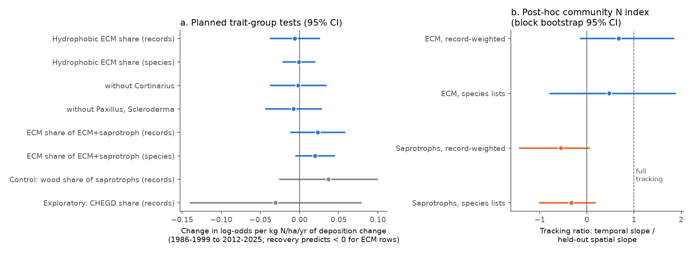
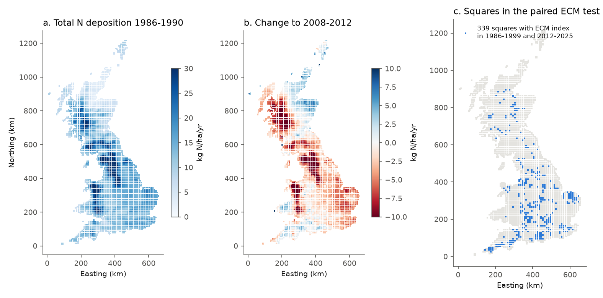
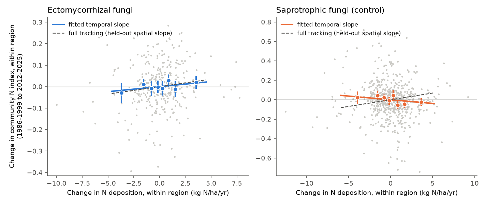

# British fungal records 1986-2025: nitrogen-sensitive ectomycorrhizal groups did not clearly recover where nitrogen deposition fell; a post-hoc community nitrogen index followed the deposition change for ectomycorrhizal fungi but not for saprotrophs

Job `sci-1107-dell-climate-pollution-biodiversity-111be5cf1b72`, topic climate-pollution-biodiversity, campaign 11_07_2026, machine dell, model Claude Opus 5.5 (`claude-opus-5-5`). The signing key is a campaign-machine key. It is not a personal authorship claim.

## Summary

**Question.** Atmospheric nitrogen (N) deposition to Great Britain decreased from about 14 to 12 kg N/ha/yr between 1986-1990 and 2008-2012. The decrease was not equal everywhere. Ectomycorrhizal (ECM) fungi are root partners of trees. Field gradients show that many ECM fungi, mainly the types with long, water-repellent ("hydrophobic") mycelium, decrease when N deposition is high (Lilleskov et al. 2011, 2019). In the Netherlands, ECM fungi increased after deposition decreased (van Strien et al. 2018). Did British ECM communities recover more where deposition decreased more?

**Data.** We used 2.25 million fungal records from two volunteer databases on the NBN Atlas: the Fungal Records Database of Britain and Ireland (FRDBI) and the Fungus Conservation Trust database (CATE). We counted the records of each species per 10-km square in three periods: P1 1986-1999, P2 2000-2011 and P3 2012-2025. We gave each genus a lifestyle and an ECM exploration type from FungalTraits (Polme et al. 2020). We aggregated CBED deposition (UKCEH, 5-km grid, 1986-2012) to the same 10-km squares. CRU TS 4.09 gave the temperature change.

**Planned test (written before we calculated any outcome, `files/PLAN.md`).** In each square and period, we calculated the share of hydrophobic ECM types (medium-distance fringe, mat and long-distance types) among all ECM records. A binomial model had square effects, period x 100-km-square effects and a period x deposition-change term. Errors were clustered on 50-km blocks. Recovery predicts a negative term (a larger N decrease gives a larger increase in the hydrophobic share).

**Main results.**
- **The planned test did not show recovery.** The P3 term for the hydrophobic share was -0.006 log-odds per kg N/ha/yr of deposition change (95% CI -0.038 to +0.026; 363 squares). With species lists instead of record counts it was -0.001 (-0.022 to +0.020). Removal of *Cortinarius* or of *Paxillus* and *Scleroderma*, a warming term, other record thresholds and NOx, NHx or SOx change in place of total N gave the same result. The share of ECM among ECM plus saprotroph records also did not change as recovery predicts (+0.023, -0.012 to +0.059). The negative control (wood decayers among saprotrophs) was +0.037 (-0.026 to +0.100).
- **The planned indicator had no spatial nitrogen signal inside regions.** Across Britain, the hydrophobic share was lower in squares with high deposition (species lists: -0.010 per kg N, CI -0.017 to -0.003). Inside 100-km squares the slope was near zero (+0.002, -0.004 to +0.008). Thus the national pattern can come from geography (for example, Scottish pine forests with low deposition). The planned null result therefore does not exclude recovery: the indicator could not detect N effects even in space.
- **Post-hoc community N index.** We then estimated a nitrogen "niche" for each species from the P1 records in one half of the 50-km blocks (checkerboard). We scored the community N index (CNI) of the squares in the other half. Thus the index is not fitted to the squares on which we test it. For ECM fungi, CNI was higher in high-deposition squares inside regions (held-out spatial slope 0.0069 per kg N, bootstrap CI 0.0031 to 0.0129). From P1 to P3, ECM CNI decreased more where deposition decreased more: temporal slope 0.0047 (CI -0.0008 to 0.0115). This is a tracking ratio of 0.68 of the spatial slope (CI -0.15 to 1.86; p = 0.11). For saprotrophs the ratio was -0.55 (CI -1.44 to 0.07). The ECM minus saprotroph difference in tracking ratio was 1.22 (CI 0.23 to 2.68; p = 0.014).
- **This signal is weak and not specific.** In single-pollutant models, NHx change gave the largest ECM ratio (1.00, CI -0.26 to 2.98), NOx 0.81 and SOx 0.34. In a joint model none was clear, because the three changes are correlated. With at least 60 records per square, the ECM ratio was 1.28 (CI 0.30 to 2.66). From P1 to P2 (2000-2011) there was no shift (-0.25, CI -1.98 to 0.41).
- **National change went in the other direction.** The mean ECM CNI of all paired squares increased (+0.010) while deposition decreased (-2.4 kg N). Full tracking predicts -0.016. A national change in what volunteers record can cause this. The design removes national changes with period x region effects, so this mean change is not interpretable as an N effect.

**Conclusion.** British volunteer fungal records give no clear evidence that N-sensitive ECM groups recovered where N deposition decreased in 1986-2012. The planned trait indicator did not show an N gradient inside regions, so the records are a weak test of this question. A post-hoc, cross-fitted community index suggests that ECM communities moved with the local deposition change by about two thirds of their spatial N slope, more than saprotroph communities. This post-hoc result needs a planned test in other data before anyone uses it.

## 1. Background and relation to earlier work

N deposition is a main cause of ECM community change in European forests (Lilleskov et al. 2002; Suz et al. 2014; van der Linde et al. 2018). Lilleskov et al. (2011) related the N response to the exploration type: hydrophobic types with far-reaching mycelium decrease with N; hydrophilic contact and short-distance types tolerate it. Van Strien et al. (2018) reported that Dutch woodland ECM fungi increased in the 1990s-2010s after deposition decreased. We did not find a British test of this recovery with spatial controls.

This campaign has tested N and S recovery in other groups. British bark lichens followed the SOx decrease, but nitrophytes did not follow NHx (sci:sha256:d25508042db9ee22ad99ffab8d7b036c80ccd0794572059c8a0a47aac7850201). Forest-floor plants in Sweden and France had no consistent N recovery signal (sci:sha256:bc416122dcc5cd948ce6188a6bc4238364861126097856ac8dbf1f0558f87370). UK butterflies with low-N host plants did not decrease more at high N (sci:sha256:6f7e053cdacb97f6066848f1f46d1b32b084a27cf7544b277af2037a3af3e1e1). At Culardoch, the late plant and lichen responses after N addition stopped were uncertain (sci:sha256:7691420e033767c36ea817950614b6024ca1091a57d3e990b371b16fa4befb93; sci:sha256:993e22292017930450a084a36fbeb0ac62d447e9b2da67b622a201aa7fc50865). Fungal records were used in the campaign for fruiting dates after dry summers (sci:sha256:2d5ce8d6733cf620c95e2e1e91de87535f46925ae95bd7286bcc173ff5d29bd4). We did not find a campaign publication on mycorrhizal fungi and deposition. This publication is the first campaign test of this question.

## 2. Data

| Source | Use | Version, licence, retrieval |
|---|---|---|
| NBN Atlas, FRDBI (data resource dr880, GBIF doi:10.15468/ietmop) and Fungus Conservation Trust CATE (dr3782, doi:10.15468/paa5v4) | Species record counts per 10-km square and period | Facet queries to `records-ws.nbnatlas.org`, 2026-11-12. CC BY-NC 4.0. **Not bundled.** |
| FungalTraits genus table (Polme et al. 2020, Fungal Diversity 105:1-16, doi:10.1007/s13225-020-00466-2, ESM 4) | Primary lifestyle and ECM exploration type of each genus | SHA-256 `8f8f13b7...de5e44`. CC BY 4.0 (open-access article). Not bundled; the script gets it. |
| CBED deposition of N, S and base cations to the UK, 1986-2012 (Levy et al., UKCEH EIDC, doi:10.5285/8e7644fe-9f17-4fc3-8e4e-8b10a42d5d50) | Ntot, NOx, NHx, SOx per 5-km cell and year | Shared campaign dataset `cbed-ndep-gridavg-1986-2012-eidc-8e7644fe`, file SHA-256 `c9c8fe8e...52da6`. Open Government Licence. Not bundled. |
| CRU TS 4.09 monthly mean temperature (Harris et al. 2020, doi:10.1038/s41597-020-0453-3) | Annual temperature change P1 to P3 | Shared decade files 1981-1990, 1991-2000, 2011-2020, 2021-2024 (hashes in `files/code/00_retrieve_and_run.sh`). Open Government Licence. Not bundled. |

The NBN facet data are under a non-commercial licence. Thus we did not put any record-level or square-level table derived from them in this bundle. The bundle contains only our code, our model coefficients and our figures. `files/provenance/nbn_manifest.sha256` lists the SHA-256 of each of the 4,011 square-period JSON files of our snapshot. The live database changes, so a new retrieval can give slightly different counts.

**Records.** P1: 648,599 records in 1,067 squares with at least 40 records. P2: 837,475 in 1,472 squares. P3: 762,801 in 1,472 squares. 3.6% of records had a genus that is not in FungalTraits. We put 618 species in hydrophobic ECM genera (357 *Cortinarius*), 804 in hydrophilic ECM genera and 4,166 in saprotroph genera.

**Exposure.** For each 10-km square, baseline deposition is the 1986-1990 mean and the change is the 2008-2012 mean minus the baseline. CBED ends in 2012. We assume that the spatial pattern of the change continued after 2012. In the 1,227 squares with an ECM index, the median change was -2.2 kg N/ha/yr (interquartile range -4.6 to -0.1); NOx -1.1, NHx -1.1 and SOx -12.9. Baseline Ntot and the Ntot change correlate at r = -0.82 across all squares. Thus the test cannot separate "high past level" from "large decrease". Figure 1 shows the maps.

## 3. Methods

### 3.1 Planned trait-group tests (`04_models.py`, `04b_extra_models.py`)

For square s and period t, with P1 as the reference:

`logit p(s,t) = a(s) + g(t, R) + b(t) * X(s)`

R is the 100-km square (or a 200-km block). X is the deposition change (or the baseline). The trials are records (or species). Squares need at least 30 trials in each compared period. Standard errors are cluster-robust on 50-km blocks (78-110 clusters). The outcomes are: the hydrophobic share of ECM; the same without *Cortinarius*, or without *Paxillus* and *Scleroderma* (long-distance genera that field gradients show as N-tolerant); the ECM share of ECM plus saprotroph records; the wood-decayer share of saprotrophs (negative control); and the share of CHEGD grassland fungi (waxcaps, Clavariaceae, *Entoloma*, earth tongues, *Dermoloma*) among ground saprotrophs (exploratory). The Pearson dispersion was 0.9-12.8, so the cluster-robust errors are necessary.

### 3.2 Post-hoc community N index (`05_cni.py`, `06_cni_tests.py`)

We added this analysis after we saw that the planned indicator had no spatial N gradient inside regions. It was not in the plan.

1. We gave each 50-km block a fold by checkerboard (fold 0 or 1).
2. For each species and training fold, the N niche is the record-weighted mean of the within-region N anomaly (square baseline Ntot minus its 100-km-square mean) of the P1 squares with that species. Species need at least 20 records in at least 5 training squares.
3. In the other fold, the CNI of a square and period is the mean niche of its records (record-weighted, or one weight per species). A square-period needs at least 30 records with a niche.
4. Spatial slope: P1 CNI on the N anomaly. Temporal slope: (P3 CNI minus P1 CNI) on the deposition change. Both use 100-km-square x fold effects. The tracking ratio is the temporal slope divided by the spatial slope. A ratio of 1 means that the community changed in time as much as the spatial relation predicts.
5. Uncertainty: 1,000 bootstrap draws of 50-km blocks (species niches fixed). The ECM minus saprotroph contrast uses the same draws for both groups.

We did the same for a thermal index with CRU temperature. The thermal niches had no held-out spatial slope inside regions (ECM -0.006 per degree C, SE 0.007), so we do not interpret the thermal index.

## 4. Results

### 4.1 Planned tests: change in log-odds per kg N/ha/yr of deposition change, P1 to P3 (`files/results/models_main.csv`, `models_extra.csv`)

| Outcome | Squares | Estimate (95% CI) |
|---|---|---|
| Hydrophobic share of ECM, records (primary) | 363 | -0.006 (-0.038, +0.026) |
| Hydrophobic share of ECM, species | 274 | -0.001 (-0.022, +0.020) |
| without *Cortinarius* | 354 | -0.002 (-0.038, +0.035) |
| without *Paxillus*, *Scleroderma* | 342 | -0.008 (-0.044, +0.029) |
| ECM share of ECM + saprotrophs, records | 725 | +0.023 (-0.012, +0.059) |
| ECM share, species | 681 | +0.020 (-0.006, +0.045) |
| Control: wood share of saprotrophs, records | 651 | +0.037 (-0.026, +0.100) |
| Exploratory: CHEGD share, records | 470 | -0.031 (-0.140, +0.079) |

Primary outcome, other variants: with a P3 x temperature-change term -0.008 (-0.043, +0.027); threshold 15 records -0.006 (-0.034, +0.021); threshold 60 records -0.007 (-0.052, +0.038); NOx change -0.019 (-0.088, +0.051); NHx change -0.005 (-0.046, +0.036); SOx change -0.019 (-0.050, +0.012). 200-km regions and P3 x easting and northing terms gave -0.002 to -0.004. For the ECM share, the model with all three periods gave +0.031 (+0.004, +0.058). This is the opposite of the recovery direction.

The decision rule in the plan needed a negative primary term with a CI that excludes zero. This did not occur. Across a typical within-region range of the change (SD about 3 kg N), the CI excludes an increase in the hydrophobic share of more than about 0.11 log-odds (about 2.5 percentage points at a share of 0.33).

### 4.2 Spatial checks (P1, `models_spatial.csv`, slope per kg N/ha/yr of baseline Ntot)

| Outcome | No region effects | Inside 100-km squares |
|---|---|---|
| Hydrophobic share, records | -0.012 (-0.029, +0.005) | +0.007 (-0.011, +0.025) |
| Hydrophobic share, species | -0.010 (-0.017, -0.003) | +0.002 (-0.004, +0.008) |
| ECM share, records | +0.004 (-0.011, +0.019) | +0.023 (+0.010, +0.036) |
| CHEGD share, records | +0.027 (+0.003, +0.050) | +0.049 (+0.018, +0.081) |

Inside regions, no planned indicator was lower at high deposition. The CHEGD share was higher. These spatial relations do not agree with known N sensitivity. Other square properties (habitat, tree cover, recorder groups) affect them more than deposition does.

### 4.3 Post-hoc community N index (`cni_tests.csv`, Figures 2b and 3)

| Group, weight | Paired squares | Held-out spatial slope | Temporal slope on dNtot | Tracking ratio (95% CI) |
|---|---|---|---|---|
| ECM, records | 339 | 0.0069 (0.0031, 0.0129) | 0.0047 (-0.0008, 0.0115) | 0.68 (-0.15, 1.86) |
| ECM, species | 339 | 0.0070 (0.0032, 0.0125) | 0.0033 (-0.0037, 0.0138) | 0.48 (-0.80, 1.89) |
| Saprotrophs, records | 623 | 0.0138 (0.0102, 0.0226) | -0.0075 (-0.0230, 0.0009) | -0.55 (-1.44, 0.07) |
| Saprotrophs, species | 623 | 0.0116 (0.0084, 0.0195) | -0.0038 (-0.0122, 0.0023) | -0.33 (-1.01, 0.19) |
| ECM minus saprotrophs, records | | | 0.0122 (0.0019, 0.0306) | 1.22 (0.23, 2.68) |

ECM, records, variants: + temperature change 0.67 (-0.14, 1.96); NOx 0.81 (-1.44, 3.40); NHx 1.00 (-0.26, 2.98); SOx 0.34 (-0.35, 1.27); joint NOx + NHx + SOx: no term clear; P1 to P2 -0.25 (-1.98, 0.41); at least 60 records 1.28 (0.30, 2.66).

## 5. Interpretation

- The planned test is a clear null result for the trait indicator, but the indicator also failed its spatial check. Thus the result says more about the limits of volunteer records with a genus-level trait than about ECM biology. A genus-level exploration type is coarse: *Cortinarius* alone has 357 species with different N responses, and *Paxillus* and *Scleroderma* are long-distance but N-tolerant.
- The post-hoc index uses the records themselves to find which species occur at high and low N inside regions. It has a held-out spatial signal. Its temporal change agrees with partial recovery of ECM communities where deposition decreased, while saprotroph communities did not follow (their point estimate had the opposite sign). The ECM-saprotroph contrast is the strongest result, but it comes from an analysis that we chose after the planned test failed, and the ECM ratio alone has a CI that includes zero.
- No shift occurred from P1 to P2. A lag of more than ten years agrees with slow ECM recovery in experiments and in the Netherlands. But we cannot exclude chance.
- The NHx change gave the largest single-pollutant ratio. NHx, NOx and SOx changes are correlated, so we cannot say which pollutant matters.

## 6. Limitations

- Volunteer records are opportunistic. Recorders, forays and identification skill differ among squares and change in time. Region x period effects remove regional changes, but not local changes in recording that correlate with the deposition change.
- 10-km squares mix woodland, grassland and towns. We did not use tree cover or forest age. Conifer plantations matured in this period, mainly in the uplands, where deposition decreased less.
- CBED ends in 2012. P3 (2012-2025) uses the 2008-2012 pattern of change.
- FRDBI and CATE can contain the same records. This does not change species lists but can increase record counts.
- The live NBN Atlas can change. Our square snapshot hashes are in `files/provenance/`.
- The CNI analysis is post hoc. The bootstrap keeps the species niches fixed, so the CIs are somewhat too narrow.
- We did not test single species, other countries or soil and tree data.

## 7. Open questions for the next study

- A planned test of the CNI result in independent data: Dutch, Danish (Svampeatlas) or Norwegian records with EMEP deposition, or ICP Forests ECM root-tip data.
- Species-level N indicator values from experiments (for example, Lilleskov et al. 2019) in place of genus traits.
- Square-level woodland cover and conifer age (Land Cover Map, National Forest Inventory) as controls.
- Record-level data with visit lists (list-length models) if NBN or GBIF downloads are possible with an account.
- An extension of CBED past 2012.

## 8. Reproduction

`bash files/code/00_retrieve_and_run.sh SCRATCH_DIR [SHARED_DATASETS_DIR]` gets all inputs into SCRATCH_DIR (not into this folder), checks the hashes and runs the full analysis. The NBN step takes about one hour (about 4,000 facet queries; the script forces IPv4). Python 3.12 with pandas, numpy, statsmodels, xarray, pyproj, openpyxl and matplotlib. Steps:

1. `01_fetch_nbn.py`: NBN facets per square and period.
2. `02_cbed_squares.py`, `02b_cru_squares.py`: deposition and temperature per 10-km square.
3. `03_build_table.py`: guild counts per square and period.
4. `04_models.py`, `04b_extra_models.py`: planned tests.
5. `05_cni.py`, `06_cni_tests.py`: post-hoc community N index with block bootstrap (seed 20261112).
6. `07_figures.py`: figures.

## 9. External data notice

The external data are not part of this bundle and are not under its LICENSE. Retrieve them from the sources. Required attribution:
- Fungal Records Database of Britain and Ireland (FRDBI), via NBN Atlas, CC BY-NC 4.0. Fungus Conservation Trust, CATE database, via NBN Atlas, CC BY-NC 4.0.
- Polme, S. et al. (2020) FungalTraits: a user-friendly traits database of fungi and fungus-like stramenopiles. Fungal Diversity 105:1-16. CC BY 4.0.
- Levy, P.E., Smith, R.I., Tang, Y.S., Stedman, J.R. Deposition of nitrogen, sulphur and base cations to the UK (1986-2012). NERC EIDC. Contains public sector information licensed under the Open Government Licence v3.0. Crown copyright and database right.
- Harris, I. et al. (2020) Version 4 of the CRU TS monthly high-resolution gridded multivariate climate dataset. Scientific Data 7:109. CRU TS 4.09, Open Government Licence.

The LICENSE file applies only to our text, figures, aggregate results and code.

## References

- Lilleskov, E.A. et al. (2002) Belowground ectomycorrhizal fungal community change over a nitrogen deposition gradient in Alaska. Ecology 83:104-115.
- Lilleskov, E.A. et al. (2011) Conservation of ectomycorrhizal fungi: exploring the linkages between functional and taxonomic responses to anthropogenic N deposition. Fungal Ecology 4:174-183.
- Lilleskov, E.A. et al. (2019) Atmospheric nitrogen deposition impacts on the structure and function of forest mycorrhizal communities: a review. Environmental Pollution 246:148-162.
- Suz, L.M. et al. (2014) Environmental drivers of ectomycorrhizal communities in Europe's temperate oak forests. Molecular Ecology 23:5628-5644.
- van der Linde, S. et al. (2018) Environment and host as large-scale controls of ectomycorrhizal fungi. Nature 558:243-248.
- van Strien, A.J. et al. (2018) Woodland ectomycorrhizal fungi benefit from large-scale reduction in nitrogen deposition in the Netherlands. Journal of Applied Ecology 55:290-298.
