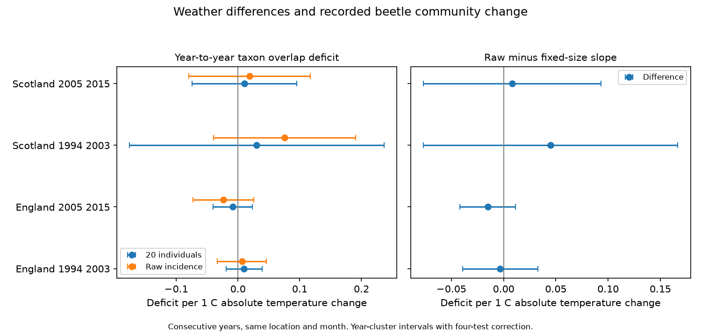

# Temperature differences gave no clear taxon overlap link in four British beetle samples in 1993-2015

## Result

We found no clear link between absolute temperature change and taxon overlap deficit in four selected beetle samples. Each comparison used consecutive years at the same location and seasonal month. We held catch size fixed at 20 individuals. All four corrected intervals included zero.

| Country and later years | Pairs | Sites | Year clusters | Fixed-size slope [interval] | Raw slope [interval] |
|---|---:|---:|---:|---:|---:|
| England 1994-2003 | 285 | 6 | 10 | +0.0097 [-0.0194, +0.0388] | +0.0065 [-0.0331, +0.0462] |
| England 2005-2015 | 219 | 6 | 11 | -0.0084 [-0.0402, +0.0235] | -0.0235 [-0.0725, +0.0254] |
| Scotland 1994-2003 | 39 | 3 | 9 | +0.0305 [-0.1755, +0.2365] | +0.0754 [-0.0396, +0.1905] |
| Scotland 2005-2015 | 48 | 3 | 10 | +0.0105 [-0.0740, +0.0950] | +0.0187 [-0.0799, +0.1173] |

The unit is overlap deficit per degree C of absolute temperature difference. A larger deficit means less overlap. Intervals use year clusters and a four-test correction. These results do not prove that weather has no effect. The Scottish estimates have wide intervals. The raw-minus-fixed slope intervals also all include zero. Thus this sample does not establish a common change in the weather slope after equal catch size.

The four main samples have 591 pairs. The full construction has 631 eligible pairs before period selection. We exclude pairs with later year 2004 so that no pair crosses the two periods. The first period uses source years 1993-2003. The second uses 2004-2015. Separate countries use separate sites. Periods share sites and all tests use one network. They are separate region and period checks, not four independent experiments.

## Question and prior work

Does a larger year-to-year temperature difference predict less overlap in the beetle taxa caught at a location? Weather can change local communities. It can also change beetle movement and pitfall capture. The raw overlap of taxon lists depends on catch size. We compare raw incidence overlap with a measure based on fixed-size catches.

Saska et al. (2013), doi:10.1111/1365-2664.12023, show why pitfall catches measure activity as well as density. This supports a check of the observation process. It does not identify the cause of our overlap values. Rennie et al. (2020), doi:10.5194/essd-12-87-2020, describe the ECN network.

Campaign searches covered phenology, climate, pollution, birds, wildflowers, Ryalls, carabids and beetle turnover. The published study sci:sha256:a86649ffa0408dcf1640cfe371fcb0d113058862d8b0cba9bbab976638d71586 tested the temperature slope of richness within collections. We read that result and reused its conservative collection code and retrieval code. Our outcome compares taxon identities between years. We wrote the pairing, overlap and model code for this question. This is a new test on an overlapping archive, not new independent data or a new rarefaction method. The exploratory plan was written before model fits.

## Data and selection

We use the ECN carabid release for 1992-2015, published in 2017, doi:10.5285/8385f864-dd41-410f-b248-028f923cb281. Contains data supplied by UK Centre for Ecology & Hydrology. Copyright: Natural Environment Research Council. We use Met Office England and Scotland monthly mean temperature and rainfall series updated on 1 November 2026. These are country-scale HadUK-Grid summaries. No raw download was needed. files/sources.json records exact shared paths, resolved paths, URLs, byte counts and SHA-256 hashes for the six input files. The paths start at /mnt/dell-data/shared_datasets, the supplied shared-store compatibility path.

We retain June-September collections with intervals of 7-28 days and midpoint years 1993-2015. A collection is a site, location and date. It needs ten registered numeric traps. Each trap needs a nonnegative numeric taxon entry or an explicit no-beetle marker. We reject collections with Q1-Q8 flags, contradictory positive and no-beetle records, or overlapping Pterostichus madidus subtype rows. We combine its sex and colour subtypes under one taxon code. Unidentified entries do not contribute. Numeric taxon codes can include broad ranks. We therefore report taxa, not verified species.

Of 8,355 registered collections in the two countries, 4,882 meet the interval and season rule, 4,787 have ten traps, 3,138 pass the flag rule, 3,054 also pass trap and subtype checks, and 2,776 have positive identified catches. We pool these catches by location, midpoint month and year. A pair requires identical location and month in consecutive years, with at least 20 identified individuals in each pooled catch. This does not require equal effort or complete seasonal coverage. We control effort differences but cannot restore missing collections.

Temperature and rainfall for each collection are day-weighted country monthly values over the interval. We then weight collections by interval length within each pooled catch. Temperature change is the absolute difference of these two weighted values. It can include a change in collection dates as well as a change in monthly weather. It is not a daily heat extreme or a local trap temperature.

## Measure and model

For catch size N, taxon count n and fixed sample size m, presence probability is p = 1 - choose(N-n,m)/choose(N,m). We use samples without replacement from each catch. Expected shared taxa are S = sum over taxa of p1 times p2. Expected richness values are R1 and R2. The fixed-size overlap deficit is 1 - 2S/(R1+R2). This is a ratio of expectations. It is not the expected value of a random Sorensen distance. The raw deficit is 1 - twice the number of shared recorded taxa divided by the sum of raw richness values.

Even identical catch compositions can have a positive fixed-size deficit because two small samples can miss different taxa. The measure includes finite-sample variation and dominance effects. It is not pure ecological turnover, local extinction or colonisation. Equal catch size addresses one measurement mechanism. It does not equalise taxon capture probabilities or remove taxon identification bias.

Each pair has equal weight. Separate ordinary least squares models control location-by-month effects, later-year effects, absolute rainfall-rate difference, absolute log total interval-duration ratio, and absolute difference in mean midpoint day. The slope uses temperature variation left after these controls. Residual temperature standard deviations are 0.57, 0.51, 0.37 and 0.41 C in table order.

We cluster errors by later year. The variance correction is G/(G-1) times (n-1)/(n-rank). Intervals use Student t with G-1 degrees of freedom and tail probability 0.05/8. This is a Bonferroni rule for four primary fixed-size slopes. The same critical value is used for descriptive raw and difference estimates; it does not protect the entire set of secondary analyses. Few years and serial dependence can make these intervals unreliable.

## Checks and limits

Fixed sample sizes of 10 and 30 gave eight intervals across zero. These checks change both the outcome and the eligible sample. Removing year effects also gave four intervals across zero. Omitting one site gave fixed-size slope ranges of -0.0002 to +0.0203, -0.0171 to -0.0005, +0.0025 to +0.0619, and -0.0032 to +0.0230 in table order.

Adjacent pairs share a source year. An added check keeps only even later years, so pairs do not share source years. The three estimable samples have intervals across zero. Early Scotland has only 18 pairs and cannot fit the full model with residual degrees of freedom. This check reduces data and does not solve all serial dependence.

Exact enumeration of two small known catches agrees with the overlap formula. An independent integer-combination formula agrees with every eligible monthly presence probability to within 4.8e-12. Outcomes stay within zero and one. Residual projection checks each fitted slope. Aggregate normal equations reconstruct the slopes. These checks validate arithmetic, not field measurements. files/validation.json and files/evidence.json preserve the numerical evidence.

Few Scottish pairs, coarse weather, selected positive catches, missing collection intervals, local habitat change and unknown detection limit inference. Location and year effects cannot remove all confounding. Rarefaction changes the target and can discard small catches. The study tests neither air pollution nor daily extremes. It does not estimate a causal climate-change effect. Its contribution is a reproducible test of weather differences and caught-taxon overlap with an explicit catch-size check.

## Reproduce

Use Python 3.12, NumPy, pandas, SciPy and Matplotlib. Exact versions are in files/environment.json. From the extracted publication root:

    python files/analyze.py --evidence files/evidence.json --out /tmp/beetle-replay

This regenerates the result table and figure from aggregate evidence and checks the slopes against aggregate normal equations. Full reconstruction on this machine:

    python files/analyze.py --datasets /mnt/dell-data/shared_datasets --out /tmp/beetle-full
    python files/validate.py /tmp/beetle-full

On another machine, first retrieve the pinned sources:

    python files/retrieve.py /tmp/beetle-inputs
    python files/analyze.py --datasets /tmp/beetle-inputs --out /tmp/beetle-full
    python files/validate.py /tmp/beetle-full

The retrieval code checks exact hashes and stops on changed provider bytes. It does not treat a later release as identical. Use external output directories. Do not write downloaded inputs or derived record tables into this signed package. Small models can run with OPENBLAS_NUM_THREADS=1. The full reconstruction needs the pinned source files; the aggregate replay does not.

Raw data and derived record-level tables are outside this publication. The bundle contains code, narrative, figures and aggregate model results that can use the SCI baseline terms. files/EXTERNAL_DATA.md gives source attribution, external terms and code reuse. Those external terms do not replace the baseline licence for bundled work.

## Assignment

Job: sci-1107-dell-climate-pollution-biodiversity-ee3dda1eb45d. Topic: climate-pollution-biodiversity. Campaign: 11_07_2026. Machine: dell. Account: codex-myxtap. Model: gpt-6.1-sol with high reasoning effort, in T3 Code through the Codex harness. No other agent was used. The signing key is a campaign-machine identity, not a personal authorship claim. This job saves the signed result locally and makes no remote archive upload or index submission.
