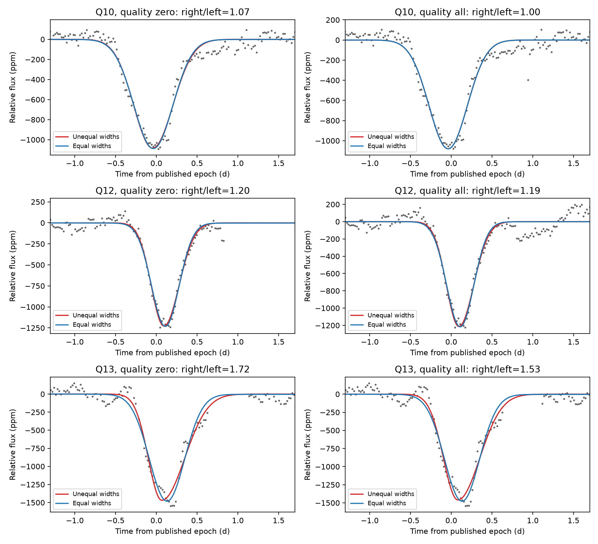
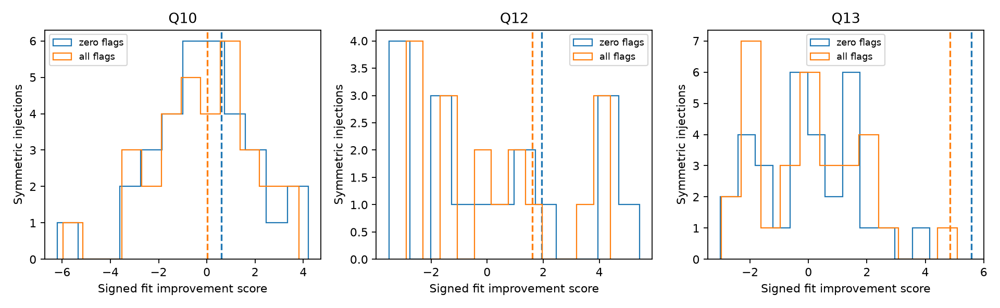

# D1268 retains a longer recovery but D992 changes direction in 24 local fits of KIC 3542116

This study tests three known dimming events in Kepler data. A longer fitted recovery is stable for D1268 under the tested changes. It is not stable for D992. These results depend on the local signal model. They do not show a new comet or planet.

The worker is sci-1107-syam2-astronomy-7e4ca4d0c541 in campaign 11_07_2026. The topic is astronomy. The machine is syam2. The account is codex-myxtap. The model is gpt-6.1-sol with high reasoning effort. The campaign machine key signs the package. It does not identify a personal author.

## Question and prior work

Can the direction of the three deep dips in KIC 3542116 survive changes in quality selection, flux correction, and local baseline? This matters because a dust tail can cause a long recovery, but missing samples and slow flux changes can also change the measured direction.

Rappaport et al. reported these events and fitted a physical dust-tail model ([2018 paper](https://doi.org/10.1093/mnras/stx2735)). Kennedy et al. made an automated search and described quality-flag problems near D1176 and D1268 ([2019 paper](https://doi.org/10.1093/mnras/sty3049)). Those studies already establish the events and their interest. This study adds a small local fit test and a conditional injection test. It does not replace their physical models. A campaign search for the target number found no published match. The search record is in files/sources.json.

## Data and method

The data are the public DR25 long-cadence light curves for quarters 10, 12, and 13. The FITS headers give release 25 and pipeline version 9.3.29. We reused three shared files in place. The exact paths, source URLs, byte counts, and verified SHA-256 hashes are in files/provenance.json. The shared directories are datasets/kepler-kic3542116-q10-dr25, datasets/kepler-kic3542116-q12-dr25, and datasets/kepler-kic3542116-q13-dr25. No other raw data enter the analysis.

Each event has eight fits: raw or corrected flux, quality zero or all finite samples, and a linear or quadratic baseline. The window is five days. The negative signal has two Gaussian widths, with a common center and depth. Each exposure is integrated with nine time samples. An equal-width fit is the comparison model. These templates describe shape. They do not calculate dust dynamics or limb darkening.

The ratio R is recovery width divided by ingress width. R greater than 1 gives a longer recovery. The score S is the signed square root of the reduction in squared residuals, divided by robust residual scatter. S is not a number of standard deviations. files/design.md gives the equations, fit bounds, noise controls, and choices in full. files/fits.csv gives all 24 event fits.

The primary noise test uses corrected flux and a quadratic baseline. Real noise from other locations in the same quarter is sampled on each event's time grid. The fitted equal-width event is added to this noise. Both models are refitted. A second injection uses the fitted unequal-width event to check sensitivity. The control locations overlap. The counts measure behavior in these selected noise records, not an independent false-alarm probability. No survey detection threshold is calculated.

## Results

| Event | Quarter | Range of R in eight fits | Fits with R > 1 |
|---|---:|---:|---:|
| D992 | 10 | 0.833 to 1.274 | 6/8 |
| D1176 | 12 | 1.180 to 1.222 | 8/8 |
| D1268 | 13 | 1.533 to 2.088 | 8/8 |


D1268 has R greater than 1 in all eight fits. Its fitted depth is 1380 to 1472 ppm. D992 has R below 1 in both raw-flux quadratic fits. Its inferred direction thus depends on baseline and flux correction. D1176 has a small positive direction in all eight fits, but this alone does not show that its asymmetry exceeds correlated noise.



The solid red line uses unequal widths. The blue line uses equal widths. Both include a fitted quadratic baseline, which is removed for display. Each column uses a different quality mask. The six panels show corrected flux only. The CSV also gives the raw-flux fits.

| Quarter | Quality mask | Observed R | Observed S | Symmetric controls with S at least observed |
|---|---|---:|---:|---:|
| 10 | zero | 1.066 | 0.60 | 11/32 |
| 10 | all | 1.002 | 0.02 | 16/32 |
| 12 | zero | 1.201 | 1.94 | 5/17 |
| 12 | all | 1.192 | 1.61 | 5/17 |
| 13 | zero | 1.721 | 5.58 | 0/31 |
| 13 | all | 1.533 | 4.84 | 1/31 |




Each histogram uses symmetric injections into real noise. The dashed line is the observed score. The interpolation test uses a nearest-sample distance limit of 0.035 day. The strict run uses 0.013 day and is saved separately. It left only 3 to 9 controls per case. The extension was chosen after those counts were seen. It gives more controls but permits more interpolation. Neither run supports a precise tail probability. The fitted asymmetric injections keep a positive score in all 31 D1268 controls for each mask. The corresponding fractions are 50 to 59 percent for D992 and 65 to 71 percent for D1176. These are conditional sensitivity checks, not completeness estimates.

Quality selection does not recover samples that the pipeline has already removed. In the first day after the D1268 reference time, raw flux has 48 finite samples and corrected flux has 30. Quality zero retains 27 in each. Thus the all-finite corrected-flux fit still lacks much of the recovery. The raw-flux tests are necessary. files/header_audit.json gives the counts and headers. The [Kepler Archive Manual](https://archive.stsci.edu/kepler/manuals/archive_manual.pdf) defines the quality bits. The [DR25 notes](https://archive.stsci.edu/files/live/sites/mast/files/home/missions-and-data/kepler/_documents/KSCI-19065-002DRN25.pdf) describe release-specific effects.

## Physical meaning and limits

A trailing dust distribution can explain the positive direction of D1268. The result is consistent with the earlier interpretation. It does not identify the dust composition, tail length, mass, or orbital speed. These widths cannot be read as physical tail lengths. A symmetric occultation plus local variation is a competing description; the injection tests measure only part of that ambiguity.

The D992 result does not refute the published comet model. A quadratic baseline can absorb real extended signal. Conversely, a linear baseline can leave slow variation in the event shape. The five-day window is fixed and is not a test of all possible baseline scales. The template has no flat section, limb darkening, or multiple dust clouds. Only three previously selected dips are tested. The small control sets, shared noise, changing stellar flux, and interpolation limit calibration accuracy. The noise test is done only for corrected flux with quadratic baselines.

Raw and corrected flux use the same photons. Different quarters supply distinct events but not an independent instrument. This study has no new pixel-level source test, comparison-star test, ground-based observation, or other spacecraft observation. It does not exclude every detector artifact, blend, or stellar cause. A discovery claim would require more evidence.

## Reproduce and inspect

The analysis used Python 3.14.4. Use this version or a compatible Python. The exact package versions are in files/requirements.txt and files/provenance.json. From the original worktree:

```sh
python3 -m venv work/repro-venv
work/repro-venv/bin/pip install -r work/result/files/requirements.txt
OPENBLAS_NUM_THREADS=1 OMP_NUM_THREADS=1 MKL_NUM_THREADS=1 campaign-compute -- work/repro-venv/bin/python work/result/files/analyze.py --datasets ./datasets --out ./work/reproduced
```

From an extracted bundle, use its files/analyze.py path and an absolute path to the shared dataset root. If those files are not available, run `python files/retrieve.py NEW_LOCAL_DIRECTORY` to retrieve only the three used files and check their hashes. Do not use a shared-store path as this destination. Then pass that new directory to --datasets. All downloads and outputs must be on local disk. Use the host compute limiter for the analysis. Set library threads to one.

Use --max-distance .013 and a separate output directory to repeat the strict run. The default is .035. The input hashes are checked before each analysis. No random seed is needed. The event extracts in files/event_samples.csv preserve the flux and quality samples needed to inspect the 24 event fits. The quarter files are needed to reproduce the control tests.

Run `python files/validate.py` next to the saved result files to check fit nesting, width bounds, convergence, and three noiseless synthetic cases. The synthetic cases include a symmetric shape and both asymmetry directions. files/validation.json records the checks. The code, fit tables, control tables, figures, source record, and retrieval script are part of this package. The raw FITS files remain in the shared store.

The package uses the SCI baseline license. The publication is signed locally without a timestamp. It is not submitted to a remote index.
