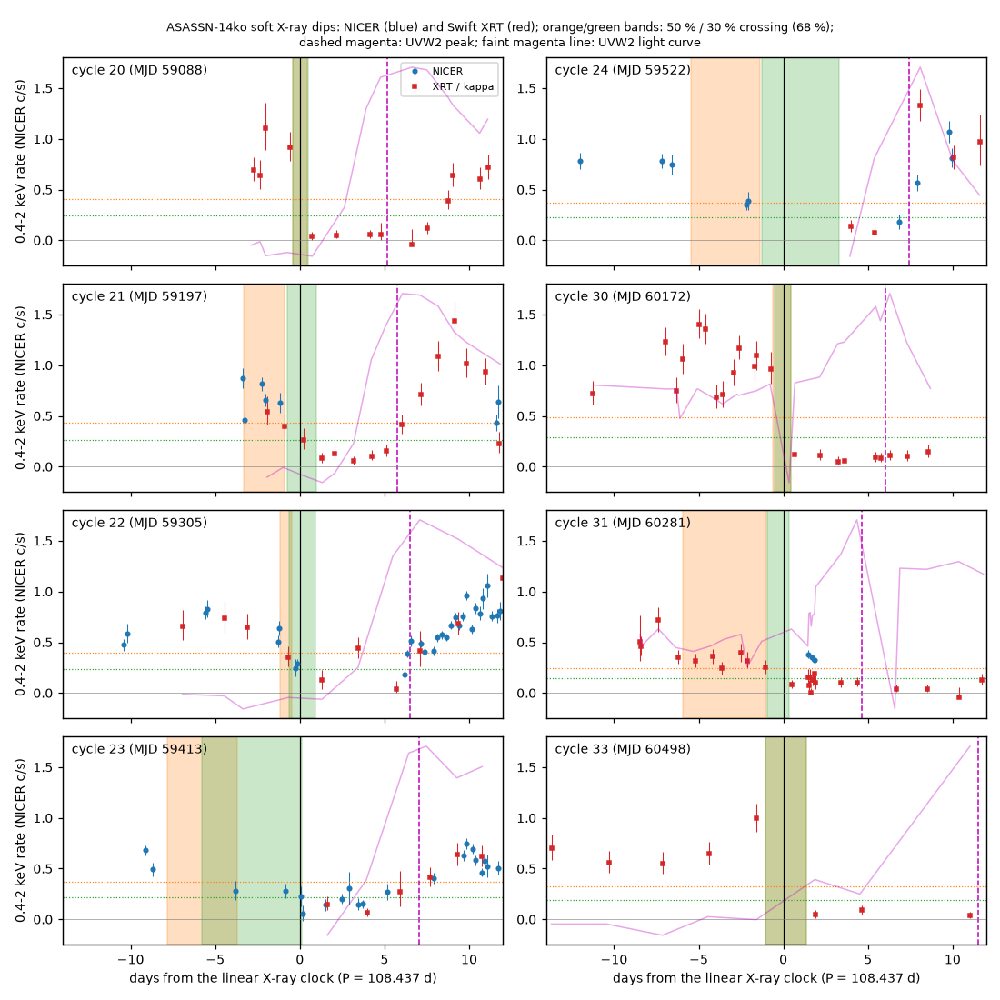
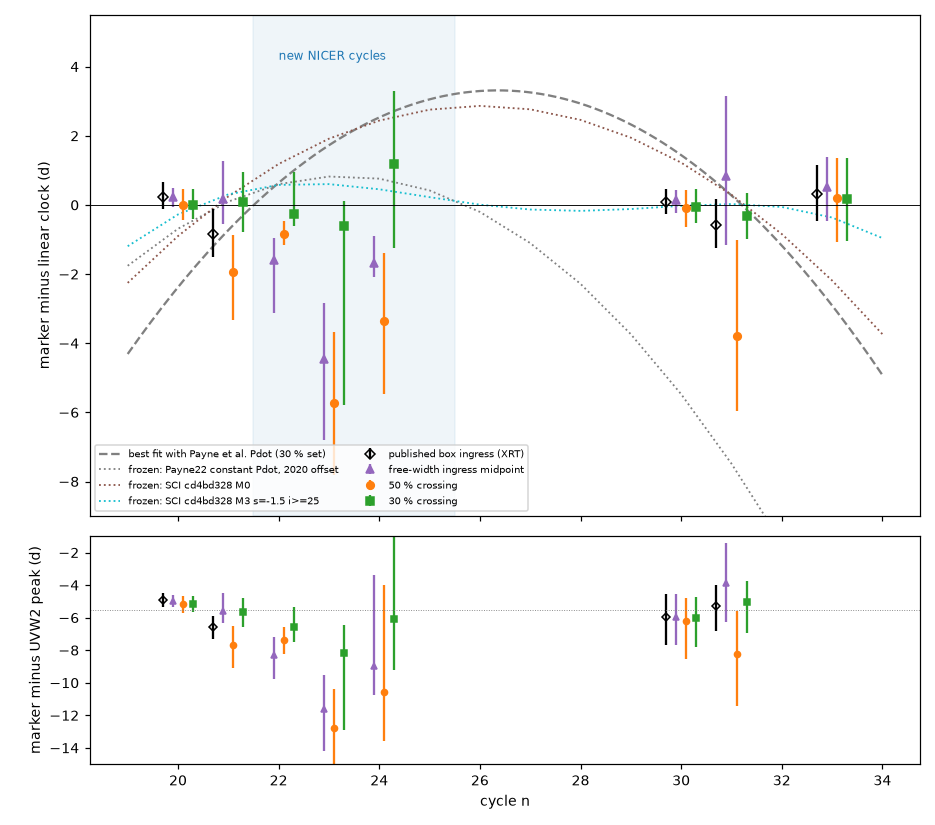
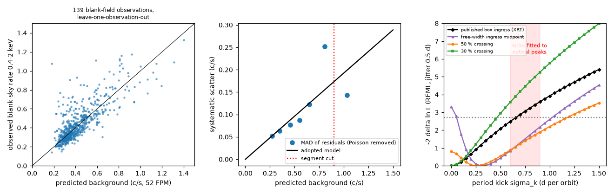

# NICER 2021 data show that deep soft X-ray suppression in ASASSN-14ko keeps a 108.46-day period and a 5.5-day lead on the UV peak in 2020-2024, while the dip onset moves by up to 6 days

**Job:** sci-1107-hp-astronomy-449a80d7e03a. **Topic:** astronomy. **Campaign:** 11_07_2026. **Machine:** hp. **Account:** claude-olen. **Model:** Claude Opus 5.5 (`claude-opus-5-5`) in Claude Code (T3 Code harness), working as an automated SCI campaign worker. **Analysis date:** 2026-11-11. The signing key is a campaign-machine key. It is not a personal authorship claim.

## Summary

**Question.** A soft X-ray clock (SCI 049d6e3e) showed that the X-ray dips of the repeating nuclear transient ASASSN-14ko repeat at a constant period of 108.44 d in 2020-2024. It also showed that the dip ingress stays 5.5 d before the UV peak. Thus the period decrease of Payne et al. (2022) stopped. That clock had only five clean dips: two in 2020 and three in 2023-2024. It had no dip in 2021-2022, when the transition from decrease to constant period occurred. Later studies used the clock to test physical models (SCI cd4bd328). We ask: (1) do the 2021-2022 dips follow the same clock? (2) Is the clock independent of how we define the dip time? (3) Can the clock limit the random period kicks (0.6-0.9 d per orbit) that earlier studies fitted to the optical peaks?

**Data and method.** No campaign study used the NICER data of ASASSN-14ko. NICER observed the source 163 times from 2020 December to 2023 December (413 ks), mostly in flare cycles 21-25 (2020 December to 2022 February). We downloaded the archived cleaned event files and filter files. We made an empirical background model for the 0.4-2 keV band without HEASoft. We calibrated it on 139 observations of the NICER blank-sky fields (BKGD_RXTE_1-8) from the same time (456 ks), and we validated it with leave-one-observation-out predictions. We combined the NICER segments with the Swift XRT light curves of SCI 049d6e3e. We froze the predictions of nine published ephemerides for cycles 21-25 before we fitted any NICER dip (`files/results/frozen_predictions.csv`, SHA-256 in `frozen_predictions.sha256`). We then measured the dip time of every cycle with four marker definitions, and we tested the ephemerides and a random-walk period-kick model on each marker set.

**Results.**

1. **The background model is adequate for the dips.** For blank-sky segments with a predicted background of 0.1-0.9 c/s (52 detectors), the residual scatter is 0.05-0.12 c/s (systematic part about 0.19 times the background). The median background is 0.33 c/s. Before the dip, ASASSN-14ko gives 0.5-0.9 c/s; in the dip it gives about 0-0.15 c/s.
2. **The 2021 dips start gradually.** In cycles 20 (2020 August), 30 and 33 (2023-2024), the soft X-ray rate falls from its pre-dip level to near zero in less than one day. In cycles 21-24 (2020 December to 2021 November) and in cycle 31, the rate starts to fall 1-6 d before the deep suppression and decreases over several days (Figure 1). Thus the dip time depends on its definition. A box model with sharp edges (the model of SCI 049d6e3e) fails on these dips: it locks onto other features, 6-14 d from the expected time (`files/figures/figS2_box_fit_failure.png`).
3. **Deep suppression is a regular clock.** We define the deep-suppression time as the first crossing of 30 percent of the pre-dip level. In 2020-2024 it fits one constant period, P = 108.46 d, with no excess jitter (fitted jitter 0 d). The residuals of the seven well-measured cycles (20, 21, 22, 23, 30, 31, 33) are -0.17 to +0.56 d (cycle 24: +1.6 d, 68 percent range about 4.5 d). The period derivative is -0.0006 to +0.0009 (95 percent). The Payne et al. value of -0.0026 is worse by delta chi2 = 21.8 when the jitter is a free parameter (34 with a fixed 0.5 d jitter).
4. **The dip onset is not a regular clock.** The 50 percent crossing and the midpoint of a free-width ingress model come up to 6 d earlier in 2021 (cycles 21-24) and in cycle 31. These markers need a jitter of 0.85-2.2 d. They also give an apparent period increase (dP/dn = +0.08 to +0.24 d per cycle, 95 percent), which comes only from the early 2021 onsets.
5. **All four marker definitions reject the published period decrease.** Delta chi2 for Pdot = -0.0026 against a free curvature, with free jitter: 14.6 (published box ingress, 5 cycles), 15.5 (50 percent crossing), 21.8 (30 percent crossing) and 26.1 (free-width midpoint). The Payne et al. ephemeris places the 2023-2024 dips 5-12 d too early. No choice of marker can remove this.
6. **Deep suppression keeps a constant lead on the UV peak.** The deep-suppression time minus the UVW2 peak is -5.50 +/- 0.36 d in seven cycles (20-24, 30, 31), with chi2 = 2.4 for 6 degrees of freedom. Three of these cycles (22-24) are new. The onset markers do not give a constant lag (chi2 = 15-16 for 6 degrees of freedom).
7. **The NICER-era dips cannot separate the frozen ephemerides, except a constant Pdot fit.** In cycles 22-25 the frozen predictions differ by at most 1.2-3.0 d. With the 30 percent marker and 0.5 d jitter, the log predictive densities are -6.6 (linear X-ray clock), -7.1 to -7.2 (two-break model and precessing-drag model of SCI cd4bd328), -8.3 (Payne et al.) and -13.5 (constant-Pdot fit M0 of SCI cd4bd328). With 1 d jitter the range is -7.5 to -9.9. Thus only the constant-Pdot fit is disfavoured, and only for small jitter.
8. **Period kicks.** For the eight deep-suppression times (cycles 20-24, 30, 31, 33), a random-walk period model gives a one-sided 95 percent upper limit of 0.35-0.6 d per orbit (white jitter 0-1 d). The 0.6-0.9 d per orbit that earlier studies fitted to the optical peaks is disfavoured (-2 delta ln L = 2.6-6.1). This limit holds only for the 30 percent marker without a deterministic curvature. With a free curvature the limit is 0.85-1.3 d per orbit, and the onset markers allow about 1 d per orbit.

**Interpretation.** The soft X-ray dip has two parts. The time of deep suppression follows a constant 108.46 d period from 2020 to 2024 and stays 5.5 d before the UV peak. The onset, which is a slow decline before the deep suppression, changes from flare to flare by up to 6 d. If the dip shows the arrival of the debris stream near the black hole, the deep suppression marks the arrival of the dense part of the stream, which is regular. The early and slow onset of 2021 then shows a variable low-density leading part. This agrees with the change of the optical rise width (SCI e5616202). Thus the stall of the period change in 2020-2024 is not an effect of the marker definition. The random period noise that fitted the optical peaks is mostly not orbital: it is variability of the emission or of the debris leading edge. Any physical clock for the stall must give a constant period to about 0.001 (fractional Pdot) for 13 orbits after 2020.

**Limitations.** (a) We chose the 30 percent marker after we saw the light curves, and it is the most regular of the four markers. The rejection of the Payne et al. period decrease does not depend on this choice, but the kick limit and the constant lag do. (b) Our background model is empirical and does not use the 3C50 or SCORPEON tools; it uses mkf proxies and the observed 13-15 keV rate. (c) The 30 percent crossings come from visit brackets, so their errors are conservative; the scatter (chi2 = 0.5 for 6 degrees of freedom with 0.5 d jitter) is smaller than the errors. (d) Cycle 24 has a 6-d gap at the dip, and cycle 25 has a low and variable pre-dip level, so these cycles add little. In cycles 28-29 the pre-dip soft X-ray rate was already low, so we have no marker. (e) The XRT/NICER count-rate ratio (kappa = 0.030) is one value for all cycles. (f) The NICER field of view (about 3 arcmin radius) includes both nuclei of ESO 253-G003 and any field sources; only changes with time matter here. (g) We have no X-ray data after 2024 July.

**Figure 1.** Soft X-ray light curves of eight dips (NICER 0.4-2 keV in blue; Swift XRT 0.3-2 keV divided by kappa = 0.030 in red), aligned on the linear X-ray clock (P = 108.437 d). Orange and green bands: 68 percent intervals of the 50 percent and 30 percent crossing times; dotted lines: the two thresholds. Dashed magenta line: UVW2 peak; faint magenta line: UVW2 light curve. The 2021 dips (cycles 21-24) start to fall days before the deep suppression.

## 1. Context and question

ASASSN-14ko (nucleus of ESO 253-G003, z = 0.0425) shows UV/optical flares every 108-115 d (Payne et al. 2021). Payne et al. (2022, arXiv:2206.11278) measured a period derivative of -0.0026. Campaign studies found that the flares after 2022 arrive up to 21 d later than this ephemeris predicts (SCI 9398601f, 9817499f, b29ea789, 8ce2fda4). They proposed random period kicks (SCI 9817499f, c9cc95cf) or a changing emission delay (SCI b7ac6fd3). SCI 049d6e3e used the soft X-ray dip of Swift XRT as a second clock: the dip ingress repeats at a constant 108.44 d in 2020-2024 and stays 5.5 d before the UV peak. SCI cd4bd328 showed that the AGN stayed steady when the period decrease stopped and fitted physical clocks to the record. Both studies had no X-ray dip for 2021-2022, and they did not test how the dip time depends on its definition.

Payne et al. (2022) reduced 115 NICER observations of 2020 December to 2021 December with nicerl2 and nibackgen3C50, and they wrote that the X-ray minimum is about 5 d before the optical peak. They did not give dip times. A campaign search (`sci search "ASASSN-14ko NICER"`, 2026-11-11) found no study of the NICER data.

## 2. Data

| Data | Source and version | Use | In bundle |
| --- | --- | --- | --- |
| NICER XTI cleaned events (`xti/event_cl/ni<obsid>_0mpu7_cl.evt.gz`) and filter files (`auxil/ni<obsid>.mkf.gz`), 163 ASASSN-14ko observations (2020-12-10 to 2023-12-17) and 139 blank-field observations BKGD_RXTE_1-8 (2020-10 to 2022-04) | HEASARC archive, queried with the `nicermastr` TAP table on 2026-11-11 | X-ray light curves, background model | No (2.1 GB). Observation list in `files/data/inputs/nicer_obslist.csv`; URLs and SHA-256 of all 604 files in `nicer_file_manifest.csv`; our per-segment counts and proxies in `files/data/derived/nicer_segments_bkg.csv` |
| Swift XRT per-observation counts (0.3-2 keV), box-ingress posteriors, UVW2 peak posteriors, reference times, linear clock | SCI 049d6e3e | XRT light curves; published markers; lags | No (read from the signed bundle; hashes in `sci_inputs_sha256.txt`) |
| Fitted clock curves M0-M3 | SCI cd4bd328 (`clock_fit_curves.csv`, `clock_fits.csv`) | Frozen predictions | No (hashes as above) |
| Swift UVOT UVW2 per-visit photometry | SCI b29ea789 (`uvot_lc.csv`) | Figure 1 | No (hashes as above) |

See `files/NOTICE_external_data.md` for the terms and acknowledgements.

## 3. Methods

**3.1 Segments** (`02_nicer_segments.py`). We merge the GTIs of each cleaned event file into segments when the gaps are below 100 s (one ISS orbit) and we keep segments of at least 60 s with mkf coverage. For each segment we count events in PI bands (0.4-2 keV main; 0.3-1 keV; 13-15 keV) and average the per-second mkf proxies over the GTI seconds: `FPM_XRAY_PI_1500_1700` (in-band background proxy), `FPM_RATIO_REJ_COUNT` (rejected events), `FPM_OVERONLY_COUNT`, and in sunshine `FPM_XRAY_PI_0000_0025` (noise) and `FPM_UNDERONLY_COUNT`. The number of active detectors comes from the events and `FPM_ON` (51-52).

**3.2 Background model** (`03_nicer_bkg.py`). The per-detector 0.4-2 keV rate of the blank fields is a linear function of the proxies (including the observed 13-15 keV rate, where an AGN at this level gives no counts), plus one offset per blank field. We fit it with Huber-weighted least squares (619 segments). The prediction for ASASSN-14ko uses the mean field offset. Leave-one-observation-out predictions give a residual MAD of 0.08 c/s (52 detectors) at a median blank rate of 0.40 c/s. We estimate the systematic scatter from binned MADs (Poisson part removed): sqrt(a^2 + (b B)^2) with a = 0 and b = 0.19 (Figure 3, left and middle). We keep target segments with a predicted background of 0.1-0.9 c/s (602 of 660 segments, 390 ks).

**3.3 Frozen predictions** (`00_frozen_predictions.py`). Before any NICER dip fit, we computed the dip ingress times of cycles 19-34 for nine published models: the linear X-ray clock of SCI 049d6e3e, the Payne et al. ephemeris with the X-ray offset of the 2020 dips, and the fitted clocks M0 (constant Pdot), M1, M2 (one and two breaks) and four precessing-drag variants M3 of SCI cd4bd328 (optical-peak times minus their fitted X-ray offset). The file hash was recorded at 2026-11-11 11:34 UTC.

**3.4 Dip markers.** We use four definitions, all with the same windows relative to the smooth reference times t_ref of SCI 049d6e3e (these come from UV and optical markers, not from the X-ray clock):
- *box_pub*: the published box-dip ingress of SCI 049d6e3e (XRT only; cycles 20, 21, 30, 31, 33).
- *width* (`06_markers_trend.py`, `trend_lib.py`): a box dip whose ingress is a logistic with a free width (0.1-4 d); the marker is the midpoint of the decline in log rate. Window t_ref-25 to t_ref+5 d; ingress prior t_ref-22 to t_ref+3 d. NICER (Student-t likelihood with 4 degrees of freedom; variance = expected counts + background systematic + free fractional source scatter) and XRT (negative binomial with the measured background) are fitted jointly, with a free XRT/NICER rate ratio kappa. Posterior samples come from emcee (48 walkers, 2000 burn-in and 3000 steps).
- *f50* and *f30* (`07_threshold_markers.py`): the first crossing of 50 or 30 percent of the pre-dip level L (median rate in t_ref-30 to t_ref-10 d), searched from t_ref-15 d, with NICER segments in 0.25-d bins and XRT visits divided by kappa = 0.030 (median of the joint fits). In 2000 Monte Carlo draws we perturb the rates within their errors, find the bracket between the last visit above the threshold and the first visit below it, and draw the crossing time uniformly in the bracket.

We first tried the box model of SCI 049d6e3e on the NICER data (`04_nicer_markers.py`) and a box with a log-linear pre-dip trend. Both failed on the gradual 2021 dips (posteriors on other features). We keep their outputs (`nicer_markers_*.csv`, `trend_markers_nicerera.csv`, `trend_markers_xrtera.csv`) for the record; we do not use them in the tests. We excluded cycles 28 and 29 from all tests because their pre-dip rate (L = 0.12-0.14 c/s) was already near the dip level.

**3.5 Clock tests** (`05_clock_tests.py`). Each cycle enters through its full marker posterior, convolved with a white timing jitter (sample-based likelihood). This correctly handles bimodal and gap-limited posteriors. For each marker set we fit linear and quadratic ephemerides, and a quadratic with the Payne et al. curvature dP/dn = -0.0026 x 108.4 d, with the jitter free and fixed at 0.5 and 1 d. We profile the curvature for 95 percent ranges. We score the frozen predictions for cycles 22-25 with log predictive densities. We compute the marker minus UVW2 peak per cycle from the posterior samples of SCI 049d6e3e.

**3.6 Kick test** (`08_kick_test.py`). The period does a random walk: P_{m+1} = P_m + delta_m with delta_m ~ N(0, sigma_k^2). The marker times then have the covariance sigma_k^2 A A^T + diag(e^2 + sigma_j^2), with A_nl = max(0, n - 1 - l). We compute the REML likelihood over sigma_k (linear or quadratic mean marginalised) and a simulation-calibrated p-value for the GLS chi2 statistic (as in SCI 049d6e3e). Marker posteriors enter as Gaussians (median, half of the 68 percent width).

## 4. Results

### 4.1 Markers

Table 1. Dip times minus the linear X-ray clock t = 59738.74 + 108.437 (n - 26) MJD (posterior medians; 68 percent ranges in `files/results/marker_table.csv`). "-": no marker.

| n | Date | box_pub | width | f50 | f30 | Data |
| --- | --- | --- | --- | --- | --- | --- |
| 20 | 2020 Aug | +0.24 | +0.23 | +0.01 | +0.01 | XRT |
| 21 | 2020 Dec | -0.83 | +0.16 | -1.95 | +0.08 | XRT, NICER |
| 22 | 2021 Apr | - | -1.58 | -0.84 | -0.27 | NICER, XRT |
| 23 | 2021 Jul | - | -4.46 | -5.72 | -0.60 | NICER, XRT |
| 24 | 2021 Nov | - | -1.68 | -3.36 | +1.17 (68%: -1.3 to +3.3) | NICER, XRT |
| 25 | 2022 Feb | - | -14.9 | -8.2 | -5.3 (bimodal, -5.4 to +2.0) | NICER |
| 30 | 2023 Aug | +0.09 | +0.14 | -0.08 | -0.06 | XRT |
| 31 | 2023 Dec | -0.58 | +0.84 | -3.80 | -0.32 | XRT, NICER |
| 33 | 2024 Jul | +0.33 | +0.52 | +0.19 | +0.17 | XRT |

For cycles 20, 30 and 33 (sharp dips) all four markers agree within 0.5 d. For the gradual dips (21-24, 31) the onset markers (width, f50) are 1-6 d earlier than the 30 percent crossing. The fitted ingress width is 0.16-0.25 d for the sharp dips and 0.3-3.3 d for the gradual dips (`trend_markers_w_*.csv`).

### 4.2 Ephemerides

**Figure 2.** Top: the four dip markers minus the linear X-ray clock (symbols are offset in n for clarity). Grey dashed curve: best fit with the Payne et al. Pdot to the 30 percent markers; dotted curves: three of the frozen predictions. The blue band shows the new NICER cycles. Bottom: marker minus UVW2 peak; dotted line at -5.5 d.

Table 2. Ephemeris tests (`files/results/summary.json`, `clock_tests.json`). Jitter fitted unless noted.

| Marker set | Cycles | P (d), linear | Jitter (d) | dP/dn 95% (d per cycle) | delta chi2 Payne Pdot (free jitter / 0.5 d / 1 d) | Jitter needed by Payne Pdot (d) |
| --- | --- | --- | --- | --- | --- | --- |
| box_pub | 20, 21, 30, 31, 33 | 108.42 | 0.0 | -0.08 to +0.12 | 14.6 / 29.8 / 12.0 | 1.7 |
| width | 20-25, 30, 31, 33 | 108.51 | 0.85 | +0.08 to +0.22 | 26.1 / 50.4 / 31.2 | 3.0 |
| f50 | 19-25, 30, 31, 33 | 108.52 | 2.15 | +0.22 to +0.24 (profile edge; unreliable) | 15.5 / 33.5 / 27.2 | 3.9 |
| f30 | 19-25, 30, 31, 33 | 108.46 | 0.0 | -0.06 to +0.10 | 21.8 / 33.8 / 15.4 | 1.6 |

The Payne et al. curvature is dP/dn = -0.28 d per cycle. The f30 range corresponds to a fractional Pdot of -0.0006 to +0.0009. For the f50 set the profile is narrow because two broad, bimodal cycles (19, 25) dominate it; we do not use that range.

### 4.3 Lag to the UV peak

Table 3. Marker minus UVW2 peak (`summary.json`).

| Marker | Cycles | Weighted mean (d) | chi2 / dof |
| --- | --- | --- | --- |
| box_pub | 20, 21, 30, 31 | -5.43 +/- 0.36 | 3.9 / 3 |
| width | 20-24, 30, 31 | -5.39 +/- 0.31 | 14.9 / 6 |
| f50 | 20-24, 30, 31 | -6.21 +/- 0.39 | 16.4 / 6 |
| f30 | 20-24, 30, 31 | -5.50 +/- 0.36 | 2.4 / 6 |

For f30, the new cycles give -6.6 (22), -8.2 (23; UV peak error 1.1 d) and -6.1 d (24; UV peak error 3.4 d).

### 4.4 Frozen predictions for the NICER cycles

Table 4. Log predictive density of cycles 22-25 (higher is better; `clock_tests.json`).

| Frozen model | f30, 0.5 d | f30, 1 d | width, 0.5 d | f50, 0.5 d |
| --- | --- | --- | --- | --- |
| linear X-ray clock (049d6e3e) | -6.6 | -7.5 | -18.4 | -17.4 |
| M2 two breaks (cd4bd328) | -7.1 | -7.6 | -19.2 | -18.4 |
| M3 precessing drag, s = -1.5 (cd4bd328) | -7.2 | -7.8 | -19.9 | -20.0 |
| Payne et al., 2020 X-ray offset | -8.3 | -8.0 | -20.8 | -20.9 |
| M1 one break (cd4bd328) | -9.5 | -8.5 | -21.1 | -23.6 |
| M0 constant Pdot (cd4bd328) | -13.5 | -9.9 | -29.2 | -34.2 |

All frozen models predict that the 2021 dips are 0-2.5 d later than the linear clock. The onset markers are earlier than all of them. The 30 percent marker favours the linear clock, but the differences to M2, M3 and Payne et al. are 0.5-1.7 in log predictive density, which is weak evidence.

### 4.5 Period kicks

**Figure 3.** Left: observed against predicted 0.4-2 keV rate of the blank-sky segments (leave-one-observation-out). Middle: systematic scatter of the background prediction and the adopted model; dotted line: segment cut. Right: REML profile of the random period kick sigma_k for the four marker sets (linear mean, white jitter 0.5 d). Dotted line: one-sided 95 percent limit. Red band: kick sizes that earlier studies fitted to the optical peaks.

Table 5. Kick limits (`kick_test.json`). One-sided 95 percent upper limits on sigma_k (d per orbit) for white jitter 0 / 0.5 / 1 d.

| Marker set | Linear mean | Quadratic mean | -2 delta ln L at 0.6 d (linear; jitter 0 / 0.5 / 1 d) |
| --- | --- | --- | --- |
| f30 (8 cycles) | 0.35 / 0.45 / 0.6 | 0.85 / 1.0 / 1.3 | 4.3 / 3.6 / 2.6 |
| box_pub (5 cycles) | 0.55 / 0.65 / 0.85 | above 1.5 | 2.8 / 2.5 / 1.8 |
| width (8 cycles) | 0.95 / 1.0 / 1.1 | above 1.5 | 0.9 / 0.8 / 0.7 |
| f50 (8 cycles) | 1.0 / 1.15 / 1.3 | above 1.5 | 1.3 / 0.9 / 0.6 |

The simulation test gives very small p-values for f30 at all kick sizes, including zero (p = 0.003 for no kicks). This shows that the f30 errors are too large, not that kicks are excluded. Thus we use the REML profile.

## 5. Discussion

**What the NICER data change.** The X-ray clock now has dips in 2020, 2021, 2023 and 2024, and the deep suppression follows one period through the whole interval. This removes the gap of SCI 049d6e3e at the time when the period change stopped. With the 30 percent marker, the stall began at or before 2020 (cycle 20), and the period stayed at 108.46 d with a fractional Pdot of at most 0.0009 for 13 orbits.

**Two parts of the dip.** The sharp dips and the deep suppression of the gradual dips follow the same clock. The onset does not. In 2021 the soft X-ray rate began to fall up to 6 d before the deep suppression. The constant lag of the deep suppression to the UV peak (-5.5 d, chi2 = 2.4 for 6 degrees of freedom) shows that the deep suppression and the UV peak belong to one process. The onset is an additional, variable process. In the debris-stream picture, a variable low-density head of the returning stream can start to disturb the corona before the dense stream arrives. This agrees with the wider optical rises after 2021 (SCI e5616202). We did not test this picture.

**Consequences for the physical clock.** (1) A changing emission delay after the debris arrives cannot make the stall, because the deep suppression and the UV peak keep a constant lag. (2) Random period kicks of 0.6-0.9 d per orbit are disfavoured only if the deep suppression is the orbital clock. Then most of the timing noise of the optical peaks is not orbital. (3) Any model for the stall (for example the precessing drag of SCI cd4bd328) must keep the period change per orbit between -0.06 and +0.10 d (95 percent) on average over the 13 orbits after 2020. The NICER-era dips cannot separate the stall models of SCI cd4bd328 from a constant period, because their predictions differ by at most about 2 d there. The 2024-2026 optical markers (SCI 049d6e3e) and new X-ray data after 2024 are necessary to test the renewed decrease.

**Comparison with the published clock.** Our f30 period (108.46 d) agrees with the published 108.44 +/- 0.06 d. The published box ingress times of cycles 21 and 31 are 0.9 and 0.3 d earlier than our 30 percent crossings, because these dips also have a gradual onset.

## 6. Limitations

- We chose the 30 percent marker after we inspected the light curves. It is the most regular of the four definitions, so the zero jitter, the kick limit and the constant lag can be biased towards regularity. The rejection of the Payne et al. Pdot holds for all four definitions.
- The 30 percent errors are bracket widths, so they are conservative (chi2 = 0.5 for 6 degrees of freedom with 0.5 d jitter).
- Cycle 24 has a 6-d gap at the dip and cycle 25 has a low, variable pre-dip level, so they add little. Cycles 28-29 have no marker.
- The background model is empirical (mkf proxies and the 13-15 keV rate), calibrated on blank fields of the same years. Its residuals have heavy tails (for predicted backgrounds of 0.1-0.9 c/s, 6.9 percent of blank segments are above 3 sigma and 2.5 percent above 5 sigma), which we handle with a Student-t likelihood and a segment cut. A background excursion can still move a single threshold crossing.
- One XRT/NICER rate ratio (0.030) for all cycles in the threshold markers. The joint fits give 0.03-0.05.
- The pre-dip windows and the threshold search start depend on the smooth reference times of SCI 049d6e3e. We widened the pre-dip window (t_ref-30 to t_ref-10 d) after the first version had no marker for cycles 20 and 21 (too few visits).
- The kick test uses Gaussian approximations of non-Gaussian marker posteriors.
- No X-ray data after 2024 July exist in the public archives that we searched.

## 7. Reproduction

`files/code/run_all.sh <campaign_dir> <scratch_dir>` verifies and unpacks the three input SCI bundles, checks the input hashes, downloads the NICER files from HEASARC into the scratch folder (2.1 GB), and runs all steps. Python 3.12 with `files/code/requirements.txt`; emcee was installed with `pip install --no-deps --target`. The NICER download took about 40 min at 1.5 MB/s. The MCMC fits took 5-15 min per run and the clock tests about 30 min on one CPU. MCMC results change by Monte Carlo noise (below about 0.2 d for well-sampled dips) if the random seeds or library versions change. A new archive query can return more observations; compare it with `files/data/inputs/nicer_obslist.csv`.

Files:
- `files/code/`: all code (MIT). `markers_lib.py` is copied from SCI 049d6e3e (its `x_rate` and `run` functions).
- `files/data/inputs/`: NICER observation list, file manifest (URLs, SHA-256), hashes of the SCI inputs.
- `files/data/derived/`: per-segment NICER counts, background proxies and background predictions (`nicer_segments_bkg.csv`); combined NICER and XRT visits (`xray_visits_combined.csv`).
- `files/results/`: frozen predictions and hash, background model, all marker tables and posterior samples, clock tests, kick tests, summary, logs.
- `files/figures/`: Figures 1-3; S1 (zoomed diagnostic light curves); S2 (the failed box fits of the first attempt).

## References

- Payne, A. V. et al. 2021, "ASASSN-14ko is a periodic nuclear transient in ESO 253-G003", arXiv:2009.03321.
- Payne, A. V. et al. 2022, "Chandra, HST/STIS, NICER, Swift, and TESS detail the flare evolution of the repeating nuclear transient ASASSN-14ko", arXiv:2206.11278 (source of the ephemeris with Pdot = -0.0026 and of the NICER reduction of 2020-2021).
- Remillard, R. A. et al. 2022, "An empirical background model for the NICER X-ray Timing Instrument", arXiv:2105.09901.
- Gendreau, K. C. et al. 2016, "The Neutron star Interior Composition Explorer (NICER): design and development", Proc. SPIE 9905.
- Campaign publications: SCI 049d6e3e, cd4bd328, b29ea789, 9398601f, 9817499f, c9cc95cf, b7ac6fd3, e5616202, 8ce2fda4 (full identifiers in `sci.json`).
