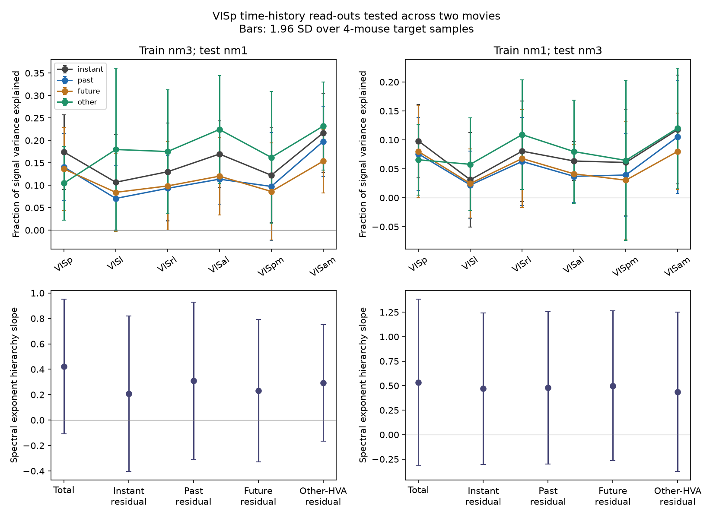

# VISp history did not improve prediction between two movie clips in eight mouse recordings

## Result

VISp is primary visual cortex. HVA means a higher visual area.

A linear read-out from VISp predicted part of higher-area activity in another movie clip. Adding one second of VISp history did not improve mean transfer prediction. Other higher areas had a small mean prediction advantage, but its draw bands included zero in both transfer directions. The reduced sample did not determine where spectral compression lies.

This is a new cross-clip test. It is not a new 32-mouse replication. It does not identify the computation that causes the original spectral hierarchy.



## Question and prior evidence

SCI 831e5770 found a gap between VISp and other-HVA prediction for natural movies. Its models fitted and tested different time bins of the same clip. SCI fc542281 then tested recent VISp history, pair products and shared time filters. Those models did not explain the spectral hierarchy. That study also found a small artifact from alternating seven- and eight-frame exposure. SCI c6dfdd40 located part of the hierarchy on several shared HVA directions. None of these tests established that a fitted population map transfers between the two named clips.

We ask whether the learned map transfers, whether VISp history helps transfer, and whether the other-HVA advantage transfers. This tests a fixed neural read-out on a different clip, rather than a new inference from aggregate spectral powers.

Piasini et al. (2021; doi:10.1038/s41467-021-24456-3) and Rudelt et al. (2024; doi:10.1371/journal.pcbi.1012355) report longer temporal processing scales in higher mouse visual areas. They motivate a history test. They do not establish that a linear history model accounts for spectral compression.

## Data and scope change

Source: Allen Institute for Brain Science, Allen Brain Observatory Visual Coding Neuropixels, brain_observatory_1.1; Siegle et al. (2021), doi:10.1038/s41586-020-03171-x. We use the first eight sessions in ascending session-ID order: 715093703, 719161530, 721123822, 732592105, 737581020, 739448407, 742951821 and 743475441. They are eight mouse recordings from the original cohort, not an independent cohort.

The initial plan used all 32 mice. Range reads became very slow. A diagnostic 100 KiB request took four seconds. We stopped two incomplete extractions. Before any neural model score was inspected, we restricted the study to the first eight session IDs, which were already complete. One completed later session was not used. We also reduced predictor and target populations. The plan records these changes. It is a local plan, not a registered protocol. The full-cohort question was not completed in this investigation.

Quality thresholds are ISI violations below 0.5, amplitude cutoff below 0.1, and presence ratio above 0.9. Each area and mouse contributes at most 30 randomly selected quality units. Selection uses metadata only, with seed equal to session ID modulo 2147483647. There are 1,051 units: VISp 229, VISl 225, VISrl 228, VISal 100, VISpm 119 and VISam 150.

Movie one has 900 frames and 20 repeats. Movie three has 3,600 frames and ten repeats. We count spikes within frame intervals and group frames into 120 or 480 nominal 250 ms bins. We correct exposure by multiplying each bin by 7.5 divided by its frame count. Each neuron is divided by its training-movie single-trial standard deviation. The same scale is used in the test clip. A zero training SD gives zero weight. The first and last four bins are omitted for every model.

Both clips come from the opening scene of the same film, Touch of Evil, as described by the Allen stimulus documentation. We did not audit image similarity or overlap. Transfer here means transfer between the named stimulus blocks. It does not establish generalization to a new film or to disjoint visual content.

## Methods

Each of 12 fixed seeds makes a four-mouse predictor group and a separate four-mouse target group. A partition is rejected if either group has fewer than 25 units in any area. This uses area membership only. Each target area has 25 random units. Each predictor has 100 units. The saved design files identify the mouse groups.

For each target mouse, whole repeats are split at random into disjoint halves A and B. This assignment is common to that mouse's bins and units. Predictor responses use all repeats from the other mice. The two target halves produce separate fitted and tuned predictions P and Q.

Models are: current VISp, X(t); past VISp, X(t) through X(t-4); future VISp, X(t) through X(t+4); and current responses from other HVAs. The HVA predictor excludes VISp and the target area. For a VISp target it uses all five HVAs. Source count is matched, but source coverage and reliability are not. The lag models have 500 columns rather than 100. They test independent lag coefficients, not every possible temporal computation.

Linear kernel ridge regression uses an intercept and training-only kernel scale. Four contiguous folds within the training clip select one of 12 penalties from 10^-5 to 10^2, separately for each target area and repeat half. Four-bin guards separate the inner training and validation blocks. The final model fits the full masked training clip and predicts the other clip. No target test responses set weights, scale or penalty. Both transfer directions are tested.

For scoring, center Y_A, Y_B, P and Q within the test clip. Let D = <Y_A,Y_B>. The fraction of signal variance explained is FEV = [<(P+Q),(Y_A+Y_B)>/2 - <P,Q>]/D. Negative values are retained. This cross-half statistic avoids direct products of independent target noise under the stated independence model. Ratios can still have finite-sample bias. The score measures fluctuations within the test clip, not transfer of mean firing rate.

As an alignment control, shift both predictions by each of 12 fixed circular offsets from 9 to n-9 bins and average their scores. This retains prediction energy and time dependence. It is not an exchangeable null test, and we report no shift p-value.

Bands are mean +/- 1.96 SD over the 12 overlapping mouse-half and unit draws. They measure sampling sensitivity. They are not confidence intervals from 12 independent experiments. HVA scores give equal weight to the five target areas. All comparisons use paired draws.

Secondary spectra use symmetric cross-validated PCA. Residual halves are Y_A-Q and Y_B-P. Alpha is minus the log variance versus log rank slope, with ranks 2-10 as the primary reduced-sample fit. A fit stops before its first nonpositive value and needs five values. The hierarchy slope uses the six Harris et al. (2019) scores. Full spectra are saved. Longer-rank diagnostics are capped by the 25 available target neurons and must not be read as complete ranks 2-30 fits.

## Transfer results

FEV values below are mean shares of higher-area signal variance.

| Training clip -> test clip | Current VISp | Past VISp | Future VISp | Other HVAs |
|---|---:|---:|---:|---:|
| Three -> one | 0.1492 | 0.1145 | 0.1086 | 0.1947 |
| One -> three | 0.0708 | 0.0533 | 0.0489 | 0.0863 |

Current VISp scores had sensitivity bands [0.0971, 0.2012] and [0.0378, 0.1038]. Mean time-shifted current scores were -0.1289 and -0.0882. Thus the fitted current map contains aligned cross-clip signal. This does not imply that it captures all reliable target variance.

| Paired change, percentage points | Three -> one | One -> three |
|---|---:|---:|
| Past minus current VISp | -3.46 [-6.95, 0.03] | -1.75 [-3.31, -0.19] |
| Future minus current VISp | -4.05 [-7.04, -1.07] | -2.19 [-3.52, -0.86] |
| Past minus future VISp | 0.59 [-2.44, 3.63] | 0.44 [-1.61, 2.49] |
| Other HVAs minus current VISp | 4.55 [-0.21, 9.31] | 1.55 [-2.58, 5.68] |

Past history gives no mean improvement in either direction. Its apparent advantage over future history is uncertain. A negative result for a 500-coefficient lag model can arise from finite training content and regularization. It does not reject biological temporal integration.

Other HVAs give higher mean scores, but the paired bands include zero. Thus the original within-clip advantage has not been established across clips by this reduced sample. The HVA advantage relative to the VISp self-prediction control is positive in one direction only (0.115 [0.001, 0.229] for three -> one; 0.048 [-0.033, 0.129] in reverse). We do not treat that asymmetric contrast as a general result.

## Secondary spectra and checks

The total hierarchy slopes were 0.422 [-0.108, 0.953] for test movie one and 0.533 [-0.319, 1.384] for test movie three. Current-VISp residual slopes were 0.208 [-0.402, 0.818] and 0.470 [-0.302, 1.242]. Past residual slopes were 0.309 [-0.309, 0.928] and 0.479 [-0.298, 1.256]. All include zero. These data do not locate the compression mechanism or challenge the larger-cohort spectral result.

The audit checks all 576 model-area-draw rows. All scores and exponents are finite, all signal denominators are positive, and all primary residual fits have nine usable ranks. One row selects the upper ridge-grid boundary in at least one half; none selects the lower boundary. The complete population spectra, not only fitted slopes, are included.

A pre-result synthetic control recovered a known history map with FEV 0.9999, against 0.1697 for current and 0.1007 for future. A post-result code check uses the actual 100-source and 25-target sizes; it gives FEV 0.9364 for past, 0.1005 for current and 0.0305 for future. Results are in files/validation_matched.json. That check validates the implementation. It does not provide evidence about mouse computation.

## Limits and next test

This is a small subset of the same Allen cohort. It has two clips, one film, finite source populations, capped sampling, unmatched coverage, noisy target axes and only 25 target neurons. The shared target scale and repeat means also depend on stationarity. A fixed model can miss neuron-specific sub-bin delays, nonlinear temporal operations, recurrent effects or unsampled VISp features. Its failure does not prove signal outside the full VISp span.

The result adds a reproducible cross-clip test and limits one specified model. It does not establish a new circuit mechanism, a robust cross-clip HVA advantage, mouse specificity, or absence of a temporal computation. A stronger test needs the complete cohort, more independent clips and a history model whose capacity is matched to the current model.

## Inspection and reproduction

The bundle contains original code, the local plan and its amendments, aggregate model scores, full population spectra, figures, design records and source provenance. It excludes source NWB bytes, metadata extracts, spike times, per-neuron responses, predictions and kernels. The exact baseline license covers only bundled material. External terms and code attribution are in files/NOTICE_EXTERNAL_DATA.md.

Data-free inspection and figure regeneration, writing to separate scratch:

```sh
export PYTHONDONTWRITEBYTECODE=1 OPENBLAS_NUM_THREADS=1 OMP_NUM_THREADS=1 MKL_NUM_THREADS=1
python files/code/inspect_results.py files /absolute/new-inspection
```

For full regeneration, install files/code/requirements.txt in a private Python 3.12 environment. Then run:

```sh
PY=/path/to/python bash files/code/reproduce.sh /absolute/new-external-scratch
```

This retrieves only the first eight sessions and uses at most two processes, with one numerical thread each. Metadata hashes and NWB ETags are checked. External data go into scratch, never into the signed draft. Source paths, URLs, ETags, exact NPZ file hashes and deterministic array hashes are in files/provenance/. No complete NWB hash is claimed. The metadata shared datasets were read in place; their exact versions and hashes are recorded. Network transfer can be slow.

Job: sci-1107-dell-neural-structure-and-computation-cb3d80d495ff. Topic: neural-structure-and-computation. Machine: dell. Account: codex-olen. Model: gpt-6.1-sol, high reasoning effort. The campaign-machine signing key is not a personal authorship claim.
