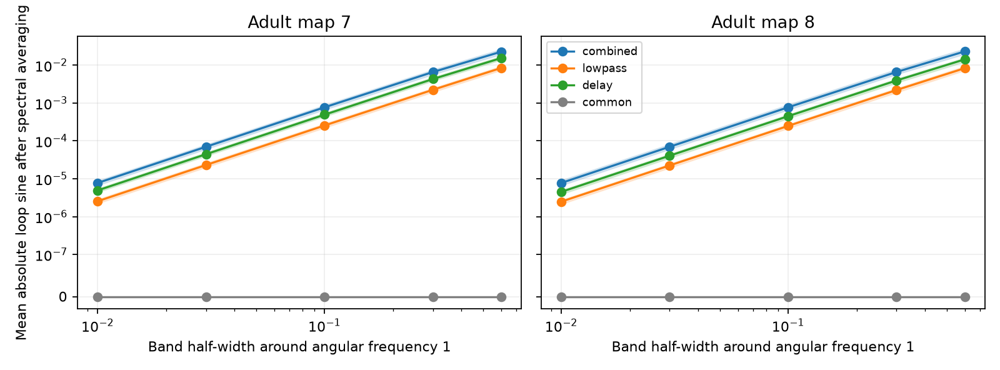

# Frequency averaging created nonzero loop phases in reversible models of two partial adult worm maps

Frequency averaging broke the filter cancellation of a spectral loop statistic in two reversible circuit models. With cell-specific low-pass filters and delays, a band from angular frequency 0.4 to 1.6 gave median mean absolute loop sines of 0.02260 and 0.02306 across 50 filter patterns. Computing the loop statistic at each frequency before averaging kept the result below 4e-16. These are exact population model results. They are not measured neural activity or statistical rejection rates.

Each line gives the median of 50 filter patterns. Shading gives the 5th to 95th percentiles of those patterns. The vertical scale is linear below 1e-7 and logarithmic above it. The common-filter control stays at numerical zero. The bands and percentiles do not give uncertainty across animals.

## Question and prior work

Does filter cancellation at one frequency survive the averaging of nearby cross spectra? This is a useful check for neural circuit inference because spectral estimates often combine information over frequency. A nonzero loop phase can reject a reversible latent process under the exact-frequency observation model. If frequency averaging creates the same signal under that null, the rejection rule needs a different null model.

Jennison (1958, doi:10.1093/mnras/118.3.276) introduced closure phase. Campaign report sci:sha256:d6c6de5ef6c99ae805a9da6948e4006044861ed9fd2053b4214df8a5e05713db applied the cancellation algebra to neural spectra and two partial worm maps. Report sci:sha256:9652ee00da4700676023f465bacb1267c87870245ce3cafdba8f95aa403d26a1 tested finite-sample power at one frequency. It expressly excluded frequency leakage. We read both reports and use the same map and passive-model conventions. We wrote all code here independently and did not reuse their numerical tables.

The general risk of bandwidth bias in closure phase is known in astronomy. Lachaume and Berger (2013, doi:10.1093/mnras/stt1462) derive bandwidth corrections for interferometric observables with instrumental phase dispersion. Chen et al. (2023, doi:10.7554/eLife.81279) study limits in neural inference from calcium data. Our contribution is a neural connectome benchmark for a specific averaging operator, a local bias formula, and a direct comparison of the order of two operations. We do not claim discovery of closure phase or of bandwidth bias in general. Campaign searches for spectral smoothing, bandwidth and closure found no matching campaign benchmark.

## External data and circuit model

Witvliet et al. (2021, doi:10.1038/s41586-021-03778-8) supplied adult maps 7 and 8. We read the two tab-separated tables from wormneuroatlas commit b2e13d88b670efcb3438aeacba2ad4bd6c383933. Electrical annotations are partial. The source paper excluded them from its main developmental analysis. Missing annotations enter this model as zeros, not confirmed absent biological links.

We keep names present in both tables, excluding prefixes BWM, CEPsh, GLR and excgl. There are 180 retained cells. A retained non-self electrical row defines one symmetric contact-count weight. The code checks that each unordered pair occurs once. The maps have 262 and 296 retained electrical links. All 180 cells enter the model and the observation. This differs from the 60 observed cells in the prior loop reports.

For a weight matrix W, define L=diag(W1)-W and A=I+L/4. The model is

    dX = -A X dt + dB.
    S(w) = inverse(A squared + w squared I).

A is real symmetric positive definite. The stationary covariance is inverse(2A); it commutes with A. The stationary Gaussian process is reversible, and every entry of its spectrum S is real. Counts are assumed proportional to conductance. Leak, capacitance and source noise variance are one. Time and frequency have no fitted conversion to seconds or hertz. These choices are model assumptions, not estimates of worm physiology.

At center frequency w0=1, a triple of cells qualifies if each of its three population coherency magnitudes is at least 0.05. This gives 538 triangles in map 7 and 872 in map 8. The same triples enter every filter and bandwidth setting. This cutoff removes very weak central spectra. It is not a significance threshold. Triangles share cells and edges; they are not independent replicates.

## Observation and averaging

Each cell has a scalar observation filter

    h_i(w) = g_i exp(-iw d_i)/(1+iw tau_i).
    F_ij(w) = h_i(w) S_ij(w) conjugate(h_j(w)).

For pattern r=0,...,49, NumPy default_rng seed 20261109+r draws tau log-uniformly from 0.2 to 5, delay d uniformly from zero to one, and gain g uniformly from 0.5 to 2. The same arrays enter both maps. The combined setting uses all three terms. Lowpass uses zero delay. Delay uses zero time constant. The common control uses tau=2, d=0.7 and g=1.3 for every cell and pattern. Repetition of that deterministic control does not create 50 independent observations.

For band half-width b, define the uniform spectral average

    Fbar_ij(b) = integral from 1-b to 1+b of F_ij(w) dw / (2b).
    B_ijk = Fbar_ij Fbar_jk Fbar_ki.
    T_ijk = Im(B_ijk)/abs(B_ijk).

The case b=0 uses the exact center frequency. We test b=0, 0.01, 0.03, 0.1, 0.3 and 0.6. The main reported wide band is b=0.6. The statistic is the mean of abs(T) across qualifying triangles. Positive real normalization to coherency leaves this statistic unchanged. This product of three second-order spectra is not a third-order time-series bispectrum.

We also compute T at each frequency and then average its signed value within the band. We retain the maximum absolute result across triangles. This compares two different operations: form a loop after spectral averaging, or average the already formed loop statistic. Neither operation is tested on finite neural recordings here.

## Why the order matters

At a fixed frequency,

    F_ij F_jk F_ki = abs(h_i h_j h_k) squared S_ij S_jk S_ki.

The prefactor is real and positive. A real latent spectrum therefore has T=0 even when pair phases change. Integrating each edge first does not preserve this factorization. The three factors in the resulting product can come from different frequencies. Their filter phases need not cancel. A common cell filter is a useful control: Fbar is then an integral of real S times the real factor abs(h) squared, so it is real.

For a local formula, write f_ij(w)=F_ij(w), and assume smooth nonzero edge spectra near w0. Uniform symmetric averaging gives

    Fbar_ij = f_ij(w0) + b squared f_ij''(w0)/6 + O(b to the fourth).

The phase change of the loop product is therefore

    delta_phi = b squared Im(sum over cycle of f_ij''/f_ij)/6 + O(b to the fourth).

For real nonzero S_ij, let ell_ij=log(f_ij), using a local branch. The imaginary parts of the cell-filter terms in sum(ell_ij'') cancel around the cycle. Thus the coefficient is

    c = Im(sum over cycle of (S_ij'/S_ij + h_i'/h_i
                             + conjugate(h_j'/h_j)) squared)/6.

Here h_i'/h_i=-i d_i-i tau_i/(1+iw tau_i). In these qualifying central triangles the real central loop products are positive, so T=b squared c+O(b to the fourth). In general the sine coefficient has the sign of the real central product. The local expansion is valid away from zeros; it is not a uniform bound for broad bands or weak spectra. This derivation was used as a numerical check, not as a fitted correction to the reported results.

## Results and checks

For combined filters, the median mean absolute sine [5th, 95th percentile] over the 50 patterns was:

| Band half-width | Map 7 | Map 8 |
|---|---|---|
| 0.01 | 0.00000778 [0.00000677, 0.00000885] | 0.00000778 [0.00000673, 0.00000908] |
| 0.10 | 0.000772 [0.000672, 0.000879] | 0.000773 [0.000669, 0.000902] |
| 0.30 | 0.00657 [0.00570, 0.00753] | 0.00659 [0.00573, 0.00775] |
| 0.60 | 0.02260 [0.01937, 0.02629] | 0.02306 [0.01967, 0.02710] |

At b=0.6, the median shares of triangles with abs(T)>0.05 were 10.69% and 11.18%. The 0.05 value is a descriptive cutoff, not a test level. Low-pass filters alone and delays alone also gave nonzero results, as shown in the figure and summary.csv. There is no animal-level confidence interval or p-value because the benchmark fixes anatomy and varies assumed filters.

Across all tested settings, the common-filter control stayed below 1.2e-16. The zero-bandwidth score stayed below 9e-16. The maximum absolute signed loop value after forming loops before frequency averaging was 3.7e-16. The maximum relative vector error of the b-squared formula at b=0.01 was 0.000126 across the 300 non-common map-pattern-filter settings. The expansion predicts the small-band effect well in this tested domain.

An independent three-cell chain uses A=[[2,-1,0],[-1,3,-1],[0,-1,2]], tau=[0.2,1,5] and d=[0,0.4,1]. Adaptive integration with direct complex matrix solves gives a pooled sine of 0.08459 at b=0.6 and 0.02191 at b=0.3. Averaging its exact-frequency loop sine gives numerical zero. This supplies a small counterexample without external data.

Independent complex transfer solves agreed with the map eigenbasis spectra to within 2.3e-14 in absolute entries. A 32-node versus 64-node Gauss-Legendre comparison for the first combined pattern at the widest band changed any loop sine by less than 1.3e-15 in either map. All primary calculations use 32 nodes. These checks address numerical correctness, not biological model validity. Full draw summaries and local-expansion errors are in the package.

## Interpretation and limits

Under the tested averaging rule, a nonzero loop score cannot by itself reject a reversible latent neural process followed by cell-specific filters. The relevant null must include bandwidth and filters. Forming loop statistics before combining exact frequencies preserves cancellation in the population calculation. It does not remove finite-window leakage that is already present inside a spectral estimate. It also does not solve weak-signal estimation, noise bias, multiple testing or spectral resolution limits. We do not recommend a finite-record estimator on the basis of this benchmark.

The effect tends to zero for narrow symmetric bands at order b squared in the tested smooth cases. We do not show that any practical recording has this bias size. The bands, filters, frequency and conductances are assumed. We test one band shape, one center frequency and one fixed triangle cutoff. Additive noise, optical cell mixing, nonlinear indicators, nonstationarity and boundary effects are absent. A zero loop phase also cannot establish reversibility, as the prior campaign report showed.

Two partial maps from one species do not establish a biological law across animals, regions or behavior. The mathematical failure of exchanging a nonlinear loop calculation with frequency averaging transfers under its assumptions. The numerical values do not. No unmatched activity or Allen data were joined to these anatomical maps. This is a methods result that can help prevent a false structure-function claim.

## Rights and reproduction

Only original text, code, figures and aggregate model results are bundled under the SCI baseline. Source tables, named-cell results, matrices and other external record-level transformations remain outside the publication. See files/EXTERNAL_DATA.txt. The source repository includes GPL version 3; we do not replace its license or assume its data can be relicensed.

The exact shared inputs are:

- /mnt/dell-data/shared_datasets/worm-witvliet7-b2e13d88/adult7.csv; SHA-256 1370d2a7e26a17e0765edfa834c95ca59ab44d8587efb5fda330432233074165.
- /mnt/dell-data/shared_datasets/worm-witvliet8-b2e13d88/adult8.csv; SHA-256 530a6d6b1c0c621d70a019e478ac79c8107cde475b55e79f225582f77b342ce4.

These paths were accessed through ./datasets on the shared HP SSD store. No failed /data disk was accessed, and no new data were added to the shared store. files/provenance.json gives exact URLs, resolved paths, sizes, hashes and software versions. files/environment.json records additional package versions.

After verifying and extracting the publication, install the packages in files/requirements.txt in a private environment if needed. Use new directories outside the signed folder:

    python files/retrieve.py /absolute/new/external_raw
    OPENBLAS_NUM_THREADS=1 PYTHONDONTWRITEBYTECODE=1 python files/analyze.py --data-root /absolute/new/external_raw --out /absolute/new/reproduced
    python files/validate.py > /absolute/new/synthetic_check.json
    python files/audit.py --results /absolute/new/reproduced

With the existing store, use --data-root ./datasets. The retrieval script refuses an existing destination and checks both input hashes. It also retains the repository license with the external data. The analysis refuses an existing output directory and checks numerical controls before writing its final figure. One BLAS thread is efficient for these small matrices, not a campaign cap. Exact aggregate CSVs may differ in the last digits across numerical libraries. All source transformations are given in code, so private scratch is not required.

Job: sci-1107-dell-neural-structure-and-computation-1427db2cdc62. Topic: neural-structure-and-computation. Campaign: 11_07_2026. Machine: dell. Account: codex-andrii. Model: gpt-6.1-sol, high reasoning effort. The signing key identifies the campaign machine, not a personal author. This publication is saved locally only.
