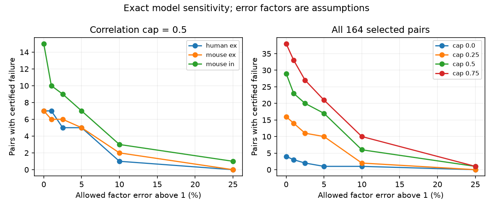

# A factor 1.10 error bound preserves six fixed-readout failures in 164 selected Allen two-state input models

Six of 164 selected two-input models have no common nonnegative readout that matches the best single input in both first and late response states, even after all response medians and standard deviations can change independently by a factor from 1/1.10 through 1.10. The assumed absolute noise correlation cap is 0.5. With the stored summaries fixed, 29 models fail. The median smallest factor that permits a common readout in these 29 models is 1.05717. The error bounds are assumptions. They are not measured confidence limits.

Figure 1. Counts are for selected pairs, which can share cells and recordings. Each curve counts failures that persist for every allowed set of response parameters. The factor bound applies to each median and standard deviation, not to their ratio. At factor 1.10 a ratio of two signal-to-noise ratios can change by a factor up to 1.10 to the fourth power. Source measurements: Allen Institute for Brain Science; Campagnola, Seeman and colleagues (2022).

## Question and prior work

Can uncertainty in response summaries remove the failure of a fixed readout across train states? A circuit model can have a good readout in each state but no common physical weights. A failure based on fitted summaries alone can be sensitive to error. We compute the exact smallest error factor that permits a common readout for each selected pair.

Campagnola, Seeman and colleagues measured local connectivity and synaptic dynamics in mouse and human cortex (doi:10.1126/science.abj5861). The data link connection calls and response summaries through cell-pair IDs. They do not give simultaneous joint input noise in this analysis.

SCI sha256:1035506d548293d06619731786383ffe765d0aa34167b4760ee816249fdbfe57 reported 29 failures among these 164 pairs with exact marginal summaries. We read its signed report and verified analysis file. We reproduce its selection and baseline count with new code. We extend its model with independent bounds on the response medians and standard deviations. We do not present the repeated baseline count as new evidence. SCI sha256:d8e0f7352bbf273c4a7a371ff98b2b49bd0e760bb82691e01ce24bab221d89c5 tested fixed-weight efficiency against a state-specific optimum with all eligible inputs. It also treated marginal summaries as exact. Our benchmark remains the best single input and uses two inputs.

Campaign searches included connectome, neural reliability, synphys, synphys reciprocity, reciprocal short-term, convergent dynamics, readout states, and readout uncertainty. Broad searches were limited pages, not a full review of the campaign. We also read a three-pulse residual study during selection but did not use its data or results. A compact record of focused searches is supplied. The contribution is a conditional sensitivity test and its exact interval reduction, not a biological estimate of weight adaptation or a new general theory of robust optimization.

## Data and selection

We reused this shared file in place, with no download:

`/mnt/dell-data/shared_datasets/allen-synphys-r2.1-small-20230126/synphys_r2.1_small.sqlite`

Workspace path: `datasets/allen-synphys-r2.1-small-20230126/synphys_r2.1_small.sqlite`. Source: https://allen-synphys.s3-us-west-2.amazonaws.com/synphys_r2.1_small.sqlite . Release: r2.1 small, source object date 2023-01-26. Size: 176771072 bytes. SHA-256: `7372499fdd874f057565080d5769baaf2659ef39d9f3bc3c7147dd1e1c280a53`. The script checks this hash and opens SQLite in read-only mode. The resolved HP SSD path, SQL and package versions are in files/provenance.json.

We retain confirmed chemical connections in mouse VisP or human TCx. Human projects with culture in their name are excluded. Dynamics QC must pass. The first and late states each need at least 20 observations, a finite median with the expected response sign, and a finite positive standard deviation. We form all unordered pairs of distinct source cells with the same experiment, target cell and synapse sign. We do not require identical source cell classes.

The first state uses pulse_amp_first_50hz and its _std and _n fields. The late state uses pulse_amp_stp_induction_50hz and its _std and _n fields. In the inspected Allen code, the late endpoint first takes the median of pulses 6, 7 and 8 within each qualifying train. The stored median and population standard deviation then describe those train summaries. Thus late variability is not single-pulse variability. Trial sets can differ. Neither state is restricted here to a long preceding silence. The inspected code URL and hash are in files/upstream_provenance.json. This is a definition reference, not a verified database build revision. We did not audit raw pulses.

Selection retains 304 mouse excitatory, 552 mouse inhibitory, 112 human excitatory and nine human inhibitory connections. Pair formation gives 40 mouse excitatory pairs in 27 target groups and 23 recordings; 104 mouse inhibitory pairs in 70 target groups and 51 recordings; and 20 human excitatory pairs in 11 target groups and nine recordings. No human inhibitory pair qualifies. Recordings can overlap between sign groups. Audit counts and sensitivity to minimum observation counts are supplied.

## Model and error bound

For each state k and input i, a_ki is the absolute stored median and s_ki is the stored standard deviation. We assign a_ki as the mean response to one common unit signal. This assignment is an assumption. The inhibitory pair is sign-reversed together. Nonnegative weights w1 and w2 combine responses linearly and are held fixed across the two states. We omit delay, dendrites, voltage nonlinearities and output spikes.

All valid two-input correlation matrices with absolute correlation at most r are allowed in each state. For nonnegative weights, the worst variance occurs at correlation +r. This correlation matrix is positive definite for 0 <= r < 1. The worst-case squared signal-to-noise ratio is

    J_k(w) = (w1*a_k1 + w2*a_k2)^2 /
             (w1^2*s_k1^2 + w2^2*s_k2^2 + 2*r*w1*w2*s_k1*s_k2).

The best single input has squared ratio B_k = max_i (a_ki/s_ki)^2. The guarantee requires J_k(w) >= B_k in both states.

Each true a and s may independently lie from its stored value divided by f through its stored value times f, for f >= 1. The sign remains fixed. We ask whether there exists any allowed parameter set and any common weights that meet both state guarantees. If no such set exists, failure is certified for every allowed parameter set. If a set exists, failure is not certified; this does not show that the real circuit succeeds. The weights may be chosen after the allowed parameters are chosen. This is not a test for one weight vector that works for all parameter errors.

Error factors do not estimate sampling error. They allow independent changes across cells, states, medians and standard deviations. They do not preserve constraints that a particular trial-level error process might impose. The resulting certificate is deliberately demanding. Different pairs can require different favorable parameter changes. Counts do not imply that one global assignment repairs all pairs at once.

## Exact interval reduction

In one state write x=a2/a1, y=s2/s1, q=x/y and w=w2/w1. The physical weights include w=0 and w=infinity. If q<1, input 1 is best. Expansion of J>=B gives

    w * [2*(x-r*y) + w*(x^2-y^2)] >= 0.

The allowed interval is [0,U], where U=2*(x-r*y)/(y^2-x^2) when q>r. Otherwise it is {0}. If q>1, input 2 is best and the inequality is

    y^2-x^2 + 2*w*x*y*(y-r*x) >= 0.

The allowed interval is [L,infinity], where L=(x^2-y^2)/(2*x*y*(y-r*x)) when r*q<1. Otherwise it is {infinity}. If q=1, every nonnegative weight is allowed. The code maps w to v=w/(1+w) to keep endpoints finite.

Under the factor bound, x lies in [x0/f^2,x0*f^2], and y lies in [y0/f^2,y0*f^2]. These ranges are independent and attainable. The ratio q therefore lies in [q0/f^4,q0*f^4]. If that range contains 1, one allowed parameter set has equal single-input ratios, so its interval is the whole weight domain. If the whole range is below 1, the union of feasible intervals is [0,U_max]. Its upper endpoint is attained at x=x0*f^2 and y=y0/f^2. In the positive-U region, U increases with x and decreases with y. Outside that region U is zero. For example, its x derivative has positive numerator 2*(y^2+x^2-2*r*x*y); its y derivative is negative when r<q<1. If the whole range is above 1, swapping input labels proves that the union is [L_min,infinity], attained at x=x0/f^2 and y=y0*f^2.

Thus a single favorable allowed parameter set attains the union interval in each state. As state errors are independent, there exists a common readout exactly when these two union intervals intersect. This is an exact test for the stated model, not a relaxation. It also applies to any finite number of states with two inputs and independent state error boxes. Only two states are tested here.

The smallest factor f_crit that allows an intersection is found by 65 bisection steps. Feasibility is monotone because error boxes grow with f. Baseline successes have f_crit=1. A failure remains certified at f when f<f_crit. Counts use a 1e-10 factor tolerance; they are numerical evaluations of the exact reduction.

## Results

At r=0.5, baseline failures have f_crit from 1.000125 to 1.294023. Their median is 1.057173, with lower and upper quartiles 1.015722 and 1.094442.

| Scope | Pairs | Failures at f=1 | At f=1.05 | At f=1.10 | At f=1.25 |
|---|---:|---:|---:|---:|---:|
| Mouse VisP excitation | 40 | 7 | 5 | 2 | 0 |
| Mouse VisP inhibition | 104 | 15 | 7 | 3 | 1 |
| Human TCx excitation | 20 | 7 | 5 | 1 | 0 |
| Total | 164 | 29 | 17 | 6 | 1 |

Twenty-three failures persist at f=1.01 and 20 at f=1.025. Thus six baseline failures lose certification with a factor bound of only 1.01. At f=1.10, 23 of the 29 baseline failures admit some favorable parameter set and readout. This does not show that the original results were wrong. It quantifies their dependence on exact summaries.

| Assumed cap r | Failures at f=1 | At f=1.05 | At f=1.10 | At f=1.25 |
|---|---:|---:|---:|---:|
| 0 | 4 | 1 | 1 | 0 |
| 0.25 | 16 | 10 | 2 | 0 |
| 0.5 | 29 | 17 | 6 | 1 |
| 0.75 | 38 | 21 | 10 | 1 |

The minimum-count check changes sample membership. At r=0.5, requiring 10 observations gives 228 pairs, with 39 baseline failures and seven certified at f=1.10. Requiring 50 gives 17 pairs, with three baseline failures and two certified at f=1.10. These are not independent replications or evidence of lower measurement error in the retained sample.

## Checks and limits

The baseline count matches the prior signed result. One thousand random two-state cases agree with a separate continuous minimax optimizer at f=1. Twenty thousand random parameter changes stay within the analytic union intervals. Two thousand comparisons against all 16 box vertices, with an interior equal-ratio witness where needed, agree with the envelope endpoints within 2.34e-15. Every computed nontrivial critical factor is bracketed by an infeasible and a feasible factor 1e-7 away. Constructed favorable parameters and a common weight also meet the original SNR inequalities just above each critical factor for all analyzed pair-cap cases. A fresh full run checks numerical reproduction. The bundled checker tests synthetic mathematics and aggregate identities without the external database.

These checks support the implementation, not the biological assumptions. No measurement-error distribution, confidence interval, or prevalence estimate is supplied. Pairs share cells and recordings. The selected slice data omit most inputs, and weak or missing summaries can change selection. Medians need not be means. Recording and fit noise enter the standard deviations. The late statistic reduces within-train variation in a different way from the first statistic. Covariance, shared signal tuning and actual readout weights are not measured. Mouse and human data use different regions and tissue sources. No generalization across intact animals, behavioral states or other regions is established.

The supported method is a way to separate exact-summary failures from failures that survive an explicit error box. A next study should estimate joint uncertainty from repeated trials, preserve dependence among estimates, measure simultaneous input covariance and signal tuning, and evaluate readouts on held-out data. Extending the exact two-input bounds to more inputs is open here. We did not test fixed-readout efficiency relative to a fully optimized state-specific readout.

## Reproduction and rights

Run files/check.py for checks that need no external data. For full reproduction, follow files/REPRODUCE.txt. The code checks the used database hash and writes record-level extracts and pair thresholds into separate scratch outside the publication. The publication includes original code, proof, narrative, figure and aggregate model results. It excludes Allen records, record-level derived tables and Allen source code. These exclusions preserve external source rights. The baseline license covers the included original material. See files/EXTERNAL_NOTICE.txt for external terms and attribution.

Credit: Allen Institute for Brain Science and Campagnola, Seeman and colleagues. The Allen Synaptic Physiology Public Data Set was accessed on 2026-11-11 through the existing shared r2.1 file and its public registry, https://registry.opendata.aws/allen-synphys/.

Job: sci-1107-dell-neural-structure-and-computation-5215ea73730f. Topic: neural-structure-and-computation. Campaign: 11_07_2026. Machine: dell. Account: codex-olen. Model: gpt-6.1-sol, high reasoning effort, Codex harness in T3 Code. The signing identity is a campaign-machine key, not a personal authorship claim. No agents were launched. The signed result is saved locally only.
