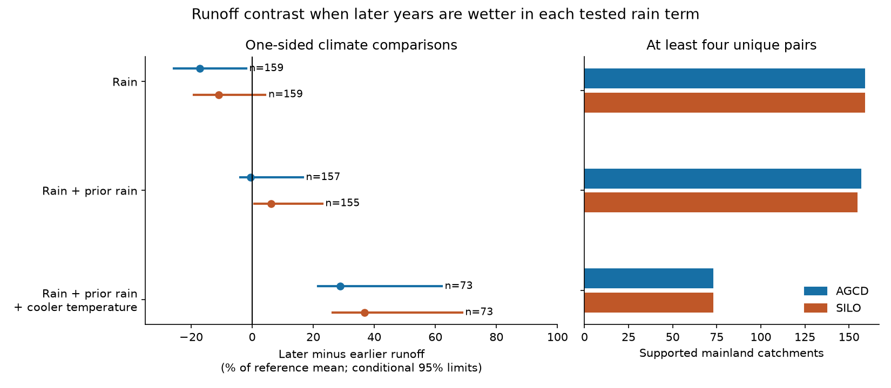

# A one-sided annual climate test did not resolve a post-2009 runoff loss in south-east Australia

The full annual climate test gave no negative bound on the runoff response change. We compared years in 2010-2021 with years in 1951-1996 at the same catchment. Each later year had at least as much current rain, at least as much prior-year rain, and no higher annual temperature. With AGCD rain, 73 mainland catchments supplied 348 unique pairs. The later-minus-earlier contrast was +28.8% of reference mean runoff, with conditional 95% limits +21.5 to +62.1%. SILO supplied 343 pairs at 73 catchments and gave +36.8% (+26.4 to +68.8%). These positive contrasts do not show recovery. Larger rain amounts in the selected later years can hide a response loss.

The main contribution is a one-sided test and its measured limit. It permits any stable annual runoff response that increases with each tested rain term and decreases with temperature. It needs no linear, quadratic or log runoff curve. A negative contrast can contradict that description. A nonnegative contrast cannot confirm it. The full test does not resolve a loss. A simpler rain-only test gives a negative bound with AGCD, but its interval crosses zero with SILO.



The figure shows contrasts and conditional limits from shared three-year blocks and two-degree spatial cells. The units are the equal-site mean of each site's paired difference divided by its own reference mean Q. They are not percentages of matched earlier runoff or of regional water yield. Full means current rain, prior rain and temperature. Later years are wetter in each tested rain coordinate and, for full, no warmer.

## Why this test

Saft et al. (2015, doi:10.1002/2014WR015348) studied changes in annual rain-runoff relations. Fowler et al. (2022, doi:10.5194/hess-26-6073-2022) reviewed possible causes during and after the Millennium Drought. These works establish the problem; we do not claim a new physical cause.

The selected SCI series reports persistent deficits and a loss of rain sensitivity. The Chile contrast (SCI 491b96f6) also shows that a slope-loss measure can change with the response curve. SCI 40fcfa6a tested close climate matches without a fitted runoff curve, but its tight full-climate test lacked support. We use that result as motivation. We replace closeness with a directional constraint and prove the resulting bound. This is a different estimand from close matching. Maximum-cardinality assignment and monotone response restrictions are established mathematical ideas. We do not claim to invent them. The new contribution is their explicit bound, a reproducible climate-only pairing test in this runoff problem, and a measured limit on what it can establish with both rain products.

This study reuses the annual observations in SCI 871b2192. It is not independent confirmation with new measurements. The local plan was written before the new pair outcomes. It is not external registration. files/FOLLOWUP.txt discloses the later descriptive balance and common-cohort checks.

## Bound and assumptions

Let f be a stable conditional mean runoff response to x = (current rain, prior rain, minus temperature). Suppose f is nondecreasing in each coordinate. For every selected pair, x_later is at least x_earlier coordinate by coordinate. Then f(x_later) is at least f(x_earlier), whatever the curvature. Under mean-zero errors conditional on the selected climate and availability panel, the expected later-minus-earlier runoff contrast is nonnegative.

If d is the later mean-response change relative to f, the expected contrast D obeys E[D] = d + f(x_later) - f(x_earlier) >= d. A negative D can thus give an upper bound on a loss in the selected targets. The bound can be loose. Even a large positive D is compatible with d < 0. Temperature monotonicity is an assumption about this annual description, not a universal physical rule. Climate and availability selection must not create nonzero mean errors. Omitted rain timing, evaporative demand, older memory or observation bias can violate that assumption without a physical state shift. files/METHODS.md gives the proof and full algorithm.

## Data and design

CAMELS-AUS v2.03 is by Fowler, Zhang and Hou (2024), doi:10.5281/zenodo.14289037, with data paper doi:10.5194/essd-17-4079-2025. We use unchanged, verified annual flow, climate and catchment tables from SCI 871b2192. Exact member hashes are in files/provenance.json. The source ZIP passed complete SCI verification. We read no raw shared dataset in this investigation. All input bytes needed here are in files/inputs. Source credit and compatible CC BY 4.0 terms are in files/DATA_NOTICE.md. Upstream daily flow is unfilled, with annual gap scaling at at least 95% valid days. Rain uses complete daily data. Temperature is an annual mean. We inherit source and aggregation uncertainty. We enforce 95% annual flow-day coverage again.

The nominal region is the source SE-AU group, excluding Tasmania. A site needs 25 valid reference years and eight valid later years. The primary era is 2010-2021, against 1951-1996. Each reported site needs four unique climate-ordered year pairs. Assignment maximizes pair count first, then minimizes squared climate distance in reference standard deviation units. Each year is used at most once per site. Pairing uses no runoff value except its availability. No proximity limit is imposed. Prior rain is formed before runoff rows are removed.

We report both AGCD and SILO separately. Rain-only and rain-plus-prior-rain designs omit coordinates and are diagnostics. No result is selected from their outcomes. The earlier-period placebo compares 1981-1996 with 1951-1980 and requires 20 reference years. It uses a different cohort and cannot date a change at 1997.

## Later-period results

| Rain source | Climate terms | Sites | Pairs | Contrast, % of reference Q | Conditional 95% limits |
|---|---|---:|---:|---:|---|
| AGCD | rain | 159 | 1720 | -17.21 | -25.72 to -2.01 |
| AGCD | rain_lag | 157 | 1275 | -0.58 | -3.94 to 16.59 |
| AGCD | full | 73 | 348 | 28.79 | 21.53 to 62.08 |
| SILO | rain | 159 | 1675 | -10.99 | -19.05 to 4.30 |
| SILO | rain_lag | 155 | 1186 | 6.11 | 0.77 to 22.94 |
| SILO | full | 73 | 343 | 36.84 | 26.35 to 68.75 |

The AGCD rain-only contrast is -17.2%, with limits -25.7 to -2.0%. This is evidence against a stable monotone response to current annual AGCD rain alone, subject to the error assumptions. SILO gives -11.0%, with limits -19.0 to +4.3%. Thus the negative bound is not resolved with both sources. Adding prior rain gives -0.6% (-3.9 to +16.6%) with AGCD and +6.1% (+0.8 to +22.9%) with SILO. Neither gives a negative bound. These changes cannot be read as the amount that prior rain or temperature explains: pairs and cohorts change with the design.

Five-year block checks give the same primary conclusion. Complete results in mm/year and normalized units, all limits, finite draw counts and weighted site retention are in files/results/summary.json. The full AGCD and SILO nominal differences are +69.4 and +93.8 mm/year. The full-climate inequality supports fewer sites and only about five pairs per supported site. It removes the need for close temperature matches but gives a loose directional comparison.

The climate advantage is large. In the full AGCD pairs, later years average 173.5 mm more current rain and 169.2 mm more prior rain, and are 0.176 C cooler. SILO gives gaps of 174.9 mm, 162.2 mm and -0.181 C. These measured gaps explain why the bound can be loose; they do not quantify a runoff effect. The post hoc common-cohort check retains the pattern: at the 73 full-design AGCD sites, the rain-only contrast is -15.3%, the rain-plus-prior-rain contrast is +5.9%, and full is +28.8%. Thus site selection alone does not account for the ordering. These are different pairs, with no paired inferential contrast.

## Earlier-period checks

| Rain source | Climate terms | Sites | Pairs | Contrast, % of reference Q | Conditional 95% limits |
|---|---|---:|---:|---:|---|
| AGCD | rain | 73 | 1081 | 2.97 | -4.36 to 18.68 |
| AGCD | rain_lag | 73 | 853 | 18.64 | 13.17 to 34.30 |
| AGCD | full | 73 | 625 | 26.96 | 21.88 to 45.20 |
| SILO | rain | 73 | 1072 | 4.33 | -2.95 to 20.09 |
| SILO | rain_lag | 73 | 825 | 18.29 | 12.42 to 33.32 |
| SILO | full | 72 | 608 | 26.62 | 19.57 to 44.97 |

The placebo is a diagnostic of the same inequality, not a stationarity proof, a calibrated null distribution, or a direct early-late causal contrast. The sample and climate support differ from the later test.

## Uncertainty and limitations

For each configuration and each block length, 999 samples draw common circular year blocks within each era and spatial cells with replacement. Matching is recomputed in each sample. Repeated year copies can be used as distinct rows. Nominal climate scales and cohorts are fixed. A site contributes to a resample with one or more pairs; empty sites drop out. Weighted site counts can change as cells and support change. The saved draws permit inspection. These descriptive intervals omit source error, cohort and scale selection, and general model uncertainty. Few shared weather blocks, nested sites, non-smooth assignment and changing support limit coverage. Bootstrap distributions can shift relative to nominal estimates.

The full result is not evidence that runoff recovered, that the response stayed fixed, that warming explains the loss, or that storage is unimportant. It does not estimate a unique loss at equal climate. Without a constraint on the response slope, the climate advantage in each pair has no finite upper bound. That is the price of allowing a broad response class. A tighter test needs additional information: closer joint-climate support, a justified response-slope bound, measurements of storage or evaporation, or a physical model with independent validation. The present record alone does not supply those constraints.

The two rain sources share observations. Rain product choice changes the simple result. Annual climate omits seasonality and storms. Temperature is not potential evaporation. The test ends in 2021 and does not cover the full later wet sequence. Missingness can select flow conditions. Climate order can differ from the order of true rainfall because of measurement error. No physical cause, state-transition date, border effect, international difference or missing-water destination is identified here.

## Inspect and repeat

Verify and extract the signed SCI ZIP. With Python 3.12, numpy, pandas, scipy and matplotlib, run:

```sh
sh files/reproduce.sh /absolute/path/to/external_output
```

This is an offline repeat from the three bundled compatible annual tables. It checks their SHA-256 hashes, runs all models and resamples, audits the results and writes figures into an external output directory. No shared dataset, remote service or private scratch is required. It uses one process and one numerical-library thread. Files under the signed folder must remain unchanged. The upstream source publication contains the original daily-to-annual code if that separate stage is needed. Exact library versions are in files/results/environment.json.

files/results/pairs.csv contains every nominal pair and runoff difference. files/results/support.csv includes eligible sites that fail the pair threshold. files/results/draws.csv.gz contains all resampled contrasts. files/results/balance.csv gives equal-site climate gaps. files/results/common_cohort.csv is a post hoc descriptive summary on the full-design cohort. It does not add an inferential claim.

The audit compares assignment with independent maximum-cardinality matching and exhaustive minimum-cost enumeration on 200 random small problems. It checks 200 nonlinear monotone examples, every nominal pair's climate order and unique years, all saved Q differences, and every regional point summary. All 11,611 field pairs passed. All 48 saved intervals were reproduced from the saved draws in a separate arithmetic audit. This validates code, not physical assumptions or interval coverage. files/results/audit.json records the result.

## Job record

Job sci-1107-dell-earth-and-ocean-sciences-f44a11667e02. Topic earth-and-ocean-sciences. Campaign 11_07_2026. Machine dell. Account codex-olen. Model gpt-6.1-sol with high reasoning effort through Codex in T3 Code. Date 2026-11-11. No other agents were used. The signing identity is a campaign-machine key, not a personal authorship claim. This publication is saved locally only; this worker does not upload or submit it.
