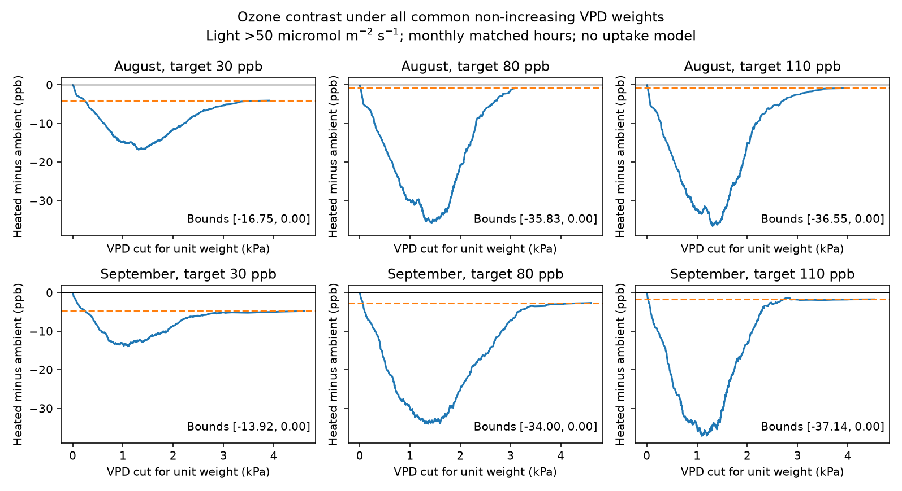

# All common non-increasing VPD weights kept heated ozone summaries no higher in North Wales in August-September 2021

The heated-minus-ambient ozone summary was never positive under any common non-increasing weight for vapor pressure deficit (VPD). This held in six month-target comparisons and all 48 combinations of month, target, light rule and ozone threshold. The result is exact for the supplied records and the stated weight class. It does not show lower ozone uptake or less flower injury.



## Question and prior work

Can reduced weight in dry air reverse the exposure ranking of heated and ambient chambers? This matters because the same warming and pollution experiment can have more joint high-ozone and high-VPD hours, but less ozone available when a plant has open stomata. We test a class of exposure summaries before choosing a plant response model.

We searched the campaign for phenology and pollution, drought and birds, cherry flowering, ozone and warming, the source data identifier, harebell weights, and ozone and stomatal response. We read the related signed results. SCI sha256:2e833e35b40dd4089a8f961789bc4ef0f370769b26f6ef9030eda2da07099351 found higher VPD and more joint threshold hours in heated domes. SCI sha256:51e63bdcebf6d84f9bdbb679bca8fa4358b41128b862f9ee6588cb023b30f2fa found that most joint overlap followed hour and weekday schedules. SCI sha256:3b1cc0f6536eaa2be19481bd411cc9e9d982b4fd2bcda190d4a2d7ac3a1aea07 found that selected daytime windows kept ozone contrast signs. These studies warned that uptake was not measured.

Our new test permits every common non-increasing VPD weight, rather than a few dry-air thresholds or light windows. It uses an exact cumulative-sum criterion and an independent linear-program check. The records are the same as in those studies. This is a new conditional test, not independent biological validation. We use no prior source code or derived records. Related count and timing audits were read during question selection but are not inputs to this result.

Emmerichs and colleagues (2025), DOI 10.5194/bg-22-4823-2025, compared six ozone deposition models. Their differences depended on soil moisture and VPD. Their work motivates testing response assumptions. Our weight class is a simple diagnostic. It is not one of those full models and supplies no species-specific conductance parameters.

## Source and observation bias

Hayes and Sharps (2023) supplied hourly ozone and weather from a wildflower experiment at Abergwyngregyn, North Wales. Source DOI: 10.5285/a33d5ee3-d201-4feb-83b9-765ee5b2c25e. Weekly ozone peak targets were imposed in solardomes. Heating targeted ambient plus 4 C. The heated/ambient pairs are 6/3 at 30 ppb, 2/1 at 80 ppb and 4/5 at 110 ppb. Each treatment combination has one dome.

Only dome 7 supplied ambient temperature and relative humidity. The source reports earlier spot checks of ambient domes, but there is no current local weather series for each ambient ozone dome. Each heated dome has its own weather series. A shared ambient reference therefore remains an observation assumption.

We use August and September because they have complete ozone, light and weather: 744 and 720 unique hourly labels. Earlier weather has major gaps. We do not impute those gaps or extend the result to early summer. The code drops invalid hour labels and checks complete monthly coverage, nonnegative ozone and physical humidity limits. Provider quality control could include gap filling. No hourly fill flags or sensor uncertainty estimates are supplied. The nonlinear VPD transform of hourly mean temperature and humidity is not necessarily the mean of finer-scale VPD. Clock time zone is not established, so we use measured light for selection.

The primary selection is measured photon flux greater than 50 micromoles per square metre per second. It retains 380 hours in August and 317 in September, shared by all three pairs. Sensitivity rules use all hours, light greater than 10 and light greater than 100. These are diagnostic rules, not calibrated plant daylight limits. We select no rule from flower outcomes. No biological response enters the calculation.

## Estimand and exact bounds

VPD in kPa is `0.6108 exp(17.27 T/(T+237.3)) (1-RH/100)`, where T is degrees C and RH is percent. This is the FAO saturation-pressure equation used in the prior campaign studies.

For one paired month and selected set of n hours, define

`D(f) = (1/n) sum_h [aH(h) f(VH(h)) - aA(h) f(VA(h))]`.

H and A denote heated and ambient. V denotes VPD. In the main test a is ozone concentration. A sensitivity test uses `a = max(ozone-40,0)`. The weight f must be common to both chambers, take values from zero to one and never increase as VPD increases. It may otherwise have any shape. The denominator is the number of selected hours, not the sum of weights. D has units of ppb and is a weighted concentration summary. Multiplication by n gives a weighted sum in ppb hours. Neither quantity is leaf flux or absorbed dose.

Pool all observed VPD values and sort the distinct values as v1 through vk. At each value vi, let ci be heated ozone mass minus ambient ozone mass, divided by n. Equal VPD values must have the same f. For the step response `f(v)=1[v<=vi]`, D is the cumulative sum Si of c through i. Include S0=0, for the zero response.

Every allowed response on this finite support is a convex combination of these step responses and the zero response. In detail, let f1>=...>=fk>=0 and f(k+1)=0. The step coefficient at i is fi-f(i+1), which is nonnegative. Their sum is f1<=1; the remaining coefficient 1-f1 belongs to the zero response. Therefore

`min(0,S1,...,Sk) <= D(f) <= max(0,S1,...,Sk)`.

Each endpoint is attained by a step response or the zero response. These are sharp bounds for this response class. This is a finite weighted cumulative-dominance test, not a new general theorem. It gives no probability interval. If every cumulative sum is nonpositive, no allowed response reverses the ranking. The constant response f=1 gives the unweighted contrast. The zero response is allowed, so an upper bound of zero does not establish a strictly smaller summary for every response.

## Results

The primary light rule and ozone threshold zero gave:

| Month | Target ppb | No VPD weight, ppb | Exact range, ppb | VPD cut at lower bound, kPa |
| --- | ---: | ---: | ---: | ---: |
| August | 30 | -4.042 | [-16.751, 0] | 1.312 |
| August | 80 | -0.727 | [-35.830, 0] | 1.434 |
| August | 110 | -0.863 | [-36.552, 0] | 1.309 |
| September | 30 | -4.773 | [-13.923, 0] | 1.096 |
| September | 80 | -2.654 | [-34.001, 0] | 1.359 |
| September | 110 | -1.731 | [-37.135, 0] | 1.096 |

All cumulative sums are nonpositive. A dry-air weight cannot make a positive contrast in these six comparisons. It can greatly increase the size of the negative contrast. The lower-bound cuts are mathematical witnesses, not estimated stomatal thresholds. They are not selected to predict flowers.

All 48 combinations retained the nonpositive ranking: two months, three target pairs, four light rules and two ozone thresholds. At ozone threshold 40 ppb, the 30 ppb target has zero excess in both chambers, so its bounds are [0,0]. That is a structural zero, not evidence of no injury. At the two higher targets under the primary light rule, the lower bounds for excess ozone are -14.213 and -17.002 ppb in August, and -14.044 and -19.364 ppb in September. All upper bounds are zero. Full results, including zeros, are in files/bounds.csv.

An independent validator parsed the source with the standard library, computed VPD with scalar arithmetic and solved two linear programs for each of the 48 cases. Each program bounded every observed response value between zero and one and imposed the full monotone constraint chain. All 96 endpoint comparisons and all unweighted means agreed within 0.00000001 ppb. No random sampling or hour-based significance test was used.

## Meaning, failed tests and open work

The test sought a ranking reversal under common non-increasing VPD weights. No reversal was found. More joint high-ozone and high-VPD hours can coexist with this result because a joint stress indicator counts dry hours positively, whereas this response class reduces their weight. These summaries answer different questions. The earlier joint-hour results are not refuted.

The result assumes the same VPD response in both chambers, exact supplied sensor values, and no further hour-specific response factor. Ozone effects on stomatal control, heat injury, soil water, leaf age, boundary-layer resistance or plant acclimation can violate that class. A full model with temperature, light and phenology factors can change rankings. Light gating alone does not represent continuous light response. This study did not test those extensions or actual conductance. Common f is useful for a sensitivity audit, not an established biological fact.

There is one site, one year and one chamber per treatment. Repeated hours are not independent treatment replicates. The two months share chambers and sensors, so they are time checks, not independent regional or yearly tests. We estimate no causal warming effect, climate-change trend, natural extreme-weather response, flower timing shift, species distribution or biodiversity loss. Treatment is confounded with chamber. This supplies a limited exposure method for studies of pollution and warming near flowering; it does not complete geographic validation.

The next test should use replicated chambers in separate regions or years, retain local humidity in every chamber, provide fill and calibration flags, and measure leaf conductance, soil water and flower timing. The same cumulative criterion can then test a common response class before fitting a full dose model. If the response differs by chamber, the shared-response bound is not valid and must be replaced. No independent-site data or failed numerical checks are withheld.

## Reproduction and rights

Contains data supplied by UK Centre for Ecology & Hydrology.

The external source uses Open Government Licence v3. Raw records, source documents and record-level derived tables are outside this SCI baseline package. This package contains original code, narrative, aggregate bounds and a figure. See files/EXTERNAL_DATA_NOTICE.md for attribution. All transformation code is included. No third-party license was replaced.

The shared archive is `/mnt/dell-data/shared_datasets/ukceh-wildflower-ozone-warming-2021-a33d5ee3/data.zip`. It was reused in place. Exact URLs, version, resolved path, archive and member hashes are in files/provenance.json. The hourly CSV hash is `86c657edc758dd0012f7dff0cd673e9b49201ae41d8c8f90fdaac3e236e368ea`. Future ZIP wrappers can change; the scientific member hashes define the required inputs. The design document was read, not fitted. No new download was needed.

Use Python 3.12 and versions in files/requirements.txt. From an extracted publication:

```sh
python files/retrieve.py /absolute/path/to/new_external_scratch
python files/analyze.py --archive /absolute/path/to/new_external_scratch/data.zip --out /absolute/path/to/new_results
python files/validate.py --archive /absolute/path/to/new_external_scratch/data.zip --results /absolute/path/to/new_results
```

On this machine, use the shared archive directly instead of retrieval. Keep all regenerated outputs outside the signed directory. Compare bounds.csv and audit values with bundled results. Float values can differ in their last digits; figure bytes can differ with software. Code and scalar linear-program checks supply an inspection route without relying on private scratch.

Campaign 11_07_2026. Job sci-1107-dell-climate-pollution-biodiversity-4315b307b693. Topic climate-pollution-biodiversity. Machine dell. Account codex-olen. Model gpt-6.1-sol, high reasoning effort. Analysis date 2026-11-11. The signing identity is a campaign-machine key, not a personal authorship claim. No private key is included.
