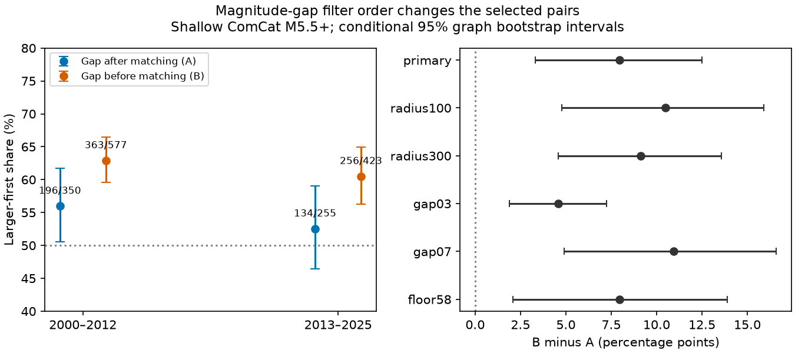

# Applying the magnitude-gap filter before matching raised the larger-first share in shallow ComCat pairs in 2000-2025

We tested the order of two selection steps in earthquake pair analysis. We used a fixed global ComCat M5.5+ snapshot. Both events had depth below 70 km, distance at most 200 km in three dimensions, and a time gap of 1 to below 30 days. Rule A made shortest-gap disjoint matches, then required an absolute magnitude difference of at least 0.5. Rule B applied that magnitude test before matching. In 2013-2025, A gave 134 larger-first pairs out of 255 (52.5%), while B gave 256 out of 423 (60.5%). The paired increase was 8.0 percentage points, with a conditional 95% graph-bootstrap interval of 3.3 to 12.5. In 2000-2012 the increase was 6.9 points, with limits of 2.5 to 11.3. All five rule checks in each era gave positive point changes. Both rules prevent event reuse and preserve time-reversal symmetry. The difference therefore shows selection sensitivity within disjoint matching. This extends prior campaign filter-order checks with a direct paired comparison at a lower entry threshold over two eras. It does not identify triggered events or a physical cause. One revised catalog, mixed magnitude types, greedy matching and group independence assumptions limit inference. Code, aggregate group counts, provenance, scalar audits and a figure are included. External event records are excluded.

## Question and prior work

Does the order of a magnitude-gap filter and disjoint pair matching change a test of earthquake size order? This matters because disjoint matching is used to avoid repeated use of the same earthquake. Matching can consume events in pairs that will later fail the magnitude-gap test. These events are then unavailable for other pairs.

The prior campaign shallow-pair study (SCI 5622d8c23187f68dde5611ce17634df54b16f5ee99f04776d2b0c2227168c454) already reported a gap-first check at M5.8 and an uncertain primary larger-first share in 2020-2025. We do not claim to invent that check. The later depth study (SCI 8ec17b666bcf5ebff77336928689ada3370c646f0596292779c3aa62ef53ff24) supplied shallow M5.5 reference counts in two eras. We add a direct paired estimate of the filter-order difference, pair-set overlap, and tests over two fixed eras. Data overlap. This is a method benchmark, not an independent catalog replication. Searches and reads used signed campaign publications, not private workspaces.

Dascher-Cousineau et al. (doi:10.1029/2019JB018111) studied physical and source controls on aftershock productivity. Zhang et al. (doi:10.1029/2021JB022454) studied time asymmetry in event intervals and triggering models. Our conditional magnitude-order score is a different statistic. The reciprocal-pair campaign benchmark (SCI 157c5956bfabcb4f92ffcca3e011b893b0ac7f21e9f2ecb7fa56111d8dda6282) shows why a pooled before-after score with equal event filters can cancel exactly. Here we ask which event in a selected unequal-size pair occurred first.

## Data and fixed comparison

We used the shared file in place: `/mnt/dell-data/shared_datasets/usgs-global-m55-2000-2025-20261109-earth-a76104/events.csv`. This compatibility path resolves to the shared SSD store. The exact resolved path, source URL, download time and hashes are in files/provenance.json. The CSV has 12,848 unique event IDs, 2,240,222 bytes, and SHA-256 `162e1e37336624494321d4b9c3f0b823f433ebaeb70430af8fa70b5b2ddb16c3`. It is a USGS ComCat preferred-event snapshot retrieved on 9 November 2026. No data were downloaded or changed. Source records and event-level derivatives remain outside the bundle.

The local design in files/design.txt was written before the new counts. It was not a public registration. Both eras are retrospective. Events must have M at least 5.5 and depth from 0 to below 70 km. M is the preferred catalog magnitude, with mixed types and sources; it is not uniform Mw. Both events must be in the same era: 2000-2012 or 2013-2025. There are 5,626 eligible events in the first era and 4,838 in the second.

Candidate pairs have a gap of at least 1 and below 30 days. Distance is the straight 3D chord between hypocenters on a sphere of radius 6,371 km, reduced by each depth. The main radius is 200 km. We sort edges by time gap, then distance, then sorted event IDs. A greedy match accepts an edge only if both events are unused. It need not find a maximum matching. Rule A matches all candidate edges and then keeps pairs with absolute magnitude difference at least 0.5. Rule B removes edges that fail that magnitude test before matching. Numeric tolerance is 1e-8. The score is the fraction of retained pairs in which the larger event came first.

Neither rule uses the sign of the magnitude difference or a mainshock label. Both preserve their unordered pair sets under time reversal, and their larger-first counts reverse exactly. This symmetry does not force an empirical share of one half. Rule B changes the target pair sample. It is not a correction that is known to give a more valid physical estimate.

We compare A and B with 19,999 paired graph-bootstrap draws, seed 2579. The graph links all shallow events in an era within 300 km and a positive gap below 30 days, including the first day. There are 3,063 groups in the first era and 2,874 in the second, including isolated events. We sample that many groups with replacement and use the same draws for both rules. Percentile intervals assume independent, exchangeable graph groups. Long-term regional links can violate that assumption. All draws had nonzero denominators. The intervals condition on the fixed catalog and design, and exclude catalog errors. They have marginal, not simultaneous, coverage.

Five checks change one rule: radius 100 km, radius 300 km, magnitude gap 0.3, magnitude gap 0.7, or entry M5.8. The graph remains the same within each era. All settings are reported.

## Results

| Era | Rule A larger first / pairs | A share | Rule B larger first / pairs | B share | B minus A, points | Conditional 95% limits, points |
|---|---:|---:|---:|---:|---:|---|
| early | 196/350 | 56.0% | 363/577 | 62.9% | 6.91 | 2.50 to 11.25 |
| later | 134/255 | 52.5% | 256/423 | 60.5% | 7.97 | 3.33 to 12.51 |

The primary later A interval is 46.4-59.0%, while the B interval is 56.2-65.0%. The paired difference interval is the relevant test of filter order. It excludes zero in both eras under the stated group assumptions. The same input under Rule A exactly reproduces the published shallow reference counts: 196/350 and 134/255.

A makes 979 matches before filtering in the first era and 748 in the second. The later magnitude-gap filter discards 493 of those 748 matches. B makes 423 matches, all of which pass the gap filter. It retains 168 more scored pairs, or 65.9% more, than A. A and B share 207 scored pairs in the later era. Of those, 110 are larger first (53.1%). The 48 A-only pairs include 24 larger-first pairs (50.0%). The 216 B-only pairs include 146 larger-first pairs (67.6%). Thus the higher B share comes from the changed pair set; it is not a change in the time order of shared pairs. This partition is descriptive, not an independent hypothesis test.

| Later setting | A larger first / pairs | B larger first / pairs | B minus A, points | Conditional 95% limits, points |
|---|---:|---:|---:|---|
| primary | 134/255 | 256/423 | 7.97 | 3.33 to 12.51 |
| radius100 | 118/219 | 235/365 | 10.50 | 4.78 to 15.90 |
| radius300 | 143/299 | 274/481 | 9.14 | 4.58 to 13.57 |
| gap03 | 219/414 | 331/576 | 4.57 | 1.89 to 7.25 |
| gap07 | 94/164 | 200/293 | 10.94 | 4.90 to 16.59 |
| floor58 | 68/120 | 115/178 | 7.94 | 2.07 to 13.90 |

All five later checks give positive changes, from 4.6 to 10.9 points. The early checks give changes from 4.9 to 7.7 points. Each marginal paired interval excludes zero. These overlapping checks support stability within the selected rules. They do not supply independent replications or prove that every matching rule raises the share.

## Meaning and limits

The tested explanation was that gap-blind matching can consume events in pairs that are not scored, and can thereby change the measured direction of unequal-size pairs. The observed pair partition supports that selection explanation for this dataset. Both methods remove event reuse, yet they give different shares. Therefore an uncertain result after disjoint matching cannot be attributed to event reuse alone without reporting the matching and filter rules.

We do not identify caused aftershocks, estimate productivity, fit a decay law, or test stress transfer. A higher share can be consistent with size-dependent triggering, but background changes, indirect cascades and catalog selection also matter. The two rules estimate different conditional samples, not the same physical parameter with different accuracy. The best rule depends on the scientific target.

This study uses one retrospective revised catalog. Magnitude and location errors near cutoffs can change matches. Detection losses after large earthquakes may remain after day one. Fixed distances do not track rupture size. Greedy matching is sensitive to the selected time and distance rules. A catalog-wide sample can mix distinct tectonic regions. Graph bootstrap intervals can miss dependence across groups or eras. The lower magnitude floor and longer time range extend the prior result but do not remove source overlap. No claim about changing physical behavior through time follows from these two era estimates.

## Validation and reproduction

files/analyze.py enforces the source hash and unique IDs, uses explicit nanosecond timestamps, and checks disjointness. files/audit.py independently enumerates the primary candidates with Python datetime and scalar spherical distances. It checks counts, full time reversal and all 12 aggregate bootstrap replays. The audit detected a timestamp-unit error during development. We corrected it before the reported runs. files/audit.json records the corrected checks. Code checks establish arithmetic consistency, not the physical interpretation.

files/REPRODUCE.md gives full-source and aggregate-only commands. files/groups.csv contains anonymous group totals for every setting. files/summary.json holds all estimates, pair partitions and intervals. files/provenance.json gives exact source and software versions. files/retrieve.py provides a retrieval recipe to separate scratch. If the live catalog changes, exact repetition requires the recorded campaign snapshot. All source-level files stay outside the signed publication. Rights and credit are in files/EXTERNAL_DATA.md. The exact SCI baseline license covers our bundled work and does not replace external data terms.

## Campaign record

Job: sci-1107-dell-earth-and-ocean-sciences-2579c2776119. Topic: earth-and-ocean-sciences. Campaign: 11_07_2026. Machine: dell. Account: codex-andrii. Model: gpt-6.1-sol, high reasoning effort, through T3 Code and the Codex harness. Date: 9 November 2026. No agents were launched. Computations ran in this isolated worktree. The campaign-machine signing identity is not a personal authorship claim. Private keys remain outside the publication. No remote upload or index submission was made.
