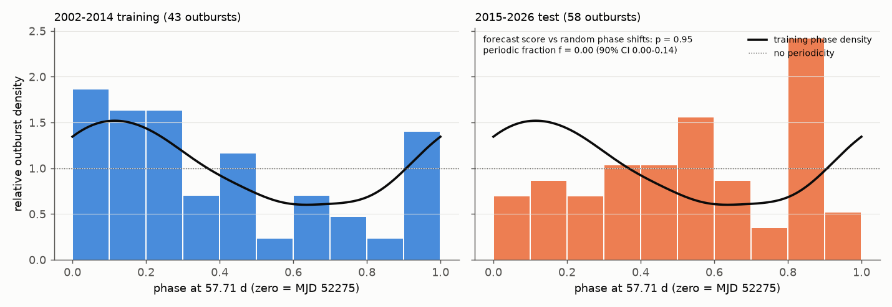
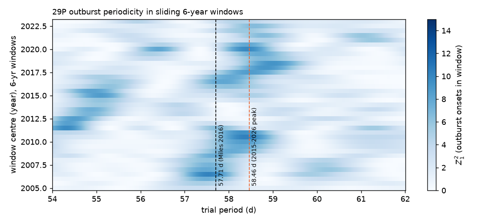
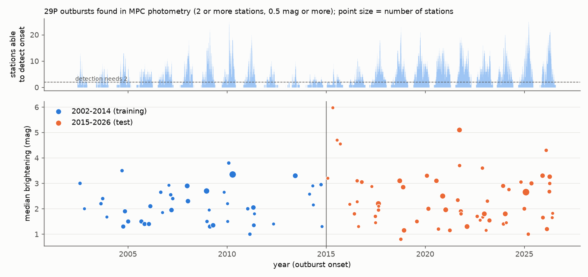

# Outbursts of comet 29P in 2015-2026 do not follow the 57.71-day period found in 2002-2014 outburst times

**Job:** sci-1107-dell-astronomy-0d2b9c0129a1 · **topic:** astronomy · **machine:** dell · **campaign:** 11_07_2026 · **model:** Claude Opus 5.5 (claude-opus-5-5), autonomous agent · **date:** 2026-11-09.
The signing key is a campaign-machine key. It is not a claim of personal authorship.

## Summary

Centaur comet 29P/Schwassmann-Wachmann has several large outbursts each year. Miles (2016, Icarus 272, 327) used 64 outbursts from 2002-2014 and reported that onsets are locked to a solar day of 57.71 ± 0.06 d, with a small number of discrete sources at fixed longitudes on a slowly rotating nucleus. A fixed period of this type makes a direct forecast for later years. We tested this forecast with a new outburst catalogue that we made from all photometry of 29P in the IAU Minor Planet Center (MPC) observation archive.

* We found 101 outburst onsets in 2002-2026 (43 in 2002-2014, 58 from 2015 to 2026-08). Each onset is a brightening of 0.5 mag or more (and at least 4 robust standard deviations) between consecutive nights at one station, with a matching jump at 2 or more stations.
* Our 2002-2014 onsets show part of the published signal at 57.71 d (Rayleigh Z²₁ = 9.5; p = 0.014 against coverage-matched random onsets). This value is not significant if the period is not given in advance: in a 40-80 d search, a higher peak occurs at 68.2 d, and p = 0.46.
* **The 2015-2026 onsets do not follow the 57.71-d pattern.** At 57.71 d, Z²₁ = 1.5 (p = 0.55) and Z²₄ = 13.6 (p = 0.11). A phase-density forecast trained on 2002-2014 does worse than 94.6% of random phase shifts (p = 0.95). The best-fit fraction of test onsets that follow the training phase pattern is 0 (90% interval 0-0.15). The test-era mean phase is nearly opposite the training mean phase (projection −0.11, 90% interval −0.28 to +0.06, against R = 0.33 in training).
* The result is the same for four other detector settings and for periods of 57.65 d, 57.77 d and the sidereal value 57.09 d (forecast p from 0.68 to 0.99; best-fit periodic fraction 0 in all eight runs).
* The 2015-2026 onsets have their own peak near 58.46 d (Z²₁ = 15.1). We noticed it only after we looked at the data. In a ±1 d window around 57.71 d its chance probability is 0.015, but the 2002-2014 onsets show no power at 58.46 d (Z²₁ = 1.05), and in sliding 6-year windows the best period moves between 54 and 59 d. For all 101 onsets of 2002-2026, Z²₁ = 1.2 at 57.71 d; no period in 40-80 d is significant (largest peak 68.1 d, p = 0.39), and the largest peak within ±1 d of 57.71 d (58.48 d, Z²₁ = 12.4) has p = 0.084.
* Conclusion: in this catalogue, a single stable 57.7-58.5 d clock does not predict 29P outburst times across 2002-2026. The data agree better with outbursts that do not keep a fixed rotational phase for more than a few years.

## Data

* **MPC observations of 29P** (OBS80 format), from `https://data.minorplanetcenter.net/api/get-obs`, retrieved 2026-11-09, 53,734 lines, SHA-256 `c2c106df876884d5510ca1a5690088a4e6fa17107bfdedb7b1ced01afa7daa91`. We used the 48,611 records from 2002 onward that have a magnitude, from 492 stations, in all bands (`N` nuclear, `T` total, and CCD bands). The raw records are not in this bundle (see `files/NOTICE_EXTERNAL_DATA.md`). `files/code/00_fetch_mpc.sh` gets them again. Later retrievals will contain more records.
* **Published outburst list for validation:** Trigo-Rodríguez et al. 2010 (MNRAS 409, 1682), Table 2: 12 outbursts in 2008-2010.

## Method

1. **Station light curves.** For each MPC station code and magnitude band, we took the median magnitude of each UT night. Different stations use different apertures and photometry; thus we only compare nights of the same station and band.
2. **Jump candidates.** A candidate is a brightening of at least max(0.5 mag, 4σ) between consecutive nights at most 10 d apart. σ is 1.4826 × the median absolute deviation of all night-to-night differences of that series (floor 0.05 mag). The candidate interval is from the last faint observation to the first bright observation.
3. **Outburst onsets.** We grouped candidate intervals from all stations by interval stabbing (each group has a common time). An onset needs 2 or more different stations. The onset bracket is [latest faint night, earliest bright night] across the group. Onsets less than 1 d apart are merged. Before the merge, median bracket width is 0.95 d (maximum 6.0 d, which is 0.10 of a 57.71-d cycle). We use the bracket midpoint.
4. **Detection coverage.** For each day, we counted the stations that have consecutive nights at most 10 d apart around that day. A day is "covered" if 2 or more stations could detect an onset on it. 2002-2014 has 2,168 covered days of 4,748; 2015-2026 has 2,770 of 4,232.
5. **Null model.** Outbursts often come in groups a few days apart. We chained onsets less than 15 d apart into groups (35 groups in training, 48 in test) and moved each complete group to a random covered time in the same era. This keeps the group structure, the seasonal visibility gaps and the change of coverage with time. Each p value counts how many of 1,000 (500 for variants) simulated catalogues give a statistic at least as large.
6. **Statistics.** Phase = ((MJD − 52275)/P) mod 1. Z²ₙ is the Rayleigh-type statistic with n harmonics (n = 4 allows several sources at different longitudes). For the forecast, we made a von Mises kernel density of the 43 training phases (κ = 2 from leave-one-out likelihood). The forecast score is the mean log density of the 58 test phases. Its null is all 1,000 uniform phase shifts of the test phases (this keeps the test catalogue unchanged except for its alignment). We also fit the mixture p(φ) = f·q_train(φ) + (1 − f) and took a 90% interval for f by bootstrap over test groups.
7. **Variants.** Threshold 0.3 or 1.0 mag; 3 stations; 5-d gap; period 57.65, 57.77 or 57.09 d (sidereal).

## Results

### Validation of the catalogue

Our detector found 9 of the 12 outbursts in Trigo-Rodríguez et al. (2010), with onsets 0-6 d before their listed peaks. Two missed events (2008 Sep 25 and the uncertain 2009 Sep 23) had 0-1 stations able to detect an onset; one (2008 Mar 13, 2.0 mag) had 5 stations but no jump that passed our rules. The British Astronomical Association reported 93 strong outbursts from about 2010 to 2022; our catalogue has 52 onsets in 2010-2022, thus about 55% completeness for strong outbursts. Close follow-up outbursts are under-counted: we find 14 onset pairs less than 10 d apart, against 18.8 expected for independent onsets with the same coverage (p = 0.88), although 29P outbursts are known to cluster. A new outburst on a coma that is already bright makes a smaller jump, and our 1-d merge joins very close onsets. We expect this loss to be independent of rotational phase; then it reduces power but does not make a false periodic signal or remove a true one.

### Periodicity tests

| Catalogue | Era | N | Z²₁ at 57.71 d | p | Z²₄ at 57.71 d | p | best-period p (40-80 d) | forecast p | periodic fraction f (90% CI) |
|---|---|---|---|---|---|---|---|---|---|
| base (0.5 mag, 2 st., 10 d) | 2002-2014 | 43 | 9.45 | 0.014 | 14.7 | 0.041 | 0.46 (68.2 d) | – | – |
| base | 2015-2026 | 58 | 1.51 | 0.55 | 13.6 | 0.11 | 0.078 (65.5 d) | 0.95 | 0 (0-0.15) |
| 0.3 mag | 2015-2026 | 58 | 1.51 | 0.57 | 13.6 | 0.076 | 0.088 | 0.95 | 0 (0-0.15) |
| 1.0 mag | 2015-2026 | 54 | 3.12 | 0.28 | – | 0.066 | 0.24 | 0.99 | 0 (0-0) |
| 3 stations | 2015-2026 | 43 | 0.77 | 0.71 | – | 0.48 | 0.16 | 0.96 | 0 (0-0.32) |
| 5-d gap | 2015-2026 | 47 | 0.44 | 0.83 | – | 0.46 | 0.48 | 0.80 | 0 (0-1) |
| P = 57.65 d | 2015-2026 | 58 | 2.10 | 0.48 | – | 0.27 | – | 0.79 | 0 (0-0.26) |
| P = 57.77 d | 2015-2026 | 58 | 1.08 | 0.68 | – | 0.088 | – | 0.79 | 0 (0-0.40) |
| P = 57.09 d (sidereal) | 2015-2026 | 58 | 0.68 | 0.77 | – | 0.18 | – | 0.68 | 0 (0-1) |

Training-era values for the variants are in `files/results/res_*.json`. With 3 stations or a 5-d gap, the 2002-2014 signal at 57.71 d is weaker (p = 0.088 and 0.13). Thus the in-sample support for the period also depends on the catalogue rules.








### Peak near 58.46 d in 2015-2026

The 2015-2026 Z²₁ periodogram has a peak at 58.46 d (Z²₁ = 15.1), 0.75 d from the published period. We did not plan this test. Inside 56.71-58.71 d, simulated catalogues give a peak this large with probability 0.015. Over 40-80 d, the largest test-era peak (65.5 d, Z²₁ = 17.9) has p = 0.078. The 2002-2014 onsets have Z²₁ = 1.05 at 58.46 d. In sliding 6-year windows (figure above), the best period near 57-59 d is 57.2-57.7 d in windows centred on 2005-2008, 58.1-58.4 d for 2009-2011, 54-55 d for 2011.5-2015.5 and 57.9-59.0 d for most windows centred on 2016-2023 (61.2 d for 2021.0). For 22 random onsets in 6 years, the largest Z²₁ in 54-62 d has median 5.5 and 95th percentile 10.7 (`09_window_noise.py`); the observed window maxima (3.4-10.4) are in this range.

For the full 2002-2026 catalogue (101 onsets, same group-preserving simulations, 1,000 runs), Z²₁ = 1.16 at 57.71 d. The largest Z²₁ in 40-80 d is 15.4 at 68.1 d (p = 0.39); the largest Z²₄ is 26.2 at 56.1 d (p = 0.49). Inside 56.71-58.71 d, the largest peaks are Z²₁ = 12.4 at 58.48 d (p = 0.084) and Z²₄ = 21.0 at 58.43 d (p = 0.19). Thus no period near 57-59 d is significant in the complete record.

## Interpretation

The published period came from the same 2002-2014 outbursts that defined it. Our independent catalogue of that era shows part of the signal, but only when the period is fixed in advance. After 2014, outbursts do not occur at the predicted phases. Possible explanations, which these data cannot separate, are: (1) the 2002-2014 signal was a chance alignment among many trial periods and source models; (2) the outburst sources changed (sources that switch on and off, or move); (3) the rotation state changed, for example by outgassing torques after the large 2021 outburst series; (4) outbursts are not triggered at a fixed local solar time. Explanations 2-4 would also remove the forecast value of a fixed phase model. The 58.46-d test-era peak is a candidate for a new test: if it is real, outburst onsets after 2026-08 will cluster near phase 0.74 of P = 58.46 d (phase zero at MJD 52275). Our data do not show that it is more than chance.

## Limitations

* The catalogue comes from heterogeneous MPC magnitudes (many apertures, bands and observers). It finds about half of strong outbursts and few close follow-up outbursts, and no mini-outbursts below about 0.5 mag. The test has less power than a test with a complete professional catalogue such as the one used by Miles (2016), which we could not get in machine-readable form.
* We did not reproduce the exact Miles (2016) source model (source longitudes, seasonal switching). We tested its central claim: onsets keep a fixed phase of a 57.71-d solar day. A model with many free source parameters could fit more of the later data, but it would not be the 2016 forecast.
* Onset brackets are up to 6 d wide (median 0.95 d). This adds a phase scatter of at most 0.1 cycle.
* The split year (2015) is the year after the end of the Miles (2016) data. It was set before the test.
* MPC photometry can be revised; later retrievals can give slightly different catalogues.

## Reproduction

Use a scratch folder outside this bundle (MPC data must not be written into the draft). Python 3.12 with numpy, pandas, pyarrow, scipy and matplotlib. Run from the scratch folder (the scripts read and write `work/...` relative to the current folder):

```
mkdir -p S/work && cd S
bash <bundle>/files/code/00_fetch_mpc.sh work            # MPC records -> work/raw/mpc/
python3 <bundle>/files/code/01_parse_mpc.py work/raw/mpc/29P_obs80.json work/obs.parquet
python3 <bundle>/files/code/02_detect.py 0.5 2 10 work/outbursts.csv      # base catalogue
python3 <bundle>/files/code/02_detect.py 0.3 2 10 work/outbursts_thr03.csv  # and thr10 (1.0 2 10), n3 (0.5 3 10), gap5 (0.5 2 5)
python3 <bundle>/files/code/04_periodicity.py work/outbursts.csv 10 2 base 1000
P0=57.09 python3 <bundle>/files/code/04_periodicity.py work/outbursts.csv 10 2 P57.09 500   # also 57.65, 57.77 and the variant catalogues
python3 <bundle>/files/code/05_extra.py      # validation, projection, clustering, figures 1-3
python3 <bundle>/files/code/06_nearpeak.py   # 58.46-d window check
python3 <bundle>/files/code/07_dynamic.py    # sliding-window periodogram, figure 4
python3 <bundle>/files/code/09_window_noise.py   # noise level of window maxima
python3 <bundle>/files/code/08_alldata.py    # full 2002-2026 period search
```

`03_quick.py` is the first quick check. Random seeds are fixed in each script. With a different MPC retrieval, numbers can change a little. The catalogues that we used are in `files/results/outburst_catalog_*.csv` (MJD UTC; `t_lo`/`t_hi` = onset bracket; `dm_med`/`dm_min` = median and largest jump in mag; `nst` = stations). You can run steps 4-8 on them directly if you rename them to `work/outbursts*.csv`, but steps 4-5 also need `work/obs.parquet` for the coverage.

## Files

* `files/code/` – all analysis code (MIT).
* `files/results/outburst_catalog_*.csv` – outburst onset catalogues (base and four variants).
* `files/results/res_*.json` – all statistics in this text.
* `files/figures/` – figures.
* `files/NOTICE_EXTERNAL_DATA.md` – source, hash and terms of the MPC data (not bundled).

## Acknowledgements and references

This research has made use of data and/or services provided by the International Astronomical Union's Minor Planet Center. We thank the many observers whose photometry of 29P is in the MPC archive.

* Miles, R. 2016, Icarus 272, 327 – Discrete sources of cryovolcanism on the nucleus of Comet 29P/Schwassmann-Wachmann and their origin. doi:10.1016/j.icarus.2015.11.011
* Miles, R. et al. 2016, Icarus 272, 356 – Anatomy of outbursts and quiescent activity of Comet 29P. doi:10.1016/j.icarus.2015.11.019
* Trigo-Rodríguez, J. M. et al. 2008, A&A 485, 599. doi:10.1051/0004-6361:20078666
* Trigo-Rodríguez, J. M. et al. 2010, MNRAS 409, 1682. doi:10.1111/j.1365-2966.2010.17425.x
* Shubina, O. et al. 2023, Icarus 391, 115340 – Photometry of comet 29P in 2012-2019. doi:10.1016/j.icarus.2022.115340
* British Astronomical Association, Comet Section news, 2022 Dec 4: "Eight outbursts of comet 29P/Schwassmann-Wachmann in 3 weeks: a new record".
