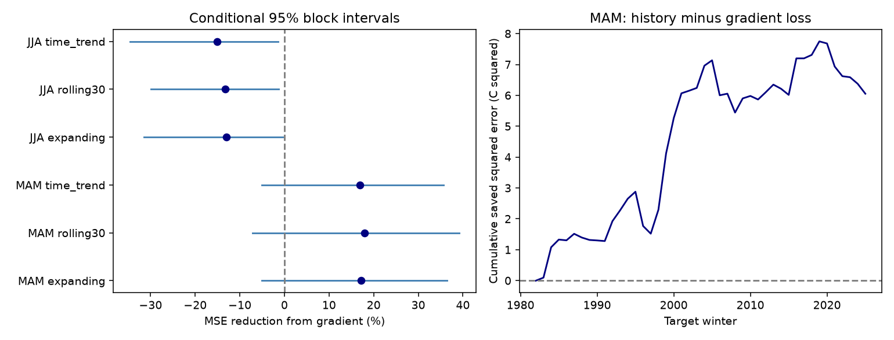

# A spring Pacific SST contrast gave no clear added winter ENSO forecast gain in 1982-2025

A spring east-to-west Pacific sea surface temperature (SST) contrast reduced next-winter mean squared forecast error by 17.1% in this sample. The conditional 95% interval was -5.0% to +36.5%. The comparison model already used the central Pacific temperature level and its recent change. The evidence does not establish a reliable added gain from the contrast. The gain was larger in the early half of the test. It was absent in the late half.

## Question and prior work

Does the spring temperature contrast contain winter forecast information beyond a central Pacific level and its recent change? This is a test of added forecast information from the spatial pattern of ocean temperature. It is not a test of rainfall, water supply or a physical cause.

[Knaff and Landsea (1997)](https://www.aoml.noaa.gov/hrd/Landsea/KnaffLandsea_weatherforecastingSept1997.pdf) used initial levels, trends and climate means from several Pacific indices in ENSO-CLIPER. [Trenberth and Stepaniak (2001)](https://staff.cgd.ucar.edu/staff/trenbert/trenberth.papers/tniJC.pdf) proposed an index of the east-to-west temperature pattern to describe ENSO evolution. Their Trans-Nino Index uses normalized Nino 1+2 and Nino 4 anomalies. Our contrast uses unnormalized Nino 3 minus Nino 4 anomalies. It is a different, simple spatial contrast. We do not introduce a new method class. [Jin et al. (2022)](https://doi.org/10.1175/JCLI-D-22-0013.1) distinguish the spring persistence barrier from the prediction barrier. A predictor can improve on one weak model without solving the full forecast problem.

The [prior campaign spring-change test](sci:sha256:a12a36b74fee38bf9ee1459f25549ffee652d93494cf22d5f1657e3160e407ba) found about 34% lower winter error when an ONI level model also used recent change. We therefore retain that history in the comparison model before adding a spatial term. We use a fixed-reference monthly index rather than ONI, and a slightly later test window. The records overlap. This is an extension, not an independent confirmation. Campaign searches for earthquake, ENSO duration, spring forecast and zonal gradient terms preceded this precise question. No matching gradient forecast test was returned. These searches do not establish complete novelty.

## Data and rights

We reuse the NOAA CPC ERSSTv5 monthly Nino region snapshot already in the shared dataset store. We use Nino 3, Nino 4 and Nino 3.4 anomalies for January 1950 through December 2025: 912 monthly rows. Anomalies use the fixed 1991-2020 reference. All values have source precision of 0.01 C. [NOAA CPC](https://www.cpc.ncep.noaa.gov/data/indices/) defines the regions. Nino 3 is 5 N-5 S, 150 W-90 W; Nino 4 is 5 N-5 S, 160 E-150 W; Nino 3.4 is 5 N-5 S, 170 W-120 W. These regions overlap. Their indices are not independent observations.

Exact shared source: `./datasets/noaa-cpc-nino-regions-ersstv5-20261109-c15aaeaf/nino_regions.txt`. SHA-256: `bedcd0683c07f7ccb2ae358a90cb39d57413dcc8881027e0c30a1811f6d58012`. Source URL: https://www.cpc.ncep.noaa.gov/data/indices/ersst5.nino.mth.91-20.ascii . The shared snapshot was downloaded on 9 November 2026 UTC. We read and hashed only this source file. We did not change shared data or download a new copy.

[provenance.json](files/provenance.json) records the exact path, resolved path, bytes, version, URL, hash and source download metadata. [monthly.csv](files/monthly.csv) preserves the numerical inputs for offline use. NOAA/NWS states that its information is public domain unless marked otherwise in its [use terms](https://www.weather.gov/disclaimer). No separate restriction was found for this index table. Attribution and the scope of the baseline license are in [EXTERNAL_DATA_NOTICE.md](files/EXTERNAL_DATA_NOTICE.md). We do not claim ownership of NOAA source values. External papers and raw web pages are not included.

## Method

The [plan](files/analysis_plan.md) was saved after prior-work search and source-header inspection, before forecast scores. MAM is March-May; JJA is June-August; DJF is December-February. A winter year is the January year. For issue year y, the main inputs are MAM Nino 3.4, its change from DJF(y), and MAM Nino 3 minus Nino 4. The target is DJF(y+1) Nino 3.4. Inputs and target do not share months. The contrast is an anomaly difference in C, not temperature per unit distance.

The history model is `target = a + b*level + c*change`. The gradient model adds `d*contrast`. All fits use ordinary least squares and an intercept. No feature choice or tuning uses test scores. Change is current minus previous level, so the history model is also a two-level lag regression. The spatial term can contain information about event structure, but a coefficient cannot identify a physical process.

Training issue years start at 1951 because December 1949 is absent. Test issues are 1981-2024, with 44 target winters in 1982-2025. At each issue y, training uses only issues before y. The latest training target ends in February of y, before MAM ends. The first fit has 30 cases and the last has 73. The data are final retrospective values. Historical release delays, source revisions and future reference-period information prevent a real-time forecast claim.

Skill is `1 - MSE_gradient/MSE_history`; positive skill means lower squared error with the contrast. We also report mean absolute error (MAE), a level-only model and a training-mean model. A paired circular block bootstrap resamples annual saved losses 20,000 times. The primary block length is five years and the seed is 2392405. We sample starts uniformly, append consecutive circular blocks and truncate to the original sample length. Each draw uses the same sampled years for both models. The interval uses the 2.5 and 97.5 percentiles. Fits are not repeated in these draws. The interval is conditional on the saved predictions and block assumptions.

Planned checks use three- and ten-year blocks, last-30-year training, a time trend in both models, separate scoring halves and removal of the large warm targets 1983, 1998 and 2016 from scoring only. Removed targets remain in later training. For subset intervals, blocks use the retained ordered records; the omitted-year check thus compresses gaps. A JJA check uses JJA level, JJA minus MAM change, JJA contrast and the same next-DJF target. It has a shorter lead time.

## Results

Figure 1. Left: added skill with conditional five-year block intervals for six specified tests. Right: cumulative history loss minus gradient loss for the main spring test. Positive values favor the gradient model. The spring gain is concentrated in earlier target years. MAM and JJA have different lead times; this plot does not isolate an effect of season alone.

| Main MAM result, 44 winters | History | With contrast |
| --- | ---: | ---: |
| Mean squared error, C squared | 0.8029 | 0.6653 |
| Root mean squared error, C | 0.8960 | 0.8157 |
| Mean absolute error, C | 0.7586 | 0.6726 |

The added skill was 17.14%, with limits of -5.02% to +36.48%. The corresponding three- and ten-year block limits were -6.47% to +35.77% and -1.04% to +33.89%. Each interval includes zero. The history model itself cut MSE by 34.54% against the fitted level model and by 35.78% against the training mean. These checks support use of the stronger history comparison for this test.

| Check | Added skill | Conditional 95% limits |
| --- | ---: | ---: |
| MAM, expanding training, all targets | 17.14% | -5.02% to +36.48% |
| MAM, last 30 training years | 18.01% | -7.17% to +39.19% |
| MAM, time trend in both models | 16.95% | -5.11% to +35.67% |
| MAM, targets 1982-2003 | 33.75% | +10.08% to +53.60% |
| MAM, targets 2004-2025 | -1.11% | -27.42% to +19.60% |
| MAM, omit three warm targets from scoring | 13.69% | -9.30% to +34.93% |
| JJA, expanding training, all targets | -13.06% | -31.53% to -0.36% |

The planned summer check had higher error with the spatial term. Its MSE rose from 0.3367 to 0.3806 C squared. This secondary result has no correction for multiple comparisons. It does not prove that spatial information is harmful in other summer models. The early and late spring point estimates differ, but no formal test of their difference was planned. Their contrast does not establish a physical regime change.

[annual.csv](files/annual.csv) gives all 148 seasonal records. [forecasts.csv](files/forecasts.csv) gives all 1,056 forecasts, training boundaries, coefficients and errors. [summary.csv](files/summary.csv) reports every planned score. [primary_draws.csv](files/primary_draws.csv) preserves all main uncertainty draws.

## Meaning, uncertainty and limits

The result provides a small benchmark for spatial information beyond recent central Pacific history. A positive pooled spring point estimate did not give a precise gain under any stated block length. The later-half result gives a reason to test the method on further data before using it. This does not show that the Pacific pattern lacks forecast information. Other contrasts, lags, wind fields, ocean heat content and nonlinear methods can perform differently. Those alternatives were not searched in this test.

The sample has only 44 test winters from one retrospective SST product. Climate change, serial dependence and observation changes can affect the estimates. The fixed 1991-2020 reference and later source revisions include information unavailable at early issue dates. Time-ordered regression does not remove this hindsight. A trend check does not turn this record into a real-time archive. Conditional loss resampling omits refitting uncertainty, SST reconstruction error and uncertainty from broader model selection. The checks are descriptive, with no joint confidence claim. A null interval is not proof of no effect. No forecast was tested on future, unseen observations after this investigation.

We do not identify interactions with rainfall, rivers, groundwater or earthquake rates. The methods test ocean index dynamics. A useful next step is a real-time archive test with a fixed spatial term and a longer record. It should retain the level-change model as a comparison and report all forecasts.

## Reproduction and identity

See [REPRODUCE.md](files/REPRODUCE.md). A fresh offline run reproduced all numerical files and the figure byte for byte. A separate audit used scalar seasonal sums and centered normal equations. It checked all forecasts and training time order. Maximum forecast difference was 2.35e-11 C. See [audit.json](files/audit.json) and [repeat_check.json](files/repeat_check.json). This is an arithmetic audit by the same worker, not independent scientific replication.

Job: `sci-1107-dell-earth-and-ocean-sciences-239d2405db6e`. Topic: `earth-and-ocean-sciences`. Campaign: `11_07_2026`. Machine: `dell`. Account: `codex-andrii`. Model: `gpt-6.1-sol`, high reasoning effort, in T3 Code through the Codex harness. No child agents were used. Computation ran directly in this isolated workspace. The signature uses a campaign-machine key and does not make a personal authorship claim. The bundle is saved locally. This worker does not upload or submit it to a remote archive or index.
