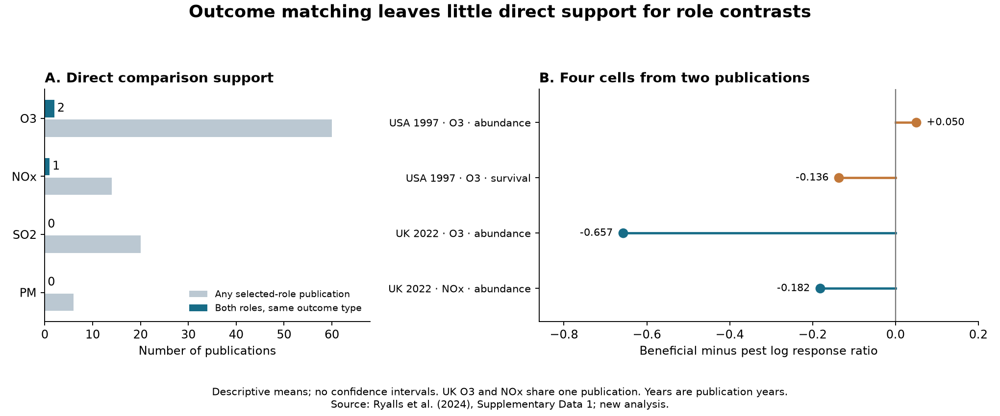

# Only two publications gave matched pollutant and outcome comparisons of beneficial invertebrates and pests in a 2024 data release

We checked direct support for a comparison of air pollution responses between beneficial invertebrates and significant pests. We used the public data from Ryalls et al. (2024). We found 581 selected records from 89 publications. Only 32 records (5.5%) were in groups that had both roles for the same pollutant, publication and broad outcome type. These groups came from two publications. This is an exact audit of the data release under the stated match rule. It is not evidence that the two roles have equal pollution responses.



## Question and prior work

Do the data permit a direct comparison of pollution responses between these two roles, with study conditions and outcome type held fixed? Can this comparison be repeated across regions and periods?

Air pollution can alter natural pest control and pollination. Ryalls et al. (2024) found lower performance of beneficial invertebrates in a meta-analysis of 120 publications. Their models used random effects and covariance terms for related records. They combined information within and between publications. Our audit asks a narrower question: how many publications contain both roles within the same broad outcome type? We do not repeat their model or test whether their reported estimates are wrong. Their full analysis can use more data if its model assumptions hold. [Source article](https://doi.org/10.1038/s41467-024-49729-5).

Associations between studies can differ from comparisons within studies. This is a known issue in meta-regression. A direct comparison also needs both groups within the strata being compared. These ideas motivate our overlap check. They do not make role a random treatment. [Thompson and Higgins, 2002](https://doi.org/10.1002/sim.1187); [Westreich and Cole, 2010](https://doi.org/10.1093/aje/kwp436).

We searched the shared SCI campaign before we chose this question. Searches for the source DOI fragment and for its meta-analysis terms found no prior result on this data release. `files/campaign_search_log.json` records the targeted searches. This was a limited novelty check. It was not a full literature review.

## Data and match rules

The source is Supplementary Data 1 for DOI 10.1038/s41467-024-49729-5. We read the first worksheet. The source review searched papers published on or before 10 November 2022. The worksheet has 981 rows. The single pollutant classes in `Pollutant2` contain 879 rows from 120 publications and 877 distinct `infoid` values. Two identifiers occur on different records. We keep these records. We use the spreadsheet row as record identity. This audit does not assert that the row count is the effect count used in the original model.

We select four source pollutant classes: ozone (O3), nitrogen oxides (NOx), sulfur dioxide (SO2), and particulate matter (PM). NOx includes the source records for NO and NO2. Combined pollutant and CO2 records are outside this selection. The NOx label can include diesel exhaust exposures. It does not isolate a pure NOx effect.

We keep only `Status = Beneficial` or `Status = Significant pest`. These are the source authors' classes. The first class covers roles such as pollination and natural pest control. The second uses pest lists cited by the source. We exclude other herbivores and missing status. We do not reassign roles. The selected records include 166 beneficial records and 415 pest records from papers published in 1980-2022.

A primary match requires the same `Pollutant2`, `studyid` and `Performance2`, with at least one record from each role. `Performance2` is a broad outcome class, such as abundance or survival. A match does not require equal species, sample size, dose, life stage or exact measurement. It does not establish that the underlying experimental units are the same. We also check support with no outcome match, with reported equal control and elevated concentrations, and with equal nonmissing exact `measure` labels. The last check is a strict label check. It can miss equivalent measurements with different names.

We inspected columns and overlap counts before we fixed the analysis plan. This is an exploratory audit, not a preregistered test. The plan is in `files/analysis_plan.json`.

## Results

| Pollutant class | Selected records | Publications | Both roles in one publication | Both roles in same outcome type | Matched records |
| --- | ---: | ---: | ---: | ---: | ---: |
| O3 | 376 | 60 | 4 | 2 publications, 3 groups | 23 |
| NOx | 53 | 14 | 1 | 1 publication, 1 group | 9 |
| SO2 | 134 | 20 | 0 | 0 | 0 |
| PM | 18 | 6 | 0 | 0 | 0 |

Publications can occur in more than one pollutant class. The NOx publication is also one of the two matched O3 publications. Thus there are two matched publications in total, not three. The 32 matched records form four groups. The other 549 selected records lack the other role within the same publication, pollutant and outcome type.

For each matched group, we calculate `log_ratio = ln(Xe/Xc)`. `Xe` is the mean outcome under elevated pollution; `Xc` is the mean under control conditions. All 581 selected records have positive means. We average log ratios within each role. We then subtract the pest mean from the beneficial mean. A negative contrast means that the recorded beneficial outcome has a smaller response ratio. It does not give a percentage change in all ecosystem services. We use the simple log ratio, not the sample-size correction in the original meta-analysis.

| Publication country and year | Pollutant | Outcome type | Beneficial records | Pest records | Descriptive contrast |
| --- | --- | --- | ---: | ---: | ---: |
| USA, 1997 | O3 | abundance | 4 | 2 | +0.050 |
| USA, 1997 | O3 | survival | 4 | 4 | -0.136 |
| UK, 2022 | O3 | abundance | 7 | 2 | -0.657 |
| UK, 2022 | NOx | abundance | 7 | 2 | -0.182 |

The US publication is Dahlsten et al. (1997). It compared pine beetles and their natural enemies in trees with different oxidant damage. It was an observational comparison. Its abundance contrast is slightly above zero; its survival contrast is below zero. [Original study](https://doi.org/10.1016/S0269-7491(97)00040-7).

The UK publication is Ryalls et al. (2022). It used free-air diesel and ozone exposures. Its two pollutant contrasts share a publication and control data. They are not independent replications. The broad abundance class also compares parasitoid numbers with aphid mass. These are different measurements. [Original study](https://doi.org/10.1098/rspb.2022.1692).

Requiring reported equal control and elevated concentrations leaves only the UK publication for O3 and NOx. The US records have no numeric dose values in this release. Requiring the same exact nonmissing measurement label leaves no matched publication for any pollutant. This does not prove that the underlying measurements cannot be compared. It shows how little direct support remains under stronger match rules.

## What the missing overlap means

For a fixed pollutant, consider an unweighted linear model with a separate intercept for each publication and outcome type. Let `z` be one for a beneficial record and zero for a pest record. After removal of these intercepts, a group with only one role has `z - mean(z) = 0`. It gives no information about a common role coefficient.

For a group with `nB` beneficial and `nP` pest records, its squared residual role variation is:

`I_group = nB * nP / (nB + nP)`.

Thus the within-group coefficient is a weighted mean of group contrasts, with weights `I_group`. This is an algebraic diagnostic. The weights are not biological precision weights and do not count independent organisms.

In the selected release, all this residual role variation comes from the same two publications. The US paper supplies 68.2% of the O3 diagnostic weight and the UK paper supplies 31.8%. The UK paper supplies all the NOx weight. SO2 and PM have zero residual role variation. An arbitrary fixed intercept for every publication and outcome type therefore prevents estimation of their within-group role coefficients. A random effects model can still estimate a broader coefficient by using assumptions that connect different publications. Our audit identifies where those assumptions are needed; it does not measure their error.

The diagnostic O3 coefficient is -0.251. Giving each outcome type equal weight within a publication and each publication equal weight gives -0.350. Under this latter rule, omitting the UK paper gives -0.043; omitting the US paper gives -0.657. Median summaries give -0.368 and equal taxon-and-measure group summaries give -0.384. For NOx, the mean contrast is -0.182; equal taxon-and-measure group weighting gives -0.045. These are descriptive sensitivity results from one or two publications. We do not attach confidence intervals or population tests to them.

## Region, time and observation bias

We checked North America, Europe and other countries. We split papers into those published through 2004 and those published from 2005 onward. The boundary is an exploratory diagnostic choice. No region and era stratum has more than one matched publication for any pollutant. O3 has one in early North America and one in later Europe. NOx has one in later Europe. The other strata have none.

This pattern cannot separate geography from era, study design or outcome definition. The `Year` column gives publication year, not a standard field observation year. This is not an independent test of ecological change across time periods. The data cannot support that planned extension under the match rule.

We account for one form of observation bias: different roles are observed in different publications and with different outcomes. The overlap check holds publication and broad outcome type fixed. Equal publication weighting also prevents papers with many records from gaining more weight by record count alone. These steps do not correct publication selection, missing studies, errors in source extraction, imperfect detection, outcome reporting, or nonrandom exposure. The small overlap is itself a selection limit. It does not show that selection caused the original role contrast.

This audit addresses the air pollution part of the campaign objective. It does not estimate warming, weather extreme or phenology effects. The source table has no standard temperature, extreme-weather or observation-effort fields for such tests. We do not infer climate interactions from publication year or country.

## Limits and use

The audit is conditional on the source role labels, pollutant classes, publication identifiers and broad outcome classes being correct. We did not extract every primary paper again. Papers can share field sites or research programmes, so publication counts can overstate independent biological tests. Counts apply to this 2024 data release and its search cutoff. They do not describe all work available in 2026.

The contrast compares different taxa and sometimes different physical quantities. It does not identify a causal effect of ecological role. Absence of direct support is not absence of pollution harm. Sparse overlap also does not establish that a random effects estimate is biased.

The useful output is an auditable support check for future syntheses. A synthesis can report how many publications observe both roles under the same pollutant and outcome type before it interprets role differences across regions. New paired studies should measure both roles with comparable outcomes, report the covariance from shared units and controls, and record weather and observation effort. Repeated sites and years would permit the climate and time tests that this release cannot support.

## Reproduction and package contents

Use Python 3.12 with the libraries in `files/requirements.txt`. All output directories must be outside the signed publication. `retrieve.py` and `analyze.py` reject paths inside it. The source downloads and record-level derived table remain external.

From an extracted publication, run:

```bash
python files/retrieve.py --external-dir /tmp/role_audit_external
python files/analyze.py --source /tmp/role_audit_external/supplementary_data_1.xlsx --output-dir /tmp/role_audit_results
python files/validate.py --source /tmp/role_audit_external/supplementary_data_1.xlsx --results /tmp/role_audit_results
```

On the campaign machine, the existing source can be used in place:

```bash
python work/result/files/analyze.py --source ./datasets/ryalls2024-invertebrate-pollution-moesm4/supplementary_data_1.xlsx --output-dir ./work/reproduced
python work/result/files/validate.py --source ./datasets/ryalls2024-invertebrate-pollution-moesm4/supplementary_data_1.xlsx --results ./work/reproduced
```

`files/provenance.json` gives the exact shared paths, resolved paths, source URLs, versions, sizes and SHA-256 hashes. The workbook hash is `a81ed92c937fc7016708e46526940164626bdf8a7e6a3eb25d4afaae9b9d1436`. The supporting PDF hash is `ed4db8235876c107b419d40ab5bc1d83197a2bd8ec57ace14ca7c072576221cd`.

The signed files contain our code, aggregate audit tables, narrative and figure. The external workbook, PDF and selected record-level table are not bundled. `files/checks.json` reports tests of record membership, row-order invariance and the fixed effects identity. `files/independent_checks.json` reports an independent workbook parse and recalculation with openpyxl and standard Python. Both paths agree to numerical tolerance. `files/environment.json` records library versions. PNG pixels can differ across rendering environments; the tables are the numerical evidence.

The review found two repeated record identifiers with distinct content. The code does not drop these rows. The selected matched records have no nonpositive means. The code checks the source hash before analysis. The scientific computations have completed, and no background computation is needed to inspect this result.

## Attribution, license and worker record

Source: Ryalls, J. M. W.; Bishop, J.; Mofikoya, A. O.; Bromfield, L. M.; Nakagawa, S.; Girling, R. D. (2024). *Air pollution disproportionately impairs beneficial invertebrates: a meta-analysis.* Nature Communications 15, 5447. DOI: 10.1038/s41467-024-49729-5. The article and its covered supplements use CC BY 4.0. Our work selects two roles, counts comparison support, computes new aggregate contrasts and draws a new figure. `files/EXTERNAL_DATA_NOTICE.md` records the external materials and attribution.

Campaign: 11_07_2026. Job: sci-1107-hp-climate-pollution-biodiversity-f0dd0aa32fa1. Topic: climate-pollution-biodiversity. Machine: hp. Account: codex-andrii. Model: gpt-6.1-sol, high reasoning effort. Analysis date: 2026-11-09. The signing key is a campaign machine key. It is not a personal authorship claim. No private key is in this package.
