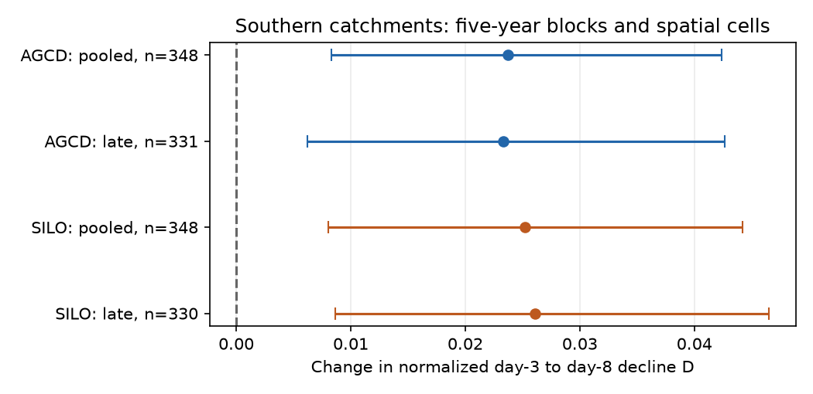
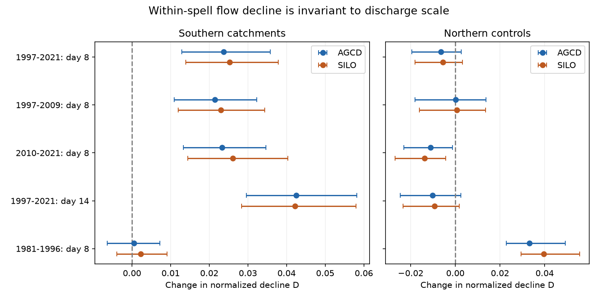

# Normalized flow decline within dry spells rose after 1997 in 348 southern Australian catchments

In 348 southern Australian catchments, normalized flow decline from dry day 3 to day 8 rose by 0.0237 after 1997. The joint 95% interval from five-year weather blocks and spatial cells was 0.0083 to 0.0424. The estimate for 2010-2021 was 0.0233 (0.0062 to 0.0427; 331 catchments). A second rain product and a geographic south-east subset gave the same direction. This new within-event signature survives an exact removal of constant discharge scale. It does not identify the cause of annual runoff loss.

## Question

Does flow decline faster within individual dry spells after 1997? A constant multiplier on discharge cannot change the normalized decline used here. This tests a different signature from a daily recession comparison at equal measured flow. It does not measure drainage at equal storage.

The selected work found a persistent annual runoff loss in south-east Australia. Source c8882d21 found an 8% pooled recession rise after dry-spell-age matching, but small and uncertain increases in long spells and in 2010-2021. Source 39140e92 tested annual flow correction in daily recession plots. We build on these results with an event endpoint test that removes flow amplitude by construction. This is a new analysis of the same flow records, not independent data confirmation. We do not repeat the annual runoff test or study the eastern US.

Event and pooled recession statistics can differ. Tashie et al. (2020), doi:10.1029/2019WR025448, tested this at continental scale. Jachens et al. (2020), doi:10.5194/hess-24-1159-2020, showed that recharge event timing and size can change fitted recession parameters. We do not claim that normalization or event analysis is new. The contribution is this regional test, its scale invariance, its zero-flow treatment and its time-block uncertainty check.

## Data

We use CAMELS-AUS v2.03 daily flow in mm/day, AGCD rain and SILO rain, with outlet location from its attribute table. The source is Fowler, Zhang and Hou (2024, v2.03), doi:10.5281/zenodo.14289037; data paper doi:10.5194/essd-17-4079-2025. The archives were read in place from the shared HP SSD dataset paths. No new downloads were needed. Exact paths, source URLs, archive hashes and used CSV member hashes are in files/provenance.json. The input directories are `/mnt/dell-data/shared_datasets/camels-aus-v2.03-zenodo14289037-` followed by `streamflow`, `hydrometeorology` and `mastertable`. Files are `03_streamflow.zip`, `05_hydrometeorology.zip` and `CAMELS_AUS_Attributes_Indices_MasterTable.csv`. We use only those files, not the full dataset store. Source credit and rights are in files/DATA_NOTICE.md.

Negative source values are missing. Catchments need at least 15 pre-1997 and 10 post-1997 calendar years with at least 95% valid daily flow. These counts select catchments; they do not exclude valid daily values in other years. The south has outlet latitude below -30 degrees. The north is a geographic control, not a matched causal control. Daily data from 1950 initialise the prior rainfall window. Tests use 1951-2021.

## Method

A dry event is a maximal run of days with basin rain below 1 mm/day. The day before its start must have finite rain of at least 1 mm. We compare Q3, flow on dry day 3, with Qh on day 8 or 14. The event must last at least h days. Both endpoints must be finite, Q3 must be positive, and Qh must be nonnegative. The endpoints must be in the same calendar year. Prior 30-day rain must be complete. Flat, rising and non-monotone paths are allowed. Each event contributes one endpoint pair per horizon, so long events do not receive extra weight.

Define D=(Q3-Qh)/(Q3+Qh). It is between -1 and 1. A positive value means net flow decline; D=1 means flow reached zero. For any positive c, D(c Q3,c Qh)=D(Q3,Qh). In an exponential path Qh=Q3 exp[-k(h-3)], D=tanh[k(h-3)/2]. Thus a faster exponential clock raises D, while a constant amplitude change does not. This identity does not assume that the observed streams follow exponential paths. D is not a percentage recession rate. A change in its mean cannot in general be converted to one physical rate multiplier.

The reference is 1951-1996. We test 1997-2021, 1997-2009 and 2010-2021 separately. The earlier placebo fits 1951-1980 and tests 1981-1996. Events are matched in 16 cells: four meteorological seasons of dry day 3, two within-era Q3 rank classes, and two prior 30-day rain classes. Q3 uses the within-era median rank so that the entire estimator, including support, stays invariant to a constant multiplier in either era. Rain uses the reference-event median as one common threshold. Ties use average ranks, with the upper class strictly above 0.5. Seasons are DJF, MAM, JJA and SON.

Each cell needs at least three events per era. Each catchment needs at least three supported cells and 20 supported events per era. Cell contrasts are weighted by supported test event counts. Catchments then have equal regional weight. No slope or recession law is fitted. Initial rank matches relative flow position, not equal absolute flow or equal storage. Omitting that rank match is a planned sensitivity check. We also report endpoint-zero frequency and mean log(Q3/Qh) within the subset with positive Qh; the latter has different censoring and is secondary.

The main endpoint was AGCD, southern catchments, day 8, 1997-2021. files/PLAN.md was written before the new calculations. Other endpoints are diagnostics, with no multiple-test correction. Paired long-minus-short and late-minus-pooled contrasts use common catchments but different event samples. The spatial analysis uses 4,999 whole 2-degree outlet-cell samples, seed 110711. These intervals hold observed years and event support fixed.

After the plan, before result inspection, we added time uncertainty for the pooled and late day-8 southern endpoints with both rain products. We resample circular five-year blocks separately within the reference and test eras, using the same sampled year fields across catchments. We also resample spatial outlet cells. There are 1,999 joint draws, seed 88921. We hold initial rank labels, rainfall thresholds and original supported cells fixed, then recompute cell means and test-count weights. A cell with no sampled events in either era receives zero weight. No minimum-count rule is reapplied in the draws. The time table records the fraction of empty cells. This is a sensitivity interval for this estimator, not a calibrated causal interval. It omits uncertainty in rank and support selection and source measurement error.

Before first result inspection, we added a geographic south-east subset: latitude below -30 and longitude at least 140. It uses the same estimator and 4,999 spatial samples, seed 43812. It is not the exact cohort of the prior annual studies. This is a diagnostic addition, not a new primary endpoint.

## Results

| Rain and test | Catchments | Mean change in D | Spatial 95% interval | Joint time-space 95% interval |
| --- | ---: | ---: | --- | --- |
| AGCD, pooled, day 8 | 348 | 0.0237 | 0.0129 to 0.0358 | 0.0083 to 0.0424 |
| SILO, pooled, day 8 | 348 | 0.0252 | 0.0140 to 0.0379 | 0.0080 to 0.0442 |
| AGCD, late, day 8 | 331 | 0.0233 | 0.0133 to 0.0346 | 0.0062 to 0.0427 |
| SILO, late, day 8 | 330 | 0.0261 | 0.0145 to 0.0403 | 0.0086 to 0.0465 |
| AGCD, drought, day 8 | 344 | 0.0214 | 0.0109 to 0.0323 | Not tested |
| AGCD, pooled, day 14 | 290 | 0.0425 | 0.0296 to 0.0582 | Not tested |
| AGCD, placebo, day 8 | 317 | 0.0005 | -0.0064 to 0.0072 | Not tested |

The southern primary sample has 84,810 supported reference events and 68,139 supported test events. Its median test-event coverage is 97.7%. The equal-catchment weighted mean D rises from 0.2079 to 0.2316. These are means of a bounded index, not runoff fractions. Joint sampling has about 1.8% empty cells for pooled tests and 2.3-2.4% for late tests. All values enter the reported estimator.



The geographic south-east subset gives AGCD day-8 changes of 0.0247 (spatial interval 0.0127 to 0.0385; 297 catchments) in 1997-2021 and 0.0218 (0.0108 to 0.0347; 285) in 2010-2021. SILO gives 0.0265 (0.0141 to 0.0410; 297) and 0.0254 (0.0120 to 0.0425; 284). No separate time-block interval was made for this subset.

The result is not confined to endpoints at zero. For positive endpoints, the AGCD mean log(Q3/Q8) change is 0.0391 (spatial interval 0.0187 to 0.0598; 344 catchments). Endpoint-zero frequency rises by 1.23 percentage points (0.53 to 2.03; 348 catchments). The positive-endpoint result has different censoring and is secondary. Removing starting-flow rank matching gives a pooled D change of 0.0239 (0.0141 to 0.0347; 351).

Northern controls have no clear pooled day-8 rise: AGCD -0.0064 (-0.0195 to 0.0026) and SILO -0.0056 (-0.0180 to 0.0031), with 154 catchments each. Their earlier placebo is positive, so the north is not a stable bias control. In paired southern catchments, late minus pooled D is 0.0013 (-0.0018 to 0.0065; 331) with AGCD. The late-period signal does not show the large attenuation seen in earlier point-cloud recession tests. This contrasts different diagnostics, not two estimates of the same physical parameter.



The figure shows spatial intervals. The time-block table gives the wider uncertainty check where applicable. The long-horizon comparison measures a longer interval and has a different set of qualifying events. It must not be read as a direct change in the same recession rate. Catchment estimates, counts, overlap and control results are in files/results/catchments.csv. All regional endpoints and samples are supplied.

## Meaning and limits

The observations show more normalized flow decline within selected dry spells after 1997. A constant positive multiplier on all discharge values within a catchment and era leaves both D and its rank-based matching unchanged. That restricted description alone cannot produce the observed contrast at fixed event selection. The positive joint time-space intervals strengthen evidence for a change beyond flow amplitude. The late-period result also shows that a small or uncertain late change in a pooled equal-flow recession statistic does not imply unchanged within-event decline.

This finding is consistent with a change in observed flow-path dynamics or event composition. It is not proof of faster slow-store drainage at matched storage. It does not show how much of the annual 40 mm loss this signature explains. The annual budget and the event endpoint diagnostic require a joint physical model and independent storage observations before attribution. Those tests remain open.

A within-event decline contrast removes a uniform discharge gain but does not isolate a physical store. Less recharge, changing mixtures of flow paths, season, evaporation, routing and a changed storage-to-flow relation can affect it. A gauge rating change that is nonlinear in flow can also affect it. This test does not verify the gauges. It does not estimate groundwater leakage, water-table change, effective input or actual evaporation.

The 1 mm threshold admits small rain. Delayed recharge can continue through a rain-free event. Endpoint comparisons omit internal path shape. Conditioning on a long dry event and positive Q3 excludes wet sequences and streams already at zero by day 3. Within-era flow ranks can absorb real changes in the initial state distribution. Seasonal and rainfall bins are coarse, and the same rain total can represent different storms. Reference and later eras have different lengths. A placebo has a different climate sequence and cannot supply a fixed bias correction. AGCD and SILO are related products, not independent replications. The north has different climate and geology. Nested catchments remain dependent. All tests concern one regional historical episode. They do not establish either an unchanged drainage law or a new cause of the runoff deficit.

## Reproduce

From the extracted publication root, with Python 3.12, NumPy, pandas and matplotlib:

```
sh files/reproduce.sh /absolute/path/to/external-scratch /absolute/path/to/external-output
```

Both destinations must be separate from the signed publication. The shared raw files need about 2 GiB, and the daily array about 167 MiB. To retrieve the immutable raw inputs elsewhere, first run `python files/retrieve.py /absolute/path/to/external-inputs`, then set DATASET_ROOT to that path for reproduce.sh. The retrieval script checks SHA-256 and writes source notices outside the publication. No private workspace is needed. Compare the regenerated archive and member hashes with files/provenance.json. The event CSVs are external scratch, not publication files.

For a short offline audit, copy files/results to a separate directory and run `python files/audit.py /that/directory`. It checks gain invariance, a known exponential decay, zero, flat and rising endpoints, invariance of the matched estimator, every regional mean and every spatial percentile. `python files/figures.py /that/directory` rebuilds the figure. The time uncertainty script rebuilds the extra time table from external event scratch. Environment versions, seeds and all bootstrap samples are preserved. The audit checks arithmetic and algebra, not real-data interval coverage.

## Provenance

Job: sci-1107-dell-earth-and-ocean-sciences-ae0d34cccf16. Topic: earth-and-ocean-sciences. Campaign: 11_07_2026. Machine: dell. Account: codex-myxtap. Model: gpt-6.1-sol, high reasoning effort, Codex in T3 Code. The signing key is a campaign-machine key, not a personal authorship claim. No agents or remote services were launched. Raw inputs remain in the documented shared dataset store. All code, aggregate evidence and instructions needed for this result are in this package or its cited external sources.
