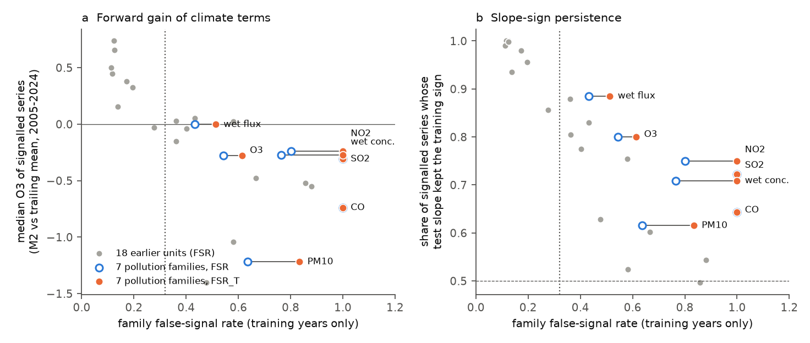
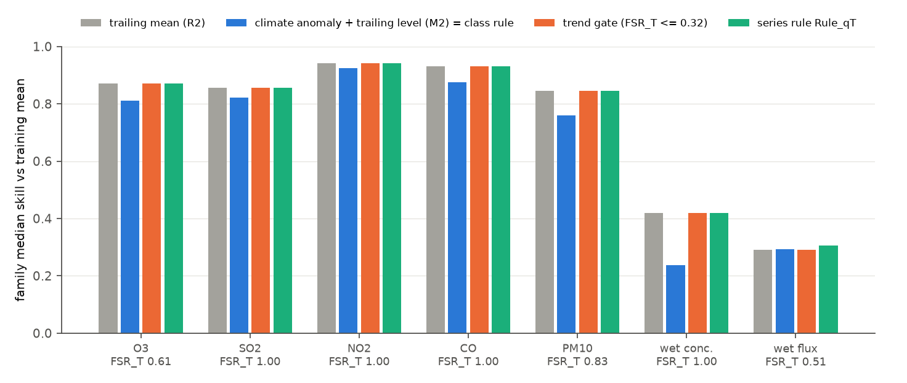
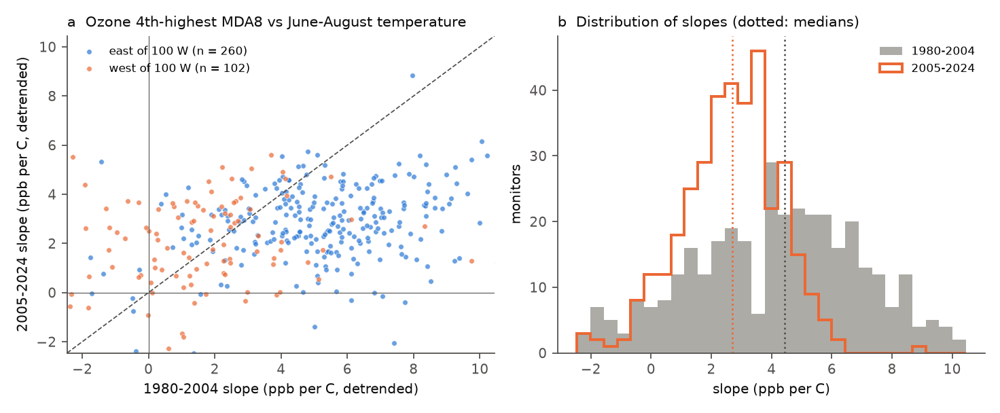

# A training-only false-signal gate beat the response-class rule in seven US air-pollution and wet-deposition families (2005-2024); ozone sensitivity to summer heat fell 39% after 2004

Job `sci-1107-dell-climate-pollution-biodiversity-5faa53c70eee`, campaign 11_07_2026, topic climate-pollution-biodiversity, machine dell, account claude-sci, model Claude Opus 5.5 (`claude-opus-5-5`). Date 2026-11-11. The signing key is a campaign-machine key. It is not a personal authorship claim.

## Summary

Forward tests in this campaign found that many climate-response relations lose skill in later years. A response-class rule says that abiotic and timing responses are forecastable and that population, production and disease responses are not (sci:sha256:17f2e323). Campaign publication sci:sha256:6081bf76 found that a class-free gate did better. The gate uses only training years: use the frozen climate slope with a 5-year trailing level (M2) for a family if its false-signal rate is at most 0.32, else use the 5-year trailing mean (R2). In that test, the gate and the class rule disagreed in only one of five families.

Air pollution and wet deposition are abiotic, so the class rule says "use climate" for all of them. But US emission controls moved their levels a lot after 1980. These families therefore test the gate where the class rule and the gate can disagree in many families. We froze the gate, two nulls and seven predictions in a timestamped plan. Then we applied them without change to seven new families: 3,060 series at 618 US sites (490 AQS, 128 NADP), training years 1980-2004 (NADP from 1978), test years 2005-2024.

| Family | Series (sites) | FSR | FSR_T | Median O2 (R2 vs R1) | Median O3 (M2 vs R2) | Test slope kept sign* |
|---|---|---|---|---|---|---|
| AOZ ozone, annual 4th-highest daily max 8-h (EPA AQS) | 362 (362) | 0.54 | 0.61 | 0.87 | -0.40 | 80% |
| ASO SO2, annual mean (AQS) | 134 (134) | 1.00 | 1.00 | 0.86 | -0.14 | 72% |
| ANO NO2, annual mean (AQS) | 106 (106) | 0.80 | 1.00 | 0.94 | -0.25 | 75% |
| ACO CO, annual mean (AQS) | 98 (98) | 1.00 | 1.00 | 0.93 | -0.69 | 64% |
| APM PM10, annual mean (AQS) | 56 (56) | 0.64 | 0.83 | 0.85 | -0.62 | 62% |
| NWC wet-deposition ion concentration, 9 ions (NADP NTN) | 1,152 (128) | 0.77 | 1.00 | 0.42 | -0.24 | 71% |
| NWD wet-deposition ion flux, 9 ions (NADP NTN) | 1,152 (128) | 0.43 | 0.51 | 0.29 | -0.10 | 89% |

*Series with training R2_cv >= 0.10. FSR: false-signal rate with the circular-shift null. FSR_T: with the trend-preserving null. Skill = 1 - MSE(model)/MSE(reference).

Main results:

1. **The gate beat the response-class rule (P1 passed).** The gate closed (FSR_T > 0.32) in all seven families. The class rule used climate in all seven. The pooled score (mean over families of the family median skill against the training mean) was 0.736 for the gate and 0.675 for the class rule: difference +0.061, 95% cluster-bootstrap interval [0.049, 0.076]. The class rule lost more than 0.05 against the trailing mean in 55-87% of the series of each family. The gate chose the better fixed strategy in 6 of 7 families. In wet-deposition flux the two strategies were tied: M2 0.293, R2 0.290 (P1b failed by 0.003).
2. **The trailing mean dominated because emission controls moved the levels (P5 passed, 7 of 7).** In the five AQS families, the median test-period level was 2.0-4.5 training standard deviations below the training mean. The trailing mean beat the training mean by 85-94%. The frozen climate terms captured at least half of this shift in only 2-4% of series.
3. **Primary pollutants had no transferable climate signal (P6a passed).** As predicted, FSR_T was 1.00 for SO2, NO2 and CO. The share of series with R2_cv >= 0.10 was at or below the share under the trend-preserving null.
4. **Ozone did not pass the gate (P6b failed).** We expected ozone to pass, because it is directly sensitive to temperature. Its FSR_T was 0.61. In ozone series, a larger training signal even came with slightly lower forward skill (Spearman rho -0.14 [-0.25, -0.04]).
5. **The ozone sensitivity to summer heat fell after 2004 (P7 passed).** We used a fixed predictor (June-August mean temperature) and removed a linear year trend inside each period. The median slope of the annual 4th-highest daily maximum 8-hour ozone was 4.4 ppb per C in 1980-2004 and 2.7 ppb per C in 2005-2024 (ratio 0.61; 69% of 362 monitors lower; one-sided Wilcoxon p = 8e-21). East of 100 W it fell from 5.4 to 2.9 ppb per C (ratio 0.55; 80% of 260 monitors lower). West of 100 W it did not fall (1.4 to 1.8 ppb per C). This agrees in direction and approximate size with the decrease of the ozone "climate penalty" after NOx controls reported for the eastern US (Bloomer et al. 2009, 3.2 to 2.2 ppb per C).
6. **The positive control failed (P4 failed).** We expected wet-deposition flux to pass the gate, because flux is concentration times precipitation. Its FSR_T was 0.51 and its median O3 was -0.10. A check made after this result (E6) showed that the climate input was correct (nClimGrid and NADP gauge precipitation: median r = 0.90 over 183 sites). Log SO4 flux followed log precipitation with median r = 0.52 after linear trends were removed, but only 0.20 without trend removal. Thus the emission trend hid a real precipitation signal from the frozen engine.
7. **FSR ordered the 25 units of three campaign tests, but not the new families alone (P2 failed for the primary outcome).** Over 25 units (18 earlier and 7 new), FSR ordered the median O3 of signalled series (rho -0.84, one-sided permutation p = 0.0001) and slope-sign persistence (rho -0.89). Inside the seven new families, FSR_T ordered slope persistence (rho -0.51) but not O3 (rho -0.24). All seven new families had O3 < 0, so their order carried little information.
8. **The trend-preserving null was not worse than the circular null (P3a and P3b passed).** Both nulls closed the gate in all seven families. The series rules Rule_qT and Rule_q differed by +0.0003 [-0.0012, 0.0019].



*Figure 1. Family false-signal rate from training years against (a) the median gain of the frozen climate slope with a trailing level over the trailing mean (O3, series with R2_cv >= 0.10) and (b) the share of these series whose test-period slope kept the training sign. Grey: 18 units of sci:sha256:7b03c5d9, 8804b69f and 6081bf76 (circular FSR). Open blue: the 7 new families with the circular-shift null. Orange: the same families with the trend-preserving null. Dotted line: the frozen gate threshold 0.32. Values below -1.5 are drawn at -1.5.*



*Figure 2. Family median skill against the training mean (R1) for the trailing mean (R2), the frozen climate anomaly with a trailing level (M2; this is also the response-class rule, because all seven families are abiotic), the trend gate and the series rule Rule_qT.*



*Figure 3. (a) Detrended slope of the annual 4th-highest daily maximum 8-hour ozone on June-August mean temperature, 2005-2024 against 1980-2004, for 362 AQS monitors. Dashed: no change. (b) Distributions of the slopes; dotted lines are medians.*

## Question

Can a forecaster tell from training years alone whether climate terms will add forecast skill in an untested family of climate-response relations, also where the response class says "yes"? Did a classic abiotic climate-response relation, the ozone-temperature slope, persist after 2004?

## Design (frozen before any fit)

We built the response tables and climate arrays and then wrote `files/plan/frozen_plan.md`. We wrote it before we computed any relation, diagnostic, null draw or skill for these families. `files/plan/script_hashes.txt` lists the SHA-256 of every analysis script at the freeze. We timestamped the concatenation `frozen_plan_with_hashes.md` (SHA-256 `b9a5f2787e4fb1274ccf4bcd194f3682e084a963284b875365eae3c55f7eeca5`) with FreeTSA (RFC 3161) at 2026-11-11 16:20:38 UTC (`frozen_plan.tsq`, `frozen_plan.tsr`). Verify with `openssl ts -verify -data files/plan/frozen_plan_with_hashes.md -in files/plan/frozen_plan.tsr -CAfile cacert.pem -untrusted tsa.crt`, with `cacert.pem` and `tsa.crt` from https://freetsa.org/files/. All listed scripts are unchanged in this bundle. Scripts written after the freeze are `e29_detrended.py`, `e30_ozone_fixed.py`, `e31_nadp_precip_check.py`, `s26_exploratory.py`, `s28_figures.py` and `run_exploratory.sh`. The plan was revised once before the timestamp, to add the series counts and the climate-extraction route. This revision was made before any fit.

**Engine (unchanged).** `p04_forecast.py` (SHA-256 `89486d26...0907387`) is unchanged from sci:sha256:7b03c5d9, 8804b69f and 6081bf76. For each series there are 120 candidate predictors: monthly mean temperature or precipitation over 1, 2, 3, 6 or 12 months, ending in one of the 12 months up to December. The model is y = a + b x. Training years end in 2004, and test years are 2005-2024. A series needs at least 15 training and 10 test years. Diagnostics: R2_in; R2_cv (leave-one-year-out with window reselection). Forecasts are one year ahead with observed weather: R1 training mean; R2 mean of the last 5 observed years; M1 frozen model; M2 frozen slope with the level from the same trailing years. O1 = M1 vs R1, O2 = R2 vs R1, O3 = M2 vs R2, O4 = M2 vs R1.

**Nulls and rules (unchanged from 6081bf76).** Circular-shift null (`n07_null.py`): the training climate rows are shifted circularly, and the window search and LOO-CV are repeated. Trend-preserving null (`n17_null_trend.py`): each predictor keeps its linear training trend, and only the residuals are shifted. max(2, ceil(4000/n)) draws per series (12-72 here). FSR = null share / observed share of R2_cv >= 0.10. Gate: M2 for the whole family if FSR_T <= 0.32, else R2. Class rule: M2 for abiotic families (here all). Rule_q / Rule_qT: M2 for a series if its q-value <= 0.2 and R2_cv >= 0.10. Only the seeds for the new families were added to the null scripts.

**Families.** Climate: nClimGrid monthly tavg and prcp at the nearest 1/24-degree cell (median distance 1.7 km). CONUS sites only.
- EPA AQS AirData `annual_conc_by_monitor_YYYY.zip`, 1980-2024. One series per AQS site; rows with Completeness Indicator "Y"; Event Type "Events Included" where present, else "No Events"; mean over POCs. AOZ: ozone standard "Ozone 8-hour 2015", y = log(4th max). ASO: SO2, 1-hour samples, "SO2 Annual 1971", y = log(annual mean). ANO: NO2 "NO2 Annual 1971". ACO: CO "CO 1-hour 1971". APM: PM10, 24-hour samples, "PM10 24-hour 2006".
- NADP NTN calendar-year precipitation-weighted mean concentrations (invalid and incomplete samples sequestered by NADP; annual values that fail the NADP completeness criteria are missing), 1978-2024. Ions Ca, Mg, K, Na, NH4, NO3, Cl, SO4 and H+. NWC: y = log(mg/L), and -pH for H+. NWD: y = log(kg/ha) = log(mg/L x precipitation in cm x 0.1).
- Bootstrap clusters are sites (AQS: one series per site; NADP: 9 ions per site).

## Results of the pre-registered tests

Full output: `files/results/prereg_tests.json`, `family_summary.csv`, `strategy_comparison.csv`, `p2_points.csv`, `level_capture.csv`, `p7_ozone_slopes.csv`, `false_signal_curves.csv`, `strategy_fixed_k10.csv`.

| Test | Frozen criterion | Result | Decision |
|---|---|---|---|
| P1 trend gate vs class rule | pooled difference, 95% interval > 0; determined if the gate closes in >= 1 family | +0.061 [0.049, 0.076]; gate closed in 7 of 7 families | **Passed** |
| P1b | gate chooses the better of M2 and R2 in every disagreeing family | 6 of 7; NWD M2 0.293 vs R2 0.290 | **Failed** (by 0.003) |
| P1c circular FSR gate vs class rule | as P1 | same decisions, +0.061 [0.049, 0.076] | Passed |
| P2 FSR orders forward skill | rho(FSR_T, O3sig) <= -0.5 in the 7 new families, and rho(FSR, O3sig) <= -0.5 with p < 0.05 over 25 units | -0.24 (new); -0.84, p = 0.0001 (25 units) | **Failed** (new-family part) |
| P2 secondary | slope-sign persistence; median O1 of all series | -0.51 / -0.89 (passed); +0.59 / -0.60 (failed) | mixed |
| P3a trend gate vs FSR gate | lower bound > -0.005 | 0.000 [0.000, 0.000] (same decisions) | Passed |
| P3b Rule_qT vs Rule_q | lower bound > -0.005 | +0.0003 [-0.0012, 0.0019] | Passed |
| P4 positive control | NWD FSR_T <= 0.32 and median O3 > 0 | FSR_T 0.51; O3 -0.10 | **Failed** |
| P5 level shifts | median O2 > 0 in >= 5 of 7 | 7 of 7 (0.29-0.94) | Passed |
| P6a primary pollutants | FSR_T > 0.32 for SO2, NO2, CO | 1.00, 1.00, 1.00 | Passed |
| P6b ozone | FSR_T <= 0.32 | 0.61 | **Failed** |
| P7 ozone heat slope | median b_test < median b_train and Wilcoxon p < 0.05 | 4.4 to 2.7 ppb per C; p = 8e-21 | Passed |

Pooled scores against the training mean: Rule_qT 0.739, Rule_q 0.738, gate (FSR or FSR_T) 0.736, trailing mean 0.736, Rule_R2cv 0.725, class rule = M2 for all 0.675, frozen model M1 0.006. The series rule Rule_qT was 0.002 above the family gate (95% interval 0.0002 to 0.006). This is because it used the climate anomaly for a few wet-flux series.

Descriptive: the within-family Spearman correlation of training R2_cv with forward O1 was negative for ozone (-0.14 [-0.25, -0.04]), not clear for SO2, NO2, CO and PM10 (0.13 to 0.18, intervals include 0), and small and positive for NWC (0.07) and NWD (0.16).

## Exploratory results (defined after the pre-registered results)

Code: `e29_detrended.py`, `p06_trend_diag.py` (unchanged from 7b03c5d9), `e30_ozone_fixed.py`, `e31_nadp_precip_check.py`, `s26_exploratory.py`. Output: `e1_e2_trendnet_family.csv`, `e5_subgroups.csv`, `exploratory.json`, `e6_nadp_precip_check.json`.

- **E1, trend versus climate in training years.** A linear year trend alone explained a median 56-74% of the training variance of SO2, NO2, CO and PM10 out of sample (R2_cv_tr). The climate signal beyond this trend (R2_cv_dt) was near chance: its false-signal rate under a trend-net circular null was 0.50-1.00. For ozone and the NADP families the trend share was small (R2_cv_tr 0.02-0.11). Their climate signals were nevertheless also weak beyond the trend (FSR_dt 0.49 ozone, 0.68 NWC, 0.34 NWD).
- **E2, trend-net slopes did not rescue the climate terms.** We selected the window and slope on linearly detrended training data and forecast with the same trailing level (M2dt). This made the losses smaller in every family, but M2dt still lost against the trailing mean (median O3dt -0.29 ozone, -0.04 to -0.22 other families). A local 10-year linear trend (R3) beat the 5-year trailing mean for SO2 (median 0.20), NO2 (0.52), CO (0.17) and PM10 (0.06), but not for ozone (-0.05) or the NADP families (-0.16). Climate terms added on top of the local trend lost in all families (median O6 -0.02 to -0.27).
- **E3, the ozone signal itself became smaller.** With the fixed June-August window, the frozen training slope lost 9% against the trailing mean (east: 20%). Half the training slope gained 0.7%, and the test-period slope itself (an oracle, not a forecast) gained only 2.1%. The detrended standard deviation of the ozone statistic fell from 8.3 to 5.3 ppb, while that of summer temperature stayed the same (0.74 C). In the east the partial R2 of temperature fell from 0.26 to 0.18 (65% of monitors lower). Thus both the slope and the explained share of ozone variability fell after the NOx reductions.
- **E5, subgroups.** In ozone, eastern monitors had FSR_T 0.50 and western monitors 1.00. Among wet-flux ions, NH4 and NO3 had FSR_T 0.31-0.32 and median O3 of -0.11 and +0.02. H+ had median O3 +0.03 (FSR_T 0.56). All concentration ions had FSR_T >= 0.61 and median O3 < 0.
- **E6, input check.** See main result 6.

## Interpretation

1. Response class is a poor guide in systems with large non-climatic drivers. The seven pollution families are all abiotic and physically sensitive to weather, but emission controls moved their levels by 2 to 4.5 training standard deviations after 2004. A frozen climate model then forecasts the old level, and a climate anomaly on a trailing level adds noise. The training-only gate saw this in all seven families and chose the trailing mean. Over three campaign tests and 25 family units, the gate and the false-signal rate are now a better guide than the class label.
2. The gate makes a decision; it does not predict the size of the gain (as in 6081bf76). Inside these seven families, all of which lost with climate terms, FSR_T did not order the size of the losses.
3. The trend-preserving null was designed for shared trends. Here it made no decision different from the circular null, because both nulls already closed the gate. It did raise the rates (for example NWC 0.77 to 1.00, NO2 0.80 to 1.00).
4. The ozone result is a substantive forward test of a published claim. The summer-temperature sensitivity of high ozone in the eastern US was about halved in 2005-2024 relative to 1980-2004, and its explained share of year-to-year ozone variation fell. Relations fitted before NOx controls over-predict the ozone response to hot summers after them. Projections that use pre-2005 sensitivities would over-state the present "climate penalty" in the east. In the west, the slope did not decrease.
5. The failed positive control is informative. Wet-deposition flux depends directly on precipitation, but a strong emission trend in concentration hid this signal from a window search on raw training years. A window selected on detrended years recovered a real precipitation correlation (E6) but still did not beat the trailing mean in forecasts (E2). Operationally, wet-deposition and pollutant forecasts at annual scale should start from a trailing level or a local trend, not from a frozen climate regression.

## Limitations

- **Only one class.** All seven families are abiotic, so this test can show only one kind of class-rule error. The class rule and the gate disagreed in all seven families, but these families share one cause (emission controls) and one country. They are not seven independent tests of the gate.
- **The positive control failed.** We cannot show in these data that the gate opens when climate terms do help. The earlier tests (sci:sha256:8804b69f, 6081bf76) showed this for rivers, lake ice, cherry bloom and spring phenology.
- **Annual statistics and single linear windows.** We used annual means and the annual 4th-highest 8-hour ozone. Daily or seasonal ozone models with several weather variables (for example sci:sha256:0dd123d4 and sci:sha256:0e9a5b32) can keep more skill. The engine uses observed (not forecast) weather and one window per series.
- **AQS coverage.** Only sites with complete years in at least 15 of 1980-2004 and 10 of 2005-2024 qualified: 362 of 2,720 ozone sites, 56 of 2,584 PM10 sites. PM10 is a small family. Site-level means over POCs mix instruments.
- **NADP.** 128 of 347 CONUS sites qualified; NADP annual completeness rules removed some years. NADP may revise values; the API export of 2026-11-11 was used (SHA-256 in provenance).
- **P7 detrending.** A linear year trend inside each period cannot remove all emission effects. The western increase is based on 102 monitors with small training slopes.
- **Null calibration.** 12-72 draws per series; bootstrap intervals do not include null-calibration noise.
- All exploratory results (E1-E6) were defined after the pre-registered results were known.

## Reproduce

External inputs are not in this bundle (`files/EXTERNAL_DATA_NOTICE.md`). Exact files, sizes, SHA-256 and URLs: `files/provenance/shared_input_files.csv`. The nClimGrid files are in the campaign store (`datasets/noaa-nclimgrid-monthly-{tavg,prcp}-20261006`); elsewhere download them from the URLs in that table.

```
sh files/code/fetch_aqs.sh /path/to/raw/aqs        # 45 files, about 190 MB; the server is slow (8 parallel connections)
sh files/code/fetch_nadp.sh /path/to/raw/nadp      # NADP API export, prints SHA-256
RAW=/path/to/raw DATASETS=/path/to/datasets SCRATCH=/path/to/scratch BUNDLE=/path/to/out \
PRIOR6081=/path/to/6081bf76/files/results sh files/code/run_all.sh
RAW=/path/to/raw SCRATCH=/path/to/scratch BUNDLE=/path/to/out sh files/code/run_exploratory.sh
```

PRIOR6081 is a folder that holds `h2_points.csv` of sci:sha256:6081bf76 (`sci read <zip> --file files/results/h2_points.csv --output h2_points.csv`). Python 3.12 with numpy, pandas, scipy, netCDF4 and matplotlib. On the Dell host the climate extraction took about 50 minutes (reading the nClimGrid files over NFS). The engine, both nulls and the tests took about 10 minutes, and the exploratory scripts about 5 minutes. Record-level intermediates go to SCRATCH and are not bundled.

## Files

- `files/plan/` frozen plan, script hashes, the timestamped concatenation, FreeTSA query and reply.
- `files/code/` all code: `b21_families.py` (family builder), `c21_climate.py` (c11 of 6081bf76 with the new families), `c22_split.py`, `b03_pack.py`, `p04_forecast.py`, `p06_trend_diag.py` (unchanged), `n07_null.py`, `n17_null_trend.py` (seeds added), `p27_ozone_penalty.py`, `s25_tests.py` (pre-registered tests), the exploratory scripts `e29`, `e30`, `e31`, `s26`, the figure script `s28_figures.py`, `run_all.sh`, `run_exploratory.sh`, `fetch_aqs.sh`, `fetch_nadp.sh`.
- `files/results/` aggregate results; `series_diagnostics.csv` (per-series model statistics and skills) and `p7_ozone_slopes.csv` (per-monitor slopes and period means).
- `files/provenance/shared_input_files.csv` input hashes and URLs.
- `files/EXTERNAL_DATA_NOTICE.md` sources, terms and required attributions.
