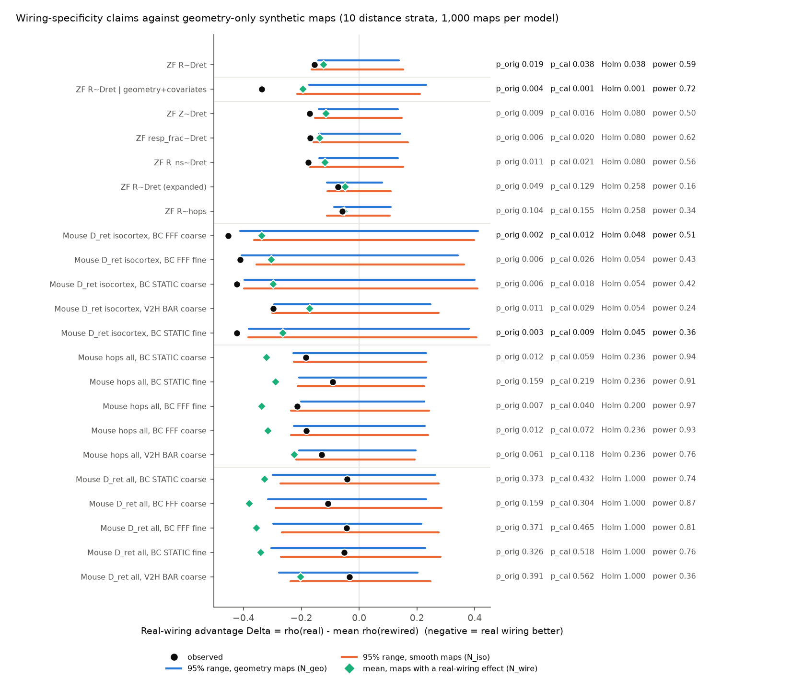
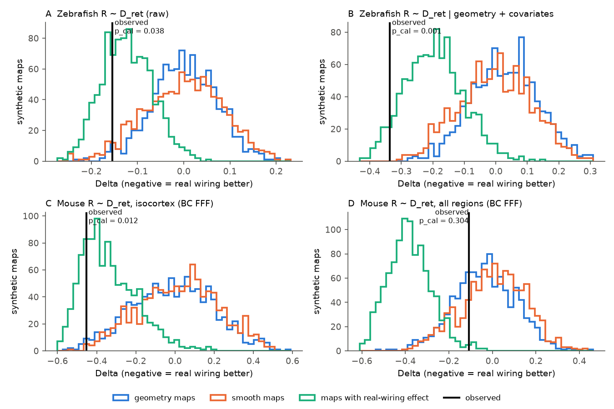
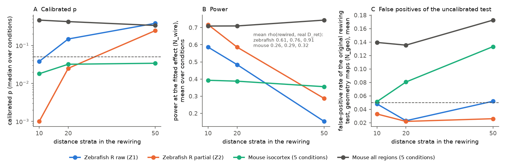

# Geometry-only synthetic maps confirmed the zebrafish retina-path wiring advantage at 10 distance strata, not at 20, and showed mouse brain-wide visual reliability does not follow specific retina paths

Job `sci-1107-dell-neural-structure-and-computation-7e56a9387e98` · campaign 11_07_2026 · topic
neural-structure-and-computation · machine dell · model Claude Opus 5.5 (`claude-opus-5-5`, Claude Code) ·
2026-11-10. The signing key is a campaign-machine key. It is not a personal authorship claim.

## Summary

**Question.** Two campaign publications tested whether the *specific* wiring of a connectome predicts a regional
visual-response gradient better than rewired graphs that keep the distance rule of the wiring. Each rewired graph
permutes the input weights of each target among sources in the same decile of centroid distance.

* Larval zebrafish (sci:sha256:6e6b5461...): regions with a longer projectome path from the retina (D_ret) had
  less reliable dark-flash responses, and real wiring beat rewired graphs (raw p = 0.019; partial p = 0.004 after
  control of Euclidean distance and quality covariates).
* Mouse (sci:sha256:19f7eb8e...): the same gradient existed, but the planned brain-wide test against rewired
  graphs failed. Exploratory tests passed inside isocortex (p = 0.002 to 0.013) and for the hop count
  (p = 0.005 to 0.13).

A later campaign study (sci:sha256:f4e4c521...) found that this kind of distance-decile rewiring gives
false-positive rates of 50% to 67% for neighbour-mean regressions on spatially smooth maps. Thus the
species difference ("wiring is specific in zebrafish but not in mouse") could be a property of the null model.
We tested this directly.

**Method.** We froze a plan (`files/code/PLAN.md`, SHA-256 in `PLAN.sha256.txt`) before we computed any new
statistic. For each published claim, we fitted spatial Gaussian-process models to the observed region map:

* N_geo: a linear trend in Euclidean distance from the retinal entry regions plus exponential-kernel spatial noise;
* N_iso: spatial noise only;
* N_wire (positive control): N_geo plus an effect of the real predictor, with the coefficient fitted to the data.

From each model we drew 1,000 synthetic maps. Each map got the original rewiring test with 1,000 newly generated
rewired graphs. The geometry-only maps give the false-positive rate (FPR) of the original test and a calibrated p
value for the observed real-wiring advantage Delta = rho(real) - mean rho(rewired). The N_wire maps give the power.

**Main results.**

1. **The uncalibrated path-distance tests were only mildly liberal.** For geometry-only maps, the original test
   gave p <= 0.05 in 2% to 10% of maps in zebrafish and in 4% to 16% in mouse at the published 10 strata (Figure 3C). This is much less than
   the 50% to 67% for neighbour-mean tests. Path distances from a fixed entry set do not carry the spatial
   smoothness of a map in the same way.
2. **Zebrafish: the planned claims survived calibration.** Raw D_ret: rho -0.665 against a rewired mean of -0.510,
   calibrated p = 0.038 (Holm 0.038). Partial D_ret: rho -0.364 against -0.027, calibrated p = 0.001 (Holm 0.001).
   Five other spatial models (Gaussian kernel, half or double length scale, spline trend) gave p = 0.001 to 0.024.
   The observed advantage agreed with maps that contain a real-wiring effect (Figure 2A, B).
3. **But the zebrafish advantage weakened with finer distance strata.** With 20 strata per target (about 3.4
   sources per stratum), the raw advantage was not significant (calibrated p = 0.148), and the partial advantage
   stayed (p = 0.025). With 50 strata the rewired graphs were almost the real graph (mean rho with real D_ret 0.91;
   power 0.15 to 0.29), so that test is not informative. Thus a part of the zebrafish "specific wiring" signal is
   fine-scale distance structure that 10-decile rewiring does not keep.
4. **Mouse brain-wide: the failure of the wiring test is informative.** Calibration did not change the failed
   brain-wide D_ret test (calibrated p = 0.30 to 0.56). Maps with a real-path effect of the fitted size gave a
   detection rate of 74% to 87% in 4 of 5 conditions. The observed advantage was smaller than such maps predict
   (p = 0.004 to 0.016 in 4 of 5 conditions; 0.075 in the fifth). The brain-wide mouse reliability gradient thus
   does not follow the specific shortest retinal paths of the Knox connectome.
5. **Mouse isocortex: the exploratory advantage survived calibration at the margin.** In 14 to 17 isocortical
   areas, rho was -0.82 to -0.87 against rewired means of -0.40 to -0.52. Calibrated p = 0.009 to 0.029; Holm
   over 5 conditions 0.045 to 0.054 (2 of 5 below 0.05). It stayed with 20 and 50 strata (p = 0.014 to 0.089).
   Power was only 0.24 to 0.51.
6. **Mouse hop count: the exploratory advantage did not survive.** Calibrated p = 0.040 to 0.219; Holm 0.20 to
   0.24.

**Conclusion.** The difference between the species is not an artefact of a liberal rewiring null. In zebrafish,
the projectome path from the retina predicts dark-flash reliability better than rewired graphs at the published
stratum width, also against maps with only geometric structure. In mouse, the brain-wide gradient does not follow
the specific retinal paths, and the data are inconsistent with a real-path effect of the size that the
correlation suggests. Two cautions apply: the zebrafish advantage depends on the width of the distance strata, and
the mouse isocortex result is at the edge of significance.



## 1. Background

Structure-function studies often correlate a connectome measure with a regional physiology map. Near regions are
both strongly connected and similar for many reasons. Thus a correlation alone does not show that the specific
connections matter. Rewired graphs that keep the distance rule are a common control. But a rewired graph also
loses fine spatial structure of the real graph. If the physiology map is smooth in space, the real graph can beat
the rewired graphs only because it is closer to space. The test is then liberal. f4e4c521 showed this for
neighbour-mean regressions on IBL data and introduced a calibration with Gaussian-process surrogate maps. We apply
the same idea to the path-distance claims of 6e6b5461 (zebrafish) and 19f7eb8e (mouse). The mouse-zebrafish
difference was an open point of the campaign (see also 48d934f4, which found that the thalamic burst link to
cortical input was not wiring-specific).

## 2. Data

No new raw data. All inputs come from two signed campaign publications and from the original zebrafish data.

| Input | Source | Use |
| --- | --- | --- |
| Region-by-fish dark-flash values (R, Z, responsive fraction, R without swims, motor coupling, F0, neuron count); 22 fish | 6e6b5461 `files/results/region_fish_values.csv` (from Legare et al. 2025, CC BY 4.0) | zebrafish region maps (median over fish; >= 11 fish; >= 10 neurons) |
| mapZebrain SC matrices (sparse, expanded), centroids, acronyms | Borealis doi:10.5683/SP3/IIVGOB; shared datasets `legare2025-zebrafish-iivgob-v1-*` | D_ret, hops, rewiring, centroid distances |
| Mouse region reliability (Barcoding FFF/STATIC coarse and fine bands; Vision2Hippocampus bar) | 19f7eb8e `files/results/region_values.csv` | mouse region maps (41 to 44 regions) |
| Knox input-share matrix A, retinal entry shares, centroids, D_ret, hops | 19f7eb8e `files/results/input_share_A.npy`, `region_structure.csv` (Allen-derived) | mouse predictors and rewiring |

SHA-256 values of all inputs are in `files/provenance/input_sha256.txt`. The Legare files agree with the hashes in
the shared dataset store. `files/code/00_get_inputs.sh` retrieves all inputs into local scratch.

## 3. Methods

**Predictors (`01_rewired.py`).** We used the published constructions without change. Zebrafish: D_ret is the
weighted shortest path from the retina through nine retinal arborization-field regions; the step cost is
-log(input share). Mouse: D_ret uses the Knox input shares and the pan-RGC tracer entry shares of 10 established
retinal targets; hops uses edges with input share >= 2%. Our recomputed real predictors equal the published ones
exactly. We generated 1,000 new rewired graphs per construction (new seeds) with 10, 20 and 50 distance strata.
For 10 strata, the mean Spearman correlation of rewired with real D_ret was 0.612 (published null: 0.610).

**Statistics (`02_calibrate.py`).** s(x, y) is the Spearman correlation; for the zebrafish partial test it is the
partial Spearman correlation after rank-OLS removal of Euclidean distance from entry, motor coupling, log F0 and log
neuron count (as in 6e6b5461). The original test p is the fraction of rewired graphs with s <= s(real).
Delta = s(real) - mean s(rewired).

**Synthetic maps.** We converted the observed map to inverse-normal rank scores g. We fitted
g = X b + e, cov(e) = v (f exp(-d / l) + (1 - f) I), by maximum likelihood (grid over l and f, GLS for b). d is the
centroid distance (zebrafish: left-hemisphere centroids, as in the published rewiring; mouse: right-hemisphere CCF
centroids). X = [1, x_geo] for N_geo, [1] for N_iso, and [1, x_geo, z(real predictor)] for N_wire. x_geo is the
Euclidean distance from the nearest retinal-entry centroid. For the mouse isocortex claim, we fitted the model on
all regions of that condition and used the isocortical subset of each synthetic map. The calibrated p is
(1 + #{Delta* <= Delta_obs}) / 1001; the reported value is the larger of N_geo and N_iso. Power is the fraction of
N_wire maps with Delta* below the 5th percentile of the N_geo Delta*. Holm correction was applied within each
planned family (zebrafish primary: 2 tests; zebrafish secondary: 5; mouse isocortex: 5; mouse hops: 5; mouse
brain-wide: 5).

**Exploratory analyses (`03_exploratory.py`, not in the plan).** E1: similarity of rewired to real predictors
by stratum width. E2: the zebrafish test in each fish separately. E3: consistency of the observed Delta with N_wire
maps, p = (1 + #{Delta*_wire >= Delta_obs}) / 1001.

## 4. Results

### 4.1 Planned tests, 10 strata (`files/results/calibration.csv`)

| Claim | n | rho real | rho rewired | p original | FPR N_geo / N_iso | calibrated p | Holm | power |
| --- | --- | --- | --- | --- | --- | --- | --- | --- |
| ZF R ~ D_ret (Z1) | 63 | -0.665 | -0.510 | 0.019 | 0.05 / 0.08 | **0.038** | **0.038** | 0.59 |
| ZF R ~ D_ret, partial (Z2) | 63 | -0.364 | -0.027 | 0.004 | 0.03 / 0.09 | **0.001** | **0.001** | 0.72 |
| ZF Z ~ D_ret | 63 | -0.544 | -0.373 | 0.009 | 0.05 / 0.08 | 0.016 | 0.080 | 0.50 |
| ZF responsive fraction ~ D_ret | 63 | -0.684 | -0.515 | 0.006 | 0.05 / 0.08 | 0.020 | 0.080 | 0.62 |
| ZF R (swims removed) ~ D_ret | 63 | -0.658 | -0.481 | 0.011 | 0.06 / 0.09 | 0.021 | 0.080 | 0.56 |
| ZF R ~ D_ret, expanded matrix | 65 | -0.501 | -0.429 | 0.049 | 0.10 / 0.07 | 0.129 | 0.258 | 0.16 |
| ZF R ~ hops | 64 | -0.572 | -0.513 | 0.104 | 0.02 / 0.05 | 0.155 | 0.258 | 0.34 |
| Mouse isocortex D_ret, 5 conditions | 14-17 | -0.82 to -0.87 | -0.40 to -0.52 | 0.002-0.011 | 0.04-0.06 / 0.03-0.05 | 0.009-0.029 | 0.045-0.054 | 0.24-0.51 |
| Mouse hops, all regions, 5 conditions | 41-44 | -0.59 to -0.68 | -0.45 to -0.52 | 0.007-0.159 | 0.05-0.08 / 0.07-0.09 | 0.040-0.219 | 0.20-0.24 | 0.76-0.97 |
| Mouse D_ret, all regions, 5 conditions | 41-44 | -0.43 to -0.52 | -0.39 to -0.46 | 0.159-0.391 | 0.12-0.16 / 0.07-0.11 | 0.304-0.562 | 1.00 | 0.36-0.87 |

The p values of the original test with our new rewired graphs agree with the published values (zebrafish 0.019 and
0.004; mouse isocortex 0.002 to 0.011 against published 0.002 to 0.013).

Sensitivity of the spatial model (zebrafish Z1 / Z2 calibrated p): Gaussian kernel 0.020 / 0.001; half length
scale 0.004 / 0.001; double length scale 0.024 / 0.002; spline trend 0.014 / 0.001. Mouse isocortex with a spline
trend: 0.030 to 0.057.



*Figure 2. Distribution of the real-wiring advantage Delta for 1,000 synthetic maps of each model. Black line:
observed value. A, B: the two zebrafish primary claims. C: mouse isocortex (Barcoding flicker, coarse band).
D: mouse brain-wide test; the observed value lies inside the geometry-only distributions and outside the
real-wiring-effect distribution.*

### 4.2 Width of the distance strata (planned sensitivity)

| Claim | strata | sources per stratum | rho rewired mean | calibrated p | power |
| --- | --- | --- | --- | --- | --- |
| ZF R ~ D_ret (Z1) | 10 / 20 / 50 | 6.8 / 3.4 / 1.4 | -0.510 / -0.607 / -0.645 | 0.038 / 0.148 / 0.383 | 0.59 / 0.48 / 0.15 |
| ZF partial (Z2) | 10 / 20 / 50 | 6.8 / 3.4 / 1.4 | -0.027 / -0.217 / -0.336 | 0.001 / 0.025 / 0.246 | 0.72 / 0.59 / 0.29 |
| Mouse isocortex (5) | 10 / 20 / 50 | 29 / 14.5 / 5.8 | -0.35 to -0.55 at all widths | median 0.018 / 0.032 / 0.034 | 0.39 / 0.39 / 0.35 |
| Mouse all regions (5) | 10 / 20 / 50 | 29 / 14.5 / 5.8 | -0.39 to -0.46 | median 0.465 / 0.425 / 0.336 | 0.71 / 0.71 / 0.74 |

In the 70-region zebrafish graph, rewired D_ret came close to real D_ret as the strata got narrower (mean rho 0.61,
0.76, 0.91). In the 291-region mouse graph it did not (0.26, 0.29, 0.32). With narrow strata the FPR of the
uncalibrated mouse test increased (isocortex from 4%-6% to 12%-16%; brain-wide from 12%-16% to 16%-19%), so finer strata alone are not a
fix in mouse. The calibration corrects for this.



### 4.3 Exploratory analyses

* **Each fish separately** (`exploratory_per_fish.csv`). With the same atlas graph and the 10-stratum null,
  Delta was negative in 22 of 22 fish for the raw test (median -0.128) and for the partial test (median -0.224).
  The rewiring p was <= 0.05 in 14 and 17 fish. This shows that the advantage is not caused by a few fish. It is
  not an independent structural replication, because all fish share one projectome (Figure 4, in `files/figures/`).
* **Consistency with a real-path effect** (`exploratory_wire_consistency.csv`). The zebrafish claims and the
  mouse isocortex claims agreed with N_wire maps (p = 0.70 to 0.94). The mouse brain-wide D_ret test did not
  (p = 0.004, 0.008, 0.015, 0.016, 0.075), and the mouse hop-count test was at the edge (0.022 to 0.123).

## 5. Interpretation

The campaign had two contradictory-looking results: in mouse, rewired connectomes predicted the retina-distance
reliability gradient as well as the real one; in zebrafish, the real projectome did better. A known weakness of
distance-decile rewiring made both results uncertain. Our calibration shows that, for these path-distance tests,
the weakness is small (FPR at most 16% at the published width), and that the main conclusions of both studies stand. The mouse result is
now stronger: with a power of 74% to 87%, a specific-path effect of the observed correlation size would usually
have been detected, and the data reject it in 4 of 5 conditions. In mouse, the reliability gradient is a property
of the general layout (entry regions plus distance-dependent wiring), not of the specific shortest paths.

The zebrafish result is real at the published stratum width, but it is sensitive to the width. At 20 strata,
rewired graphs that keep the distance structure on a finer scale matched the raw correlation. Only the partial
correlation, which removes Euclidean distance from the retinal neuropils, kept an advantage. Thus the specific
zebrafish wiring adds information beyond coarse geometry, but some of the advantage at 10 strata is fine-scale
geometry. In a 70-region graph, a finer null soon becomes the real graph itself, so the data cannot separate
"specific connection" from "fine distance rule" below about 3 sources per stratum.

The mouse isocortex result (exploratory in 19f7eb8e) survived calibration, but only at the edge, with 14 to 17
areas. It needs an independent test, for example with other cortical visual stimuli or a different connectome
(single-neuron reconstructions).

## 6. Limitations

* The synthetic maps come from stationary, isotropic Gaussian processes with one linear (or spline) trend.
  Real maps can have other geometric structure (for example, anisotropy or boundaries between divisions). The
  sensitivity models changed the conclusions little, but they do not cover all forms.
* The N_wire power uses the coefficient that we fitted to the same data. It is a model-based estimate.
* The claims came from the same data sets that we recalibrate. This study corrects the null model; it does not
  give new data.
* The mouse predictors come from the average-mouse Knox connectome and the bundled tables of 19f7eb8e; the zebrafish
  predictors come from an atlas projectome made from sparse tracings in other larvae. All fish and mice share one
  structural graph per species.
* Region maps are small (14 to 65 regions). The calibrated p values have a floor of 0.001 (1,000 maps).
* The hypothesis families and the Holm correction follow our plan; other groupings give other corrected values.

## 7. Reproduction

```bash
# from files/code; CAMPAIGN_DIR holds the two cited ZIPs; DATASETS_DIR (optional) holds the Legare files
bash run_all.sh /path/to/scratch /path/to/CAMPAIGN_DIR /path/to/DATASETS_DIR
```

Scripts: `00_get_inputs.sh` (inputs into scratch), `01_rewired.py` (rewired predictors, checks against the
published predictors), `02_calibrate.py` (planned tests), `03_exploratory.py`, `04_figures.py`, `common.py`.
Logs of our run are in `files/results/logs/`. Software versions are in `files/provenance/environment.txt`.
Seeds are fixed in the code. Our run took about 20 min for `01` and 16 min for `02` on a shared, heavily loaded
machine.

## 8. Files

* `files/code/`: plan, plan hash, all scripts.
* `files/results/calibration.csv`: one row per claim, condition and stratum width (all statistics, all models).
* `files/results/gp_fits.csv`: fitted spatial-model parameters.
* `files/results/rewired_check.csv`: agreement of the new rewired graphs with the published ones.
* `files/results/exploratory_*.csv|json`: exploratory analyses.
* `files/figures/`: figures 1 to 4.
* `files/NOTICE.md`: external data terms and attribution. `files/provenance/`: input hashes, environment.
