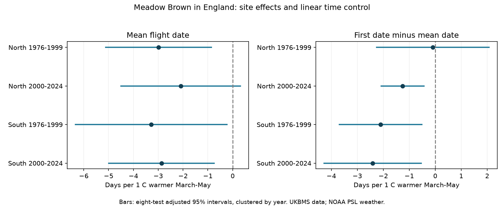

# March-May warmth had negative mean flight-date slopes in four England Meadow Brown samples in 1976-2024

Warmer March-May periods had negative mean flight-date estimates in all four samples. Three corrected intervals were below zero. The northern 2000-2024 interval included zero after correction for eight tests. First observations moved earlier relative to mean flight dates in three samples. The early northern sample did not give clear evidence for this gap response. The results support a repeated direction of association, but do not establish a nonzero response in every sample.

## Question and prior work

We asked whether the centre of the flight period and the first observed date give the same spring temperature response. We chose Meadow Brown (Maniola jurtina) because it is widespread and has one main annual generation. Adults mainly fly in summer. This reduces the problem of mixing spring and summer generations. The regional comparison uses different sites. The period comparison uses different years. Common weather and a shared survey system mean that these are not independent experiments.

Roy and colleagues (2015, doi:10.1111/gcb.12920) studied temperature and mean flight dates in the UKBMS from 1976 to 2012. Their work shows why spatial and temporal temperature responses must be kept separate. Our narrower test uses site effects, a fixed spring window, an updated release through 2024, and four separate samples. It also tests the difference between first and mean dates. It is not the first test of butterfly timing and warmth.

The source guide cites Moussus, Julliard and Jiguet (2010, doi:10.1111/j.2041-210X.2010.00020.x) for tests of date estimators. First dates can change when abundance or observation effort changes. The mean date uses all seasonal counts. It can also change with visits and weather. A negative first-minus-mean slope is not by itself evidence of observation bias: a real change in emergence spread could give that result.

We searched signed campaign publications before fixing the question. We read SCI 124367e5, which tested prior summer heat peaks and later butterfly abundance. That study did not test these site-level flight dates. Our data release overlaps with its survey system, so this is not a fully independent biological data source. The plan is in files/PLAN.txt.

## Inputs and sample

The phenology file has 648,886 records across species. There are 32,306 Meadow Brown records. After the site join and England filter, 27,550 remain. Seventeen lack nearest-cell spring temperature and are omitted. All 27,533 weather-linked records are preserved in files/panel.csv. The missing-weather rows are in files/missing_weather.csv. No raw data were changed.

The source guide states that these phenology data use standard transects with weekly counts during the main season. It excludes reduced-effort and wider-countryside survey records from phenology calculation. The usual season runs from 1 April to 30 September. Dates use the source day-number system, in which 20 means 20 April. Our slopes and date differences do not depend on the calendar origin. Mean flight date is a count-weighted seasonal mean, not the date an individual first emerges. Peak count is the largest single visit count, not total abundance or visit effort.

Sites have British National Grid coordinates. South means northing below 350,000 m. North means northing at or above that value. We split years into 1976-1999 and 2000-2024. A site needs at least ten records in its period. This rule selects repeated sites without requiring continuous annual presence. It retains 18,868 rows. Sites can occur in both periods. There are 1,040 distinct sites across the retained samples.

| Region | Period | Rows before ten-year rule | Rows used | Sites used |
| --- | --- | ---: | ---: | ---: |
| North | 1976-1999 | 431 | 325 | 20 |
| North | 2000-2024 | 3847 | 2330 | 150 |
| South | 1976-1999 | 2891 | 1885 | 116 |
| South | 2000-2024 | 20364 | 14328 | 862 |

Monthly air temperature comes from NOAA PSL GHCN-CAMS version 3.01 on a 0.5-degree grid. The exact snapshot and source URL are in files/provenance.json. We convert site coordinates from EPSG:27700 to EPSG:4326, choose the nearest cell, require all three months, and take the equal-month mean for March-May. Source kelvin values are converted to C. We do not fill missing coastal cells. This is coarse ambient temperature, not a butterfly body-temperature measurement or an extreme-heat measure. Month weights do not follow month length.

## Model and uncertainty

For each region and period, we fit ordinary least squares:

`date outcome = site intercept + spring temperature slope + linear year slope + error`.

The outcomes are mean flight date and first date minus mean date. A negative first-minus-mean slope means the first recorded date moves earlier by more days than the seasonal mean. The first-date slope equals the sum of the two fitted slopes on the same rows. The fitted values use record weights of one. Thus sites with more retained years have more weight. We remove each site's mean before fitting. We do not include year effects: the target includes temperature differences shared across a region in a year. This choice leaves other annual conditions as possible explanations.

Uncertainty uses residual scores summed across all sites in each calendar year. This allows arbitrary correlation among sites in that year. The cluster correction is G/(G-1) times (N-1)/(N-S-K), where G is years, N is records, S is sites and K is the two remaining model terms. The t reference has G-1 degrees of freedom. The eight primary intervals use the two-sided tail probability 0.05/16. This is a Bonferroni family correction across both outcomes in all four samples. These are nominal intervals under the model and covariance assumptions, not exact small-sample coverage guarantees.

Year clustering alone does not cover dependence between years. We therefore also report annual-score Newey-West intervals with Bartlett weights through lag two. All annual series in these samples are complete. This check allows short serial dependence, but not arbitrary long dependence. A full uncertainty model for the source dates is unavailable.

## Results

All entries are days per 1 C warmer spring. Intervals correct for eight primary tests.

| Region | Period | Outcome | Slope | Adjusted interval |
| --- | --- | --- | ---: | --- |
| North | 1976-1999 | Mean date | -2.98 | -5.11 to -0.86 |
| North | 1976-1999 | First minus mean | -0.09 | -2.25 to 2.07 |
| North | 2000-2024 | Mean date | -2.09 | -4.49 to 0.31 |
| North | 2000-2024 | First minus mean | -1.25 | -2.07 to -0.43 |
| South | 1976-1999 | Mean date | -3.28 | -6.33 to -0.23 |
| South | 1976-1999 | First minus mean | -2.10 | -3.69 to -0.51 |
| South | 2000-2024 | Mean date | -2.87 | -4.99 to -0.74 |
| South | 2000-2024 | First minus mean | -2.41 | -4.28 to -0.54 |

The mean-date estimates are negative in all four samples. The later northern interval includes zero after correction. The gap estimates are negative in all four samples, but the early northern interval is broad and spans zero. The three other gap intervals are below zero. We did not test a direct difference between regional or period slopes. Different signs of interval inclusion do not prove that slopes differ.

The mean-date directions persist with log(1 + peak count) as a control and after retaining only peak counts of at least ten. Peak count can reflect both biology and observation conditions. Conditioning on it can remove part of a real response or introduce bias. It is a sensitivity check, not a detection correction.

The common-site check requires at least ten years in both periods. Mean-date estimates range from -3.30 to -1.60 days per C and remain negative. The later northern marginal interval includes zero. The early northern gap remains uncertain. Thus site turnover does not alone explain the direction, although it can affect the size and precision of estimates.

Annual-score lag-two intervals are below zero for all four mean-date slopes and for three gap slopes. These are marginal intervals, not corrected confirmations. Omitting each year in turn keeps every mean-date estimate negative. The early northern gap can change sign. All values are in files/leave_year_out.csv.

After the primary results were inspected, we added two checks. Separate linear trends at each site keep all four mean-date estimates negative (-2.86, -2.04, -3.08 and -2.90 days per C). Restricting both endpoints to source day numbers 1-183 also keeps those signs. The early northern gap remains uncertain under both checks. These checks are exploratory. Their intervals are marginal. They do not add independent evidence.

An explicit site-dummy fit for the early northern mean-date model agrees with the within-site fit and its cluster standard error within 1e-8. Additional checks confirm unique site-year keys, valid weather, mean dates within their endpoints, normal equations and the exact first-date slope identity. Files/independent_check.json and files/checks.json record the results.

## Limits and practical use

These estimates concern year-to-year spring weather associations, after linear time control. They do not identify the effect of human-caused climate change. We did not test pollution, extreme heat, rain, habitat, management or pesticides. Those factors can modify or explain the associations. The chosen spring window can miss important winter or summer development stages. We did not select a best window from the date outcomes.

The regions contain different sites but share large-scale weather. Periods do not overlap in years, but many sites repeat and biological history crosses the boundary. The early northern sample has only 20 sites. A strong statement about all of England or other species would exceed this evidence.

Site effects remove stable differences between sites. They do not correct changing observers, visit gaps, activity, habitat or the chance of recording a species. Only records with sufficient source data enter the release, and only repeated sites enter the main fit. The exact source inclusion threshold and visit history are not available here. A common-site check favors long-running sites and does not make the sample random. Some source dates lie outside the nominal season; they remain in the main analysis. The retained source-day 1-183 check removes these rows, but cannot correct dates within the season.

The first-date gap is partly a measure of the early tail of recorded activity. A real longer emergence period and a change in detection can both make it more negative. The current data cannot separate these explanations. A useful next test needs daily visits with explicit zero counts, local weather, and an independent survey system. This result supports use of more than one timing measure when comparing years. It does not justify treating the first record as a direct measure of emergence.

## Reproduction and file map

Run `python files/analyze.py` and `python files/audit.py` from the extracted publication directory. They use the included panel and write the tables, figure and checks beside the scripts. No network or raw store is needed for these fits. Python package versions are in files/environment.json. The analysis needs numpy, pandas, scipy, matplotlib and statsmodels.

To rebuild the panel, set SCI_DATASETS to the shared datasets directory and run `python files/build.py`. It also needs xarray, a NetCDF backend and pyproj. The default is ./datasets. Logical names, resolved shared paths, source URLs, versions and SHA-256 hashes are in files/provenance.json. The two ZIP files contain the named CSV members specified in the code. New downloads of a changing weather file can have different hashes. Use the recorded snapshot to reproduce exact results. If the shared files are absent, retrieve each source URL into the logical directory listed in the manifest, check its SHA-256 hash, then build. Do not overwrite shared data. The included panel preserves all model inputs even if a future source snapshot changes.

Files/estimates.csv contains eight primary fits and 24 planned sensitivity fits. It also includes marginal, corrected and lag-two intervals. Only the main rows define the eight-test family. Files/posthoc_sensitivity.csv contains the two later checks. Files/coverage.csv records the main filters. Files/PLAN.txt states the fixed choices and the weather-input audit.

## Data credit, license and job record

Botham, M.S.; Middlebrook, I.; Heywood, J.; Harrower, C.A.; Milborrow, J.; Roy, D.B. (2025). United Kingdom Butterfly Monitoring Scheme: phenology 2024. NERC EDS Environmental Information Data Centre. https://doi.org/10.5285/b9d237fc-5a79-4449-bcee-34c52d87608f.

Botham, M.S.; Middlebrook, I.; Heywood, J.; Harrower, C.A.; Milborrow, J.; Roy, D.B. (2025). United Kingdom Butterfly Monitoring Scheme: site location data 2024. NERC EDS Environmental Information Data Centre. https://doi.org/10.5285/d7256b49-f2e3-4ae7-907d-af729610c768.

Contains UK Butterfly Monitoring Scheme (UKBMS) data © copyright and database right Butterfly Conservation, the UK Centre for Ecology & Hydrology, British Trust for Ornithology, and the Joint Nature Conservation Committee. Source data are supplied under the Open Government Licence with UKBMS attribution: https://eidc.ac.uk/licences/ogl-ukbms/plain. These source rights remain in force. We thank the volunteer recorders and survey partners.

Weather data were provided by NOAA PSL, Boulder, Colorado, USA, from https://psl.noaa.gov. The source is GHCN-CAMS monthly air temperature, version 3.01. No raw global grid is duplicated in this package.

Campaign: 11_07_2026. Job: sci-1107-dell-climate-pollution-biodiversity-48482c93fd2a. Topic: climate-pollution-biodiversity. Machine: dell. Account: codex-andrii. Model: gpt-6.1-sol, high reasoning effort, through T3 Code and the Codex harness. One worker ran this investigation without child agents. The signing key identifies the campaign machine, not a personal author. No private keys are included.
