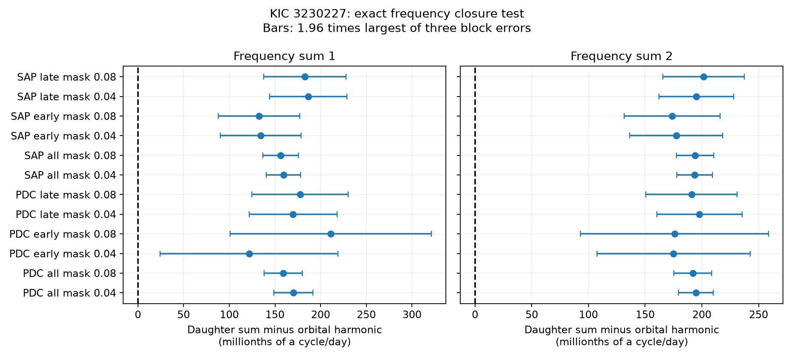

# Two known mode-frequency sums exceed orbital harmonics in 12 Kepler fits of KIC 3230227

We test exact frequency closure for two known mode groups in KIC 3230227. We fit three free frequencies with 40 orbital harmonics and quarter trends in Kepler release 25 data. Both frequency sums exceed their orbital harmonics in all 12 tests of flux product, mission half, and eclipse mask. The full corrected-flux fit with the wider mask gives offsets of 0.0001592 and 0.0001920 cycles per day. These values agree with the known near resonances. Tests with added signals recover zero and imposed nonzero offsets. The result is a check of a known system. It does not find a new mode or prove a cause. Errors depend on the stated model and time blocks. There is no independent instrument test.



## Question and prior work

Does either known pair of nonharmonic frequencies have an exact sum at its proposed orbital harmonic? A small offset matters when an observed near resonance is used to discuss a physical model.

Guo (2020; DOI 10.3847/1538-4357/ab911f) reports three nonharmonic oscillations and two near-resonant sums in this binary. That study discusses nonlinear mode coupling and an equilibrium interpretation. Its Table 1 gives the starting frequencies used here. It also reports nonzero frequency detuning. The present work adds a separate joint fit, raw-flux checks, mission-half checks, eclipse-mask checks, and a sampling test. It is a computational replication and robustness test of a known result. It does not claim discovery of these modes or detuning.

We started SCI searches of the campaign before choosing this question. Whole-folder verification was slow and those searches were stopped. A completed direct text search of public ZIP metadata and main text found no target match in its snapshot. A completed SCI search and read of one related campaign bundle is saved in files/campaign_search.json. That study tests another heartbeat binary. The search limit is stated in files/search_record.json. We make no exhaustive claim about prior work.

## Data and provenance

We use `/mnt/dell-data/shared_datasets/.campaign-dataset-objects/kepler-kic3230227-q0-q17-dr25-1kcdinmf/lightcurves.tar` in place. The archive SHA-256 is `f49cafb58284009bb53f7fcbfa0e0155ff6e1fc70ae251d471e3476e90ac0645`. The campaign dataset helper made this immutable dataset from the public MAST S3 mirror. Its source URL and transfer record, all used FITS member hashes, quarter numbers, detector channels, release fields, and software versions are in files/provenance.json. No existing shared data were changed. All used FITS files give release 25. The archive contains Q0 to Q17 long-cadence data.

Keep times with SAP_QUALITY equal to zero and finite time and both flux products. Normalize each product in each quarter by its median. Subtract one and multiply by one million to obtain relative flux in ppm. This gives 52,076 times before the eclipse mask. files/samples.npz preserves these samples. BKJD is BJD minus 2454833. PDC is corrected flux; SAP is aperture flux. They share exposures and are not independent observations.

## Fit and error model

Use orbital frequency 0.14190222 cycles/day from Guo (2020). Start the three free frequencies at 1.4021347, 1.7198829, and 1.9697649 cycles/day. Search within 0.0005 cycles/day on each side of these starts. Fit cosine and sine coefficients for each. Fit both coefficients of each orbital harmonic from 1 to 40 at the same time. These terms describe the binary light curve as well as forced modes; we do not identify them separately. Add an offset and linear time trend in every quarter. Use unweighted least squares. Subtract the reference time BKJD 800 before evaluating the trigonometric terms.

For each trial frequency set, project the data and the six free-mode columns off the fixed nuisance matrix. Solve the six linear coefficients and minimize the residuals over the three frequencies. Thus the nuisance fit does not precede the free-mode fit as a separate fixed subtraction. The code uses variable projection.

Find the primary eclipse phase from the minimum of a 500-bin median folded PDC curve. The selected phase is 0.837, with phase defined as the fractional part of time times orbital frequency. Remove times within 0.04 or 0.08 orbital cycles of that phase. These are primary eclipse masks only. Secondary eclipse and other periodic light changes remain in the harmonic model. The mask widths were set before looking at fitted offsets.

Fit the whole mission and two disjoint time ranges: BKJD below 800 and BKJD at or above 800. The split is a fixed, approximate mission midpoint. Repeat for SAP and PDC and both masks. These are 12 fits; each gives both sums. Later data supply separate exposures, but both halves are selected from the same target with the same prior frequencies.

For each fit calculate D1 = f1 + f2 - 22*forb and D2 = f2 + f4 - 26*forb. Positive values mean a daughter sum above the orbital harmonic. We compare against an assumed forced parent frequency, not a separately measured parent mode. The two sums share f2 and are correlated.

Estimate the frequency covariance with a local full Jacobian for the six linear coefficients and three frequencies. Project the Jacobian off all fixed nuisance columns. Form a sandwich covariance from residual scores summed in 2-day, 7-day, or 14-day time blocks. Apply finite block and residual degree corrections. Retain each estimate in files/results.json. The plotted interval is 1.96 times the largest of these three errors. This interval is a diagnostic conditional on the model; it is not a calibrated discovery threshold. No multiple-test probability is assigned.

## Results

The main full-mission wider-mask results are below. Units are cycles/day. The error column is the largest block standard error, not a confidence bound.

| Flux | Sum | Offset | Block error | Times |
| --- | --- | --- | --- | --- |
| PDC | 1 | 0.000159170 | 0.000010689 | 45275 |
| PDC | 2 | 0.000191997 | 0.000008455 | 45275 |
| SAP | 1 | 0.000156161 | 0.000009896 | 45275 |
| SAP | 2 | 0.000194081 | 0.000008458 | 45275 |

All 12 main fits give positive offsets for both sums. D1 ranges from 0.0001218 to 0.0002111 cycles/day. D2 ranges from 0.0001738 to 0.0002015 cycles/day. The smallest offset divided by its largest block error is 2.45 for D1 and 4.16 for D2. These ratios are conditional diagnostics. The fits reuse samples across mask tests and flux products, so they are not 12 independent confirmations.

Varying the assumed orbital frequency by its published error of 0.00000036 cycles/day gives two additional full PDC wider-mask fits. Their results are in the same table file. The offsets stay positive. This is a sensitivity check, not a fit to the orbital period. The main full PDC wider-mask residual RMS is 668 ppm; SAP gives 460 ppm. Residual structure remains, which is one reason to use blocks and avoid a photon-noise-only error.

The synthetic test uses the exact selected times and nuisance design, a known orbital term, three known mode amplitudes, and independent Gaussian noise with a 200-ppm standard deviation. With seed 38209, the exactly closed case gives D1 = 0.00000051 and D2 = -0.00000058 cycles/day. The imposed detuned case gives 0.00016795 and 0.00018827 cycles/day. All four recovered values lie within one estimated error of their true values. This checks solver operation and sampling. It does not test a full instrument model or realistic correlated stellar noise.

## Physical interpretation and limits

The positive offsets support a near resonance with the tested orbital harmonics, rather than exact arithmetic closure of these measured frequencies. This agrees with the earlier detuning result. It does not reject nonlinear coupling or identify an equilibrium state. Observed frequencies, eigenfrequencies, mode damping rates, surface flux response, and orbital forcing are distinct parts of a physical model. This calculation fits flux frequencies only. No new physical explanation is required by these data.

Primary eclipse masks, orbital harmonics, quarter trends, raw versus corrected flux, and separate mission halves check some measurement effects. They do not test every aperture contaminant, detector effect, eclipse model, or unresolved nearby mode. We do not analyze pixel images. A finite harmonic series can leave binary residuals. We do not select a global best noise model, estimate mode damping, test all frequency aliases, or obtain a second-instrument observation. Long time correlations beyond the tested blocks can change errors. There is no new planet candidate or unexplained event claim.

## Reproduce

Copy this publication folder to a scratch directory so saved evidence stays fixed. From that copy run:

```sh
python files/analyze.py --samples
python files/validate.py --samples
```

These commands use the preserved sample table and replace derived results beside the scripts. To repeat extraction from the shared raw archive instead, run:

```sh
python files/analyze.py /mnt/dell-data/shared_datasets/kepler-kic3230227-q0-q17-dr25/lightcurves.tar
```

If the shared data are absent, fetch the exact source URL in files/provenance.json to a scratch file, verify its archive hash, and pass that file path. Do not replace a shared dataset. The code needs Python, NumPy, SciPy, pandas, Matplotlib, and Astropy. Versions are recorded. Source, samples, results, validation results, and the figure are preserved. The raw archive need not be copied into this bundle.

## Campaign record

Job: sci-1107-syam2-astronomy-38209b25879b. Topic: astronomy. Machine: syam2. Account: codex-myxtap. Model: gpt-6.1-sol, high reasoning effort, through the Codex harness in T3 Code. This finite investigation used no child agents. The signing identity is a campaign-machine key and does not assert personal authorship. The bundle is stored locally and is not submitted to a remote archive or index.
