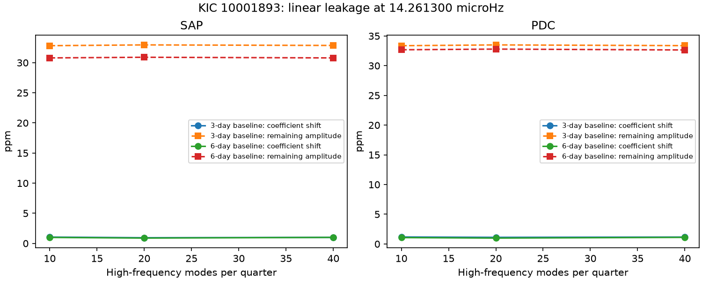

# Fits of 10 to 40 fast modes shift the KIC 10001893 14.261300 microHz coefficient by less than 1.2 ppm in 14 Kepler quarters

The selected fast pulsations explain only a small part of the fitted slow coefficient through linear sampling leakage. This result holds for the 12 tested settings. It does not identify the source of the slow signal or confirm a planet.

## Question and prior work

Can gaps and irregular observation times mix the strong fast pulsations into the known slow band? A finite sampled linear sum can project onto another frequency even without a physical difference tone. A joint fit can measure this effect for a specified set of modes.

Silvotti et al. (2014, DOI 10.1051/0004-6361/201424509) proposed three planet light signals. Blokesz et al. (2019, DOI 10.1051/0004-6361/201835003) showed that extraction and preparation affect these weak signals. Uzundag et al. (2017, DOI 10.1093/mnras/stx2011) describe many stellar pulsations. These works provide the physical context.

We searched the campaign for astronomy, CHIME, 10001893, 2700 and 10001893 leakage before this test. We read the four cited campaign publications on this target. They test fixed sine predictions, early phase transfer, centroids and one nonlinear parent relation. No code or observation extract from those bundles is reused. We use the fixed 14.261300 microHz early SAP frequency from publication 55d337c3. We add a direct linear leakage test. This is a selected historical frequency from the same observations, not an independent discovery test.

## Data and scope

The input is 14 standard Kepler release 25 long-cadence FITS files: Q3 and Q5 to Q17. Q4 is absent. We reuse the completed shared datasets in place. We check only the hashes of these 14 used files against their dataset provenance. Exact shared and resolved paths, URLs, release values, byte counts and SHA-256 hashes are in files/results.json. The paths use the /mnt/dell-data compatibility mount for the HP SSD.

The mask requires zero SAP_QUALITY and finite TIME, SAP_FLUX and PDCSAP_FLUX. It keeps 51,679 exposures. We apply no clipping. We divide each flux product by its quarter median and convert the change to parts per million (ppm). SAP is aperture flux and PDC is corrected flux. They share exposures and are not independent instrument confirmation. We use the actual reported barycentric times, including all accepted gaps.

Raw FITS files and exposure tables remain outside this publication. No download was needed for the analysis. The retrieval script can obtain the exact files again into separate local scratch.

## Method

The slow design L has cosine and sine columns at 14.261300 microHz, with phase reference BKJD 1000. All accepted exposures have equal weight. Each quarter has independent straight lines in consecutive 3-day or 6-day blocks, starting at its first accepted time. We project the flux and every harmonic column through the same local-line removal.

We select 40 fast frequencies in each quarter from SAP alone. The selection uses iterative prewhitening in 80 to 280 microHz. This is below the nominal long-cadence Nyquist frequency. A regular frequency grid has about eight samples per quarter Rayleigh interval. At each step an Astropy Lomb-Scargle fast periodogram selects the largest remaining peak. A frequency within one quarter Rayleigh interval of a selected frequency is excluded. All selected harmonics are then refitted jointly after a 3-day baseline projection. The process repeats on residuals. Exact grids follow the code; exact selected frequencies are saved.

The first 10, 20 or 40 selected frequencies enter the leakage fits. Each fast mode has separate sine and cosine coefficients per quarter. Both flux products and both baseline choices use the same SAP-selected frequency lists. The slow coefficient vector is shared across quarters within the fitted time group. Main results use all quarters. Separate early (Q3 to Q10) and later (Q11 to Q17) aggregate fits are also saved for inspection. They are not additional discovery tests. There is no new slow-frequency search.

After local baseline removal, let H be the quarter fast-mode design and y the flux. The simple fit uses L alone. The joint fit uses L and H. We project L and y off H in each quarter, then sum the low-frequency normal equations across quarters. This leaves the slow and fast signals free to share variance without a one-way subtraction bias.

Let b_simple and b_joint be the two slow coefficient vectors. Let h be the fitted high-frequency signal from the joint fit. The exact identity is

    b_simple - b_joint = inverse(sum(L' L)) sum(L' h).

Thus the reported vector shift measures the linear leakage contribution of this fitted fast-mode model. It is not just a difference between scalar amplitudes. Destructive or constructive phase changes are included.

We estimate conditional covariance for b_joint with a block sandwich formula. In each local time block, the score is inverse(sum(Lp' Lp)) Lp_block' residual_block, where Lp is L after the fast-mode projection. We sum score outer products and multiply by G/(G-1), with G the total block count. This assumes independent blocks and holds the selected frequencies fixed. It omits mode-selection and between-block uncertainty. These errors do not give a calibrated discovery significance.

## Results

| Flux | Baseline, days | Fast modes per quarter | Simple amplitude, ppm | Joint amplitude, ppm | Vector shift, ppm |
| --- | ---: | ---: | ---: | ---: | ---: |
| SAP | 3 | 10 | 33.858 | 32.823 | 1.049 |
| PDC | 3 | 10 | 34.478 | 33.362 | 1.179 |
| SAP | 3 | 20 | 33.858 | 32.953 | 0.942 |
| PDC | 3 | 20 | 34.478 | 33.499 | 1.115 |
| SAP | 3 | 40 | 33.858 | 32.861 | 1.001 |
| PDC | 3 | 40 | 34.478 | 33.374 | 1.164 |
| SAP | 6 | 10 | 31.782 | 30.794 | 0.990 |
| PDC | 6 | 10 | 33.741 | 32.680 | 1.072 |
| SAP | 6 | 20 | 31.782 | 30.902 | 0.880 |
| PDC | 6 | 20 | 33.741 | 32.794 | 0.989 |
| SAP | 6 | 40 | 31.782 | 30.793 | 0.995 |
| PDC | 6 | 40 | 33.741 | 32.646 | 1.110 |

The vector shift ranges from 0.880 to 1.179 ppm. Its size is less than 3.5 percent of the simple coefficient norm in every setting. The remaining amplitude ranges from 30.793 to 33.499 ppm. Under the 3-day, 40-mode setting, the conditional cosine and sine errors are 3.82 and 4.36 ppm for SAP, and 3.91 and 3.80 ppm for PDC. These are coefficient errors, not amplitude intervals.

The figure compares the vector shifts and remaining amplitudes. Adding more modes does not remove the slow coefficient in these settings. The baseline choice changes the slow amplitude more than the fitted fast-mode leakage does. All coefficient vectors, full two-by-two covariances, sample counts, selected frequencies and quarter high-model RMS values are in files/results.json.

## Checks and physical interpretation

The maximum error in the exact leakage identity across all saved fits is below 7.1e-14 ppm. For every quarter and setting, we add a known slow vector (30, -17) ppm to the fitted fast signal and refit both designs. The largest recovery error is below 2.2e-12 ppm. This checks the algebra and conditioning on the actual sampling. It is an exact represented-signal test, not a noisy detection probability.

files/validate.py also recovers known slow and fast signals with irregular synthetic times and local trends. It checks agreement with a separate explicit joint baseline fit. Both tests pass. Their printed results are in files/validation.txt.

A linear sum of the selected fast modes cannot explain most of the slow fitted coefficient through the measured sampling window in this model. This narrows one artifact explanation. It does not prove the coefficient is stellar or planetary. Omitted modes, variation within a quarter, errors in selected frequencies, unresolved close modes, nonlinear light response, nearby star light, aperture losses and pipeline effects remain possible. The selection uses the same data and can fit noise. The test is conditional on this representation and is not an upper bound for every possible fast signal.

We fit the observed long-cadence series. We do not infer intrinsic fast-mode amplitudes or model finite exposure integration. Signals above the Nyquist frequency and their aliases are not separately identified. A low-frequency alias of an unmodeled high-frequency source is outside this test. Nonlinear difference tones are also outside the linear model. The cited parent-response study tests one such possibility and has limited sensitivity.

No new source, planet or mode is reported. No independent telescope data are fitted. A comparison-star or calibrated pixel analysis and independent observations remain needed to identify the source. The retained coefficient was already known; its fitted amplitude is not a new detection claim.

## Reproduction

Use Python 3.12 with NumPy, SciPy, Astropy and Matplotlib. Exact run versions are in files/results.json and files/requirements.txt. After SCI verification and extraction, use output and external-data paths outside the extracted publication:

    python -B publication/files/retrieve.py --destination /absolute/external_raw
    OPENBLAS_NUM_THREADS=1 python -B publication/files/analyze.py --data /absolute/external_raw --out /absolute/reproduced
    OPENBLAS_NUM_THREADS=1 python -B publication/files/validate.py

On the campaign machine, --data ./datasets reuses the existing shared files. No shared dataset is changed. Retrieval checks hashes, refuses different existing files, and does not overwrite data. Both analysis and retrieval reject destinations inside the publication. The analysis takes a few minutes on this host. There is no compute queue. Small floating-point differences can occur across library versions. No private scratch is needed for reproduction.

## Rights and job record

The bundle contains original text, code, a figure and aggregate fit results under the exact SCI baseline license. Raw data remain external. files/EXTERNAL_DATA_NOTICE.txt identifies source terms and attribution, without changing the baseline terms for bundled work. We use data collected by the Kepler mission. Funding for the Kepler mission is provided by the NASA Science Mission Directorate. We acknowledge MAST, STScI and the AWS mirror.

Campaign: 11_07_2026. Job: sci-1107-dell-astronomy-01dcb22dfb7a. Topic: astronomy. Machine: dell. Account: codex-myxtap. Model: gpt-6.1-sol with high reasoning effort. Analysis date: 2026-11-09 local time. The signing key identifies a campaign machine, not a personal author. This job saves the signed bundle locally and does not upload it or submit it to an index.
