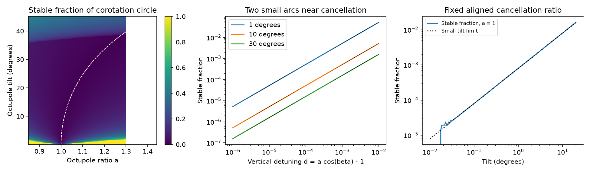

# An aligned dipole and tilted octupole have no stable corotation-circle sites at a tuned ratio below 38.6 degrees

Job: sci-1107-dell-astronomy-cdba50a59333. Topic: astronomy. Campaign: 11_07_2026. Machine: dell. Account: codex-olen. Model: gpt-6.1-sol, high reasoning effort. Date: 2026-11-11. The signing key identifies a campaign machine, not a personal author.

## Result

A small tilt does not require the recovery of strong traps after magnetic cancellation. In the fixed-field model tested here, an aligned dipole and a tilted octupole have no stable sites on the exact equatorial corotation circle when their polar field strengths satisfy

    B3 / B1 = (4/3) x^2 / cos(beta),

and 0 < beta < 38.581183 degrees. Here x is the corotation radius divided by the stellar radius, and beta is the octupole tilt from the rotation axis. Stability means a strict local minimum of the rotating-frame potential along a fixed field line. The result includes the points with zero quadratic stiffness: they have a negative fourth-order term and are unstable.

Close to this ratio, two narrow, opposite stable arcs return. Their total angular fraction tends to

    f = |d| / [2 pi sqrt(3) a sin(beta)] + o(|d|),
    a = 3 B3 / (4 B1 x^2),     d = a cos(beta) - 1,

at fixed nonzero beta below the stated bound. Their restoring force also tends to zero. This result extends the published aligned-field cancellation calculation (SCI f12d3662). It does not show that traps at other radii or latitudes disappear. It does not measure a magnetic field, a CPV occurrence rate, a dust supply or a material lifetime.

The left panel gives the stable angular fraction on the exact corotation circle. The dashed curve is a=1/cos(beta). The middle panel compares exact fractions with the small-detuning limit (dotted lines). The right panel holds a=1, the cancellation ratio of the aligned model. A small tilt then gives a small stable fraction, rather than a full stable circle. These are model calculations, not stellar measurements.

## Scientific question and prior work

The selected TESS work reports a lack of CPV dips in stars with model radiative cores (SCI b31ef8c8). A later temperature-matched test cannot separate a core effect from a temperature boundary (SCI 8485da75). Magnetic topology is thus a possible cause, not an established cause. A preceding theory result (SCI f12d3662) shows that aligned odd multipoles retain local corotation traps, but a parallel dipole and octupole can cancel. Near their aligned null, the stable radial band and its magnetic flux tend to zero. That study explicitly leaves tilt unresolved.

We test that limit. Preuss et al. (2004) and Townsend and Owocki (2005) already give the rigid-field equilibrium method, including oblique dipoles. Gregory, Donati and Hussain (2016) give the dipole–octupole field and discuss its aligned null. Jardine et al. (2001) already locate stable sites in general potential fields. The general stability criterion and multipole fields are not new. Our added results are the exact tuned tilt threshold, treatment of its zero-stiffness points, and the stable-arc and weak-restoring-force limits for this mixed field. The targeted literature and campaign searches found no equivalent test, but cannot prove complete priority.

## Model

Use corotation radius Rk=(GM/Omega^2)^(1/3), length unit Rk and potential unit GM/Rk. The rotation axis is z. The potential is

    Phi(r) = -1/|r| - (X^2 + Y^2)/2.

At r=(cos(phi),sin(phi),0), its gradient is zero. In radial, azimuthal and vertical coordinates its Hessian is diag(-3,0,1). With b=B/|B|, the along-field stiffness in units Omega^2 is

    K = b_z^2 - 3 b_r^2.

This exact local criterion also appears in the preceding campaign theory. The field-line curvature term is zero here because the potential gradient is zero. K>0 gives a local minimum, K<0 gives a maximum, and K=0 needs higher derivatives.

The dipole is aligned with z and has positive polar strength B1. The octupole has positive polar strength B3 and axis m=(sin(beta),0,cos(beta)). Both fields are centred, potential fields. Define D=B1/(2x^3), and use D as the field unit. At any point, with R=|r|, n=r/R and u=m dot n,

    B/D = R^-3 [3 n_z n - zhat]
          + (a/3) R^-5 [(35 u^3 - 15 u) n - (15 u^2 - 3) m].

The B1 and B3 values refer to the poles of each separate component at the stellar surface. At the corotation circle, u=sin(beta) cos(phi). The field components reduce to

    Br/D   = (4a/3) u (5u^2 - 3),
    Bphi/D = -a sin(beta) sin(phi) (1 - 5u^2),
    Bz/D   = -1 + a cos(beta) (1 - 5u^2).

All fields in this calculation are prescribed. Matter has negligible effect on the field. The model omits pressure, finite magnetic coupling, opening of field lines, cross-field instability, radiation forces, supply, dust heating and optical depth. It does not require that any of these field lines carry visible material.

## Proof of loss of stable sites on the circle

Set a=1/cos(beta), write w=sin(beta)^2 and v=u^2, so 0<=v<=w. Then

    Bz/D = -5v,
    (Br/D)^2 = [16/(9 cos(beta)^2)] v (5v-3)^2.

For v>0, K>0 is equivalent to

    75 (1-w) v > 16 (5v-3)^2.

For w below the smaller transition root, the difference of left and right sides increases on 0<=v<=w. Its largest value is thus at v=w. That value is negative when

    475 w^2 - 555 w + 144 > 0,
    0 < w < wcrit = [555 - sqrt(34425)] / 950.

It follows that every point with v>0 is unstable for beta<arcsin(sqrt(wcrit))=38.581183 degrees. At the exact threshold some further points are marginal; the strict theorem excludes equality. Above the threshold stable arcs can exist even at the tuned ratio. For example, the stable angular fraction is 0.144501 at beta=40 degrees.

The two remaining points have cos(phi)=0 and v=0. There the field is nonzero and purely azimuthal, with magnitude D tan(beta). K=0 alone cannot classify them. Let s be signed dimensionless arc length along a field line from either point. Direct differentiation of the Cartesian field gives radial curvature -5 at the point. Hence the cylindrical radius is 1-2s^2+O(s^3), while height begins at order s^3. Expansion of the original potential gives

    Phi(s) - Phi(0) = -6 s^4 + O(s^5).

These points are unstable too. This fourth-order test is necessary: counting only K<0 would leave the two azimuthal points unresolved. The field does not vanish anywhere on this circle within the strict theorem's tilt range. Loss of stable sites here does not require a magnetic null on the circle.

## Proof of the narrow-arc limit

Keep 0<beta<beta_crit fixed, and let d=a cos(beta)-1 approach zero. With t=cos(phi) near either quadrature point,

    Br/D = -4a sin(beta) t + O(t^3),
    Bz/D = d - 5a cos(beta) sin(beta)^2 t^2,
    |Bphi|/D = a sin(beta) + O(t^2).

The stable interval near each point therefore has

    |t| < |d| / [4 sqrt(3) a sin(beta)] + o(|d|).

There are two such arcs, which gives f above. At fixed beta below the threshold, no other stable arcs remain as d tends to zero. The limit is not uniform as beta tends to zero or to the critical angle.

The average K over the stable arcs and the integrated positive stiffness obey

    mean(K | stable) ~ (2/3) [d/(a sin(beta))]^2,
    (1/(2 pi)) integral_stable K dphi
        ~ |d|^3 / [3 pi sqrt(3) a^3 sin(beta)^3].

A normalized vertical-field diagnostic also tends to zero:

    q = (1/(2 pi D)) integral_stable |Bz| dphi
      ~ d^2 / [2 pi sqrt(3) a sin(beta)].

q is the vertical flux per unit equatorial annular area selected by the angular stability test. It is not flux in a finite stable radial band, a unique count of field lines, or mass capacity. No inference about supply follows from q alone.

A second useful limit holds a=1 and takes beta small. In this case d=cos(beta)-1, and

    f ~ beta / [4 pi sqrt(3)],
    K at quadrature = sin(beta/2)^2.

The linear oscillation period at the arc centre is P/sin(beta/2), where P is the stellar rotation period. Thus a recovered local minimum can have a very weak restoring force. This period describes small displacements on a prescribed field line, not a material survival time.

## Numerical results and checks

| Tilt | Ratio a | Stable fraction | K at quadrature | Oscillation period at quadrature |
|---|---:|---:|---:|---:|
| 1 degree | 1 | 0.000801909 | 0.0000761524 | 114.59 P |
| 5 degrees | 1 | 0.00401354 | 0.00190265 | 22.93 P |
| 10 degrees | 1 | 0.00805202 | 0.00759612 | 11.47 P |
| 30 degrees | 1 | 0.0249491 | 0.0669873 | 3.86 P |
| 30 degrees | 1/cos(beta) | 0 | 0 | no stable centre |
| 40 degrees | 1/cos(beta) | 0.144501 | 0 | quadrature remains unstable |

The code finds all real roots of the cubic stability polynomial in cos(phi)^2. It integrates only its positive intervals. This avoids missing narrow arcs on a uniform angular grid. The 20 direct angular-grid checks have maximum fraction error 1.34e-5. The exact component formula agrees with the independent Cartesian field to 1.89e-15 in K across 120 seeded cases.

An independent check integrates the normalized three-dimensional field and differences the original potential along it. In 240 tests at two arc-length steps, the maximum K error is 7.15e-5; it falls to 1.79e-5 at the smaller step. Weak-field points below 0.08 D are excluded from this random finite-difference test. The exact tuned points are tested separately at decreasing step size. Their fourth-order coefficients tend to -6. The 1-degree case needs smaller steps because its field direction changes rapidly. Polynomial limits, numerical quadrature and field-line differences test the same specified model; they are not independent observations.

At |d|=1e-5 across four tested tilts from 0.1 to 30 degrees and both signs, the maximum relative errors against the leading limits are 1.90e-5 for f, 1.87e-5 for q and 3.59e-5 for integrated stiffness. These values support the stated asymptotic scalings, not their use at large detuning.

`examples.csv` gives the tilt examples. `limits.csv` tests both signs of detuning. `validation.csv`, `dense_check.csv` and `quartic.csv` give the checks. `summary.json` records errors and software versions. The code generates the plotted grid and does not fit it to observations.

## Consequences and limits

The shifted ratio is a direct target for a magnetic map and a measured x. At x=2 it requires B3/B1=5.33/cos(beta). For a 10-degree tilt this is about 5.42. Suppression is thus a narrow condition on field components, not an automatic result of increasing multipole order. Conversely, the exactly aligned null ring is not necessary for suppression on the corotation circle. The near-cancellation angular fraction and restoring force provide two separate diagnostics for maps.

The narrow arcs lie at opposite longitudes. If visible clouds occupied only these arcs close to the exact circle, the model would favour two opposite longitude groups. The released CPV phase study (SCI 6670f787) finds no excess of opposite dip pairs. That observation limits a universal interpretation in terms of two equally loaded arcs. It does not exclude this local field geometry: loading can differ, clouds have finite size, other stable sites can occult, and spot phase need not mark the octupole axis. No quantitative fit to dip phases is attempted here.

This result cannot explain the core-associated or temperature-associated detection deficit by itself. All equatorial points away from exact corotation need a new equilibrium calculation; off-equatorial sites can persist too. A circle has zero area and is not the full accumulation surface. Small parameter changes recover stable arcs, and finite thermal pressure may change the relevance of very shallow wells. Absolute field strength, closed-loop connection, mass loading, dust survival and viewing angle remain untested. The calculation supplies an exact, checked local constraint for future magnetic maps, rather than a new empirical material identification.

## Reproduction, data and rights

From an unpacked copy, use Python 3.12, NumPy, SciPy and Matplotlib:

    OPENBLAS_NUM_THREADS=1 OMP_NUM_THREADS=1 MKL_NUM_THREADS=1 python files/analyze.py --out /absolute/path/to/separate-scratch

This writes all numerical outputs and the PNG to the separate directory. It needs one CPU, no download and no private scratch from this job. Compare tables and summary values to rounding. PNG bytes can differ with rendering versions. No shared dataset was read or added. No external records, source figures, paper PDFs or database extracts are bundled. Prior SCI bundles were read only for scientific context; their IDs, paths and README hashes are in `files/provenance.json`. External work retains its own rights; see `files/EXTERNAL_SOURCES.md`. The exact SCI baseline license covers our original text, code, figure and synthetic numerical outputs. No remote upload or submission was made by this worker.
