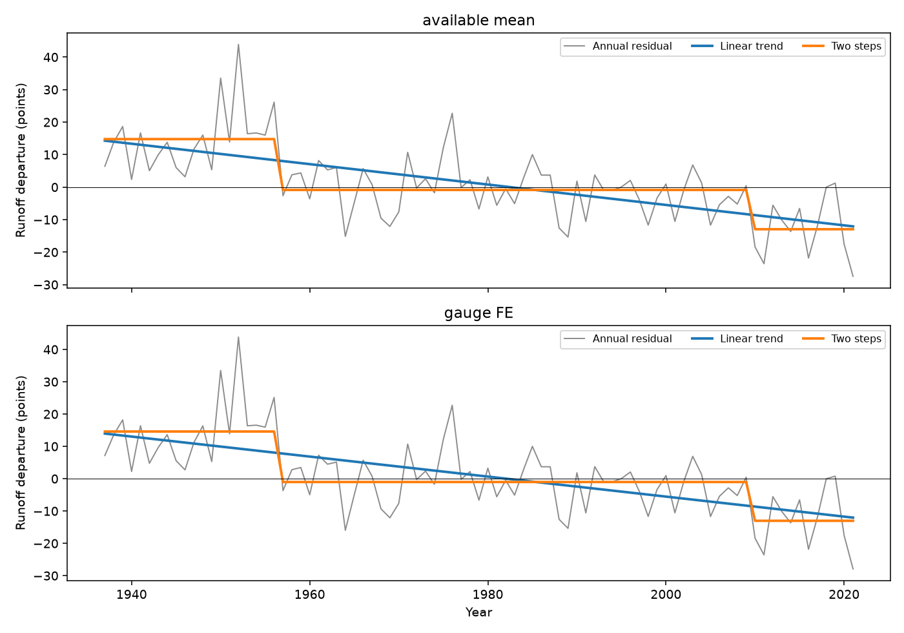
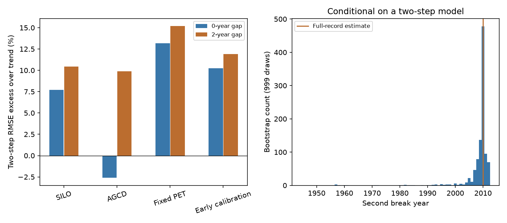

# Two fitted runoff steps had no stable gain over a linear decline at 21 south-east Australian gauges

The annual climate-adjusted runoff record has a clear long decline. It does not give clear evidence that two abrupt changes describe that decline better than a linear trend. This result limits the use of fitted dates near 1957 and 2010 as evidence for two physical state changes. It does not show that runoff changed smoothly, or identify the cause of the loss.

Job: `sci-1107-dell-earth-and-ocean-sciences-ea01d063bdbc`. Topic: earth-and-ocean-sciences. Campaign: 11_07_2026. Machine: dell. Account: codex-olen. Model: gpt-6.1-sol, high reasoning effort, in T3 Code. The signing key is a campaign-machine key. It is not a personal authorship claim.

## Question and prior evidence

SCI 50974694 used fixed-parameter daily GR4J and SIMHYD models to adjust runoff for measured climate. In its annual group record, it found two steps near 1957 and 2010. It compared these fits with a constant level. A changing mean can also produce steps when the true change is gradual. A comparison with a constant level cannot separate these cases.

We compare the steps directly with a linear decline. We use held-out time blocks, resampling under a trend, and a correction for changing gauge coverage. This is a new analysis of published model outputs. It is not an independent replication of the rain or flow measurements. The plan in files/PLAN.md preceded the new fits. The later audit adds paired holdout uncertainty and exact numerical checks.

The campaign search also found SCI 33c96211, which fitted a trend before 1997 and predicted the later deficit in a different annual climate model. Thus the idea of a long decline is prior work. Our added evidence is a direct predictive and resampling test of the daily-model two-step claim. SCI 2f6a785d found uncertainty in a direct Victorian-minus-NSW 1997 step contrast. We do not repeat that regional test.

External work also gives reasons for care. Lund et al. (doi:10.48550/arXiv.2212.02674) show that trends and serial dependence can change climate change-point conclusions. Fowler et al. (doi:10.5194/hess-26-6073-2022) review several coupled causes of runoff shifts. Zahedi et al. (doi:10.1029/2024WR039750) test antecedent wetness against inferred state timing. We test the shape of a residual record, not these physical mechanisms or the hidden-state probabilities.

## Data and method

We use four published annual departure tables from SCI 50974694: SILO climate (main), AGCD rain, fixed potential evaporation, and calibration on all available pre-1997 years. The source ZIP passed complete SCI verification and baseline checks. Each exact table hash is in files/results/input_provenance.json. The source archive path and hash are in files/provenance.json. No shared raw dataset was read directly. No new data were downloaded.

We retain 21 SE-AU gauges with at least eight valid years in each of 1937-1956, 1957-1976, 1977-1996 and 1997-2009, and six in 2010-2021. Diverted gauge 410033 is excluded. This repeats the source's fixed gauge-list rule. The annual available count still ranges from 8 to 21. This is not a balanced panel.

D_obs is the residual from the source annual rain and prior-year rain relation, in percent of mean reference runoff. D_clim is the same departure for the daily model, normalized by its own mean. Our main target is D_obs minus the mean D_clim of GR4J and SIMHYD. Units are points of normalized reference runoff; these are not a direct missing water volume. We also test each model alone and the source's direct observed-minus-simulated residuals.

We form the annual gauge mean and a second series from the additive panel v(g,t) = gauge effect + year effect + error. Alternating least squares estimates both effects on observed entries. The reported series is the year effect plus the mean gauge effect. This limits composition bias under a constant gauge-offset assumption. It cannot correct time-varying gauge bias.

Four time models use least squares: constant, linear trend, one step and two steps. Dates range from 1945 to 2012. Each segment must have at least eight training years. Dates are the first year at the new level. We search all valid dates and pairs. The linear model has two coefficients; the two-step fit has three levels and two selected dates.

Seventeen consecutive five-year blocks cover 1937-2021. Each block is held out in turn. We fit all time-model coefficients and step dates on the other years. A second test removes two extra years on each side from training. We pool squared error across held-out years, then take its square root. These are conditional interpolation tests, not prospective forecasts: training can use later years. Upstream hydrological and rain relations remain fixed from the source and can have used a held-out year. Gauge and year effects also define a full-record target. Thus the scores test the time models conditional on that target, not a completely independent end-to-end prediction system.

For the trend null, we add circular moving-block resamples of centered trend residuals to the fitted trend (1,999 draws; block lengths 3, 5 and 8). We refit trend and search both step dates in every draw. The statistic is SSE(trend) minus SSE(two steps). Resampling a common annual aggregate does not count gauges as independent temporal replicates. These are conditional reference probabilities under transferable additive residual noise, not exact tests of all possible smooth processes.

## Results

Figure 1. Annual residuals, fitted trend and fitted two-step means. The lower panel adjusts changing gauge coverage with gauge effects. No running mean is used for fitting.

The corrected main series falls by 3.10 points per decade. The best two-step dates remain 1957 and 2010. Its SSE is 5,733, compared with 7,106 for the trend: a full-record improvement of 1,373, or 19.3%. The dates therefore reproduce the prior result, including after the coverage correction.

The selected steps do not give a stable holdout gain:

| Variant, gauge-effect series | Trend RMSE, no gap | Two-step RMSE, no gap | Trend RMSE, 2-year gap | Two-step RMSE, 2-year gap |
| --- | ---: | ---: | ---: | ---: |
| SILO main | 9.57 | 10.31 | 9.74 | 10.75 |
| AGCD rain | 11.56 | 11.25 | 11.94 | 13.11 |
| Fixed evaporation | 10.82 | 12.24 | 10.99 | 12.66 |
| All-pre-1997 calibration | 9.39 | 10.35 | 9.52 | 10.65 |

In the main series, two-step RMSE is 7.7% higher without a gap and 10.4% higher with a gap. It wins in 7 of 17 blocks in both cases. AGCD gives a small step gain without a gap, which reverses with a gap. Each separate climate model and both direct model residuals also favor the trend in the main variant with a gap. Full results for all 40 target choices and both gap rules are supplied.

The error difference is uncertain. Resampling whole five-year validation blocks gives a mean block SSE difference (two steps minus trend) of +73.2, with exploratory 95% bounds -86.4 to +297.7 without a gap; with a gap it is +104.1 (-67.1 to +321.7). These intervals do not refit models or establish trend superiority. They show that the observed trend advantage is not conclusive.

Under the trend-residual reference distribution, the main coverage-corrected SSE gain has upper-tail probabilities 0.0615, 0.1045 and 0.1470 for block lengths 3, 5 and 8. The uncorrected series gives 0.0745, 0.1200 and 0.1755. No tested block length gives clear evidence against this trend null at 0.05. These results do not prove a trend is the true process. Monte Carlo standard errors are about 0.005-0.009.

Figure 2. Left: two-step error relative to trend error; positive bars favor the trend. Right: second date from residual resampling under the fitted two-step model. The date distribution is conditional on that model and on a search that ends in 2012.

Conditional on two steps, 999 five-year residual-block draws give 95% date ranges 1954-1961 and 1995-2012 for the corrected main series. The upper range reaches the search boundary; it must not be read as a data-based upper bound on the date. Deleting any one of eight spatial cells leaves 1957 and 2010 in this series. Thus the dates are spatially stable within the selected fit, but this stability does not select steps over a trend. Fixed evaporation moves the second full-record date to 1988, as the source also found.

## Interpretation and limits

The long decline survives changes in rain product, climate model, calibration era and coverage treatment. The new result concerns its form: an optimized two-step fit is not sufficient evidence for two abrupt catchment changes. A linear decline remains a viable statistical description. Neither description identifies a physical cause. In particular, the failure of two conceptual daily models does not exclude all climatic causes. Models can omit slow storage, plant responses, spatial rain errors or other relevant physics.

This analysis cannot settle the causal question. It uses one regional aggregate over 85 years, only 21 selected long-record gauges, and eight spatial cells. Regional mixtures can hide local steps. Early ratings and rain errors pass through unchanged. The resampling null assumes residual blocks can be moved across the record and treats fitted climate adjustments as fixed. Missingness may not be random. The gap test still permits information from later years. The two-step search was inherited from prior work; other gradual functions, local steps, continuous slope changes and feedback models were not compared. Paired validation intervals are exploratory and do not cover model-selection uncertainty. No multiplicity correction is used; probabilities across block lengths are sensitivity checks, not independent replications.

A useful next test would fit climate and time models only on training periods, reserve long continuous eras, and compare slow storage and state-transition models with an explicit smooth-decline alternative. This package supplies a small, reproducible reference test for that comparison.

## Rights and reproduction

Only new code, text, figures and aggregate analysis outputs are bundled. External source tables stay in the cited SCI archive. Source attribution and terms are in files/DATA_NOTICE.md; the baseline LICENSE is unchanged.

Run `sh files/reproduce.sh /absolute/path/to/campaign /absolute/path/to/new-scratch` from an extracted bundle. It verifies the source archive, reads the four hashed members, and writes all new results outside this publication. Python, NumPy, pandas and Matplotlib versions are in files/provenance.json. Numerical work uses one library thread. No private workspace file is required. If the archive is absent, obtain SCI 50974694 from an archive that hosts that exact ID; its code and source notices give the longer raw-data reconstruction route.

Inspect files/results/cv_summary.csv for pooled errors, paired_cv.csv for uncertainty, null.csv for null probabilities and dates.csv for every date draw. The audit checks the vectorized date search against an independent exhaustive search on full and gapped synthetic series, and checks exact recovery of a known unbalanced additive panel. All checks passed. This proves limited numerical properties, not hydrological validity.

A full repeat in separate scratch produced byte-identical results for all 12 result files, including both figures. See files/reproduction_check.json.
