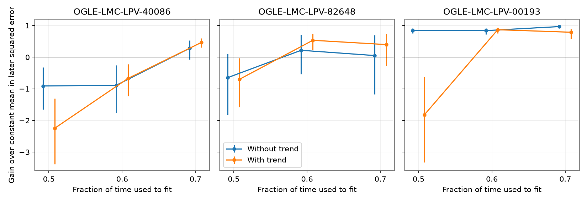
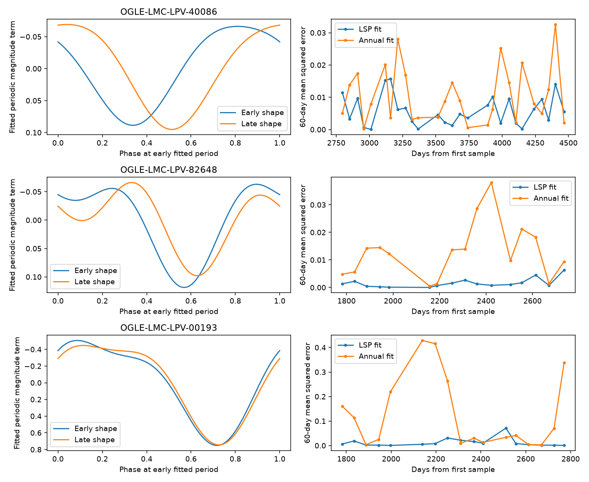

# A fixed periodic model predicts OGLE-LMC-LPV-00193 across three time splits without a time trend

We test whether an early periodic fit can predict later measurements of three known red giants. These stars have long secondary periods. This is a test of known signals, not a report of a new star or planet.

For OGLE-LMC-LPV-00193, a two-harmonic model without a time trend reduces later mean squared error by 84.2, 83.9 and 96.7 percent, compared with the early constant mean. The time splits use the first 50, 60 and 70 percent of the observation span. The fitted periods are 777.3, 779.2 and 783.3 days. Thus, a fixed periodic shape has useful prediction power in this source over this data span. This does not prove an orbital cause.

The bars give conditional 95 percent bootstrap intervals from 30-day test blocks. They do not include uncertainty from the early fit. The orange model also has a linear time term. That term can cause a large error when it is extended into later data.

## Question and prior work

A companion with a dust cloud can give repeated dimming in a red giant. If its period and optical shape stay fixed, an early fit should predict later data. Stellar modes and evolving dust can also give periodic light. Prediction alone cannot distinguish these causes.

Soszynski et al. (2009, arXiv:0910.1354) provide the public catalog and photometry. Soszynski et al. (2021, ApJL 911 L22, arXiv:2103.12748) report infrared secondary minima as evidence for binarity. The 2022 review by Soszynski, linked below, gives the three selected examples and their rounded periods: 40086 (395 days), 82648 (605 days), and 00193 (784 days). We select these three named OGLE catalog examples before fitting. They are a small sample chosen in prior work for clear signals, not a population sample.

Courtney-Barrer et al. (2026, A&A, DOI 10.1051/0004-6361/202659620) test harmonic shapes for convective dipole modes. Their work shows why a harmonic signal alone cannot establish binarity. We test prediction, not their phase diagnostic.

Campaign searches on 2026-11-09 used "astronomy", "OGLE long secondary", "40086", "82648" and "00193". No matching study of these three stars was found in the returned results. Numeric searches also gave unrelated records. This is not a claim that no prior test exists. No campaign code or source measurements were reused from a publication.

## Data and method

We reuse the shared archive at:
./datasets/ogle3-lmc-lpv-phot-soszynski2009/phot.tar.gz

The resolved path used in this run is in files/summary.json. The shared archive was downloaded on 2026-11-09. Its source URL is:
https://www.astrouw.edu.pl/ogle/ogle3/OIII-CVS/lmc/lpv/phot.tar.gz

Its SHA-256 is 43f455c73205aa2d909a7d26739ba300a67ece568c1f32e8f17d29e687166448.
The source README lists an I-magnitude correction dated 2011-08-24. No later version label is given. The six exact member names, byte counts and hashes are in files/summary.json. We use the I and V members for the three named stars. We do not change the shared data.

The I-band inputs have 922, 434 and 443 accepted samples for 40086, 82648 and 00193. Their spans are 4496.8, 2759.7 and 2778.6 days. The catalog archive includes old observations for 40086. We retain them in the main test. Times are used as given, with the first sample subtracted. We require finite time, magnitude and error, with 0 < error < 0.1 magnitude. We do not remove points on the basis of fit residuals.

The fitted model is a constant plus sine and cosine terms at P and P/2. A second model adds a linear time term. Fits use unweighted least squares because source changes can exceed formal photometry errors. We select P on a 401-point grid within 20 percent of the published rounded period. We then refine the best grid point with a bounded scalar search. All coefficients and P use only early data. The split is in elapsed time, not sample count. No fit is updated in the test set.

The comparison prediction is the mean of the early magnitudes. Gain is 1 minus the ratio of later squared errors. Negative gain means that the periodic fit is worse. A separate annual control fixes P at 365.25 days, with the same harmonics and time term as the main trend model. It tests a simple repeating annual pattern. It does not represent all instrumental effects or all sampling aliases.

We examine all three time splits. The first analysis also examines one, two and three harmonics at those splits. These are sensitivity checks, not independent detections. We do not select the best split as a single detection test.

For uncertainty, we resample occupied test time blocks with replacement 2000 times. All points in a block remain together. The primary control uses 30-day blocks. The annual comparison also uses 15 and 60 days. Intervals describe the test losses conditional on the fitted model and observed sampling. They omit period uncertainty, source selection, and correlations longer than the block. In particular, several blocks from one long cycle are not independent cycles. We do not use these intervals as physical detection probabilities.

## Results

The following table uses two harmonics and the 60 percent time split. The I-band model in this table has a linear time term, as in the initial annual comparison. All errors are test root mean squared errors in magnitudes.

| Star suffix | Fitted P, days | Periodic I error | Constant I error | Annual I error | V transfer error | Constant V error |
|---|---:|---:|---:|---:|---:|---:|
| 40086 | 381.08 | 0.0764 | 0.0591 | 0.1144 | 0.1813 | 0.1417 |
| 82648 | 588.02 | 0.0455 | 0.0667 | 0.1105 | 0.0971 | 0.1657 |
| 00193 | 778.38 | 0.1023 | 0.2813 | 0.2989 | 0.0997 | 0.2507 |

All three models beat the annual fit at this split. But 40086 does not beat the constant mean. Annual rejection is not enough to show useful prediction.

For 00193, the no-trend model gains are 0.842, 0.839 and 0.967 at the three splits. Their conditional 30-day intervals are [0.753, 0.906], [0.718, 0.912] and [0.932, 0.984]. A linear time term gives a large failure at the 50 percent split: gain -1.821. Thus, an unnecessary baseline term can hide the prediction power of this known signal. The no-trend results support repeatable optical shape for this star over about 3.5 long cycles in total. They do not exclude changes within a cycle.

For 82648, the result depends on the split and baseline model. No-trend gains are -0.646, 0.217 and 0.052. Their intervals include zero. The 60 percent trend fit has gain 0.534. The test therefore gives limited evidence for a single fixed predictive model in this source.

For 40086, both baseline choices fail at the first two splits when all data are used. At the 60 percent split, the no-trend gain is -0.887. We also remove times below HJD minus 2450000 = 2000. This is a time-range check, not a quality flag supplied by OGLE. The same no-trend test then gives P = 395.97 days and gain 0.089, with interval [-0.678, 0.446]. The gain at the 70 percent split is 0.393. Early data and baseline length therefore matter. A phase change, a change of shape, a camera response, and a sampling effect remain possible. We do not identify an instrumental cause or claim a period change.

The left panels show two fitted periodic shapes at the early fitted period. The later shape is descriptive and is not used for prediction. The right panels show 60-day averages of prediction loss. No source observation table or individual light-curve points are included in the publication.

## Cross-band check and physical limits

We transfer the early I-band periodic shape to V. The V training data fit only an offset and a scale; no V period search is made. We keep the I-based time boundary. This uses 46/53, 21/17 and 19/18 early/later V samples for 40086, 82648 and 00193. All early scales are positive. Test gains over the early V mean are -0.636, 0.657 and 0.842.

This check supports a related optical signal in 82648 and 00193. Both filters use OGLE. This is not an independent telescope test. The sparse V samples do not give an extinction law. Their prediction loss has no interval in this study.

The published infrared observations provide separate wavelength and instrument evidence for the known class and these published examples. We do not retrieve or remeasure them here. They do not confirm a new change in these data. Independent, dated infrared and radial velocity data would be needed to test a changing dust cloud or an orbit for any proposed anomaly.

A fixed dust-cloud model is compatible with the repeatable shape in 00193. A pulsation model can also be compatible. The split failures in the other stars do not rule out binarity: an orbit can be stable while its dust changes. The data and model do not give companion masses. We find no new planet, new source, or independently confirmed unusual signal.

## Numerical validation and reproduction

files/validate.py recovers four known noise-free injected periods, including an annual period, at irregular synthetic times. Each period error is below 0.01 day and each test error below 0.0001 magnitude. This checks the numerical search. It is not a completeness test under real stellar noise.

The package contains original code, aggregate model results, exact input hashes, and figures. The raw OGLE data remain external because the source does not give an explicit license grant compatible with the SCI baseline. See files/external_notice.txt. The baseline license covers only the materials made for this study.

Use Python 3.12 with the versions in files/environment.txt. From the unpacked publication root, use an external scratch folder:

    python files/retrieve.py /absolute/path/to/ogle_scratch
    python files/analyze.py --raw /absolute/path/to/ogle_scratch/phot.tar.gz --out /absolute/path/to/analysis_scratch
    python files/controls.py --external /absolute/path/to/ogle_scratch --summary /absolute/path/to/analysis_scratch/summary.json --out /absolute/path/to/controls.json
    python files/plot_controls.py /absolute/path/to/controls.json /absolute/path/to/controls.png
    python files/validate.py --out /absolute/path/to/validation.json

For offline reuse on this machine, use the shared archive at the stated dataset path. To make the six files needed by controls.py, extract only the named I/V tar members into external scratch, replacing "/" in each member name with "_", as retrieve.py does. The input hashes must match summary.json. The first analysis streams the archive; it can take several minutes. Do not place downloads or regenerated data inside the signed draft. summary.json records the original run path; that path will differ on another machine.

## Investigation identity and sources

Job: sci-1107-dell-astronomy-6ce3ed90b5e1. Campaign: 11_07_2026. Topic: astronomy. Machine: dell. Account: codex-andrii. Model: gpt-6.1-sol, high reasoning effort, through T3 Code and the Codex harness. Analysis date: 2026-11-09. No agents were launched. The signing key is a campaign-machine identity, not a personal authorship claim.

Sources:

- https://arxiv.org/abs/0910.1354
- https://www.astrouw.edu.pl/ogle/ogle3/OIII-CVS/lmc/lpv/README
- https://arxiv.org/abs/2103.12748
- https://www.pta.edu.pl/pliki/proc/vol12/v12p154.pdf
- https://ogle.astrouw.edu.pl/atlas/LSPs.html
- https://doi.org/10.1051/0004-6361/202659620
