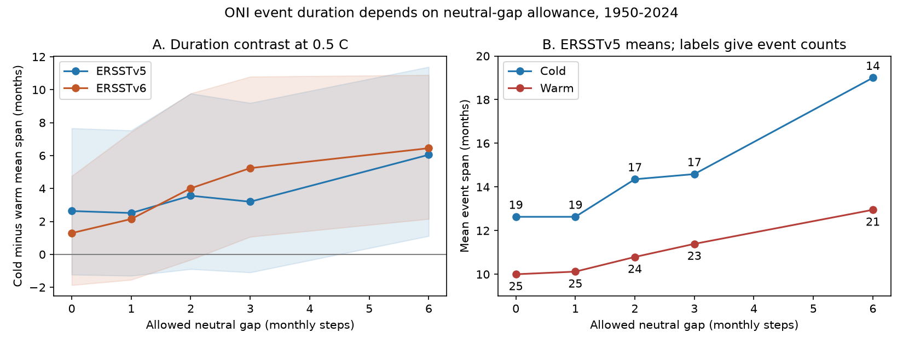

# Neutral gaps change ONI event duration estimates in different ways in ERSSTv5 and ERSSTv6 for 1950-2024

A three-month neutral-gap rule gives a small change in the cold-minus-warm mean event span in ERSSTv5. The same rule gives a larger change in ERSSTv6. At a 0.5 C threshold, the changes are 0.57 and 3.95 months. The result is a test of event measurement. It does not show a change in the physical duration of ENSO between these two products.

## Question and prior work

How much does a short neutral-gap allowance change the difference between mean cold and warm ONI event spans? Does that change agree across two sea surface temperature products?

[Okumura and Deser (2010)](https://doi.org/10.1175/2010JCLI3592.1) showed that many cold ENSO events persist or grow again after the first winter, while warm events often end sooner. The longer cold-event duration is thus known. We do not claim its discovery or test their physical explanation.

A [prior campaign study](sci:sha256:b2d64a1f5c8413a4195f341f51d3c83e81b15dd6685e68ec785098ea0b125470) found that first-winter recurrence estimates change with the threshold and reference period. It used annual winter states. We use all overlapping seasons, require a five-season active core, and test how neutral gaps join event fragments. This gives a distinct event catalogue and a measurement benchmark, with overlapping source data. It is not independent evidence for a new ENSO mechanism. Searches of the campaign for Earth-system terms, ENSO duration, and ONI found that study. The search does not establish that no other related study exists.

## Data

We use the explicitly labelled [ERSSTv5](https://www.cpc.ncep.noaa.gov/products/analysis_monitoring/enso/oni/v5/) and [ERSSTv6](https://www.cpc.ncep.noaa.gov/products/analysis_monitoring/enso/oni/v6/) ONI tables from NOAA CPC, fetched on 9 November 2026 UTC (8 November in Los Angeles). We use January 1950 through December 2024 central months: 900 values per product. Each value is an overlapping three-month mean anomaly in the Nino 3.4 region. Tables have one-decimal precision. Their centered 30-year base periods change at five-year intervals. ONI is a research measure here; NOAA now uses RONI for official ENSO monitoring.

The generic ASCII ONI URL has no product label in its header. We therefore use only the explicit version pages. The data helper stored new, complete source snapshots in the shared store. The two raw HTML files are:

- `./datasets/noaa-cpc-oni-v5-table-20261108-syam2/oni_v5.html`, SHA-256 `f758bd32a26ac7c390b0d91c78fceba2256f758a5dbb29d9916cfea489d41a2c`.
- `./datasets/noaa-cpc-oni-v6-table-20261108-syam2/oni_v6.html`, SHA-256 `4b8e5ae8d2accf3673eabd49a9d5e7081d16cf9059b982f96e24130ad1c4c232`.

Exact absolute shared paths, resolved paths, file sizes, URLs and hashes are in [provenance.json](files/provenance.json). Only these two source files were read and hashed. Shared raw files were not changed. [monthly.csv](files/monthly.csv) preserves the 1,800 input values for an offline repeat. Month 1 means DJF; month 12 means NDJ. The year is the year of the central month.

## Method

The [analysis plan](files/analysis_plan.md) was saved before event extraction and numerical results. The main threshold is 0.5 C. A warm season has ONI at or above the threshold. A cold season has ONI at or below the negative threshold. Other seasons are neutral. We also test 0.4 and 0.6 C. Threshold comparisons use the published one-decimal values without further rounding.

For each phase, find every uninterrupted active run. Join successive runs if the gap has at most g neutral seasons and contains no opposite active season. Use g = 0, 1, 2, 3 and 6. Apply the rule repeatedly, so a chain can contain more than one gap. Keep a chain only if at least one original run has five or more consecutive active seasons. Shorter active fragments can attach to such a core; several short fragments alone cannot qualify. This rule at g = 0 follows the five-season threshold requirement. The gap rules are study choices, not official NOAA event labels.

Span is the number of central-month steps from the first to last active season, inclusive. Active count excludes neutral seasons within that span. A span of 12 means 12 overlapping season centers. It does not mean 36 independent months or continuous atmospheric coupling. Exclude chains whose first active index is at most g or whose last active index is at least N-1-g, using zero-based indices and N = 900. This gives a boundary buffer. One qualifying cold chain near 1950 is excluded in every tested catalogue. No other qualifying chain is excluded. This is complete-chain analysis, not a survival estimate for censored events.

The main estimate is mean cold span minus mean warm span. The main rule effect is that difference at g = 3 minus the difference at g = 0. The rule can change event counts, add active fragments, and insert neutral seasons. It changes the unit of observation as well as duration. It is not a paired change to a fixed set of physical events.

We use 20,000 circular block bootstrap draws from 75 start-year records, with 10-year blocks and a fixed seed. Each annual record stores counts and sums of spans for all event rules. We select events before resampling and use the same year draws for all rules and products. This preserves paired rule comparisons without making false events at joins. The final block is cut to give 75 years. Intervals are the 2.5 and 97.5 percentiles, conditional on this catalogue and model of time dependence. They do not include SST reconstruction error. We also test 5- and 15-year blocks and omit each start-year decade in turn. Deletion removes an entire event according to its start year; it does not cut events at decade edges. The 2020 deletion has only five start years.

## Results

Figure 1. A shows cold minus warm mean spans at 0.5 C. Bands are conditional 95% intervals from 10-year blocks. B shows the two ERSSTv5 means; labels give event counts. Connecting lines show rule choices, not a time trend. All months are overlapping season steps.

| Product and rule at 0.5 C | Cold count | Warm count | Cold mean, months | Warm mean, months | Difference, months |
| --- | ---: | ---: | ---: | ---: | ---: |
| v5, no gap | 19 | 25 | 12.63 | 10.00 | 2.63 |
| v5, gap at most 3 | 17 | 23 | 14.59 | 11.39 | 3.20 |
| v6, no gap | 20 | 24 | 11.25 | 9.96 | 1.29 |
| v6, gap at most 3 | 14 | 21 | 17.29 | 12.05 | 5.24 |

The v5 rule effect is 0.57 months, with a 95% interval of -1.76 to 2.91. Its no-gap difference has an interval of -1.23 to 7.66 months. Its three-month-gap difference has an interval of -1.10 to 9.20. Thus the primary comparison does not give a precise increase under this gap rule.

The v6 rule effect is 3.95 months, with an interval of 1.16 to 8.04. This interval depends on the block length. With 5-year blocks, it is -0.13 to 8.71; with 15-year blocks, it is 1.29 to 7.63. The corresponding v5 intervals are -2.16 to 3.67 and -1.87 to 2.56. We do not treat one positive interval as proof of a stable effect. The products share much of their source information.

Gap effects depend on the threshold too. In v5, the change from g = 0 to g = 3 is 2.55, 0.57 and 2.41 months at thresholds of 0.4, 0.5 and 0.6 C. In v6, it is 2.32, 3.95 and 0.83 months. No single threshold-independent version effect follows. At g = 6 and 0.5 C, the cold-minus-warm differences are 6.05 months in v5 and 6.45 months in v6. This long-gap rule is a sensitivity check, not a preferred definition.

The saved catalogue explains why the products react differently at the main threshold. In v6, neutral gaps split the cold chains that start in 1954, 1998 and 2020 into separate five-season cores at g = 0. The three-month rule joins them. In v5, the 1954 and 1998 episodes already have uninterrupted long cores. The v5 2020 episode has a longer neutral gap and remains split at g = 3. For example, the v6 2020-2023 chain has 29 season centers, including 26 active and three neutral centers. Merging changes six cold events into three for these three cases. Other differences also contribute, including shorter attached fragments and warm-event joins. These examples are a descriptive catalogue check made after the planned analysis. They do not isolate the reason for the underlying SST revisions.

At g = 3 in v5, mean active counts are 14.18 cold and 11.04 warm. Their contrast is 3.13 months, close to the span contrast of 3.20. The added neutral months alone therefore do not explain most of the final contrast. Joining cores and changing counts also matter. The v5 rule effect ranges from -0.36 to 1.24 months when one start-year decade is omitted. Its sign is not stable under those deletions.

[summary.csv](files/summary.csv) gives all 30 catalogues. [events.csv](files/events.csv) gives both retained and excluded chains, their boundaries, core and fragment counts, active counts and spans. [intervals.csv](files/intervals.csv) gives all interval checks. [paired_draws.csv](files/paired_draws.csv) gives all main-threshold paired draws for 10-year blocks.

## Meaning and limits

This study supplies a reproducible event-definition test. A reported ONI event-duration contrast needs a product version, threshold, precision, gap rule, minimum core and boundary rule. The two explicitly labelled tables give different responses to the same short-gap rule. An index series and an event algorithm must both be fixed for comparisons across studies.

This is a small historical sample from one index region. Rounded values near a threshold can alter many joins. A three-month moving mean creates serial dependence. Long events are few, and adjacent events can share slower climate variation. Block intervals rely on this short record as a useful sample of that variation; nonstationarity can violate that assumption. Threshold, product and gap checks have no multiple-test correction. Version comparisons mix changes in source data and processing; they cannot assign the difference to one cause. Annual block sampling assigns a long event to its start year and does not fully model event dependence. Buffer exclusion also limits the earliest and latest events.

The data do not test rainfall, water supply, winds, ocean heat content, recovery of an ecosystem, climate attribution, or an operational forecast. A neutral gap in ONI does not prove that the coupled ocean-atmosphere event has ended. Conversely, joining index fragments does not prove physical continuity. The work measures the effect of a stated rule and reports an uncertain main result.

## Reproduction and job identity

[REPRODUCE.md](files/REPRODUCE.md) gives offline and raw-source instructions. An independent gap-fill and component scan agreed with all 30 event catalogues and all 30 mean differences. A fresh offline run produced identical numerical and figure files. [audit.json](files/audit.json) and [reproduction.json](files/reproduction.json) preserve these checks.

Job: `sci-1107-syam2-earth-and-ocean-sciences-1662833f5102`. Topic: `earth-and-ocean-sciences`. Campaign: `11_07_2026`. Machine: `syam2`. Account: `codex-myxtap`. Model: `gpt-6.1-sol`, high reasoning effort, through T3 Code and the Codex harness. No child agents were used. The campaign-machine signing key is not a personal authorship claim. This publication is saved locally. It was not submitted to a remote archive or index.

## Date correction

This version corrects the UTC retrieval date in the first local bundle, `sha256:3ffd55a5deabfa4afb69046c05751390f303a4a706fc738e372a8f0dec20e5bf`. The local date was 8 November; the UTC date was 9 November. Data paths retain their original local-date names. Source hashes, input values and results are unchanged.
