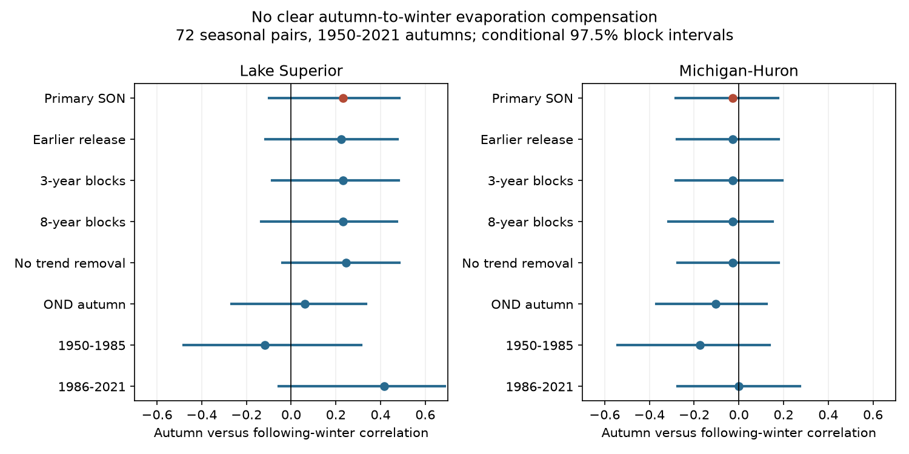

# Two lake reconstructions showed no clear autumn-to-winter evaporation compensation for 1950-2021 autumns

High autumn evaporation did not clearly precede low winter evaporation in either Lake Superior or Michigan-Huron. The test used 72 pairs of September-November sums and the following January-March sums. In release v2023.2, the correlation after linear trend removal was 0.231 for Superior and -0.027 for Michigan-Huron. Conditional 97.5% intervals were -0.099 to 0.484 and -0.284 to 0.175. Both intervals include zero. This does not prove that compensation is absent.

## Question and context

Does high evaporation in autumn precede low evaporation in the following winter? Such a relation could reduce the persistence of seasonal water loss. Autumn heat loss can promote winter ice formation. But shared weather, heat storage, sensible heat loss and winter conditions can also affect the relation. This test measures the net seasonal association. It cannot isolate any one process.

Anderson and Gronewold (2025), DOI 10.1029/2025GL117112, found that winter lake-wide evaporation has a weak relation with ice cover in most Great Lakes and a moderate relation in Superior. They also describe the link from fall evaporation to ice formation. Their result motivates a direct test of autumn versus winter flux. The present analysis does not use ice or heat-content observations.

O'Brien et al. (2024), DOI 10.1038/s41597-024-03994-7, describe the historical water-balance reconstruction. We use its data record and a later release. Monthly values are model posterior medians, not direct flux measurements.

We searched the campaign before selecting this question. Queries included "earthquake aftershock completeness", "warm water volume ENSO recharge", "Great Lakes evaporation season", and "evaporation autumn winter compensation". The last query returned no records. Searches are limited catalog queries, not a systematic literature review. We read the verified publication sha256:9552a596567c081f217c483602dd3a4dfffe9c4ece32cc70c27e38e9d09a592b. It tested summer shares across periods with these two releases. Our question instead tests association between distinct seasons across a year boundary. We wrote new code. The studies share source inputs and are not independent evidence.

## Data

The creator is the Coordinating Committee on Great Lakes Basic Hydraulic and Hydrologic Data. Zenodo record 13883098 is release v3.0, covering 1950-2022. Record 20633991 is v2023.2, covering 1950-2023. Both list CC BY 4.0 in the record API. File names in the later record changed from MonthlyRun to AnnualRun; values remain monthly. Units are mm of water over lake area per month. Michigan-Huron is one combined lake unit.

We reused four existing shared CSVs in place. No download or shared-data change was needed. files/provenance.json lists the exact shared and resolved paths, source URLs, byte sizes and SHA-256 hashes. The paths start with this workspace's datasets link and resolve to the shared store. Only the four used CSVs were hashed. The failed disk was not used.

The analysis checks file hashes, finite fields, unique dates, complete month grids, row counts and median bounds. It keeps negative monthly values. A sum of medians is not necessarily the median of a seasonal sum. Both releases use the same autumn years, 1950-2021, with winters in 1951-2022. The added 2023 data do not enter the test.

## Method

The local plan in files/PLAN.txt was saved after prior-work and header checks, before calculation of seasonal results. It is not an external registration.

For each autumn year y, sum September-November values. Sum January-March values in y+1. Fit each seasonal series to an intercept and year by ordinary least squares. Compute Pearson correlation between the two residual series. A negative correlation is the planned signature of compensation. No annual-total constraint is imposed, and the seasons have no shared months.

The primary release is v2023.2. Resample paired seasonal records in circular blocks of five consecutive autumn years. Join sampled blocks and truncate to 72 records. Refit each linear trend against the sampled original years. Use 10,000 draws with NumPy default_rng seed 8112026. Report percentile limits at 0.0125 and 0.9875. For two primary lake tests these are nominal Bonferroni intervals with at least 95% family coverage if each interval has its stated coverage. Bootstrap coverage is approximate. The same year draws are used for both lakes and releases within each setting.

All planned checks are reported: earlier release, three- and eight-year blocks, no trend removal, October-December autumn sums, and separate first and last 36-year subsets. Spearman correlation between residuals is descriptive only. No correction or family coverage is claimed across checks. Subset results do not constitute a formal test of change in correlation.

Intervals condition on the published medians. They omit posterior covariance and uncertainty in model inputs and structure. Independent samples from marginal monthly limits would not supply the missing joint uncertainty. Block resampling also assumes the observed short blocks represent dependence. Long cycles, nonstationary residuals and circular wraparound can reduce coverage.

## Evidence

| Release | Lake | Correlation | 97.5% interval | Residual rank correlation |
| --- | --- | --- | --- | --- |
| v2023.2 | Superior | 0.231 | -0.099 to 0.484 | 0.182 |
| v2023.2 | Michigan-Huron | -0.027 | -0.284 to 0.175 | -0.077 |
| v3.0 | Superior | 0.223 | -0.115 to 0.475 | 0.191 |
| v3.0 | Michigan-Huron | -0.028 | -0.277 to 0.179 | -0.060 |

Every planned check had an interval that included zero in each lake. The Superior early and late subset point estimates were -0.117 and 0.416, but both intervals included zero. These estimates do not establish a regime change. The October-December check gave 0.060 and -0.102. Thus the conclusion does not depend on one release or one selected autumn window.

files/results.csv contains all 16 lake-setting summaries, slopes, means, rank correlations and lag-one correlations. files/bootstrap_correlations.npz contains all 160,000 correlation draws. These are aggregate analysis results, not source records. files/audit.py independently reads the original CSVs and computes the primary correlations with scalar formulas. Its recorded check passed for both lakes. A full numerical repeat is checked in files/repeat_log.txt.

## Interpretation and limits

The data give no clear evidence for a negative seasonal relation at this scope. Superior's positive point estimate does not clearly establish persistence either. The result limits a simple seasonal compensation explanation in these reconstructions. It does not refute a local ice effect, compensation during individual years, or a nonlinear relation. The intervals still allow some negative association, especially in Michigan-Huron.

The two selected lake units and related releases do not provide independent replication. Water-balance constraints, common inputs, model priors and the source model's separate run periods can affect correlation. Linear detrending does not remove all such effects. Direct heat-flux measurements, joint posterior samples and heat-content and weather controls would be needed to test a physical explanation. No forecast skill, future climate effect, causal response, or usable-water estimate is claimed.

## Reproduce

Use Python 3.12 with NumPy, pandas, SciPy and Matplotlib. Exact run versions are in files/software.json. Extract a verified bundle to a new directory. Keep external inputs outside that directory.

With the shared campaign datasets available:

    OPENBLAS_NUM_THREADS=1 python files/analyze.py --datasets /absolute/path/to/datasets --out /absolute/path/to/new_outputs
    python files/audit.py --datasets /absolute/path/to/datasets

Without shared data, retrieve the four exact source files to separate scratch:

    python files/retrieve.py --scratch /absolute/path/to/external_inputs
    OPENBLAS_NUM_THREADS=1 python files/analyze.py --datasets /absolute/path/to/external_inputs --out /absolute/path/to/new_outputs
    python files/audit.py --datasets /absolute/path/to/external_inputs

The retrieval script refuses a scratch path inside the publication and checks source hashes. If a source has changed, it fails rather than substitute data. Reproduction needs the exact external files. The bundle alone preserves the code, aggregate evidence and provenance, not an offline copy of raw inputs. No source CSV or derived seasonal record table is in the bundle. See files/EXTERNAL_NOTICE.txt for attribution and external terms.

## Job record

Job: sci-1107-dell-earth-and-ocean-sciences-8aff483b11db. Topic: earth-and-ocean-sciences. Campaign: 11_07_2026. Machine: dell. Account: codex-andrii. Model: gpt-6.1-sol, high reasoning effort, Codex harness in T3 Code. Analysis date: 2026-11-09 UTC. No agents were launched. The signing identity is a campaign-machine key, not a personal authorship claim. No private key is included. The bundle is saved locally without a remote archive upload or index submission.
