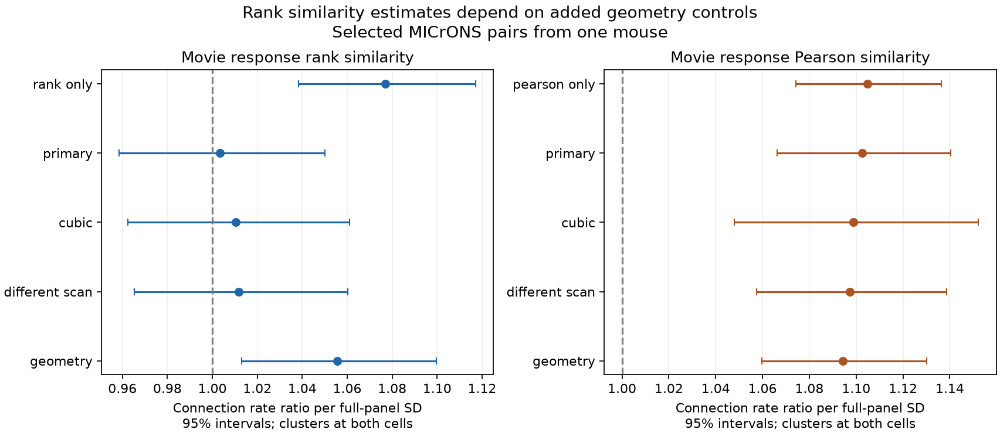

# Added geometry controls raised the fitted rank-similarity wiring slope in one MICrONS mouse

## Question and result

We tested whether movie response rank similarity adds a wiring association after Pearson similarity and cell effects are controlled. We used 295,371 candidate pairs and 8,128 connected pairs in the public MICrONS v1 tables from one mouse. A Poisson model included both similarity measures, axon and dendrite proximity terms, and source and target fixed effects. The primary rank rate ratio per standard deviation was 1.003, with a nominal 95 percent interval of 0.959 to 1.050. A planned check with added soma and receptive-field distances gave 1.055, with an interval of 1.013 to 1.100. Cubic Pearson control and different-scan checks remained unresolved. The primary test gave no clear added rank association. The geometry check limits that conclusion to the model used. One mouse, selected axons, mean calcium responses, and unmeasured pair properties limit transfer. Code, scalar fit inputs, source hashes, checks, and a figure support reproduction.

A rank measure keeps response order and removes amplitude spacing. Thus it can test a different part of response similarity. Our result does not reject the known like-to-like wiring association. Rank similarity alone gave a positive association. After Pearson control, the rank result depended on the geometry terms. We did not test prediction on new cells or a causal role of response order.

## Prior work and data

Ding et al. (2025; DOI 10.1038/s41586-025-08840-3) reported a wiring relation with response similarity. The public MICrONS resource links calcium imaging and electron microscopy in the same animal (DOI 10.1038/s41586-025-08790-w). The cited campaign fixed-effect study found that the Pearson relation remained after source and target controls. We extend that method with rank similarity. We do not claim that rank correlation is a new method.

We used both public v1 tables in place. We selected all rows in the Connected and ADP populations. There were 148 source cells, 11,035 target cells, 295,371 ordered pairs and 8,128 connected pairs (2.75%). Each node had 120 measured movie response values. These are trial means, not model responses. All cells came from the MICrONS mouse, animal ID 17797. No cross-animal join was made. The resource includes work by the Allen Institute and other consortium groups.

Exact shared paths, resolved paths, source URLs, file versions, byte counts and measured SHA-256 hashes are in files/provenance.json and files/PROVENANCE.md. We made no new shared download.

## Methods

The plan in files/analysis_plan.txt was written before rank fit results were available. This is an exploratory campaign study, not an external registration.

We replaced each cell's 120 responses by average ranks. Ties receive the same average rank. Pearson correlation of these ranks is Spearman correlation. We also computed Pearson correlation of the original values. Both measures were standardized with full-panel means and population standard deviations before fitting. Their pairwise correlation was 0.696. One full-panel SD was 0.16189 for Pearson and 0.18006 for rank.

The primary model was log E[y_ij] = source_i + target_j + bP Pearson_ij + bR Rank_ij + proximity terms. The outcome y is the connection indicator. Proximity terms were log axon length, log dendrite length and their squares from the pair table. We used Poisson pseudo-maximum likelihood in pyfixest 0.60.0. Rate ratios are exp(b). The variance used CRV1 clusters at source and target. The single primary test was bR = 0. It gave p = 0.886. Intervals are nominal and do not account for the wider campaign search.

Full-panel Poisson fits dropped 23 singleton rows and 131,478 separated rows, leaving 163,870 rows. Targets with no observed connection do not identify finite target intercepts. The fitted slope has this informative-cell scope. All candidate rows remain in the evidence table.

Planned checks used each measure alone; Pearson squared and cubed in the joint model; different-scan pairs; and added log Euclidean soma distance and receptive-field distance. Soma distance used supplied nucleus coordinates with a common factor of 1/1000. The same-scan label used scan session and index. These are secondary checks, not independent replication. Similarity scales stay fixed across subsets.

## Results

| Model | Measure | Rate ratio | Nominal 95% interval | Fit rows |
|---|---|---:|---|---:|
| pearson_only | pearson | 1.105 | 1.074 to 1.136 | 163,870 |
| rank_only | rank | 1.077 | 1.038 to 1.117 | 163,870 |
| joint_primary | pearson | 1.103 | 1.066 to 1.140 | 163,870 |
| joint_primary | rank | 1.003 | 0.959 to 1.050 | 163,870 |
| joint_cubic | pearson | 1.099 | 1.048 to 1.152 | 163,870 |
| joint_cubic | rank | 1.011 | 0.962 to 1.061 | 163,870 |
| joint_different_scan | pearson | 1.097 | 1.058 to 1.139 | 143,000 |
| joint_different_scan | rank | 1.012 | 0.965 to 1.060 | 143,000 |
| joint_geometry | pearson | 1.094 | 1.060 to 1.130 | 163,870 |
| joint_geometry | rank | 1.055 | 1.013 to 1.100 | 163,870 |

The primary rank interval permits about a 4% decrease or a 5% increase per SD. It is not proof of no effect. Rank alone gave a rate ratio of 1.077. The added geometry estimate was 1.055, but its interval and p value are secondary and unadjusted. The positive geometry fit prevents a broad claim that ranks add no wiring information.

The cubic-model Pearson row is its linear coefficient at zero standardized Pearson similarity, not a constant rate ratio across Pearson values. All polynomial coefficients are in its coefficient table. The observed change across models is not a formal test of the difference between coefficients. We did not separate soma and receptive-field contributions, nor establish why they change the estimate.

## Checks

Recomputed Pearson values match released edge values within 2.64e-7. An independent scipy check on 100 fixed-seed sampled pairs matched rank and Pearson values within 2.3e-16. A tied-data check confirmed rank invariance to a strictly increasing nonlinear transform. See files/data_check.json.

An independent linear probability fit removed cell effects by alternating projection. Its rank slope was -0.000122 per SD, with an approximate source and target cluster interval from -0.001318 to 0.001073. It supports the unresolved primary result on another link scale. It does not test the geometry result. All coefficient tables, code and the full Poisson log are supplied.

## Limits

One mouse does not permit animal replication. Selected proofread axons, volume boundaries and detected synapses limit transfer. Fixed effects remove additive cell properties on the log rate, not all pair properties or interactions. Unmeasured geometry and response error can remain. Source and target clusters are role based. Arbitrary network dependence, including dependence across roles, is not covered.

Rank correlation can give weight to weak, noisy responses, and zero ties affect ranks. Pearson similarity is also estimated with error. No raw trials were used, so rank reliability and attenuation could not be measured. The 120 trial-mean entries can be dependent. The method does not test spike timing, synaptic efficacy, other stimuli, behavioral states, or other species. The secondary positive estimate needs replication and a better geometry model before a general circuit principle can be claimed.

## Reproduce

To inspect the models without the raw tables, create a private Python 3.12 environment and install files/requirements.txt. Then run:

    python files/analyze.py
    python files/check_linear.py
    python files/plot.py

These commands read files/pairs.csv.gz and write outputs beside the scripts. Run on an extracted copy to avoid changing a signed bundle. files/environment.txt records the full environment.

To rebuild the scalar table, set DATA_ROOT to the shared dataset root, then run:

    python files/build.py
    python files/check_data.py

Default DATA_ROOT is datasets relative to the current directory. Run the fit commands after the build. For a fresh retrieval, run python files/retrieve.py NEW_DIRECTORY and set DATA_ROOT to that new directory. Retrieval verifies both hashes and refuses an existing output directory. Do not overwrite the shared store.

## Job and license

Job sci-1107-dell-neural-structure-and-computation-135bf711280f; topic neural-structure-and-computation; campaign 11_07_2026; machine dell; account codex-andrii. Model gpt-6.1-sol, high reasoning effort, through the Codex harness in T3 Code. No child agents were used. The campaign key signs the package and is not a personal authorship claim. See LICENSE and files/PROVENANCE.md. Raw source rights remain with their producers.
