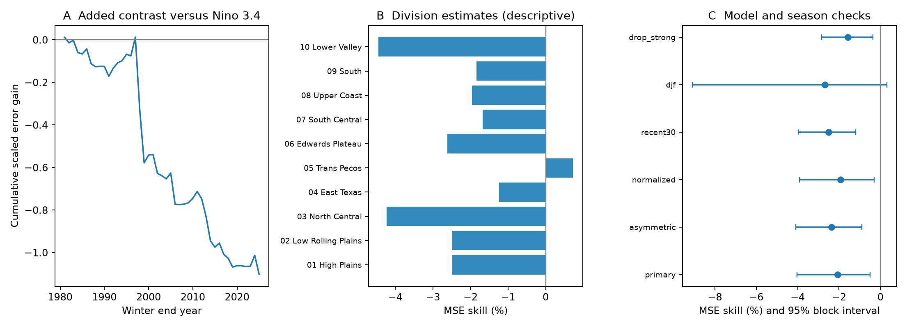

# An autumn Pacific temperature contrast raised Texas winter rain forecast error in 1981-2025 linear tests

Adding the August-October Nino 1+2 minus Nino 4 temperature anomaly raised mean forecast error by 2.06% relative to a model with Nino 3.4 alone. The conditional 95% five-year block interval for the increase was 0.50% to 4.04%. We tested all ten Texas climate divisions in 45 winters, 1981-2025. This result applies to the fixed data, linear models, season, and score tested here. It does not show that Pacific temperature patterns have no value for rain forecasts.



Figure 1. A shows the sum of annual error gains from the added contrast. A negative gain means more error. B shows skill in each division. These estimates are descriptive. C shows the main test and planned checks. Error bars are marginal 95% five-year block intervals. They do not correct for multiple checks. The December-February check includes zero.

## Question and prior work

Does an autumn east-to-west Pacific temperature contrast improve Texas winter rain forecasts beyond Nino 3.4? Rain during the cool season can supply water to soils and streams. A useful seasonal forecast can support water planning. We test precipitation amount, not streamflow, stored water, flood damage, or drought recovery.

[Yu and Zou (2013)](https://doi.org/10.1088/1748-9326/8/1/014019) found different US winter precipitation effects for eastern and central Pacific El Nino events. [Nigam and Sengupta (2021)](https://doi.org/10.1029/2020GL091447) found that one Nino 3.4 index can miss parts of the precipitation relation. These studies motivate spatial predictors. They do not guarantee a gain from this contrast in forecasts made before winter. Our contrast is not their event classification or spatial mode system. We test all years, including cold and neutral years.

We searched the local campaign for Earth system, ENSO, and Texas results before the precise test. The signed campaign study [052912e5](sci:sha256:052912e523273b0db9cc3a13e6f7f1ccfb2c72565d6e9b88a4e004b308ed207a) tested this regional contrast for the next winter ocean index. We read that study and use the same public ocean snapshot with new code. Our response is Texas rain in the coming winter. The campaign search returned no direct Texas rain forecast study. The search is not proof that none exists. No private worker files were used. This publication supplies a small forecast benchmark and a negative result, not a new physical theory. The plan in files/plan.txt was saved before outcome calculation. It was not externally registered.

## Data and provenance

We use two public NOAA files in place. The fixed source versions and hashes are:

| Source | Shared dataset path under /mnt/dell-data/shared_datasets | SHA-256 of used source file |
|---|---|---|
| CPC ERSSTv5 regional monthly SST anomalies, 1991-2020 reference, snapshot 2026-11-07 | noaa-cpc-nino-monthly-ersstv5-9120-20261107/nino-monthly.ascii.txt | bedcd0683c07f7ccb2ae358a90cb39d57413dcc8881027e0c30a1811f6d58012 |
| NCEI nClimDiv precipitation v1.0.0, dated 2026-10-06 | noaa-nclimdiv-precip-divisions-v1-20261006/climdiv-pcpndv-v1.0.0-20261006.txt | 1389b59ba1f6a238fde82383cc9aee600f9b458308a32d17e78415fc24a68460 |

[files/provenance.json](files/provenance.json) gives exact URLs, original metadata, resolved shared paths, byte counts, and source and metadata hashes. The shared files were not changed. No new source download was needed. [NOAA documentation](https://www.drought.gov/data-maps-tools/climate-division-datasets-nclimdiv) describes nClimDiv as a division dataset derived from nClimGrid. It is not a set of independent rain gauges. [NOAA division names](https://www.psl.noaa.gov/data/correlation/climdivisions.html) identify the ten Texas divisions. Code 41 is Texas; the precipitation element is 01. Values are monthly inches. The analysis preserves the used 1950-2025 monthly rows in files/rain_monthly.csv and files/ocean_monthly.csv. These compact source extracts permit offline checks without copying all shared raw data.

Nino 1+2 is an eastern tropical Pacific region. Nino 4 is a central Pacific region. Their latitude ranges differ. The difference is a regional contrast in degrees C, not a temperature derivative or a complete measure of ENSO type. The main contrast uses raw anomaly units. The normalized check uses each region's training mean and sample standard deviation; it is not the published filtered Trans-Nino Index.

Winter y is November and December of y-1 plus January-March of y. Ocean inputs are means of August-October of y-1. The target total starts after the input period. All monthly values used in the target passed the nonnegative-value check. There are 75 complete winters, 1951-2025, in all ten divisions. We use 1951-1980 as the initial training set and 1981-2025 for testing. The newer available months were not added after the plan was set. There are 450 division-year forecasts but only 45 test years. Divisions are not independent replicates.

## Method

Each division has a separate ordinary least squares fit. At each test year, the fit uses all earlier winters from 1951. Model M has an intercept and autumn Nino 3.4. Model G adds autumn Nino 1+2 minus Nino 4. A reference forecast is the earlier-year division mean. No test target is used for fitting, tuning, or choice of a predictor. Forecast amounts are not clipped at zero.

We divide each squared forecast error by that division's sample variance of winter totals in 1951-1980. This scale is fixed before the first test year. We average scaled errors equally over divisions and test years. Thus, a wet division does not dominate only because its amounts are larger. The score is not an area-weighted state rain total.

The primary gain is M mean scaled squared error minus G mean scaled squared error. Positive gain means improvement. Skill is 100 times gain divided by M mean error. We resample annual error vectors in circular blocks of five consecutive test years. Each draw keeps all divisions and both models together. We use 10,000 draws, seed 1112 (1107 plus the block length), and the 2.5 and 97.5 percentiles. The last year wraps to the first. Three- and eight-year blocks are planned checks. These intervals are conditional on the fitted forecasts and fixed initial scales. They do not include refitting uncertainty or source reconstruction uncertainty.

Other planned checks add absolute Nino 3.4 to both models, normalize the two contrast regions within training, use only the previous 30 training years, change the target to December-February, split test years, or omit the test winters 1983, 1998, and 2016. The last check retains these earlier events in later training sets. It tests their influence on test scores only. Initial variance scales are recomputed for the changed season. No check replaces the primary test.

## Results

The mean scaled squared error was 1.18718 for M and 1.21168 for G. The gain was -0.02450, with a five-year block interval of -0.04692 to -0.00621. Thus, the extra predictor raised error in this test. Nine division point estimates were negative. Trans Pecos had a positive point estimate of 0.73%. We do not make a separate significance claim for any division.

| Test | Added-contrast skill (%) | Conditional 95% interval (%) |
|---|---:|---:|
| Main, five-year blocks | -2.06 | -4.04 to -0.50 |
| Three-year blocks | -2.06 | -4.36 to -0.48 |
| Eight-year blocks | -2.06 | -3.71 to -0.69 |
| Absolute-strength term in both models | -2.36 | -4.10 to -0.89 |
| Training-normalized regional contrast | -1.94 | -3.91 to -0.31 |
| Recent 30-year training | -2.51 | -3.98 to -1.19 |
| December-February target | -2.67 | -9.09 to 0.31 |
| Test winters 1981-2002 | -2.12 | -5.95 to 0.22 |
| Test winters 2003-2025 | -1.99 | -3.17 to -0.47 |
| Omit three strong test winters | -1.57 | -2.84 to -0.37 |

The Nino 3.4 model reduced scaled error by 15.37% relative to the earlier-year mean. Its conditional interval was 4.86% to 24.41%. Thus, the main negative result concerns the extra contrast. It does not imply no forecast information in ENSO. Period estimates do not establish a change between periods. The December-February interval cautions against a claim for every winter definition.

The independent calculation in files/audit.py rebuilt all seasonal totals and all 900 model predictions from the saved monthly evidence. It used normal equations, instead of the least-squares solver in the main code. The largest prediction difference was 4.62e-14 inches. It reproduced the primary gain and checked the training chronology. This is a numerical audit by the same worker, not an independent scientific replication.

## Interpretation and limits

A simple explanation is that the contrast has too little stable extra signal to offset the cost of estimating one more coefficient. This is a possible statistical explanation, not a demonstrated mechanism. We did not measure circulation, tropical convection, or the physical rain pathway. More spatial fields, nonlinear models, or a different lead may behave differently. The result does not challenge the broad existence of different ENSO rain effects.

This is a retrospective forecast exercise with revised, reconstructed source data. The fixed 1991-2020 anomaly reference and later revisions were not available in the early test years. Training uses earlier dates only, but these are not historical issue-time data. We ignore source release delays and do not claim operational forecast skill. The score concerns seasonal amounts; monthly data cannot resolve daily extremes. Ten divisions from one state limit transfer to other places. The interval assumes that resampled blocks represent relevant year-to-year variation. It is conditional on the chosen 30-year initial scale and fitted forecasts. Shared training sets, a short record, model error, climate change, and the test selection process can limit that assumption. The intervals do not include all sources of uncertainty. The model and data choices were informed by prior work, so this is not independent confirmation of that work.

## Reproduction and package

Use Python with the versions in files/requirements.txt. The recorded run used Python 3.14. The code needs NumPy and Matplotlib. No SciPy is required. On this campaign host, from the extracted bundle root:

```sh
python3 -m venv /tmp/texas-rain-repro
/tmp/texas-rain-repro/bin/pip install -r files/requirements.txt
OPENBLAS_NUM_THREADS=1 OMP_NUM_THREADS=1 MKL_NUM_THREADS=1 campaign-compute -- /tmp/texas-rain-repro/bin/python files/analyze.py
OPENBLAS_NUM_THREADS=1 OMP_NUM_THREADS=1 MKL_NUM_THREADS=1 campaign-compute -- /tmp/texas-rain-repro/bin/python files/audit.py
```

Run in a working copy, because these commands replace derived outputs. The saved monthly CSV files are sufficient. To re-extract from the shared raw data, add `--raw-root /mnt/dell-data/shared_datasets` to analyze.py. It verifies source hashes before extraction. To retrieve sources on another host, run `python files/fetch_sources.py NEW_LOCAL_DIRECTORY`, then use that directory as --raw-root. This script refuses revised bytes and does not modify shared data. If upstream bytes have changed, use the preserved monthly evidence or obtain the exact snapshots from the campaign store. The source hashes in this bundle identify the required version.

files/annual.csv gives all input seasons and rain totals. files/predictions.csv gives the observed and predicted amounts, fixed scales, and contrast coefficients. files/annual_error_gains.csv gives annual paired gains. files/results.json gives exact test and division summaries. files/audit.json gives the independent numerical checks. files/job.json records the job, topic, machine, model, account, and compute settings. Code and evidence are included under the SCI baseline license. Original NOAA data remain attributed to NOAA.

Job: sci-1107-syam2-earth-and-ocean-sciences-eac9fb838a0e. Topic: earth-and-ocean-sciences. Campaign: 11_07_2026. Machine: syam2. Account: codex-myxtap. Model: gpt-6.1-sol, high reasoning effort. The signature uses the configured campaign-machine key. It is not a claim of personal authorship. No remote archive or index was used.
