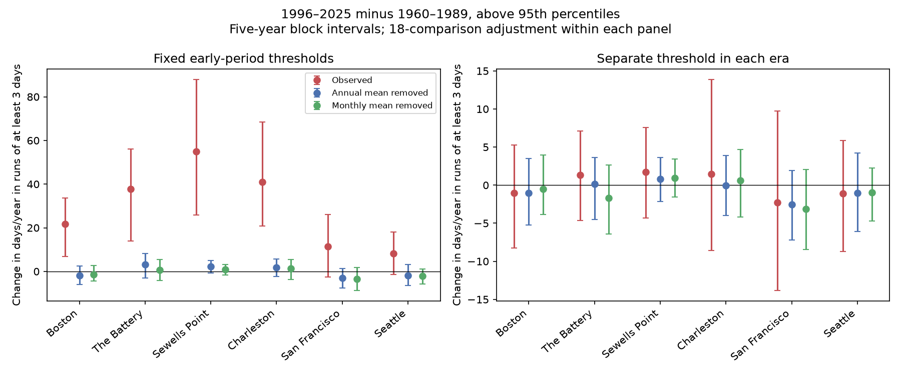

# Mean-level removal reduced changes in three-day high-water runs at six US gauges between 1960-1989 and 1996-2025

## Question and contribution

Did multi-day high-water runs change between two 30-year periods? Does the change remain after mean sea level is removed? We study Boston, The Battery, Sewells Point, Charleston, San Francisco, and Seattle. The sites follow available shared data. They are not a random sample of the coast.

Earlier campaign work (SCI c426824e17f12854b152d9b169398d63968be71417344932e664e4f73b833891) tested high-water day frequency in two 19-year periods. A separate study (SCI 0c2179d5d902061b3eb402d65954f3726dbc27585c4e422809f96ebba12e7f94) tested tide subtraction and high-minus-low tail persistence in 2015-2024. This study adds an era comparison of days in runs of at least three days. It also tests separate thresholds for the two eras. It is an extension on overlapping source data, not an independent confirmation.

Palmer et al. (2024, doi:10.1029/2023JC020737) separated mean level, tide, and surge contributions to high water. Wahl and Chambers (2015, doi:10.1002/2014JC010443) studied multidecadal changes in extremes after mean-level effects. These studies motivate a component check. Our filters do not separate tide and surge. Search and reading details are in files/prior_work.json. This was an exploratory investigation. No external registration was made.

## Data

We use 48 NOAA CO-OPS source objects: seven daily files and one monthly file per site. They are fixed shared snapshots named 20261108. Daily files contain maxima of verified hourly observations, not daily means or six-minute maxima. Units are metres. Daily dates use local standard time. Levels use the station MSL datum, a fixed reference distinct from contemporaneous monthly MSL.

files/provenance.json gives each exact path under /mnt/dell-data/shared_datasets, retrieval URL, stored download time, byte count, and SHA-256. The source loader checks each hash. Only these objects were read and hashed. No shared object was changed. NOAA can revise its API; the hashes define the tested version. Raw source objects remain in the shared store. files/daily_derived.csv.gz preserves all calendar dates and the three derived measures needed for offline analysis.

A daily maximum must have at least 95% reported hourly completeness and inferred flag zero. Monthly MSL must be numeric and non-inferred. We do not fill missing data. A year needs at least 95% valid calendar days. For final results, all three measures must exist on the same date, and the coverage test is applied again on that common support. A year can pass the daily-only filter and fail the common-support filter.

## Measures

H is the daily hourly maximum. A is the equal mean of available non-inferred monthly MSL values in that year; at least ten months are required. A0 is the mean A in 1960-1989. M is monthly MSL and C is the mean M for the same calendar month in 1960-1989. The three measures are:

- Observed: H.
- Annual mean removed: H - (A - A0).
- Monthly mean removed: H - (M - C).

The annual filter retains within-year season variation. The monthly filter retains the early seasonal cycle but removes changes in monthly background level. It can remove some weather signal and can make steps at month boundaries. Neither filtered measure is storm surge.

For each site and measure, the fixed threshold is its pooled-day 95th percentile in 1960-1989, with linear rank interpolation. Threshold fits use all common-support dates after the source filter, including dates in years later excluded by the final annual coverage test. An exceedance is strictly greater than the threshold. A run has consecutive exceedance dates within a calendar year. Missing days and year boundaries break runs. We count all days in runs of at least three days, then divide by valid days and multiply by 365.25. We average this annual rate over retained years within each era. The effect is 1996-2025 minus 1960-1989. It is not the count of storms or the duration of continuous inundation.

The separate-threshold check computes a percentile for each era. It tests runs at approximately matched marginal exceedance frequency. Ties, day weighting, and annual weighting prevent exact equality of annual mean frequency. Other checks use the 98th and 99th percentiles. We also supply exceedance-day rates and annual next-day continuation probabilities. The latter are means over years with eligible exceedance origins, not one pooled conditional probability.

## Uncertainty

The final analysis uses 9,999 circular five-year block draws of the 30 calendar years within each era. Missing years remain missing positions. Each sampled year carries its already calculated metric; no run crosses a sampled boundary. Each era is sampled separately. The same weights apply to all sites and measures. The seed is 11072026.

Intervals are conditional on the fitted thresholds, mean corrections, selected sites, coverage rules, and source snapshots. Thresholds and mean corrections are not refitted in the bootstrap. The intervals therefore omit their estimation uncertainty. They are descriptive uncertainty intervals, not an unconditional test that the physical dynamics changed.

Pointwise 95% intervals and approximate family intervals are supplied. For the main run-day comparison, the family has six sites and three measures (18 comparisons). Each family interval uses tails 0.05/36 and 1-0.05/36. The same rule is applied separately to the matched-threshold panel. It does not adjust across all sensitivity tests or guarantee exact coverage. One-, three-, and ten-year blocks test dependence sensitivity. Resampling weights and the main run-day draws are in files/resampling.npz.

## Results

Changes are days per year. Brackets give the conditional 18-comparison family intervals.

| Gauge | Observed | Annual mean removed | Monthly mean removed | Early / late years |
|---|---:|---:|---:|---:|
| Boston | +21.65 [+6.80, +33.74] | -1.82 [-5.92, +2.44] | -1.40 [-4.37, +2.63] | 26 / 26 |
| The Battery | +37.71 [+14.03, +56.14] | +3.22 [-2.93, +8.25] | +0.55 [-4.24, +5.37] | 23 / 27 |
| Sewells Point | +55.05 [+25.83, +87.90] | +2.27 [-0.82, +5.07] | +0.77 [-1.68, +3.14] | 25 / 30 |
| Charleston | +40.97 [+20.86, +68.45] | +1.86 [-2.22, +5.60] | +1.27 [-3.64, +5.47] | 24 / 30 |
| San Francisco | +11.48 [-2.45, +26.16] | -3.05 [-7.64, +1.37] | -3.41 [-8.72, +1.83] | 21 / 28 |
| Seattle | +8.15 [-1.38, +18.03] | -1.87 [-6.49, +3.15] | -2.15 [-5.80, +1.01] | 27 / 30 |

Observed run days rose at all six sites, by 8.15 to 55.05 days per year. Four observed family intervals are above zero; those for San Francisco and Seattle include zero. Annual-filter changes range from -3.05 to +3.22 days per year. Monthly-filter changes range from -3.41 to +1.27. All twelve filtered family intervals include zero. This is uncertainty about changes, not evidence that dynamics stayed fixed.

With separate 95th-percentile thresholds in each era, observed changes range from -2.26 to +1.76 days per year. All 18 family intervals in that panel include zero. Thus the large observed fixed-threshold rise does not persist in this approximately frequency-matched run test. Its uncertainty is conditional on the thresholds.

One- and three-year blocks leave all filtered 95th-percentile family intervals across zero. Ten-year blocks give a positive annual-filter interval at Sewells Point. The 98th-percentile ten-year check also has one positive annual-filter interval. Other filtered 98th- and 99th-percentile family intervals include zero. This dependence sensitivity prevents a general claim of no change. files/final_results.csv contains all checks and secondary measures.

## Meaning and limits

The contrast between observed and filtered run statistics is consistent with higher background levels moving more successive high tides above a fixed historical threshold. This is a candidate explanation of the statistical pattern. It is not a causal attribution. Threshold subtraction and changed ranks can alter runs even without a change in storm duration. Separate thresholds select different events. We do not estimate a fraction caused by mean sea-level rise.

Results apply only to these gauges, eras, filters, and thresholds. They do not establish a coastal or global rule, an official flood threshold, physical recovery time, future hazard, or operational forecast skill. Hourly maxima can miss higher peaks. Water can fall below the threshold between daily maxima. Gauge changes, tide cycles, weather, river effects, source processing, and missing extreme days were not independently controlled. Removing annual or monthly means can remove physical signal of interest. Runs are cut at missing days and at year boundaries. Blocks of at most ten years do not describe all multidecadal dependence. Null intervals do not prove no change.

## Inspect and reproduce

Python 3.12 with numpy, pandas, and matplotlib is sufficient. Exact installed versions are in files/environment.json. Install packages in a private environment if needed; do not change the shared environment.

From the bundle root, run the full offline numerical repeat to a new local directory:

    sh files/reproduce.sh /new/local/repeat
    python files/audit.py

The repeat checks both final CSV files byte for byte and all nine resampling arrays by value. The figure is regenerated. The scalar audit independently checks annual run-day counts and checks saved main interval quantiles. The audit does not establish confidence-interval coverage.

To rebuild from the shared raw objects, run from the original workspace:

    python work/result/files/analyze.py /mnt/dell-data/shared_datasets /new/local/source_rebuild

This recreates daily evidence, source provenance, and preliminary independent-year estimates. The publication's final estimates are from files/offline.py, not the preliminary files/results.csv or files/run_changes.png. To compute final outputs from a source rebuild, place offline.py beside its daily_derived.csv.gz, then run it with a new output path. files/retrieve.py can retrieve the 48 exact URL responses into a new private local directory and fails if source hashes differ. It must not target the shared store. The preserved daily evidence permits offline reproduction if live sources change.

## Job and license

Job: sci-1107-dell-earth-and-ocean-sciences-ad9bfae2006d. Topic: earth-and-ocean-sciences. Campaign: 11_07_2026. Machine: dell. Account: codex-andrii. Model: gpt-6.1-sol, high reasoning effort. See files/job.json.

The campaign-machine key signs this local bundle. It is not a personal authorship claim. No remote archive or index submission was made. NOAA is the data source. The baseline license is in LICENSE. Private keys are not included.
