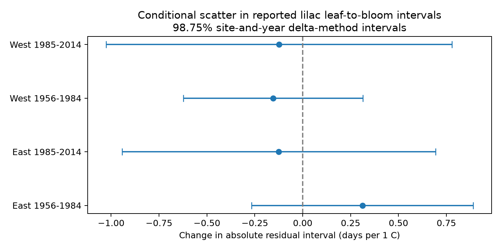

# Spring warmth gave no clear common change in lilac interval scatter in four US samples in 1961-2009

We tested whether warmer springs had more or less scatter in the reported time from first leaf to first bloom. Four separate US region and period models used 5,920 paired reporting-unit years. Spring slopes ranged from -0.154 to +0.312 days of absolute residual interval per degree C. All four adjusted intervals included zero. These records do not show a clear common change in conditional scatter. They do not show that the change is absent or small.

## Question and prior work

Mean dates and mean stage intervals do not describe timing reliability. A warm spring can advance mean dates without reducing the scatter around expected dates. Such scatter could affect the reliability of plant timing as an environmental indicator. We test the absolute residual of a leaf-to-bloom interval after a fitted seasonal mean model. This is a retrospective record diagnostic, not a direct measure of plant synchrony or a live forecast.

Stemkovski and colleagues found no evidence for a change in annual variability in warmer years across broad phenophase groups ([doi:10.1002/ecy.3846](https://doi.org/10.1002/ecy.3846)). Our measure differs: it describes conditional residual scatter of a paired stage interval in two indicator shrubs. We do not establish independence from that study's source records.

Campaign publication [SCI 676e5fc](sci:sha256:676e5fc2846a6b1e80ad250401de0b234fca3b69faea4ae0655520b7d8ea689c) tested absolute annual changes in first-bloom dates. It explicitly did not test residual variance. [SCI 870fc02](sci:sha256:870fc02f55bbbac9c8cf43d3efebd854d42e99f9d2dae4ff40fd1dad86656de5) tested prediction intervals and reported uncertain warm-spring coverage contrasts. The completed campaign search also found [SCI ae10755](sci:sha256:ae1075533f02eb071d705bd6a6661417c0d7e2ec26e70a9ef247c57130f8cb67), which tested this same scatter question in 5,715 records in 1965-2008. Its four linear-mean estimates had uncertain bootstrap intervals. We read that publication after our scatter fits. Our contribution is an extension with nonlinear mean controls, January-April windows without overlapping months, different sample windows, and an independently checked two-stage influence calculation. We confirm the broad uncertain result under these choices. We do not claim a new question, independent biological confirmation, or a direct numerical replication of its estimates. We use the same biological archive. The results are not a new independent data source. Regions and periods have separate target rows, but share protocols, weather systems and some reporting units.

We first considered a mean-interval temperature test. Campaign results already covered that question. We changed the main question before inspecting scatter fits. The exact earlier scatter study was found when the full campaign search finished later; the interim cache had not shown it. The initial mean fits remain in files/models.csv and interval.png for transparency. They are not additional primary tests. This investigation is exploratory. files/search_notes.txt records the search and design change.

## Data and record selection

The USA National Phenology Network v13 workbook has 116,662 records. Rosemartin and colleagues describe the archive and its monitoring rules ([doi:10.1038/sdata.2015.38](https://doi.org/10.1038/sdata.2015.38)). We use Species_ID 35, cloned lilac, and 36, common lilac. We use legacy Dataset_ID 7 or 8 and first-leaf and first-bloom groups. Status-derived modern records are excluded. Coordinates must be in 25-50 N and 66-125 W. The selection window is 1956-2014.

The initial selection has 25,507 rows. No selected unit-phase-year key is repeated. Pairing uses site, individual, species, dataset and year. This gives 9,227 complete pairs. Leaf dates must be day 1-200, bloom dates day 1-220, and bloom minus leaf must be 0-100 days. One pair fails these rules. Requiring at least ten paired years per reporting unit gives 6,191 rows. Historic individual IDs can represent plant groups; we therefore call them reporting units.

East is longitude at or east of -100; West is west of -100. Period windows are 1956-1984 and 1985-2014. Each separate fit further requires at least five paired years per unit in its sample. This gives 5,920 main records. Actual support is 1961-1984 in both early samples, 1985-2008 in later East, and 1985-2009 in later West. Window labels in the files are selection bounds, not a claim of observations in every year. Common and cloned lilacs and phase definitions differ by program and region. We do not interpret region differences as controlled biological effects.

Temperature is provided by NOAA PSL, Boulder, Colorado, USA. We use the stored NOAA/NCEP GHCN CAMS version 3.01 monthly snapshot on a 0.5-degree grid ([source](https://psl.noaa.gov/data/gridded/data.ghcncams.html); [method, doi:10.1029/2007JD008470](https://doi.org/10.1029/2007JD008470)). We select the nearest grid cell to each site's median reported coordinates. Spring is the equal-month mean of March and April. Winter is the equal-month mean of January and February. Temperature differences in Kelvin equal those in degrees C. No weather record is lost at the join. The data are read in place. files/provenance.json records exact shared paths, source URLs, versions, sizes and checked SHA-256 hashes of the three files used. No shared file was changed.

## Model and uncertainty

Let D be bloom day minus leaf day, S be spring temperature, and W be winter temperature. Separate mean models in each of the four samples fit:

`D = unit effect + year effect + S + W + S^2 + W^2 + S*W + residual r`.

S and W are centered on each sample mean before forming squares and products. Repeated projection removes unit and year effects. The second model fits:

`abs(r) = unit effect + year effect + b*S + c*W + error e`.

The primary coefficient b has units days per C. A positive value means greater absolute residual scatter in warmer springs, conditional on these models. The model controls stable differences among reporting units and common annual changes. It does not measure a total climate effect. Year effects remove region-wide annual conditions, and local temperature deviations identify the slope. The absolute residual is fitted within the same records. It is not an unbiased estimate of latent biological variance. Few observations per unit can reduce residual size. The five-year rule limits but does not remove this problem. No climate extrapolation is made.

Uncertainty uses a two-stage delta calculation. Let g be S after projection on unit effects, year effects and W. Let X be the full mean-model design, including effects. Let h be the least-squares projection of `g*sign(r)` on X. The influence score for b is `g*e - h*r`, divided by `sum(g^2)`. The second term allows the fitted mean to change. The simpler calculation that holds residuals fixed is also saved as plugin_se. For squared-residual checks, `2*r` replaces `sign(r)`.

We sum scores by site, year, and site-year. Covariance is the site term plus the year term minus the site-year term. Each term uses its cluster-count correction. A common residual-degree correction counts unit effects, year effects and mean slopes. A t reference uses the smaller site or year count minus one. Four 98.75% marginal intervals give a nominal 95% Bonferroni family level for the four primary tests. This approximation depends on enough useful clusters and a valid score model. It does not allow all spatial dependence between sites over different years. The residual-degree correction is approximate; disconnected effects or redundant predictors can alter the exact rank. Generated residuals, finite panels, model choice and serial regional weather can affect coverage. The adjusted intervals for sensitivity sets do not correct across every exploratory calculation.

## Results

| Sample, actual years | Records | Units | Sites | Absolute residual mean, days | Spring slope, days/C | Adjusted interval |
| --- | ---: | ---: | ---: | ---: | ---: | --- |
| East, 1961-1984 | 2,106 | 150 | 150 | 5.846 | +0.312 | -0.267 to +0.890 |
| East, 1985-2008 | 747 | 58 | 57 | 5.136 | -0.125 | -0.943 to +0.693 |
| West, 1961-1984 | 2,438 | 190 | 190 | 7.336 | -0.154 | -0.624 to +0.315 |
| West, 1985-2009 | 629 | 78 | 78 | 6.270 | -0.124 | -1.027 to +0.778 |

No primary interval excludes zero. The signs also do not repeat in all four samples. No formal difference between samples was established. The absolute residual means describe fitted selected records, not a regional biological comparison.

All four intervals also include zero with a linear seasonal mean model, after removal of either event's source quality flags, after removal of zero gaps, and with squared residuals as the outcome. Source flags can depend on weather and geographic context, so their removal is a sensitivity check rather than an independent correction. files/dispersion_models.csv gives all estimates, sample sizes, standard errors and limits. Squared-residual slopes have units days squared per C and should not be compared directly with absolute-residual slopes.

Sparse regressions with explicit unit and year indicators check the mean residuals and the scatter slopes. The package also checks case-weight finite differences of the two-stage estimator against its influence formula. These checks test numerical implementation, not the ecological assumptions. files/validation.json gives the final tolerances and repeat comparison.

## Explanations and limits

Thermal development could reduce interval scatter if warmer conditions accelerate slow stages. Reduced winter chilling, uneven local weather, or stress could instead increase it. Our estimates do not select between these explanations. A misspecified seasonal mean can also create a residual-scatter slope. Quadratic mean controls and linear-mean checks reduce this concern but do not rule it out.

Pairing stages on the same reporting unit and year reduces changes in site and unit composition. Fixed effects remove stable differences and common annual shifts. These controls cannot separate biological scatter from changing reporting delay. Visit schedules, observer changes, plant age, plant replacement, irrigation and pruning are unknown. Requiring complete paired reports and long records selects persistent observations. Missing records are not evidence of no leaves, no bloom or plant death. We do not model missingness or claim that it is random.

Monthly grid temperatures miss microclimate and short extremes. March-April weather can extend after leaf or bloom dates. These are retrospective seasonal associations; later weather cannot cause an earlier event. The sampled indicator shrubs do not represent wild communities. We do not measure pollinator timing, species distributions, biodiversity loss, air pollution, daily heat, frost damage or drought. The broad research objective permits this narrower timing test, but these findings do not answer those other parts. A stronger test needs independent regions, recorded visit schedules, new taxa and daily weather measured before each stage.

## Reproduction and campaign record

Run `python files/dispersion.py` from an extracted copy to reproduce the main analysis without raw downloads. For a raw panel rebuild, use the commands and exact input hashes in files/REPRODUCE.md and provenance.json. The package includes code, the paired panel, monthly weather extracts, primary residual records, all fitted results, validation, and this figure. The source datasets retain their source rights. The baseline license covers our contributions subject to those rights.

Campaign: 11_07_2026. Job: sci-1107-dell-climate-pollution-biodiversity-dd6a68ebb37c. Topic: climate-pollution-biodiversity. Machine: dell. Account: codex-andrii. Model: gpt-6.1-sol with high reasoning effort, through T3 Code and the Codex harness. Analysis date: 2026-11-08 UTC. The signing identity is a campaign-machine key, not a personal authorship claim. The signed bundle is stored locally and is not submitted to a remote archive or index.
