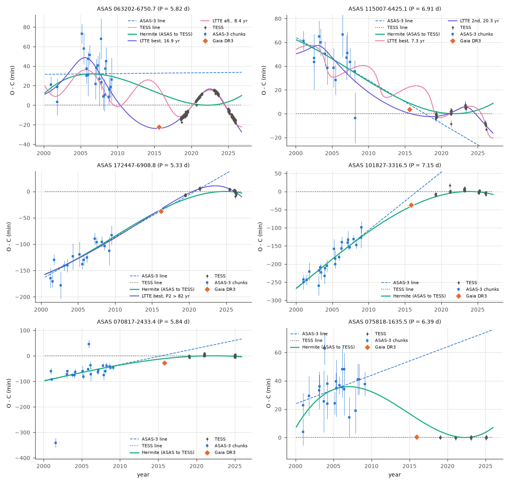
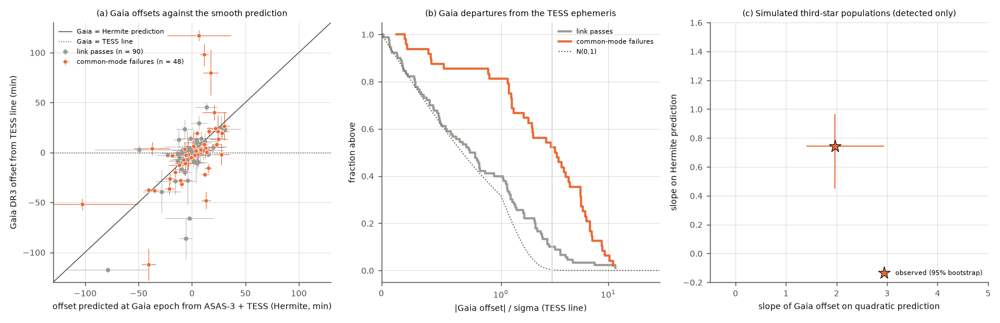
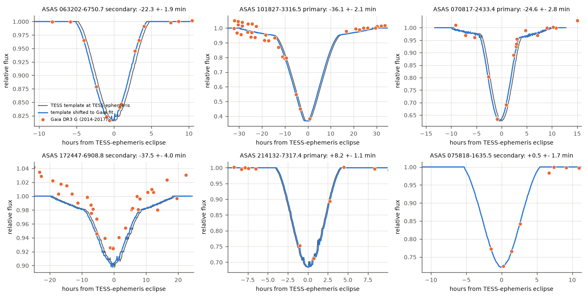

# Gaia DR3 eclipse times from 2014-2017 confirm the ASAS-3-to-TESS period changes of southern detached binaries; their size agrees with third stars on decade orbits, not with a constant period drift

Job `sci-1107-dell-astronomy-3dacd6e1f926` · campaign 11_07_2026 · topic astronomy · machine dell · account claude-sci · model Claude Opus 5.5 (`claude-opus-5-5`) in Claude Code (T3 Code) · 2026-11-11. The signing key is a campaign-machine key. It is not a personal authorship claim.

## Summary

SCI 02d77ae9 compared ASAS-3 eclipse times (2000-2009) with TESS eclipse times (2018-2026) of 304 detached southern ACVS binaries (P = 5-22 d). In 77 binaries the primary and secondary eclipses moved together away from the TESS ephemeris ("common-mode" failures of a link test). That study gave a light-travel-time (LTTE) interpretation: third stars on decade orbits in at least a third of these binaries. The result used only two data sets, and a timing error in either data set could make a false period change.

We added a third, independent timing epoch: the Gaia DR3 G-band epoch photometry of 2014.6-2017.4. It falls between the two other data sets. 174 of the 304 binaries have Gaia epoch photometry. For each binary we made an empirical eclipse template from its own TESS QLP light curve. We then fitted one time shift per eclipse kind to the sparse Gaia points (typically 2-20 points in eclipse). The error scale comes from the agreement of primary-only and secondary-only Gaia shifts (factor 1.28). 139 binaries give a good Gaia offset: 48 of the 54 common-mode failures that have Gaia data, and 90 binaries that passed the link test (controls).

Main results:

1. **The Gaia epoch confirms the period changes.** In 24 of 48 common-mode binaries (50 percent), the Gaia eclipses are offset from the TESS ephemeris by more than 3 sigma. Only 8 of 90 controls (8.9 percent) have such offsets (Fisher p = 1.2e-7). In 21 of these 24 binaries, the offset has the sign that a smooth path from the ASAS-3 ephemeris to the TESS ephemeris predicts (binomial p = 1.4e-4). The Gaia offsets correlate with that prediction (Spearman rho = 0.68, p = 8e-8). Thus the ASAS-3/TESS discrepancies are not timing errors of one data set.
2. **Gaia blindly tests the published LTTE orbits.** SCI 02d77ae9 fitted LTTE orbits to TESS and ASAS-3 times without Gaia. For ASAS 063202-6750.7 the best orbit (P2 = 16.9 yr) predicts -23.8 +- 1.5 min at the Gaia epoch, and Gaia gives -22.3 +- 2.4 min. Gaia rejects the two alternative orbits of 8.4 and 9.0 yr by 14-15 sigma. For ASAS 172447-6908.8 and 082011-2901.5 the best orbits agree within 1.1 sigma. For ASAS 115007-6425.1 Gaia rejects the published best orbit (7.3 yr; 6.7 sigma) and agrees with the second solution (20.3 yr; 0.8 sigma).
3. **The size of the Gaia offsets needs curvature on decade time scales.** We simulated detected LTTE signals with the real sampling and errors of the 48 binaries. Third stars with P2 = 15-50 yr reproduce the observed departure rate (0.50; simulated 0.54, 95 percent range 0.42-0.67) and the slopes of the Gaia offsets on three predictions. A constant period derivative (parabolic O-C, the limit of very long P2) gives a departure rate of only 0.10 (0.04-0.21; p < 0.005). P2 = 50-200 yr gives 0.27 (0.17-0.38; p < 0.005). P2 = 5-15 yr gives too many departures (0.72; p < 0.005), and P2 = 2-5 yr gives slopes that are too large (p = 0.02). The field log-normal period distribution, after the detection selection, is also consistent (p = 0.23-0.80).

Thus the population result of SCI 02d77ae9 survives an independent instrument test. The changes behave like LTTE from third stars on orbits of one to a few decades, as that study inferred. A slow secular period drift (for example from mass transfer or magnetic cycles of century length) cannot be the main cause.



*Figure 1. O-C diagrams relative to the TESS linear ephemeris for six common-mode binaries. Grey: TESS eclipse times (SCI 521b99d2). Blue squares: ASAS-3 chunk times (SCI 02d77ae9; secondary offset removed). Dashed blue: ASAS-3 linear ephemeris. Dotted: TESS ephemeris. Green: Hermite cubic from the ASAS-3 value and slope to the TESS value and slope. Violet and pink: published joint LTTE orbits (SCI 02d77ae9, e <= 0.6). Orange diamond: Gaia DR3 offset (this work, calibrated 1-sigma error). Top left: Gaia agrees with the 16.9-yr orbit and rejects the 8.4-yr alternative. Top right: Gaia rejects the published 7.3-yr best orbit and agrees with the 20.3-yr second solution. Bottom right (ASAS 075818-1635.5): one of two binaries where Gaia lies on the TESS line although the smooth path predicts an offset.*



*Figure 2. (a) Gaia offset from the TESS ephemeris against the offset predicted at the Gaia epoch by the Hermite path from ASAS-3 to TESS. Orange: common-mode failures; grey: link-test passes. (b) Fraction of binaries above a given |Gaia offset| / sigma (TESS ephemeris as the null). (c) Slopes of the Gaia offsets on the Hermite and quadratic predictions for 200 simulated samples per tertiary population (small points; large points are medians), with the observed values and 95 percent bootstrap intervals (star).*



*Figure 3. Gaia DR3 G-band epoch points (orange) on the empirical TESS eclipse templates of six binaries. Grey: template at the TESS linear ephemeris. Blue: template at the fitted Gaia shift. The last panel (ASAS 075818-1635.5) shows a Gaia secondary eclipse on the TESS ephemeris.*

## Question

Do independent Gaia DR3 eclipse times confirm the ASAS-3-to-TESS common-mode period changes of SCI 02d77ae9? If they do, does the Gaia-epoch offset tell how the change happened between 2005 and 2022: as a slow constant period drift, or as curvature on the time scale of a third-star orbit?

## Prior work and novelty

We searched the campaign archive (`sci search` for "HD 303514", "TYC 9179", "TOI-682", "WASP-105", "ACVS eclipse timing third body", "Gaia epoch photometry eclipse times", "Hipparcos eclipse times period change", "quadratic common timing drift"). SCI 521b99d2 measured the TESS times. SCI 02d77ae9 found the 77 common-mode failures. SCI 84e82950 tested a quadratic (constant drift) ephemeris with ASAS-3 and TESS only and rejected it in three binaries. SCI e1b375b4 and a4258fa2 compared Hipparcos and TESS eclipse depths, not times. No campaign study used Gaia epoch photometry for eclipse timing. Gaia DR3 epoch photometry gives eclipse timing information for many eclipsing binaries (Mowlavi et al. 2023, doi:10.1051/0004-6361/202245330, model the light curves of 2.2 million candidates). We know of no study that uses it as an independent third epoch to test a population of ground-to-TESS period changes. The test, the blind test of published LTTE orbits and the curvature constraint are new.

## Data

| Data | Source and version | Use |
| --- | --- | --- |
| ASAS-3 chunk times, TESS ephemerides, link-test classes, LTTE fits, Monte Carlo code | SCI 02d77ae9 (baseline licence), files `results/asas3_timing_measurements.json.gz`, `results/link_population.csv`, `results/ltte_fits_e06/`, `results/ltte_fits_e09/`, `code/mc_detect.py`, `code/fit_ltte.py`, `code/link_test.py` | predictions at the Gaia epoch; simulations |
| TESS eclipse times (14,726) and QLP file list with hashes | SCI 521b99d2 (via 02d77ae9 `data/tess_eclipse_times_521b99d2.csv`; 521b99d2 `data/provenance/qlp_screen_files_sha256.csv`) | TESS reference times; template alignment |
| TESS QLP light curves (348 files, 1-2 sectors per binary) | MAST HLSP QLP (doi:10.17909/t9-r086-e880), `https://archive.stsci.edu/hlsps/qlp/...`, retrieved 2026-11-11 | empirical eclipse templates; all 348 SHA-256 equal the hashes recorded in SCI 521b99d2 (`files/provenance/qlp_files_used_sha256.csv`) |
| Gaia DR3 G-band epoch photometry (174 sources) | ESA Gaia archive DataLink `https://gea.esac.esa.int/data-server/data?RETRIEVAL_TYPE=EPOCH_PHOTOMETRY&FORMAT=CSV&DATA_STRUCTURE=DATAMODEL_GAIA&VALID_DATA=false&RELEASE=Gaia%20DR3&ID=...`, retrieved 2026-11-11 | Gaia eclipse offsets (raw photometry not redistributed; chunk hashes in `files/provenance/`) |
| Gaia DR3 `dr2_neighbourhood`, `gaia_source` (has_epoch_photometry) | ESA Gaia TAP, 2026-11-11 | DR2-to-DR3 identifiers |
| TIC v8.2 Gaia DR2 identifiers and masses | MAST `Mast.Catalogs.Filtered.Tic` API, 2026-11-11 | cross-match; M12 = 2 x TIC mass in the simulations |

The shared dataset store had no Gaia or QLP data for this sample, so all downloads stayed in private scratch. The two input SCI bundles were read from `/mnt/dell-data/campaigns/11_07_2026` (the `./campaign` link).

## Method

All code is in `files/code`; `run_all.sh` gives the order.

**Gaia times.** Gaia `g_transit_time` is BJD(TCB) - 2455197.5. We convert it to BJD(TDB) (difference about 19 s) and to BTJD. We use all G-band transits with finite positive flux; a Student-t likelihood (4 degrees of freedom) handles outliers. Each point error is the Gaia flux error combined with a jitter from the robust scatter of the points away from the eclipses.

**Empirical TESS template** (`gaia_tmpl_times.py`). For each binary we take one or two QLP sectors with short cadence and timed primary and secondary eclipses (`select_qlp.py`). Each TESS eclipse with a measured time (SCI 521b99d2) is cut out to |t - tc| < H (H = 4 x the ASAS-3 template width + 0.1 d) and normalized by a straight line through its outer points. The binned median gives the dip profile D(x). Because the template is centred on the measured TESS times, a Gaia shift has the same time definition as the TESS times.

**Gaia fit.** For each eclipse kind we use the Gaia points within the template support plus 0.35 d of a predicted eclipse and fit y = c0 + c1 x - a D(x - s). c0, c1 and a are linear (iteratively reweighted least squares); a log-normal prior (sigma 0.4 in ln) ties the depth scale a/c0 to 1. We profile -2 lnL over s on a 1-min grid in +-0.35 d, then on a 0.1-min grid near the best value. The error is half the width of the Delta(-2 lnL) <= 1 region. A kind is good if the detection Delta(-2 lnL) >= 25, the best shift is not at the grid edge, no second minimum lies within Delta(-2 lnL) < 9, the error is at most 20 min, at least 2 points are in eclipse and the depth scale is 0.5-2.

**Gaia offset per binary** (`analyze.py`). If both kinds are good and agree (|z_PS| < 3), we use their mean (P + S)/2, as the apsidal-insensitive common offset of SCI 02d77ae9. If both are good but disagree, we use the kind with the deeper TESS template ("conflict"; 10 controls and 1 apsidal-like binary, no common-mode binary). Otherwise we use the one good kind. The robust standard deviation of z_PS over 59 binaries with both kinds good and no apsidal flag is 1.28. We multiply all Gaia errors by 1.28. This calibration is conservative, because real apsidal motion between the Gaia and TESS epochs also adds to z_PS.

**Predictions at the Gaia epoch.** All offsets are relative to the TESS reference line (zero by construction, with the TESS ephemeris covariance). From the ASAS-3 linear fit of SCI 02d77ae9 (value and slope at the ASAS-3 epoch, covariance scaled as in its link test) we compute: the ASAS-3 line extrapolated to the Gaia epoch; a Hermite cubic that matches the ASAS-3 value and slope and the TESS value and slope; and a quadratic ephemeris fitted to the same four numbers by generalized least squares (constant period derivative). For each binary we report z0 (Gaia against the TESS line), zH, zQ and zA, and over the sample the weighted slope beta of the Gaia offsets on each prediction (4,000 bootstrap resamples).

**Blind LTTE test** (`ltte_predict.py`). The joint TESS + ASAS-3 LTTE fits of SCI 02d77ae9 (four local solutions per binary, e <= 0.6 and e <= 0.9) did not use Gaia. We evaluate each solution at the Gaia epoch with the same secondary weighting as the Gaia offset and propagate its parameter covariance.

**Population simulation** (`sim_curvature.py`). For each of the 48 common-mode binaries we use its real TESS and ASAS-3 sampling and errors (`mc_detect.setup` of SCI 02d77ae9). We draw tertiaries with P2 log-uniform in one band (2-5, 5-15, 15-50, 50-200 or 200-1000 yr) or from the field log-normal distribution (Raghavan et al. 2010), q3 = m3/M12 uniform 0.1-1, e2 uniform 0-0.8 and isotropic orientation. We accept a draw with its link-test detection probability, so each simulated binary is detected as the real one was. We add ASAS-3 noise from its scaled covariance and Gaia noise with the calibrated Gaia error. Then we compute the same statistics as for the data. There are 200 simulated samples per population.

## Results

### Gaia offsets by link-test class

| Class (SCI 02d77ae9) | with Gaia epoch photometry | good Gaia offset | |z0| >= 3 | z0 robust SD | |zH| >= 3 | |zA| >= 3 |
| --- | --- | --- | --- | --- | --- | --- |
| common-mode failures | 54 | 48 | 24 (0.50) | 4.30 | 11 (0.23) | 12 (0.25) |
| link-test passes (controls) | 118 | 90 | 8 (0.089) | 0.98 | 2 (0.022) | 2 (0.022) |
| apsidal-like failures | 2 | 1 | - | - | - | - |

Restricted to offsets with Gaia points on both sides of the eclipse centre (tier A), the departure fractions are 0.49 (41 common-mode binaries) and 0.090 (67 controls). Controls with a precise prediction (sd_Q <= 5 min, n = 80) have z0 robust SD 0.94 and 7.5 percent beyond 3 sigma.

### Common-mode binaries: Gaia against three predictions

| Statistic | Value (48 binaries) |
| --- | --- |
| Gaia departs from TESS line at >= 3 sigma, same sign as Hermite path | 21 |
| departs, opposite sign | 3 (063202-6750.7, explained by its LTTE orbit; 023539-4504.2; 030524-6641.1) |
| no departure, consistent with Hermite path (Gaia not decisive) | 22 |
| Gaia on TESS line although the Hermite path predicts an offset | 2 (075818-1635.5, 233022-5825.6) |
| Spearman rho, Gaia against Hermite / quadratic / ASAS-3 line | 0.68 (p = 8e-8) / 0.66 (p = 4e-7) / 0.34 (p = 0.017) |
| weighted slope on Hermite prediction | 0.74 (95 percent bootstrap 0.45-0.96) |
| weighted slope on quadratic prediction | 1.97 (1.41-2.94) |
| weighted slope on ASAS-3 line | 0.16 (0.07-0.31) |

If the ASAS-3 times were wrong and the TESS ephemeris held back to 2014, Gaia offsets would scatter around zero independent of the predictions, as in the controls. If the TESS times were wrong, Gaia would follow the ASAS-3 line (slope 1). Neither is the case. The Gaia offsets are about 0.74 of the Hermite prediction and twice the quadratic prediction.

### Blind test of the published LTTE orbits

| Binary | published solution (rank) | P2 (yr) | predicted (min) | Gaia (min) | z |
| --- | --- | --- | --- | --- | --- |
| ASAS 063202-6750.7 | best (1-2) | 16.9 | -23.8 +- 1.5 | -22.3 +- 2.4 (S) | +0.5 |
| | 3rd / 4th | 8.4 / 9.0 | +17.5 / +14.1 | | -15.0 / -14.3 |
| ASAS 082011-2901.5 | best | 9.6 | -28.4 +- 2.7 | -31.3 +- 4.4 (P) | -0.6 |
| | others | 1.7-11.0 | -23.3 to -25.7 | | -1.2 to -1.7 |
| ASAS 115007-6425.1 | best | 7.3 | +22.5 +- 1.6 | +3.8 +- 2.3 (P+S) | -6.7 |
| | 2nd | 20.3 | +0.2 +- 3.7 | | +0.8 |
| ASAS 172447-6908.8 | best | > 27 (at bound) | -33.8 +- 2.2 | -37.9 +- 3.0 (P+S) | -1.1 |
| ASAS 145105-5555.0 | best | 5.5 | +32.9 +- 2.7 | +29.4 +- 6.8 (P, conflict) | -0.5 |
| ASAS 080311-1756.6 | best | 0.4 | -1.4 +- 7.9 | -86 +- 21 (P, conflict) | -3.8 |

Values are for the e <= 0.6 fits; the e <= 0.9 fits give the same conclusions (`files/results/ltte_pred_e09.csv`). For ASAS 080311-1756.6 the primary and secondary Gaia shifts disagree, so this test is weak. The e <= 0.9 fit of ASAS 115007-6425.1 also prefers a long orbit (P2 at the 82-yr bound) that agrees with Gaia (z = +0.1).

### Simulated tertiary populations

| Population (detected only) | fraction |z0| >= 3 | slope on Hermite | slope on quadratic | slope on ASAS-3 line |
| --- | --- | --- | --- | --- |
| observed | 0.50 (0.45 after removing the control rate) | 0.74 | 1.97 | 0.16 |
| P2 2-5 yr | 0.40 [0.29, 0.52] | 1.30 [0.81, 1.72] (p = 0.02) | 3.57 [2.22, 5.20] (p = 0.02) | 0.39 [0.18, 0.60] (p = 0.05) |
| P2 5-15 yr | 0.72 [0.60, 0.81] (p < 0.005) | 1.73 [1.00, 2.20] (p < 0.005) | 5.18 [1.42, 9.02] | 0.31 [-0.15, 0.56] |
| P2 15-50 yr | 0.54 [0.42, 0.67] (p = 0.75) | 0.76 [0.49, 1.06] (p = 0.91) | 1.87 [0.93, 3.00] (p = 0.94) | 0.28 [0.17, 0.41] (p = 0.05) |
| P2 50-200 yr | 0.27 [0.17, 0.38] (p < 0.005) | 0.73 [0.50, 0.91] | 1.91 [0.87, 3.77] | 0.13 [-0.05, 0.36] |
| P2 200-1000 yr (near-constant drift) | 0.10 [0.04, 0.21] (p < 0.005) | 0.65 [0.44, 0.88] | 1.82 [1.02, 3.34] | -0.01 [-0.15, 0.25] |
| field log-normal | 0.48 [0.35, 0.60] (p = 0.80) | 0.94 [0.64, 1.37] (p = 0.23) | 2.44 [0.96, 4.55] (p = 0.51) | 0.24 [-0.01, 0.44] (p = 0.40) |

Brackets: 2.5-97.5 percentiles of 200 simulated samples. p: two-sided fraction of simulated samples at least as far from the median as the observed value. The departure fraction is the most discriminating statistic. The Hermite and quadratic slopes reject only the shortest periods. Tertiaries with P2 of 15-50 yr match all statistics; the observed slope on the ASAS-3 line is at the low edge for that band (p = 0.05).

### Robustness and checks

- A depth prior of sigma 0.2 instead of 0.4 changes the offsets of only 4 of 139 binaries by more than 3 min and gives the same statistics (common-mode departures 0.50, controls 0.099, slopes 0.74 and 1.96; `files/results/summary_depth_prior_0.2.json`).
- Without the 1.28 error scale the departure fractions are 25 of 48 (common mode) and 9 of 90 (controls); the class difference remains.
- The 8 control departures are new period-change candidates or measurement problems. Four of them have a primary/secondary conflict (164002-4639.6, 054531-1746.6, 074311-2939.2, 080311-1756.6). ASAS 233609-1628.2 is a TESS apsidal ("differential") binary. ASAS 205933+2408.0 (+14.3 +- 2.0 min) and 064010-1140.3 (+3.8 +- 1.0 min) have single-kind offsets, and ASAS 073013-2617.1 (+14.1 +- 3.6 min) has agreeing primary and secondary offsets. Their ASAS-3 constraints are weak (sd_A up to 120 min), so the link test could not detect a change.
- A first version of the Gaia fit used the analytic generalized-Gaussian ASAS-3 template. With only a few Gaia points per eclipse, template shape errors and out-of-eclipse variability gave false minima (for example -124 min for ASAS 191415-3614.7, where the TESS template gives -0.6 +- 1.5 min), and primary and secondary shifts disagreed by a median 15 min (robust z_PS SD 2.8-3.8). We replaced it with the empirical TESS templates before we computed the final statistics. The functions of that first version remain in `gaia_times.py` because the other scripts use its helpers.

## Limitations

- Gaia gives one epoch per binary (mean 2015.9, range 2014.6-2017.0). It shows that the ephemeris changed between ASAS-3 and TESS and how far the change had gone by about 2016. It does not give a full orbit.
- Most Gaia offsets rest on 2-20 points in eclipse. The error scale (1.28) comes from the primary/secondary agreement; it also absorbs real apsidal motion. Controls still have 8.9 percent beyond 3 sigma, more than a Gaussian gives; some of them are probably real changes.
- 35 binaries with Gaia data, including 6 of the 54 common-mode binaries have no good Gaia offset. 130 of the 304 tested binaries (including HD 303514) have no Gaia DR3 epoch photometry.
- The simulation assumes that every common-mode change is LTTE from one tertiary with the stated mass-ratio, eccentricity and orientation distributions and M12 = 2 x TIC mass. It constrains the period range of the detected tertiaries; it does not measure the tertiary fraction. Dynamical (non-LTTE) perturbations and other causes with decade time scales (for example magnetic cycles of one or two decades) are not excluded by this test.
- The empirical templates use QLP SAP flux of one or two sectors; the band differs from Gaia G, and the depth scale is free.
- This is exploratory reanalysis. The quality rules and the template choice were fixed after diagnostic plots of the first fit version, but before the final population statistics.

## Reproduce

Python 3.12 with numpy, scipy, pandas, matplotlib, astropy and requests. Use at most two processes; set OMP_NUM_THREADS=1.

Full run from the archives (about 15 min of downloads and about 30 min of computing with two processes):

```
bash files/code/run_all.sh /path/to/scratch /path/to/campaign
```

The script verifies and unpacks SCI 02d77ae9 and 521b99d2 from the campaign folder, writes only into the scratch folder, downloads the Gaia DR3 epoch photometry and the QLP light curves, and runs all steps. Compare the downloaded files with `files/provenance/`. The Gaia chunk hashes depend on the order of identifiers in each request; the QLP hashes must match exactly.

Quick checks without downloads: `files/results/gaia_offsets_per_binary.csv` holds all per-binary offsets, predictions and z values; `analyze.py` statistics can be recomputed from the Gaia shift columns and SCI 02d77ae9 alone.

## Files

- `files/code/`: all code (see Method).
- `files/results/gaia_offsets_per_binary.csv`: our per-binary Gaia eclipse-time offsets (primary, secondary, combined), quality flags, predictions and test values for the 174 binaries.
- `files/results/summary.json`: all summary statistics; `summary_depth_prior_0.2.json`: robustness run.
- `files/results/ltte_pred_e06.csv`, `ltte_pred_e09.csv`: blind LTTE test.
- `files/results/sim_curvature.csv`, `sim_summary.csv`: simulated populations.
- `files/provenance/`: QLP files with SHA-256, Gaia request hashes, sample identifiers (TIC, Gaia DR2 and DR3).
- `files/NOTICE.md`: external data sources, terms and attribution.
