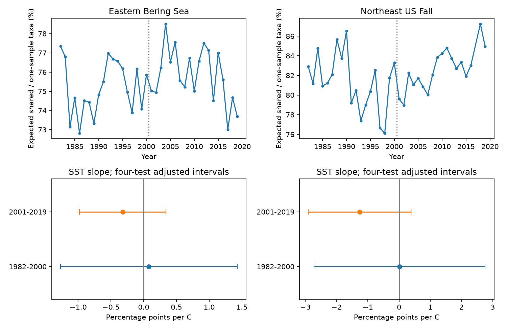

# Sea warmth gave no clear link to expected shared-taxa fractions in four US trawl samples in 1982-2019

We tested whether warmer survey seasons had a lower fraction of taxa expected in both of two samples with fixed effort. We used eastern Bering Sea and Northeast US fall trawl records in two periods. All four adjusted temperature slope intervals included zero. The result does not establish a stable temperature link or prove that the link is absent.

## Question and prior work

A prior campaign study found a positive temperature-richness link in the early Northeast and a negative link in late Bering records after fixing haul counts within strata (SCI 3551fe2177f2406d73e5b6fcb8046eed5e9d392af34b4b87cbdde5a73f3c2d7d). Could a change in taxa that are easy to miss explain those links? We test a related diagnostic: the fraction of expected richness that is shared by two disjoint samples of the same size. This is a calculation from a finite catch table. It is not a test with new repeat surveys or a species detection model.

OceanAdapt supplies catch records and methods for distribution indicators. Pinsky et al. (2013, doi:10.1126/science.1239352) linked marine distribution shifts to climate velocity. Gotelli and Colwell (2001, doi:10.1046/j.1461-0248.2001.00230.x) explain effort and richness comparisons. Fredston et al. (2023, doi:10.1038/s41586-023-06449-y) found no consistent demersal fish biomass or turnover response to bottom heatwaves across many surveys. Our test uses seasonal surface temperature. It does not test heatwaves or repeat their analysis.

Campaign searches covered phenology, climate, pollution, butterfly drought, OceanAdapt, and trawl repeat detection. We read the published fixed-effort richness study. We reuse its verified evidence tables and rebuild them from raw data. This is a new diagnostic on the same observations, not independent validation of that study. No new probability theorem is claimed.

## Data and record selection

We used the OceanAdapt catch file at commit 0d4bcaffe649e970674fe165fe892ab4d787e76a and NOAA ERSST v5 from a shared 2026-11-08 snapshot. Exact shared paths, resolved paths, URLs, versions, byte counts and SHA-256 hashes are in files/source_provenance.json. The raw files are used in place:

- /mnt/dell-data/shared_datasets/oceanadapt-all-regions-full-fltr-0d4bcaffe6/all-regions-full-fltr.csv.gz; SHA-256 cb632fe63d5dd0ff0000288673e59ebe59ae15e34a320b38e9308859353e2a41.
- /mnt/dell-data/shared_datasets/ersst-v5-psl-sst-mnmean-20261108-olen/sst.mnmean.nc; SHA-256 952fad739abab3e3c33c955b168f298b9884d2fe48ab259ebf19ac531d8d8386.

These shared compatibility paths point to the SSD dataset store. We made no shared data changes. We checked both raw hashes. All five saved evidence tables match a full rebuild from these raw files.

The sample has 75 region-years in 1982-2019. Northeast 2017 is absent and is not filled. A stratum must have at least two recorded hauls in each available year. Bering has 10 strata and 13,427 hauls. Northeast has 46 strata and 7,945 hauls. Fixed regional lists have 541 and 332 two-word genus-species labels. This name filter does not validate taxonomy. Positive catch per unit effort defines a detection. Identical haul-taxon repeats are reduced to one. A taxon with conflicting catch values in any retained haul is removed: Platichthys stellatus in Bering and Placopecten magellanicus in Northeast. All source labels help define the haul list, before this taxon filter. Missing rows within a recorded haul mean no detection. Completely absent hauls cannot be recovered.

Temperature is the area-weighted seasonal mean of fixed, nearest valid ERSST grid points at stratum centroids. Seasons are May-August in Bering and September-November in Northeast. ERSST has a two-degree grid. Saved monthly values and grid cells allow inspection. This is a regional surface proxy, not bottom temperature or actual temperature at a tow.

## Exact diagnostic

For taxon j in stratum s, n_s is the observed haul count and k_js is the count with positive catch. Draw one haul uniformly from each stratum for sample A, then a different haul from each stratum for sample B. Draws across strata are independent. Both samples have the same effort: 10 or 46 hauls. These sample sizes differ between regions, so regional levels are different targets.

The probability of no detection in one sample is:

    p0_j = product_s (n_s - k_js) / n_s

The probability of no detection in either sample is:

    p00_j = product_s [(n_s - k_js)(n_s - k_js - 1)] / [n_s(n_s - 1)]

A factor is zero if fewer than two no-detection hauls exist. By inclusion-exclusion, the probability of detection in both samples is 1 - 2*p0_j + p00_j. Expected one-sample richness is R1 = sum_j (1-p0_j). Expected union richness is R2 = sum_j (1-p00_j). Expected shared richness is S = 2*R1 - R2. Our main outcome is F = 100*S/R1.

F is a ratio of expectations. It is not the expectation of a sample-specific overlap ratio or Jaccard index. It is not detection probability conditional on true occupancy. Rare and spatially restricted taxa can lower F. Real community structure and observation practice can both change it. Two disjoint draws share the same finite empirical table and need not be statistically independent. The exact formula accounts for their dependence. No random subsampling is needed. The calculation fixes stratum coverage and haul counts, but not tow location within strata, catchability, gear, identification, or sampled area per tow.

## Models and uncertainty

The local plan in files/plan.txt was saved before these outcome fits. It is not external registration. We fit F = intercept + b*SST + c*year separately in 1982-2000 and 2001-2019 in each region. Each model has 18 or 19 annual units. We use HAC covariance with three observed-year lags and the n/(n-p) correction. Each interval uses a t quantile with n-p degrees of freedom and nominal 98.75 percent coverage. Bonferroni correction gives intended joint 95 percent coverage for four main slopes. This is an approximate short-series procedure, not a guarantee under arbitrary dependence. A lag is not always one calendar year because 2017 is absent.

Sensitivity checks use one or five covariance lags, consecutive-year differences with one covariance lag, and a 2009 step in the late Northeast model. The step addresses a known survey-change concern without identifying a gear effect. Each sensitivity family uses the same four-test rule. We do not claim joint error control over all choices. Separate slopes for S, R1-S, and R1 are descriptive decompositions with the same interval convention. They are outside the primary test family.

## Results

F ranged from 72.81 to 78.51 percent in Bering and from 76.10 to 87.25 percent in Northeast. These are empirical sampling diagnostics, not estimates of total biodiversity.

| Region | Period | Years | F slope, percentage points per C | Adjusted interval |
| --- | --- | ---: | ---: | --- |
| Eastern Bering Sea | 1982-2000 | 19 | 0.08 | -1.27 to 1.43 |
| Eastern Bering Sea | 2001-2019 | 19 | -0.32 | -0.98 to 0.34 |
| Northeast US Fall | 1982-2000 | 19 | 0.02 | -2.72 to 2.76 |
| Northeast US Fall | 2001-2019 | 18 | -1.26 | -2.91 to 0.39 |

All main intervals included zero. All one-lag and five-lag intervals also included zero. Difference-model slopes were 0.12, -0.47, -0.90 and -0.16 in table order; each adjusted interval included zero. The late Northeast step slope was -1.30 [-2.91, 0.32]. Thus the tested choices did not give a clear common temperature link to the shared fraction. Large or smaller links remain possible within the reported intervals.

The descriptive shared-richness slope was -2.96 expected taxa per C in late Bering and 5.48 in early Northeast. Their respective working intervals were [-4.47, -1.45] and [1.89, 9.06]. These are about 84 and 82 percent of the prior one-sample richness point slopes. The decomposition shows that taxa expected in only one disjoint sample cannot alone account for those point associations. It does not rule out detection bias in taxa shared by samples. A null fraction slope also does not show constant detectability: numerator and denominator can change together. The other shared-richness intervals included zero. Full estimates are in files/outputs/models.csv.

## Limits and meaning

We found no clear repeated warmth link to the expected shared fraction. We did not establish equivalence or the absence of an ecological response. The samples are distinct regions and periods, but periods share taxa, strata and survey history. They are not four independent experiments. Few annual units limit uncertainty estimates and trend control. Taxonomic changes, fishing, ice, habitat, within-stratum sampling and detection remain possible causes. Surface temperature can differ from the thermal exposure of bottom animals. Raw-table and climate reconstruction uncertainty are not fully propagated. Selection of long-running strata narrows the survey footprint. We did not measure air pollution, extreme heat events, ecological timing, or causal effects of long-term warming.

The useful output is an exact diagnostic for fixed-effort incidence data and a reproducible null test. It separates taxa expected in both disjoint samples from taxa expected in only one, with no new rare-taxon threshold or future-based taxon selection.

## Reproduce

From the extracted publication root:

    python files/analyze.py
    python files/verify_results.py

The first command rebuilds the diagnostic, models and PNG from included sufficient evidence. The second uses exhaustive enumeration on a toy table to check the disjoint-draw identity. It then checks all saved slopes, HAC standard errors and intervals with separate matrix code. It does not validate the source observations.

To rebuild inherited evidence from raw sources:

    python files/upstream_analyze.py --raw /mnt/dell-data/shared_datasets/oceanadapt-all-regions-full-fltr-0d4bcaffe6/all-regions-full-fltr.csv.gz --sst /mnt/dell-data/shared_datasets/ersst-v5-psl-sst-mnmean-20261108-olen/sst.mnmean.nc --out rebuilt

Compare the five tables in rebuilt with files/evidence, using table values rather than compressed-file bytes. files/upstream_analyze.py is the unchanged code from the cited SCI publication under its baseline MIT code license. Its default output path is specific to the original worktree, so use --out. Its original provenance metadata are retained in files/upstream_source_provenance.json for attribution; current paths and job identity are in files/source_provenance.json.

Python 3.12, numpy, pandas, scipy, statsmodels, matplotlib, xarray and a NetCDF backend are needed. Versions are recorded. Raw hashes are checked by the upstream script. If shared files are unavailable, retrieve the URLs from provenance into private scratch and check the hashes. The NOAA endpoint changes with new months; a new copy may not match. Saved monthly evidence preserves the fitted temperature values. Use campaign-dataset for any new reusable shared download and never replace existing data.

The package contains incidence counts, haul denominators, monthly climate values, grid cells, the prior annual panel, new annual outcomes, models, code, numerical checks and a static PNG. The baseline license covers our original work and inherited code under its stated terms; it does not replace upstream data terms.

Job: sci-1107-dell-climate-pollution-biodiversity-79e7d87aef86. Topic: climate-pollution-biodiversity. Campaign: 11_07_2026. Machine: dell. Account: codex-andrii. Model: gpt-6.1-sol with high reasoning effort. No agents were launched. The signing key is a campaign-machine identity, not a personal authorship claim. No private keys are included.
