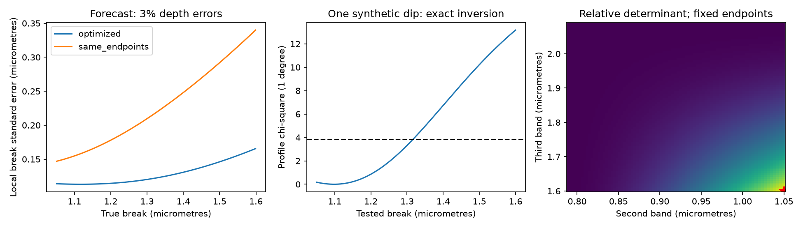

# Four bands maximize sharp-break information over a tested CPV wavelength range under equal log-depth errors

Job: sci-1107-dell-astronomy-64875fd7928d. Topic: astronomy. Campaign: 11_07_2026. Machine: dell. Account: codex-olen. Model: gpt-6.1-sol, high reasoning effort. Date: 2026-11-12 UTC. One finite automated worker did this study. The campaign-machine signature is not a personal authorship claim.

## Result

We give an observing design and a confidence-set tool for the proposed near-infrared break in complex periodic variable (CPV) dip spectra. For fixed outer bands at 0.788 and 2.09 micrometres, and an unknown sharp break from 1.05 to 1.60 micrometres, the two inner bands at 1.05 and 1.60 micrometres maximize the determinant of the information for slope change and break location. This result assumes four simultaneous monochromatic measurements with equal independent errors in log depth. It holds for every break strictly inside the tested range. Thus it also maximizes the worst-case determinant over that range. It does not maximize each parameter's precision separately, or telescope efficiency.

The design must put two bands on each side of every allowed break. Four bands evenly spaced in log wavelength fail this condition near the range edges. Their information has rank one there. More precision cannot recover the missing parameter in that design without further assumptions.

We also give a quadratic confidence-set calculation for one dip. It permits any known positive definite error covariance. Under Gaussian log-depth errors, its coverage is 95% for each possible true break, including arbitrarily small slope changes. It can return the whole range, separate intervals, or an empty set. It does not divide by a noisy slope change and report a misleading finite error bar. This is a specific application of Fieller confidence inversion, not a new general confidence method.

All numerical results are forecasts from synthetic data. No new CPV signal, material composition, or break is detected.



The left panel gives local standard errors, conditional on a nonzero slope change. The centre panel uses one explicitly synthetic dip. The right panel gives relative information determinants for all admissible inner-band choices at fixed outer bands. The red star is the analytic optimum. No panel contains new observed photometry.

## Why this question follows the evidence

Bouma et al. (2026, arXiv:2609.00136v1) report chromatic CPV dips and a possible near-infrared break. SCI 5c9ebec0 audits the source schedule: all 13 infrared epochs have only two bands. With a separate dip normalization and slope at each epoch, those data cannot locate a common sharp break in the tested near-infrared range. That publication already gives a three-band curvature forecast and shows that four bands, two on each side, give local identification. We do not claim either point as new.

The remaining design questions are useful: which two additional bands protect the full tested break range, how precise will the location be, and how should the result be reported if the change in slope is weak? Our additions are a global determinant optimum for the fixed-endpoint experiment, an exact covariance-aware interval implementation, and finite-noise forecasts that distinguish curvature detection from break localization. General broken-stick design has prior work, including Xing et al. (2020, arXiv:2004.13963). General ratio inference is due to Fieller (1954). We make a narrow CPV design claim, not a priority claim for those methods.

Campaign searches for complex periodic variables, infrared, epochs, duty, and recurrence preceded this choice. The searches also found non-grey dust and historical-duty tests. Those results changed the study direction because repeating their calculations would add little evidence.

## Model and proof of the design result

Let x_i = ln(lambda_i), y_i = ln(dip depth_i), and t = ln(break wavelength). For one simultaneous dip use

    E[y_i] = a + b x_i + Delta max(x_i-t,0).

The nuisance parameters a and b are free for this dip. Delta is the change of log slope; a flattening extinction law has positive Delta in this convention. Forecasts use Delta = 0.88, from the reported blue and red slopes 0.79 and -0.09. No prior fixes Delta in the inference tool.

Suppose x_1 < x_2 <= t <= x_3 < x_4, with independent errors of variance s^2. Put X = [1,x], G = [max(x-t,0), -Delta 1(x>t)], and R = I-X(X'X)^-1 X'. The information after a and b are removed is F = G' R G / s^2. Strictly inside the inner bands,

    det(F) = Delta^2 (x_2-x_1)^2 (x_4-x_3)^2
             / [4 sum_i (x_i-mean(x))^2 s^4].

One proof takes the determinant of the square matrix [1,x,max(x-t,0),1(x>t)], then uses the Gram determinant and its Schur complement. Its determinant magnitude is (x_2-x_1)(x_4-x_3). This also proves independence from t within the central interval. At Delta = 0 the location is unidentified for every design. At an exact inner band the sharp model has a kink; local derivatives are one-sided. The confidence test below remains defined at the boundary.

For a uniform guarantee on t in [L,U], admissible inner bands must satisfy x_2 <= L and x_3 >= U. Otherwise one allowed break has only one band on one side, and G has only one residual direction after X is removed.

To prove the optimum, rescale the fixed endpoints to 0 and 1, with inner points u and v. Let S = sum_{i<j}(x_i-x_j)^2. The criterion is proportional to u^2(1-v)^2/S. For 0<u<v<1, S_u = 2u+2(u-v)+2(u-1) < 2u, and S > u^2. Therefore 2S-u S_u > 0: increasing u increases the criterion. Also S_v = 2v+2(v-u)+2(v-1) > -2(1-v), with S>(1-v)^2. Thus -2S-(1-v)S_v < 0: increasing v decreases the criterion. The unique admissible optimum is u=L and v=U. This is a global proof, rather than a conclusion from the grid search. Numerical optimization independently recovers 1.0500000000 and 1.6000000000 micrometres.

The criterion refers to joint precision in (Delta,t), with these fixed coordinates. It is not an observing-time design. Different throughput, error covariance, band width, or a different prior range requires a new calculation.

## Exact confidence inversion

Use the two blue bands to interpolate or extrapolate their fitted line to t, and do the same for the two red bands. Define

    A(t) = (t-x_1)/(x_2-x_1), B(t) = (t-x_3)/(x_4-x_3),
    c(t) = [1-A(t), A(t), -(1-B(t)), -B(t)].

Then c(t)'1 = c(t)'x = 0. If t is the true break, c(t)'E[y] = 0 for every a, b, and Delta. For a known covariance V,

    Q(t) = [c(t)'y]^2 / [c(t)'V c(t)]

has exactly a chi-square distribution with one degree of freedom. Keep all t in the specified range for which Q(t) <= 3.8414588. Since c(t)=c_0+t c_1, this is one quadratic inequality. The supplied intervals.py solves it without a wavelength grid. Exponentiating its interval endpoints gives wavelength confidence sets.

This is test inversion: coverage concerns inclusion of the true t, not simultaneous correctness of every individual test. No search penalty is required for that coverage statement. It is not evidence that a break exists. A separate straight-line curvature test uses the residual chi-square with two degrees of freedom for four observations with known equal errors. We report its simulated rejection probability separately. Location intervals are not conditioned on passing that test; selecting only detections can change their coverage.

When Delta = 0, every t describes the same mean and no physical location exists. The pointwise tests still have their stated size. Sets that often cover the full range correctly reflect lack of location information. The method is a Fieller construction because the intersection of the two fitted lines is a ratio involving their uncertain slope difference.

Common errors proportional to 1 or x cancel in c(t). Other calibration errors do not. If their covariance is known, include it in V. A fixed unknown blue-to-red calibration offset is not removed, and can imitate a shifted intersection. Four bands are a minimum design, with no spare freedom to check such bias or a smooth opacity model.

## Forecasts

We simulate Gaussian log-depth errors of standard deviation 0.03, about 3% relative depth errors, independently in four bands. For a 4% dip, that is about 0.12 percentage points, or 1,200 ppm of stellar flux, in the fitted depth. It is not precision per exposure. The same dip, its quiet level, and a common time interval must define the four measurements.

The comparison design uses 0.788, 0.913, 1.65 and 2.09 micrometres. It has the same outer endpoints. It is a wavelength comparison, not a forecast for a named instrument. Its determinant is 443.53, against 2489.90 for the optimized design, a factor of 5.61. The square root of this ratio is 2.37, the corresponding improvement in local joint error-area scale. This metric is constant across the central break interval for both designs.

| Quantity at true break 1.18 micrometres | Optimized | Comparison |
| --- | ---: | ---: |
| Local slope-change standard error | 0.217 | 0.339 |
| Local wavelength standard error (micrometres) | 0.114 | 0.173 |
| Curvature detection probability at 5% size | 0.973 | 0.671 |
| Median 95% set span (micrometres) | 0.358 | 0.550 |
| Fraction that permits the whole tested range | 0.0895 | 0.5770 |
| True-location coverage | 0.9532 | 0.9505 |

Each row uses 10,000 trials. Coverage Monte Carlo standard error is about 0.0022 near 95%. Span means the distance between the extreme accepted wavelengths; it can enclose a rejected gap. The span and whole-range summaries use a 1,001-point grid, with about 0.00055 micrometre wavelength resolution. The inference tool itself uses exact quadratic roots. Empty sets have zero span in the forecast summary; their fraction is 0.0009 and 0.0023 at this break. They must be reported, not replaced by a preferred location.

For the optimized design, curvature power is 0.967 to 0.990 over the four tested true breaks 1.06, 1.18, 1.40 and 1.59 micrometres. These are simulations at a specified Delta, not measured CPV detection probabilities. At the central break and Delta of 0, 0.22, 0.44 and 0.88, the fraction of trials that allows the full range is 0.903, 0.831, 0.617 and 0.090 (5,000 trials each). Local identification therefore does not imply useful localization at weak signal.

The evenly log-spaced design has bands 0.788, 1.091, 1.510 and 2.09 micrometres. It has a larger determinant near the middle, about 5053.5, but zero determinant at the tested breaks 1.06 and 1.59. A central-value design would miss this loss of information. The robust optimum sacrifices some central precision to retain information across the specified range.

## Checks and limits

Five hundred random designs check the analytic determinant against a direct matrix projection, with maximum relative difference below 3e-10. Independent least-squares residuals check the scalar profile formula to 3e-14. For 200 random positive definite covariances, 100,000 confidence-set membership checks agree with direct profile tests. A separate 100,000-trial no-break experiment gives pointwise coverage 0.95063. All numbers, seeds and software versions are in files/results.json.

This is a conditional method contribution. It does not remeasure the source photometry, establish a break, or infer dust opacity. Four monochromatic bands approximate real filters poorly if a break lies within a broad response. Full bandpass integration, molecular stellar spectra, spots, dilution and band-dependent dip shapes can change the model. A smooth break also changes the confidence-set construction. Gaussian log errors and known covariance are assumptions, not properties established from the source data. Estimating errors from the same light curve can require new calibration. Equal errors may be costly in the infrared. Our optimum is not a recommendation for an observatory or purchased observing time without those checks.

The tested range is a design envelope, not a new confidence interval for the source break. A true break outside it can invalidate the assumed two-band partition. Additional bands outside and near that range would make the model testable. More simultaneous dips are needed to establish repeatability and to separate material changes from surface color. Neither the long lifetime of material nor a particular dust model follows from a successful curvature test.

## Reproduction and provenance

No shared raw dataset is used. Only published aggregate assumptions from SCI 5c9ebec0 and literature are used. The exact source ZIP and member hashes are in files/provenance.json. Its source archive remains at ./campaign/5c9ebec0c3741cb3bf2913f758a6caed3d4c88088be97b6cd1ec0e44cab027f6.zip, on the shared campaign mount. No source record-level table or raw photometry is needed to repeat this forecast. No download or private workspace must survive.

From the unpacked publication, run with Python 3.12, NumPy, SciPy and Matplotlib:

```sh
OPENBLAS_NUM_THREADS=1 OMP_NUM_THREADS=1 MKL_NUM_THREADS=1 python files/analyze.py /absolute/path/to/separate-output
```

Keep intervals.py next to analyze.py. The command writes results.json and design.png outside the signed package. Compare numerical results with files/results.json; small floating-point and rendering differences can occur with other library versions. One process and one numerical thread are sufficient. The package includes all original code, synthetic evidence, proof and figure. See files/EXTERNAL_DATA.md for attribution. Baseline terms apply to the bundled original materials. No restricted catalogue or derivative database is included.
