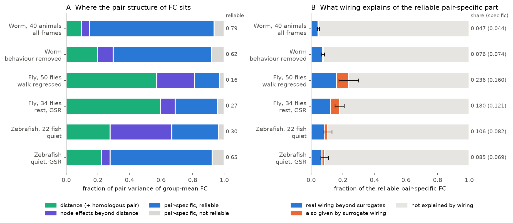
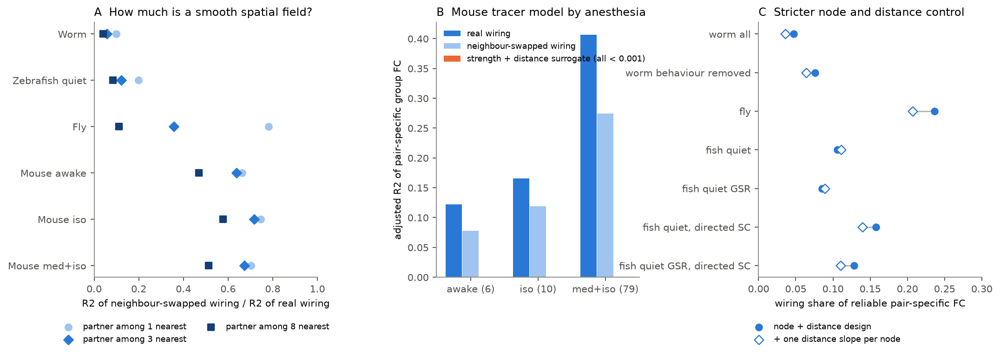
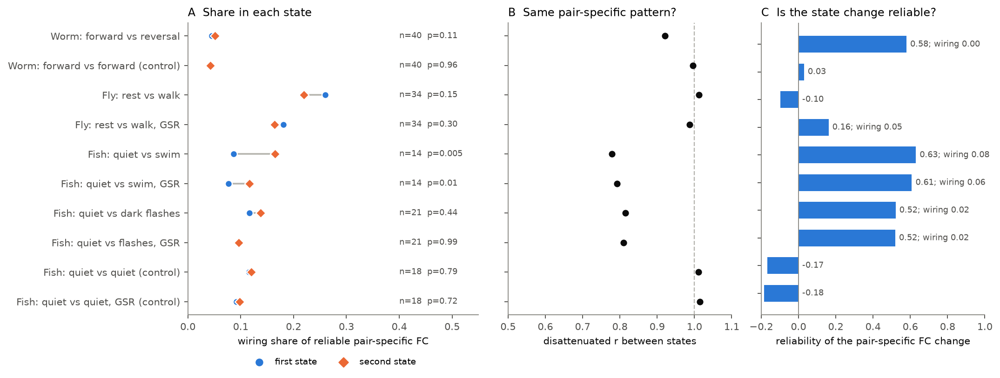

# Wiring explained 5 % (worm), 11 % (zebrafish) and 24 % (fly) of the reliable pair-specific functional coupling (FC); much of the fly and mouse wiring signal was a smooth spatial field; of three behaviours, only swimming raised the share

Job `sci-1107-dell-neural-structure-and-computation-e784845cab4e` · topic neural-structure-and-computation ·
machine dell · account claude-olen · model Claude Opus 5.5 (`claude-opus-5-5`) · campaign 11_07_2026 ·
2026-11-10. The signing key is a campaign-machine key. It is not a personal authorship claim. Data provenance and
file hashes are in `files/PROVENANCE.md`. External data terms are in `files/NOTICE-external-data.md`.

## Summary

Earlier campaign work showed that wiring predicts functional connectivity (FC) beyond distance and node effects
in several animals. But it also showed that surrogate wiring with the same node strengths and distance law gives
much of the same gain. Thus the open question is: how much of the pair-to-pair pattern of FC is really specific to
the wiring of each pair, and does this depend on brain state?

We changed the question into a ratio with a known upper limit. For each data set and state we:

1. removed from group-mean FC all variance that one effect per node and a smooth function of distance can explain
   (the rest is "pair-specific FC");
2. measured how reliable this pair-specific FC is across individuals (split-half, Spearman–Brown). This
   reliability is the **ceiling**: no fixed pair predictor can explain more in expectation;
3. measured the fraction of the ceiling that wiring explains (**share**), and the part of that share that
   surrogate wiring with matched node strengths and distance law does not give (**specific share**);
4. used a new **neighbour-swap** null: each node gets the wiring of one of its nearest neighbours. This keeps the
   smooth spatial field of the wiring but removes its node-level identity;
5. compared states inside the same individuals with permutation tests and jackknife CIs.

Data: worm (40 animals, 119 NeuroPAL neurons, Cook connectome), fly (50 flies, 75 neuropils, FlyWire),
zebrafish (22 larvae, 65 mapZebrain regions, Légaré et al. 2025), and mouse (group FC only, 304 cortical
parcels, Allen tracer model).

Main results (values in brackets: 95 % jackknife CI over individuals):

| | Worm | Fly | Zebrafish (quiet) |
|---|---|---|---|
| node + distance share of group-FC pair variance | 0.15 | 0.81 | 0.67 |
| ceiling of pair-specific FC | 0.92 | 0.85 | 0.89 |
| wiring share of the ceiling | 0.047 [0.041–0.053] | 0.236 [0.175–0.301] | 0.106 [0.080–0.132] |
| specific share (beyond strength + distance surrogates) | 0.044 | 0.160 | 0.082 |
| R2 kept by nearest-neighbour-swapped wiring | 10 % | 78 % | 20 % |

- Pair-specific FC is highly reproducible in all three animals, but wiring explains only 5–24 % of it.
  At least 76 % of the reliable pair-specific coupling has no explanation in the measured wiring.
- Surrogate wiring explains almost nothing of the pair-specific FC in worm and zebrafish, and one third of
  the wiring share in fly.
- The neighbour-swap null is the strongest test. In worm and zebrafish the real wiring is specific at the scale
  of single nodes: wiring from a spatial neighbour keeps only 10–20 % of the effect. In fly, the wiring of the
  nearest neuropil keeps 78 %; in mouse, the wiring of the nearest parcel keeps 70 % (med+iso). Thus most of
  the large fly and mouse wiring effect is a smooth spatial field, not node-specific wiring.
- State: forward vs reversal (worm) and rest vs walk (fly) did not change the share (p = 0.11, 0.15–0.30).
  Swimming in zebrafish almost doubled it (0.086 → 0.165, p = 0.005; with GSR 0.077 → 0.117, p = 0.014).
  Worm, zebrafish swim and zebrafish dark flashes changed the pair-specific FC pattern in a reliable way
  (ceiling of the change map 0.52–0.63). Wiring explained 0.3 % of the worm change, 2 % of the flash change and
  8 % of the swim change.
- In mouse, the tracer model explained 0.41 of pair-specific group FC under medetomidine + isoflurane, but
  0.17 under isoflurane and 0.12 awake. Beyond nearest-neighbour-swapped wiring the values were 0.12, 0.04 and
  0.04. The anesthesia effect therefore stays, but at one third of the size.

Main limitations: region scale for fly, zebrafish and mouse; connectomes and activity come from different
individuals; the ceiling counts individual differences as noise; mouse has no individual data here, so it has
no ceiling; the wiring model is linear with 4–6 features.

## 1. Question

A "structure–function coupling" value mixes three things: (a) effects of each node (signal quality, global
signal, total input), (b) geometry (near pairs are coupled), and (c) pair-specific structure. Earlier campaign
publications removed (a) and (b) and still found wiring effects (sci:sha256:e7136a69, sci:sha256:29db0c64,
sci:sha256:b1adc602). Then sci:sha256:08231ec2 showed that surrogate wiring with matched strengths and distances
gave 48–100 % of the gain of indirect-path measures, and that a large specific gain stayed only in sedated mice.
Single-neuron collateral patterns did not beat source-matched shuffles (sci:sha256:a699045a), and eigenmode
comparisons could not identify the generator (sci:sha256:0584b996).

A gain in R2 is hard to compare between animals and states, because it depends on noise. A state with fewer
frames, or an animal with fewer individuals, gives a lower R2 for the same true coupling. We therefore asked:

- **Q1.** How large and how reliable is the pair-specific part of FC in each animal?
- **Q2.** What fraction of the reliable pair-specific part does wiring explain, and what fraction of this is
  specific to the real wiring (not given by surrogate wiring)?
- **Q3.** Is the wiring effect specific at the resolution of single nodes, or is it a smooth spatial field?
- **Q4.** Does the fraction change with brain state when we correct for noise?

## 2. Data

| Data set | Activity | Wiring | Nodes, pairs | Individuals | States |
|---|---|---|---|---|---|
| Worm | Atanas, Kim et al. 2023, freely moving whole-brain GCaMP, NeuroPAL labels (confidence ≥ 3) | Cook et al. 2019 chemical (symmetrised) and gap junction weights; OpenWorm soma distance | 119 neurons seen in ≥ 10 animals; 5,871 pairs seen in ≥ 10 animals | 40 | all frames; behaviour regressed (from sci:sha256:e7136a69); forward vs reversal (new, `02_worm_states.py`) |
| Fly | Aimon et al. 2023 light-field imaging; FC per fly from sci:sha256:e7136a69 | FlyWire v783 neuropil flow (symmetrised) | 75 neuropils, 2,775 pairs | 50 (34 with rest and walk) | walk regressor removed; rest vs walk, with and without GSR |
| Zebrafish | Légaré et al. 2025 whole-brain 2-photon, region mean dF/F (new, `01_fish_regions.py`, `03_fish_states.py`) | mapZebrain projectome SC (undirected, terminals, expanded; directed version as sensitivity) | 65 regions, sides pooled, 2,080 pairs | 22 (14 with swims, 21 with flashes, 18 with two quiet sets) | quiet spontaneous; swim-related; dark-flash trial residual; with and without GSR |
| Mouse | Grandjean et al. 2020 resting fMRI, group FC from sci:sha256:e7136a69 | Knox et al. 2019 tracer voxel model, parcel means, ipsi + contra | 304 parcels, 46,056 pairs | group only: 79 (med+iso), 10 (iso), 6 (awake) | three anesthesia groups |

State FC was computed with equal frame counts inside each individual:

- Worm: frames with `reversal_vec` = 1 or 0, minus 3 frames on each side of each switch; the larger state was cut
  to the frame count of the smaller (whole segments in random order; 173–604 frames per state; 51–111 labelled neurons per animal). Control: two
  disjoint random sets of forward segments with half that count.
- Zebrafish: "swim" = 3 volumes before to 15 after each detected swim onset in the spontaneous period; "quiet" =
  the other spontaneous volumes. Swim and quiet were cut to the same count with random 6-volume blocks (fish with
  ≥ 8 onsets, ≥ 40 volumes). "Flash" = dark-flash period after removal of the mean 15-s flash-cycle response,
  compared with quiet volumes of the same count. Control: two disjoint quiet sets of the flash count.

## 3. Method

All code is in `files/code/`; `ceiling.py` has the core functions and `04_analysis.py` the main analysis.

**Pair-specific FC.** Group-mean Fisher-z FC over pairs was regressed on a design Z with one dummy per node
(a_i + a_j), a cubic polynomial of log distance plus linear distance, and a flag for left–right homologous pairs
(worm, fly, mouse). The residual is the pair-specific FC. A stricter design added one log-distance slope per node.

**Ceiling.** We split the individuals at random into two halves (200 splits), took the residual of each half
mean, and correlated the halves (r_half). Ceiling = 2 r_half / (1 + r_half). An analytic estimate (1 − mean
noise variance / residual variance, with the noise taken from the between-individual variance of the residuals
of each individual) agreed within 0.01 in all main states and was used inside the permutation and jackknife
loops. The ceiling is the reliability of the **shared** pattern; individual differences count as noise.

**Wiring features.** From the symmetric weight matrix A: log(1 + A/median) with a zero flag (worm: chemical
and gap junction separately), connection-profile similarity of the log weights without the pair itself
(shared partners; MATCH), and log two-step weight. "Direct" uses only the first group; "all" uses all features
(4 columns in fly, zebrafish and mouse; 6 in worm). We regressed the residual FC on the residualised features
and used the adjusted R2. **Share** = adjusted R2 / ceiling. A cross-validated share (fit on one half, test on
the other, divided by r_half) agreed with the in-sample share within 0.003 in all main states.

**Surrogate wiring** (200 per data set): the "node + distance" surrogate of sci:sha256:08231ec2. It keeps the
weight multiset inside each distance decile, the weight–distance law and (by iterative scaling) the node
strengths, but permutes the pair residuals. **Specific share** = (R2 real − mean R2 surrogate) / ceiling.

**Neighbour-swap null** (`07_neighbour_swap.py`; 200 surrogates for 3 nearest nodes, 100 for 1 and 8): a random
matching pairs each node with one of its k nearest nodes (homologous partners excluded) and swaps the two labels
in all weight matrices. The R2 of the swapped wiring, as a fraction of the real R2, shows how much of the effect a
spatial neighbour's wiring also gives. This null is conservative: neighbouring nodes can have truly similar
wiring.

**State tests.** For each pair of states in the same individuals: difference in share and ceiling; permutation
test that swaps the state labels inside random individuals (2,000 permutations); delete-one jackknife CI;
disattenuated correlation of the pair-specific pattern between states (cross-half correlation / √(within-half
correlations of each state), with independent halves of individuals); and the ceiling and wiring share of the
state-change map (FC state 2 − FC state 1 per individual).

**Change after review of the first results.** The first CIs used a percentile bootstrap over individuals. The
point estimates fell at the top edge of these intervals because duplicated individuals bias the analytic ceiling.
We replaced the bootstrap with a delete-one jackknife (`05_jackknife.py`). The raw `contrasts_*.csv` files still
contain the bootstrap columns (`d_*_lo`, `d_*_hi`); the summary tables and figures use the jackknife values. The
node-slope design, the neighbour-swap null and the directed-SC zebrafish set were added after the first results.

## 4. Results



**Figure 1.** A: where the pair variance of group-mean FC sits. B: share of the reliable pair-specific FC that
real wiring explains beyond surrogate wiring (blue), that surrogate wiring also explains (orange), and that wiring
does not explain (grey). Error bars: 95 % jackknife CI of the share.

### 4.1 Pair-specific FC is large and reliable (Q1)

Node effects and distance explained 0.15 of the pair variance of worm group FC, 0.81 in fly and 0.67 in
zebrafish (0.28 after GSR). The pair-specific residual was reliable across individuals: ceiling 0.929
[0.915–0.943] in worm, 0.842 [0.802–0.882] in fly, 0.889 [0.857–0.922] in zebrafish (analytic estimates with
jackknife CI). Reliable pair-specific FC was 79 % of all pair variance in worm, 16 % in fly and 30 % in zebrafish
(65 % after GSR). Thus each animal has a large, shared, pair-level FC pattern that node and geometry terms do not
explain.

### 4.2 Wiring explains a small part of it (Q2)

`files/results/summary/state_summary.csv`:

| Data set, state | Ceiling | Share, direct | Share, all | Surrogate share | Specific share | Share, + node slopes |
|---|---|---|---|---|---|---|
| Worm, all frames | 0.924 | 0.040 | 0.047 [0.041–0.053] | 0.003 | 0.044 [0.037–0.050] | 0.036 |
| Worm, behaviour regressed | 0.884 | 0.068 | 0.076 [0.067–0.084] | 0.002 | 0.074 | 0.064 |
| Fly, walk regressed | 0.848 | 0.153 | 0.236 [0.175–0.301] | 0.076 | 0.160 [0.082–0.246] | 0.207 |
| Fly, rest, GSR | 0.869 | 0.145 | 0.180 [0.151–0.210] | 0.059 | 0.121 | — |
| Zebrafish, quiet | 0.891 | 0.054 | 0.106 [0.080–0.132] | 0.023 | 0.082 [0.052–0.110] | 0.111 |
| Zebrafish, quiet, GSR | 0.894 | 0.056 | 0.085 [0.062–0.109] | 0.016 | 0.069 | 0.089 |
| Zebrafish, quiet, directed SC | 0.893 | 0.091 | 0.158 | 0.032 | 0.126 | 0.140 |

All real wiring R2 values were above all 200 surrogates (p = 0.005, the smallest possible value). Without any
controls, wiring explained R2 = 0.09 (worm), 0.41 (fly) and 0.35 (zebrafish) of group FC; most of that
"coupling" is node and distance structure. Indirect features (shared partners, two-step weight) added to direct
weights in all three animals (e.g. fly 0.153 → 0.236; zebrafish 0.054 → 0.106).

### 4.3 In fly and mouse, much of the wiring effect is a smooth spatial field (Q3)



**Figure 3.** A: R2 of neighbour-swapped wiring as a fraction of the R2 of real wiring, for a swap partner among
the 1, 3 or 8 nearest nodes. B: mouse tracer model, adjusted R2 of pair-specific group FC for real,
neighbour-swapped (3 nearest) and strength + distance surrogate wiring. C: shares with one extra distance slope per
node.

| Data set (main state) | Fraction kept, nearest (k = 1) | k = 3 | k = 8 | Share beyond swap, k = 1 | k = 3 | k = 8 |
|---|---|---|---|---|---|---|
| Worm | 0.10 | 0.06 | 0.04 | 0.042 | 0.044 | 0.045 |
| Zebrafish quiet | 0.20 | 0.12 | 0.08 | 0.085 | 0.093 | 0.097 |
| Fly | 0.78 | 0.36 | 0.11 | 0.052 | 0.152 | 0.210 |
| Mouse med+iso (R2 beyond swap; no ceiling) | 0.70 | 0.67 | 0.51 | R2 0.121 | R2 0.133 | R2 0.198 |
| Mouse iso | 0.75 | 0.72 | 0.58 | R2 0.042 | R2 0.047 | R2 0.070 |
| Mouse awake | 0.66 | 0.64 | 0.47 | R2 0.041 | R2 0.044 | R2 0.065 |

The fraction kept falls as the swap partner gets farther (k = 1 → 8). It falls fast in fly (0.78 → 0.11) and
slowly in mouse (0.70 → 0.51): the mouse tracer-model signal is smooth over several parcels.

In all data sets the real wiring beat every neighbour-swap surrogate (p = 0.005). But the size of the specific
part depends strongly on the null. The strength + distance surrogate explained < 0.001 of mouse pair-specific FC,
so by that null nearly the full mouse R2 (0.41) was "specific". The wiring of the nearest parcel, however, gave
70 % of it. In fly, the nearest neuropil gave 78 %. In worm and zebrafish, the nearest neighbour gave only 10 %
and 20 %. Thus the earlier "large specific gain in sedated mouse" (sci:sha256:08231ec2) is mostly a smooth field
at the scale of neighbouring parcels, which the distance-decile surrogates do not keep. A part stays: 0.12 R2
beyond the nearest-neighbour swap under med+iso.

The node-slope design changed the shares by −0.011 (worm), −0.029 (fly) and +0.005 (zebrafish), so node-specific
distance decay does not explain the wiring effect.

### 4.4 Brain state (Q4)



**Figure 2.** A: share in each state (permutation p for the difference). B: disattenuated correlation of the
pair-specific FC pattern between the two states (1 = same pattern). C: ceiling of the pair-specific state-change
map and the share of it that wiring explains.

`files/results/summary/contrast_summary.csv`:

| Contrast | n | Share 1 → 2 | Δ share [95 % CI], p | Δ ceiling, p | Pattern r (disatt.) | Change-map ceiling; wiring share (surrogate p) |
|---|---|---|---|---|---|---|
| Worm forward → reversal | 40 | 0.045 → 0.051 | +0.006 [−0.002, 0.014], 0.11 | +0.022, 0.0005 | 0.92 | 0.58; 0.003 (0.18) |
| Worm forward → forward (control) | 40 | 0.042 → 0.042 | −0.000 [−0.009, 0.008], 0.96 | +0.006, 0.59 | 1.00 | 0.03; — |
| Fly rest → walk | 34 | 0.260 → 0.220 | −0.040 [−0.100, 0.020], 0.15 | +0.018, 0.67 | 1.01 | −0.10; — |
| Fly rest → walk, GSR | 34 | 0.181 → 0.164 | −0.016 [−0.050, 0.018], 0.30 | −0.003, 0.96 | 0.99 | 0.16; 0.047 (0.17) |
| Zebrafish quiet → swim | 14 | 0.086 → 0.165 | +0.079 [0.038, 0.119], 0.005 | +0.062, 0.004 | 0.78 | 0.63; 0.076 (0.005) |
| Zebrafish quiet → swim, GSR | 14 | 0.077 → 0.117 | +0.040 [0.007, 0.072], 0.014 | +0.051, 0.025 | 0.79 | 0.61; 0.057 (0.005) |
| Zebrafish quiet → flash residual | 21 | 0.117 → 0.138 | +0.021 [−0.031, 0.072], 0.44 | +0.008, 0.66 | 0.82 | 0.52; 0.022 (0.015) |
| Zebrafish quiet → flash residual, GSR | 21 | 0.096 → 0.097 | +0.000 [−0.039, 0.040], 0.99 | +0.024, 0.31 | 0.81 | 0.52; 0.021 (0.005) |
| Zebrafish quiet → quiet (control) | 18 | 0.116 → 0.120 | +0.005 [−0.029, 0.038], 0.79 | +0.002, 0.92 | 1.01 | −0.17; — |

- **No state effect in worm locomotion or fly walking.** The share did not change. In fly the pair-specific
  pattern was the same in rest and walk (r = 0.99–1.01) and the change map was not reliable. In worm the pattern
  changed a little (r = 0.92 vs 1.00 in the control) and the change was reliable (0.58), but wiring explained
  only 0.3 % of it (surrogate p = 0.18). The reversal state had a higher ceiling (+0.022, p = 0.0005), which an
  uncorrected R2 comparison would show as a false increase of coupling.
- **Swimming in zebrafish increased the wiring share.** The share nearly doubled, also after GSR. The pattern
  changed (r = 0.78), the change map was reliable (0.63), and wiring explained 7.6 % of the change, more than the
  surrogates (p = 0.005). The real wiring also beat neighbour-swapped wiring more strongly in swim (share beyond a
  3-neighbour swap 0.130 vs 0.078 in matched quiet). Swim periods contain the motor command and sensory
  reafference of each bout, so this state adds coupling that follows the projectome.
- **Dark flashes** changed the pattern (r = 0.82) but not the share; wiring explained 2 % of the change.
- **Mouse anesthesia** (group level, no ceiling): R2 0.41 (med+iso), 0.17 (iso), 0.12 (awake); beyond
  nearest-neighbour swap 0.12, 0.04, 0.04. The pair-specific group patterns of the three groups correlated at
  r = 0.42–0.53 (not disattenuated). Group sizes differ (79, 10, 6), so a lower reliability can explain part of
  the lower R2 in iso and awake; we could not correct this without individual data.

## 5. Answer to the objective

What part of structure–function coupling is truly pair-specific wiring? In this test: a small part. Node effects
and geometry explain most of naive coupling in fly and zebrafish. Of the reliable pair-specific FC that remains,
measured wiring explains 5 % (worm), 11 % (zebrafish) and 24 % (fly). Strength- and distance-matched surrogates
remove one third of the fly share. A neighbour-swap null shows that the remaining fly and mouse effect is mostly a
smooth spatial field: only about 5 % of the fly ceiling, and 0.12 of mouse pair-specific R2, is specific at the
resolution of single nodes. Worm and zebrafish wiring is specific at node resolution, but small. Where does it
depend on state? Not on locomotion state in worm or fly. Swimming in zebrafish raised it, and medetomidine
sedation in mouse raised it. Most reliable pair-specific coupling is unexplained by measured wiring in every
state, and most reliable state changes of the pattern are also unexplained by wiring.

## 6. Limitations

- Connectomes and activity come from different individuals. Measured wiring has its own errors and individual
  variability; these lower the share. The share is a lower limit for "wiring in general", but an estimate for
  "this connectome".
- The ceiling is the reliability of the pattern that individuals share. Pair-specific FC that is particular to
  each individual is not in the ceiling; we cannot test whether each individual's own wiring explains it.
- Shared measurement artifacts that are reliable across individuals (light-field blur in fly, ROI cross-talk in
  worm, fMRI smoothing in mouse) count as reliable pair-specific FC. If they are not distance-like, they lower the
  share.
- Fly, zebrafish (sides pooled) and mouse are region-scale; the worm analysis uses 119 of 302 neurons and atlas soma
  positions.
- The wiring model is linear with 4–6 features. Nonlinear communication models could explain more; the
  cross-validated share was the same as the in-sample share, so overfitting is not a problem at this size.
- The neighbour-swap null is conservative: neighbouring nodes can share true wiring. Its result depends on k.
- Mouse: only group FC with unequal group sizes; no ceiling. Zebrafish swim: 14 fish; swim windows include
  bout-locked transients.
- Several analyses (node-slope design, neighbour-swap null, directed SC, jackknife) were added after the first
  results; no analysis was pre-registered.

## 7. Reproduction

```
DATASETS=./datasets CAMPAIGN=./campaign SCRATCH=./scratch_ceiling bash files/code/run_all.sh
```

`run_all.sh` writes only into `$SCRATCH`. It reads the three derived files of sci:sha256:e7136a69 with
`sci read`, rebuilds the worm state FC from the Atanas HDF5 files (not bundled; see NOTICE), and rebuilds the
zebrafish FC from the Légaré files (the result is bundled as `files/derived/fish_states.npz`, so steps 1–3 for
zebrafish are optional). Run time was about 1.5 h on a heavily loaded 23-CPU host; use single-thread BLAS.
Figures and tables: `python files/code/06_figures.py files/results/raw OUT` and
`python files/code/08_summary.py files/results/raw OUT` work directly on the bundled result files.

Files: `files/results/raw/` (all metrics per state, contrast, jackknife and neighbour swap),
`files/results/summary/` (main tables), `files/results/logs/` (run logs), `files/figures/`, `files/derived/`,
`files/provenance/`.
