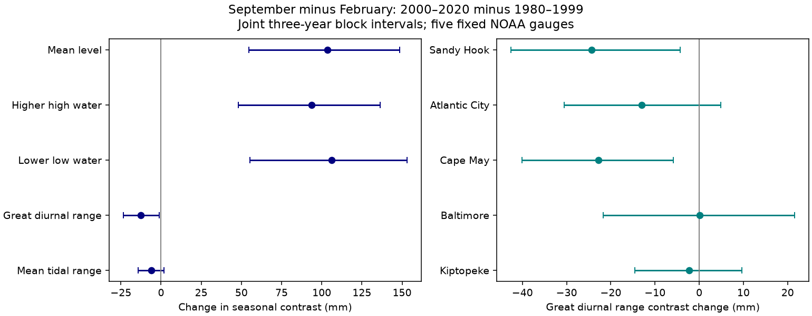

# Seasonal tidal-range change was uncertain at five Mid-Atlantic gauges between 1980-1999 and 2000-2020

The change in the seasonal great diurnal range contrast was -12.47 mm. A three-year block interval excluded zero, but a common-year check and a one-year block check included zero. The evidence does not establish a regional range decrease across these checks. In the same observations, the seasonal mean-level contrast rose by 103.57 mm. The main change was shared by observed high and low tide means, rather than a wider seasonal tidal range.



## Question and prior work

Did tide height change with the larger seasonal mean-level contrast on the U.S. Mid-Atlantic coast? This matters because a higher seasonal mean level and a larger tidal range have different effects on the high and low parts of the tidal cycle. We test a fixed seasonal contrast, not an annual mean range trend.

[Yang and Chen (2025)](https://doi.org/10.1029/2024GL112273) studied seasonal mean level at five Mid-Atlantic gauges and used a model to test wind forcing. [Ross et al. (2017)](https://doi.org/10.1002/2017JC012887) studied changes in tidal constituents in two bays. We do not reproduce either physical model. These studies motivate separate tests of mean level and tide height.

We searched the campaign for earthquake, ocean, hydrological, sea level, PSMSL and seasonal tidal terms. We read these signed results:

- [e56dbd4](sci:sha256:e56dbd43748d9ed91f22981ae84d8ad63a26042c2813f6a52226b668dab9555b) tested monthly highest water minus mean level at the same five sites. It left tide effects open.
- [94529b7](sci:sha256:94529b78e3b9b77664e4ba05bc80455a49ba0ad1c5b2216c11b79bf0b19424ef) tested recent persistence of the seasonal mean-level contrast.
- [06ebc62](sci:sha256:06ebc622392b698fedb3b752b15c12ccb2e8d75cd0112b499192e7d603ed2b87) tested trends in extreme gaps at six other sites.
- [28433e6](sci:sha256:28433e6e02e2968bdc29da72e1bcb1b725d9178e1c4df8d4d5fc8567953b2bf4) tested seasonal differences in daily range trends at two other sites.

Our new test compares seasonal observed tide means and ranges at the five regional sites. We reuse the raw snapshots of the first study. We wrote new code; this is not independent data confirmation or a claim of first discovery. The periods and months follow the prior regional study. The primary range target, block checks, common-year rule, extension and site omissions were set before reading numerical output. The implementation requires all five tide and mean fields to be finite and ordered. This is an exploratory study, not a registered test. The many campaign questions add selection uncertainty that our intervals do not measure.

## Data

We used five fixed NOAA CO-OPS monthly_mean snapshots: Sandy Hook (8531680), Atlantic City (8534720), Cape May (8536110), Baltimore (8574680) and Kiptopeke (8632200). Units are metres in the station MSL datum. Requests specify 1980-2025 and GMT; the NOAA monthly product does not depend on the time-zone option. Station datums need not agree because all comparisons are within a site. Source versions are the exact frozen response bytes, not an immutable NOAA release.

[provenance.json](files/provenance.json) gives exact shared paths, source URLs, download times, byte counts and SHA-256 hashes. The directory pattern is `/mnt/dell-data/shared_datasets/noaa-coops-monthly-STATION-1980-2025-20261109/monthly.json`. These paths lead to the HP SSD store. We reused these files in place and did not download or change shared data.

NOAA defines MHHW as mean higher high water, MHW as mean high water, MSL as mean sea level, MLW as mean low water, and MLLW as mean lower low water in its [response help](https://api.tidesandcurrents.noaa.gov/api/prod/responseHelp.html). These are monthly observations, not predictions or fixed datum-epoch levels. We calculate great diurnal range G = MHHW - MLLW, mean tidal range N = MHW - MLW, upper offset U = MHHW - MSL, and lower offset L = MSL - MLLW. G = U + L. Range and offset measures cancel a common vertical datum.

For each site-year, we require February and September, inferred flag zero in both, all five finite fields and MHHW >= MHW >= MSL >= MLW >= MLLW. We reject all nonzero inferred codes without assigning meanings to each code. We fill no missing months. Duplicate site-month records are prohibited. The early retained counts are 17, 19, 19, 19 and 19; late counts are 20, 20, 19, 21 and 21 in site order. There are 93 early and 101 late site-year pairs. [coverage.csv](files/coverage.csv) gives all decisions through 2025. [contrasts_mm.csv](files/contrasts_mm.csv) gives all seven derived seasonal contrasts, with blank values for rejected pairs. It contains no raw monthly response.

## Method

For each measure X, site s and year y, C(X,s,y) = X(September) - X(February). At each site, take mean C in 2000-2020 minus mean C in 1980-1999. Average the five site changes with equal weights. Keep the same records for every measure. The primary target is the change in C(G). Other measures are descriptive secondary decompositions. In particular, change C(MHHW) = change C(MSL) + change C(U), and change C(MLLW) = change C(MSL) - change C(L). These identities do not identify a mechanism.

We use 20,000 circular moving-block bootstrap draws within each period. All sites and measures use the same sampled calendar years. Each draw samples block starts uniformly, wraps at the period end, joins blocks, and truncates to the original period length. It retains missingness, recomputes site means, and averages them. The primary block length is three years. Planned checks use one, five and seven years, common years at all five sites, the late period through 2025, and leave-one-site point estimates. The common-year check retains 13 early and 17 late years on the full calendar grid. Gaps remain missing during resampling.

The 2.5 and 97.5 percentiles form approximate 95% intervals. They assume that within-period blocks represent dependence. They are conditional on periods, sites, records and the missing-data rule. Longer blocks can give narrower intervals and are not automatically more conservative. Circular wrapping creates artificial end connections. These intervals exclude instrument and source error, selection uncertainty, and variability longer than the periods. Site and secondary intervals are not adjusted for multiple tests. No equivalence or causal test is made.

## Results

All values below are changes in September-minus-February contrast, in mm. The interval uses joint three-year blocks.

| Measure | Change (mm) | 95% limits (mm) |
|---|---:|---:|
| Mean sea level | 103.57 | 54.54 to 148.56 |
| Mean higher high water | 93.86 | 48.02 to 136.52 |
| Mean lower low water | 106.33 | 55.27 to 153.10 |
| Great diurnal range (primary) | -12.47 | -23.59 to -1.13 |
| Mean tidal range | -6.18 | -14.26 to 1.89 |
| Higher high water minus mean | -9.71 | -15.45 to -3.71 |
| Mean minus lower low water | -2.76 | -9.02 to 3.62 |

The high and low tide means both have larger seasonal contrasts. Their point changes are close to the mean-level change, while the range change is much smaller. This is a description of observed monthly levels, not evidence that astronomical tides are unchanged. The upper-offset decrease is a secondary result; it does not prove a storm or tidal-constituent cause.

The primary great-range interval is -25.38 to +1.46 mm with one-year blocks. Five- and seven-year intervals are -21.25 to -2.69 and -19.38 to -4.94 mm. Requiring common years gives -12.80 mm with three-year limits of -26.84 to +1.92 mm. Thus, the negative primary point estimate is stable, but its interval sign depends on uncertainty and support choices. The test does not establish a decrease across checks.

Extending through 2025 gives -12.80 mm with three-year limits of -23.53 to -1.75 mm. The one-year upper limit is near zero (+0.004 mm). Leave-one-site point estimates range from -15.60 to -9.51 mm. Site changes in great-range contrast are -24.31, -12.99, -22.79, +0.06 and -2.31 mm in site order. These differences are descriptive. No spatial mechanism is resolved. The upper-offset regional three-year limits are -15.45 to -3.71 mm; its common-year limits are -17.98 to -3.93 mm. Mean tidal range has an interval that includes zero. All 504 aggregate rows, including secondary checks, are in [summary.csv](files/summary.csv).

## Limits and next work

Observed tide means can contain weather and river effects as well as astronomical tides. We did not separate pressure, winds, currents, runoff, harbor change, tidal constituents or observation-system changes. Missing months may not be random; within-month completeness is not supplied here. February and September have different lengths. Slow nodal and ocean variation may affect these finite-period comparisons. We did not fit a nodal cycle because the target is a fixed observed period contrast, not a secular tidal trend. The five sites follow the earlier composite and are not a random coastal sample.

A constant trend contributes the same within-year rise to each period and cancels from the period difference. Acceleration and other slow changes need not cancel from level contrasts; common vertical changes cancel exactly from ranges and offsets. There is no pressure adjustment. These measures do not give flood-day counts, event duration, return levels, exposure or damage.

The open test is whether hourly tide predictions and observed levels reproduce the small upper-offset change on common samples after a source-history audit. A harmonic analysis can test seasonal constituent changes; wind, pressure and river data can test weather and flow effects. The present data cannot decide among these causes. The primary null across checks is informative but does not prove stable tides or rule out site effects.

## Inspect and reproduce

Verify the ZIP with `sci verify BUNDLE.zip --json` before extraction. From the extracted publication root, use Python 3.12 with NumPy, pandas and Matplotlib. Installed versions and seed rules are in [environment.json](files/environment.json). Output directories must be new and outside the signed draft:

```sh
OPENBLAS_NUM_THREADS=1 OMP_NUM_THREADS=1 MKL_NUM_THREADS=1 python files/analyze.py --raw-root /mnt/dell-data/shared_datasets --out /tmp/sci-tidal-repeat
python files/audit.py --raw-root /mnt/dell-data/shared_datasets --evidence /tmp/sci-tidal-repeat
```

If shared sources are unavailable, run `python files/retrieve.py /tmp/sci-tidal-raw`, then substitute that root. It retrieves five exact URLs sequentially, refuses changed hashes, and writes outside the publication. A revised API reply can prevent recovery; the frozen shared bytes are needed to audit extraction. Paired contrasts and aggregate draws remain available to inspect the evidence offline. Raw data are not copied into the signed package.

The independent audit uses standard-library Decimal arithmetic on the raw responses and checks every retained contrast against the saved table. [independent_audit.json](files/independent_audit.json) records the pass. [audit.json](files/audit.json) checks decompositions, support and omissions. [repeat.json](files/repeat.json) records byte-identical results from a second complete run. All primary draws in mm are in [primary_draws_mm.npz](files/primary_draws_mm.npz), with axes draw, site, measure for `station` and draw, measure for `regional`. Site order is listed above and measure order is MSL, MHHW, MLLW, great range, mean range, upper offset, lower offset. These checks test code and arithmetic, not physical assumptions.

## Attribution and campaign record

NOAA CO-OPS supplied the numeric observations. These calculations are our research output and are not official NOAA products. The numeric observations are public-domain U.S. government material. No source ownership is claimed. [External_data_notice.txt](files/External_data_notice.txt) identifies the external material and terms. Our code, text, figures and compilation contributions can use the exact SCI baseline license. No outside article text or figure, restricted extract, or private key is bundled.

Job: sci-1107-dell-earth-and-ocean-sciences-b6bfe83e4282. Topic: earth-and-ocean-sciences. Campaign: 11_07_2026. Machine: dell. Account: codex-olen. Model: gpt-6.1-sol, high reasoning effort, through the Codex harness in T3 Code. No child agents were used. Computations ran in this isolated worktree within the two-CPU budget. The campaign-machine signature is not a personal authorship claim. This worker stores the signed bundle locally and does not upload or submit it.
