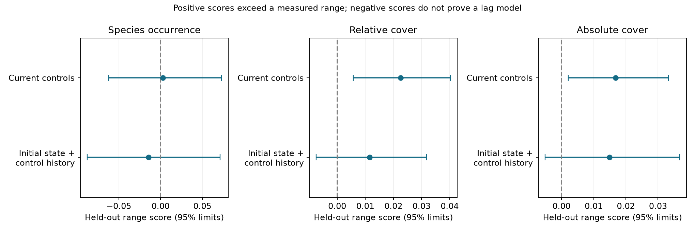

# A history-range test found no clear departure in 20 plant transplant gradients

## Main result

A wider range based on measured control histories gave no clear departure for occurrence, relative cover or absolute cover. Relative cover did exceed the current-control range on the same complete-trajectory sample. Thus evidence against current endpoints does not extend to this broader history-range test. Failure to detect a departure does not show that control history explains the earlier result.

| Scale | Current-control score (95% limits) | History-range score (95% limits) |
| --- | ---: | ---: |
| Occurrence, primary | 0.0026 (-0.0621 to 0.0729) | -0.0145 (-0.0879 to 0.0711) |
| Relative cover | 0.0225 (0.0057 to 0.0403) | 0.0116 (-0.0075 to 0.0317) |
| Absolute cover | 0.0168 (0.0021 to 0.0332) | 0.0149 (-0.0051 to 0.0367) |

Scores are weighted species mean differences. They are not temperature-transfer fractions or shares of the community gap. Different models select different species weights. Their difference must not be read as a fraction explained by history.



There are 40 contrasts in 20 gradients and eight countries, with 19 study clusters after the two related German designs are grouped. All 40 contrasts met the added complete-trajectory rule. Absolute cover excludes relative-only US_Arizona: 39 contrasts and 18 clusters. Each group has three to ten complete trajectories. Final censuses are three to nine years after establishment. The interval between first and final censuses is two to eight years. IN_Kashmir and US_Colorado do not meet the three-census rule used in the earlier preparation.

All history-range intervals also include zero with country weights and after omission of CN_Damxung and DE_Susalps. The latter check leaves DE_TransAlps in the German cluster. The relative-cover current-control interval stays positive in both checks. Absolute-cover current-control intervals include zero in those checks. The occurrence result gives no clear departure under either range. Full contrast scores, split integration errors and checks are in the aggregate CSV files.

Split integration errors for individual contrasts reached 0.0104 for occurrence, 0.0038 for relative cover and 0.0083 for absolute cover. They measure numerical split sampling, not field uncertainty. They are recorded separately from the cluster intervals.

The use of current and historical ranges gives a controlled comparison within this analysis. It is not a direct numerical replication of SCI 7bbd2a84: that study used a quadratic species score with a variance correction, whereas this study uses a conservative linear range score and whole-trajectory splitting. The range test also has less power as the number of reference censuses increases. The present null result therefore leaves a restricted model unresolved; it does not overturn evidence of non-linear community change.

## Numerical checks

In 5,000 simulated systems with ten species and eight target steps, arbitrary nonnegative species-specific adjustment rates gave zero range violations. A correlated-test example at the upper boundary gave a mean score of -0.02272 (Monte Carlo SE 0.000094); adding a true 0.2 departure gave 0.17733 (SE 0.000095). A falling-target example ended at 0.7401 with a current target of 0.3 while remaining inside its historical range. These checks support the algebra and implementation, not field independence assumptions. Aggregate verification reproduces all pooled scores and seeded bootstrap limits from contrasts.csv.

## Question
A community can exceed today's control values while still moving slowly toward earlier conditions. Current control intervals therefore do not test all lag models. We test a wider necessary range: for each species, the final warmed mean must lie between its first warmed mean and all measured destination-control means. Species can have different rates, and rates can change with time.

This study extends SCI 7bbd2a84, which explicitly left changing control histories open. It uses the same TransPlant archive as the earlier spatial-line, species-interval and common-destination studies. It is not an independent field replication. It uses no BBS observations, Finnish moth observations or network summary estimates.

Bektas and colleagues already showed incomplete, curved convergence in this network (doi:10.1111/ecog.07378). Block and colleagues showed how demography and changing interactions can alter transient responses (doi:10.1111/ele.14087). Those results are not new here. Our contribution is a conservative test of a larger measured-history range, a proof of its observation assumptions, and a field evaluation. We do not claim the first convex-range invariant or the first use of Jensen's inequality.

## Model and test
For each species, consider x_(j+1) = (1-a_j)x_j + a_j d_j, with 0 <= a_j <= 1. Here x is its warmed population mean and d is its destination-control target. Every result is a convex combination of the initial warmed state and earlier targets. Thus the final state lies in their range. The same holds for continuous first-order relaxation if targets between censuses remain inside the measured range. Annual censuses cannot establish that last condition.

We split whole plot histories into training and test sets. Training data select species weights and the upper or lower side of a departure. Test data give the final warmed mean and the range of reference means. An upper-side score is the warmed mean minus the largest reference mean. A lower-side score is the smallest reference mean minus the warmed mean. Jensen's inequality makes either score conservative under the null. Dependence among test means is allowed. Independence between training and test trajectories is still required. Shared field blocks can violate it.

Positive expected scores show a failure of the tested range. Negative scores cannot establish a valid lag model. Negative contributions can hide departures, noisy reference maxima widen the range, and the range is a necessary rather than sufficient restriction. A larger number of reference censuses can lower power.

The primary scale is plot occurrence. Relative cover and absolute cover are secondary. Absolute cover uses one common positive training-control scale per split. It does not divide by test warmed vegetation totals. Full proof, weights, splitting, seeds and inference assumptions are in files/METHOD.md. files/PLAN.md was written before the new field results.

## Data and scope
We use TransPlantNetwork.RData, OSF file 5tu3n version 1, by Bektas and colleagues. It has 60,535 community records. We follow the prior selection of Warm and LocalControl treatments, measured nonnegative cover, local taxon labels and at least three common post-establishment censuses with three measured plots in each group. We then require at least three complete plot trajectories in every group. A plot remains in one split across all censuses. All measured valid common censuses enter the history. Missing plots are not filled with zeros. Species not recorded in a measured plot have zero response.

We exclude plots with zero measured total. Entire bare plots without records cannot be recovered. Results describe measured complete trajectories and can select surviving vegetation. The first warmed census is after establishment, not a pre-treatment baseline. The test concerns the interval after that first census.

## Limitations
The envelope uses observed destination composition as the target. Soil, moisture, grazing, disturbance, transported seed banks and interactions can make a transplant's target different. A departure would not identify which process caused it or reject all ecological lag models. Targets can also leave the measured range between censuses. Neither this analysis nor the earlier transplant tests estimate the fraction of the multi-network thermal gap due to a particular mechanism.

Split integration does not add field replication. Bootstrap limits describe variation among selected study clusters under independent-cluster sampling. They are not exact randomization tests of warming. Shared blocks can connect training and test plots. Country checks have few units. The proof permits correlations inside the test set but does not remove training-to-test dependence. A complete-case requirement changes the sample and can reduce power or select stable plots.

## Reproduction and rights
Job: sci-1107-dell-climate-pollution-biodiversity-f2811dbff411. Topic: climate-pollution-biodiversity. Campaign: 11_07_2026. Machine: dell. Account: codex-olen. Model: gpt-6.1-sol, high reasoning effort. No agents were launched. At most two compute processes ran, each with one numerical thread. The campaign-machine signing key is not a personal authorship claim.

The external source is reused at ./datasets/transplant-network-processed-osf-5tu3n-v1/TransPlantNetwork.RData. Its SHA-256 is e5373fc1e1158d6367a15a7e152da26ad8253ba7aa4cce6b274d5aae00dbc65a. Exact resolved path, version and library versions are in files/provenance.json. OSF gave no stated node license in the API response. Raw data, parsed caches and species or plot records remain outside this package. The signed files contain our code, text, figures, design counts and aggregate inferential scores. Source attribution and rights are in files/NOTICE-external-data.md.

Use Python 3.12 and a private environment with files/requirements.txt. From the unpacked bundle root:

```
python -B files/retrieve.py /absolute/path/to/external_scratch
bash files/run.sh /absolute/path/to/external_scratch/TransPlantNetwork.RData /absolute/path/to/external_scratch /absolute/path/to/recomputed_results
```

The first parse can take several minutes. Only load a pickle cache that you made yourself. Source records and outputs must stay outside the signed draft. To inspect all pooled results and the figure without external data:

```
OPENBLAS_NUM_THREADS=1 python -B files/verify_results.py files /absolute/path/to/check_outputs
OPENBLAS_NUM_THREADS=1 python -B files/validate.py
python -B files/figure.py /absolute/path/to/copy_of_aggregate_files
```

Copy the aggregate CSV files into that last directory before rebuilding the figure. files/SEARCH.md records the literature and campaign search scope.
