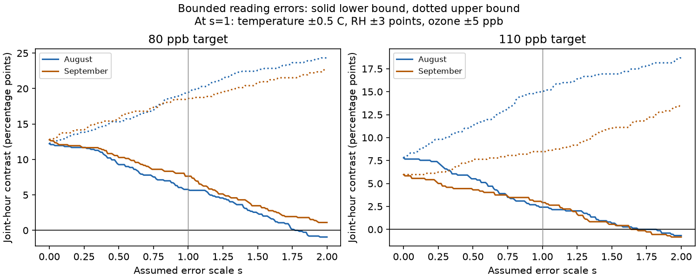

# Assumed reading error limits kept four joint ozone and dry-air contrasts above zero in North Wales in 2021

Four monthly exposure contrasts stayed positive when each temperature, relative humidity and ozone reading could differ by up to 0.5 C, 3 percentage points and 5 ppb. The test used August and September 2021 at two ozone targets in one wildflower experiment. Doubling all three limits permitted zero or negative contrasts in three of the four tests. These limits are assumptions. The source does not supply sensor error estimates. The result does not show that the sensors met these limits or that heating caused a plant response.



## Question and prior evidence

Does a reported excess of joint high-ozone and high-drying-demand hours survive bounded measurement error? This is useful for work on climate, pollution and floral resources. Atmospheric drying demand can change plant water use and ozone uptake. An experiment in snap bean found that vapor pressure deficit changed ozone responses (Fiscus and colleagues, 2012, DOI 10.1093/jxb/err443). That result motivates attention to exposure measurement. It does not transfer a plant effect to this experiment.

We searched the campaign for phenology and temperature, pollution and biodiversity, spring frost, ozone, solardomes, and vapor pressure. We read the strongest related local studies. SCI sha256:2e833e35b40dd4089a8f961789bc4ef0f370769b26f6ef9030eda2da07099351 reported higher vapor pressure deficit (VPD) and more joint threshold hours in this same release. It explicitly left sensor error untested. SCI sha256:51e63bdcebf6d84f9bdbb679bca8fa4358b41128b862f9ee6588cb023b30f2fa compared joint hours with schedule-controlled references; its ranges were not sensor error bounds. SCI sha256:1ceb6dc11fbe44a507f581f0653d16455b0d051fabcbb9cb417d554762e20584 tested flower widths. SCI sha256:1450109aa182d4ae33d13253ad49b9d1946045e1d7226e082f1c1e55dd9a11cf tested missing flower visit dates.

Our new test gives sharp bounds for bounded errors in the exposure readings and reports the error scale at which a positive lower limit is lost. We wrote new code and used the shared raw archive. This is a secondary, exploratory analysis of the same exposure records. It is not an independent replication or a correction to the prior results.

## Source and observation process

Hayes and Sharps (2023), DOI 10.5285/a33d5ee3-d201-4feb-83b9-765ee5b2c25e, released hourly ozone and weather records from eight solardomes at Abergwyngregyn, North Wales. Five wildflower species were grown in pots. Three ozone target levels have heated and ambient domes: 30 ppb uses domes 6 and 3; 80 uses 2 and 1; 110 uses 4 and 5. Heating was nominally 4 C above ambient. Targets describe peaks in a weekly ozone profile, not constant concentrations.

Ambient temperature and humidity came only from dome 7. All three contrasts use this shared weather reference. The supporting document says earlier spot checks supported that choice. The record does not measure current ambient weather differences between dome 7 and each paired ozone dome. There is one chamber per treatment combination. Hours and pots do not supply independent treatment replication.

The analysis uses all 1,464 hours in August and September. Every required channel is present. June and July have major weather gaps and are outside this test. One earlier row has no hour label; it is excluded before the date filter. Valid date-hour labels are unique. The source reports quality checks and possible gap filling but gives no flags for filled readings. Complete coverage therefore does not establish that every value was directly measured. No flower response enters our calculation.

## Error model and sharp bounds

Use es(T) = 0.6108 exp[17.27 T/(T+237.3)] kPa and V(T,R) = es(T)(1-R/100), where R is relative humidity in percent. This is the FAO-56 saturation pressure formula applied to hourly mean values. V is air VPD, not leaf VPD or stomatal ozone dose.

The inherited diagnostic event is V at least 2 kPa AND ozone at least 60 ppb. These cutoffs are not injury limits. Let D be 100 times the heated event share minus the ambient event share. Units are percentage points.

At scale s, each possible true reading may be anywhere within its observed value plus or minus 0.5s C, 3s humidity percentage points, and 5s ppb ozone. Humidity intervals are intersected with [0,100]. Ozone may be restricted to nonnegative values without changing the event bounds. We impose no cross-hour, cross-instrument or cross-variable error restrictions. Thus this model permits errors that change with time, and persistent directional errors, but does not assume independent random errors. The scale is a joint sensitivity path. It is not a sensor specification, measured error distribution or probability statement. Many other error ratios are possible.

V rises with T and falls with R throughout the tested physical range. The smallest heated event indicator uses T minus its limit, R plus its limit (capped at 100), and ozone minus its limit. The largest ambient indicator uses the opposite limits, with R floored at zero. Sum the difference of those indicators to obtain the lower bound for D. Reverse all directions for the upper bound. The same corners bound the mean VPD contrast.

These bounds are sharp under this model: every reading at the chosen corner is feasible and attains the limit. The shared ambient weather reference is assigned the same corner in every use. The bounds could be narrower if calibration errors were common across instruments or otherwise constrained. A strict constant additive calibration model with physical humidity constraints is a different model; we do not claim sharpness for it. The bounds do not cover unknown ambient chamber gradients, hourly averaging error, unmarked source processing or sensor drift outside the assumed intervals.

We evaluate s = 0, 0.25, 0.5, 1 and 2. A monotone search also finds the infimum scale at which the lower bound is no longer positive, up to floating point precision. Event shares are step functions. The limiting scale is not a probability or a precise measurement of calibration error; equality at a jump can depend on the inclusive threshold convention. Tables report many digits only for code inspection.

## Results

| Month | Target (ppb) | Observed D | Bounds at s = 1 | Bounds at s = 2 | First loss scale, approximately |
| --- | ---: | ---: | ---: | ---: | ---: |
| August | 80 | 12.23 | 5.78 to 19.49 | -0.94 to 24.33 | 1.767 |
| August | 110 | 7.80 | 2.42 to 15.05 | -0.67 to 18.68 | 1.686 |
| September | 80 | 12.78 | 7.64 to 18.61 | 1.11 to 22.64 | 2.377 |
| September | 110 | 5.97 | 2.92 to 8.47 | -0.83 to 13.47 | 1.637 |

D and its bounds are percentage points. At s = 1 the positive contrast persists in all four tests. At s = 2 only September at the 80 ppb target keeps a positive lower limit. Its first loss scale is about 2.377, equivalent along this chosen path to limits of 1.189 C, 7.132 humidity points and 11.886 ppb ozone. The smallest loss scale is 1.637, for September at 110 ppb. This corresponds to 0.819 C, 4.912 humidity points and 8.186 ppb. These are combined limits, not separate thresholds for each instrument.

The pooled 61-day lower limits at s = 1 are +6.69 and +2.66 percentage points at the two higher targets. Their first loss scales are 2.010 and 1.681. Pooling conceals the weaker August result at 80 ppb. At 30 ppb both event shares and both bounds remain zero through s = 2. This is a threshold result, not evidence of no ozone harm.

Mean VPD differences are less sensitive along this error path. At s = 2, the six monthly lower limits for the three target pairs remain positive, from +0.250 to +0.483 kPa. Their first loss scales range from 3.138 to 4.067. Ozone errors have no role in these mean-VPD bounds. This contrast between a continuous mean and a joint threshold count shows why a stable drying-demand result alone does not guarantee a stable co-exposure count.

The tables contain all targets, all selected scales and the pooled period. No tests were discarded. We do not use p values or sampling confidence intervals. The bands describe allowed errors in fixed records.

## Interpretation and limits

Under the stated small error limits, reading error alone cannot reverse the four high-target monthly exposure signs. Larger errors can. Without calibration records, the data cannot select an error scale. This test adds a conditional reliability result to prior exposure and schedule audits. It neither confirms nor rejects a causal effect of warming, ozone or VPD on flowers.

The two months have no shared hours but use the same chambers, sensors and season. They are temporal checks, not independent regions, years or experiments. Joint ozone and VPD conditions do not identify absorbed ozone, plant water stress, flower loss, ecological mismatch, species ranges or biodiversity decline. Conditions were imposed in chambers; this is not a climate-change attribution or a test of natural weather extremes. The chosen cutoffs and error ratio need not apply to other species or instruments.

Next work should recover sensor calibration and filled-value flags, log weather in each ambient dome, and test realistic error correlations. Replicated treatment chambers at independent sites and years, with exact plant visit dates and leaf conductance, are needed to connect these exposures to plant responses. New calibration information can be evaluated with the supplied formulas before a biological model is fitted.

## Reproduction and rights

Contains data supplied by UK Centre for Ecology & Hydrology. The source, retrieved shared archive version and exact member hashes are in files/provenance.json. The shared input is datasets/ukceh-wildflower-ozone-warming-2021-a33d5ee3/data.zip, resolved on this machine as recorded in that file. Raw data, supporting documents and record-level derivatives remain outside this bundle. The source uses the Open Government Licence v3. The separate external notice preserves attribution and identifies those materials. Bundled code, narrative, figures and aggregate analytical results are our contributions under the SCI baseline terms.

From an extracted publication, use Python 3.12 and the packages in files/requirements.txt. Installed run versions are in files/audit.json. Prefer the shared input in place. For a new machine, retrieve to external scratch, then run:

```sh
python files/retrieve.py /absolute/path/to/new_external
python files/analyze.py --archive /absolute/path/to/new_external/data.zip --out /absolute/path/to/new_results
python files/validate.py --archive /absolute/path/to/new_external/data.zip --results /absolute/path/to/new_results
```

All input downloads and generated output must stay outside the signed directory. Compare bounds.csv, tipping.csv and the numeric audit values with the bundled files. PNG bytes can vary by plotting version. The independent standard-library validator checks all 45 aggregate rows and enumerates 64 error corners on a regular subsample of 51 hours for each target and selected scale. All checks passed. The analysis also checks unique hours, complete late-window records, the formula at zero C and monotone bounds. No random seed or fitted model is used.

Campaign: 11_07_2026. Job: sci-1107-dell-climate-pollution-biodiversity-617bc5d23b84. Topic: climate-pollution-biodiversity. Machine: dell. Account: codex-olen. Model: gpt-6.1-sol, high reasoning effort. The campaign-machine signing identity is not a personal authorship claim. No private key is included.
