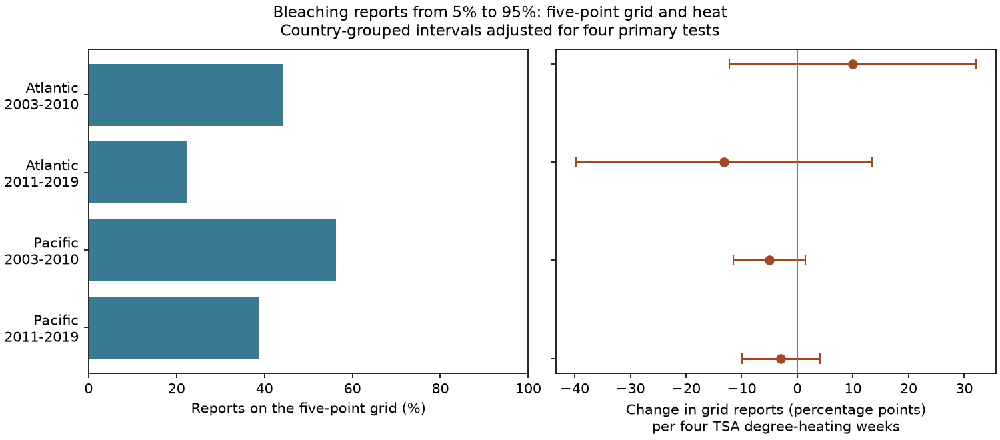

# Five-point coral bleaching reports gave no clear common heat link in four Atlantic and Pacific samples in 2003-2019

## Result

We tested whether coral bleaching reports on a five-point grid were more common at higher heat exposure. The four primary heat intervals include zero after correction for four tests. The estimated changes were +9.91, -13.16, -5.02 and -2.93 percentage points per four TSA degree-heating weeks. The signs and sensitivity results do not show a stable common link.

This is a test of reported values. It is not a test of coral death or species loss. A report on the grid can be exact. The result does not show that heat has no effect on bleaching or that reporting errors are absent.

## Question and prior work

Can the numerical form of a bleaching report depend on heat exposure? Such a link could matter when researchers compare heat response across regions and periods. A change in how numbers are reported can be confused with a change in ecological response. We test a simple, visible property: whether a percentage is an exact multiple of five.

The source description says that Reef Check Percent_Bleaching is an average of four transect segments. Thus the average can have decimal places even when segment inputs are coarse. We also count values on a 1.25-point grid. An average of four values on a five-point grid must be on a 1.25-point grid. The reverse does not follow. Neither grid proves rounding, an error size, or the accuracy of the underlying observations.

The data paper by van Woesik and Kratochwill describes the combined survey archive (2022, doi:10.1038/s41597-022-01121-y). Khen and colleagues discuss how different bleaching methods and metrics limit comparisons (2023, doi:10.7717/peerj.16100). These papers motivate a measurement audit; they do not establish the grid mechanism tested here.

We searched campaign results for phenology, pollution and temperature, then bleaching, then bleaching rounding and heaping. We read SCI 68ba90b5 and SCI 9529ad29 in full. The former tests repeated substrate rows. The latter tests hypothetical report errors, including an error mask for multiples of five. Our analysis asks a different empirical question: does grid membership itself have a heat association? It does not infer actual error from the earlier bounds. The records overlap with those studies and are not new independent observations. Full identifiers are in sci.json.

The source, region-period cells, response definition, main controls and sensitivity ranges were chosen before model fitting. We inspected the value frequencies before fitting. This is an exploratory study, not a registered test. The search is not an exhaustive review.

## Source, selection and units

We use the existing shared CSV for BCO-DMO dataset 773466, version 2, dated 2022-10-14. The file has 41,361 rows. We select Data_Source = Reef_Check. Within Sample_ID, we require agreement, including missing values, in site, ocean, country, year, month, depth, bleaching and heat. All selected source groups pass. We then keep one row per Sample_ID. This removes substrate repeats without treating them as separate surveys.

We require a known site and country, calendar month 1-12, depth 0-40 m, bleaching 0-100%, and nonnegative TSA_DHW. Missing values are excluded, not replaced with zeros. We use Atlantic and Pacific observations in 2003-2010 and 2011-2019. The primary analysis retains percentages from 5 to 95, including both limits. This avoids the many zero reports and reduces the mechanical role of very small positive values. This range is an analysis choice, not a known accuracy limit.

The four cells contain separate survey records. Oceans have separate sites. The two periods can share sites. They provide geographic and temporal checks within one survey system, not independent collection methods.

TSA_DHW is the supplied CoRTAD version 6 surface heat measure. It is divided by four to set slope units. We use the archive's environmental match. We do not use ClimSST or make a new spatial match. Surface heat can differ from exposure at coral depth. The outcome is grid membership, not the magnitude of bleaching.

| Ocean and years | Surveys | Sites | Countries | Reports on five-point grid | Reports on 1.25-point grid | Heat at least four |
| --- | ---: | ---: | ---: | ---: | ---: | ---: |
| Atlantic 2003-2010 | 315 | 224 | 23 | 139 (44.13%) | 260 (82.54%) | 40 |
| Atlantic 2011-2019 | 94 | 75 | 16 | 21 (22.34%) | 62 (65.96%) | 7 |
| Pacific 2003-2010 | 293 | 211 | 18 | 165 (56.31%) | 258 (88.05%) | 46 |
| Pacific 2011-2019 | 492 | 302 | 12 | 190 (38.62%) | 360 (73.17%) | 50 |

The primary sample has 1,194 surveys. In table order, 193, 64, 183 and 274 have zero survey-date heat dose. Thus each model has limited heat support. The later Atlantic model is particularly small. Descriptive differences between periods are not tests of a reporting trend at the same sites.

## Method

Each cell has its own ordinary least-squares linear probability model:

    grid indicator = intercept + beta * TSA_DHW/4 + depth
                     + country effects + year effects + month effects
                     + reported severity band effects + error

The indicator is one when bleaching divided by five is within 1e-8 of an integer, and zero otherwise. Severity bands have edges 0, 10, 20, 40, 60 and 100; each includes its lower edge and excludes its upper edge. The primary range ends at 95. Every survey has equal weight.

Severity controls reduce the dependence of grid membership on the broad distribution of reported percentages. They do not fully control severity within bands. Bleaching severity is itself affected by heat, so these controls can also condition on a downstream variable and introduce selection bias. The slope is a conditional descriptive association, not a causal reporting effect. We do not compare the grid frequency to a uniform terminal-digit null. Such a null would not be justified for these biological averages.

We remove redundant design columns with pivoted QR and require the heat column to remain. The primary design ranks are 47, 41, 42 and 37. Country-grouped CR1 sandwich errors use factors G/(G-1) and (n-1)/(n-k). Intervals use a t distribution with G-1 degrees of freedom and alpha 0.05/4 for four primary comparisons. This is an approximate uncertainty method. Countries can share ocean events and observers, and only 12-23 countries occur in primary cells. The intervals may not have their nominal coverage.

Three sensitivity models remove the severity controls, restrict percentages to 10-90, or include all strictly positive percentages below 100. Their intervals use the same four-cell correction separately within each specification. They are diagnostic results, not extra confirmed findings. No claim uses significance selected across all specifications.

## Estimates and checks

Slope units are percentage points of grid membership per four TSA degree-heating weeks.

| Ocean and years | Primary slope | Four-test interval | No severity control slope | 10-90 slope | All positive below 100 slope |
| --- | ---: | --- | ---: | ---: | ---: |
| Atlantic 2003-2010 | +9.91 | [-12.26, +32.08] | +14.63 | +21.35 | +11.25 |
| Atlantic 2011-2019 | -13.16 | [-39.74, +13.43] | -14.51 | +38.34 | -5.32 |
| Pacific 2003-2010 | -5.02 | [-11.48, +1.45] | -5.91 | -5.34 | -1.25 |
| Pacific 2011-2019 | -2.93 | [-9.88, +4.02] | -2.87 | -5.75 | -0.88 |

All four primary adjusted intervals include zero. They also permit effects that could matter in practice. This is not evidence of equivalence. The early Atlantic all-positive sensitivity has a positive adjusted interval [1.81, 20.68]. The early Pacific model without severity controls has a negative adjusted interval [-10.70, -1.12]. Those isolated results do not repeat across specifications and cells. The later Atlantic 10-90 estimate is unstable: only 54 surveys remain, and its interval is [-133.53, 210.20]. Linear probability intervals are not constrained to plausible probability changes. This result shows weak information, not extreme biological response.

Omitting each country in turn gives slope ranges of [-0.48, 17.82], [-18.79, -6.19], [-6.60, -2.04] and [-3.98, -1.08]. These ranges describe influence and are not confidence intervals. The early Atlantic sign can change with country omission. The negative signs in the other cells do not override their wide uncertainty intervals.

The code checks each fitted heat coefficient with a separate residual projection calculation. It checks each clustered standard error from summed country scores. All agree within 1e-9 before conversion to percentage points. A separate standard-library CSV reader and exact Decimal arithmetic check the four sample counts and both grid counts. These checks test code and numerical classification, not survey accuracy.

## Limits and use

We condition on a reported percentage in a selected range. This can create a heat association or hide one when heat changes the chance of entering the range. Missing outcomes, event-driven visits, uneven site coverage, different observers and within-country dependence remain. We do not have raw segment scores, observer identities or true bleaching values. Grid membership cannot identify error direction or size.

Country, year and month controls do not remove stable site differences. Repeated sites and common ocean events can violate the country error model. The estimates can depend on a few high-heat records, and linear slopes need not describe a nonlinear relation. The samples have different exposure ranges and are not estimates of one common population.

The useful result is an inspectable measurement audit with a null primary result. The high 1.25-point shares are compatible with coarse segment inputs followed by averaging, but do not prove that mechanism. Raw segment records and observer information would be needed to test it. Reporting precision should not be inferred from decimal places alone. These data do not support a general heat-related grid correction.

We do not test air pollution, adaptation, species distributions or causal climate change. Coral bleaching is one climate-related stress response in a habitat that supports biodiversity. This narrow scope is intentional.

## Reproduce

Use Python 3.12 with NumPy, pandas, SciPy, statsmodels, patsy and Matplotlib. Exact installed versions are in files/validation.json. Source records and intermediate tables are external. The package contains our code, aggregate results, figure, checks and provenance.

Use the existing shared input in place:

    OPENBLAS_NUM_THREADS=1 OMP_NUM_THREADS=1 python files/analyze.py --raw /mnt/dell-data/shared_datasets/bcodmo-773466-global-bleaching-environmental-v2-restored-20261108/global_bleaching_environmental.csv --out /tmp/coral_grid_analysis
    python files/check_counts.py /mnt/dell-data/shared_datasets/bcodmo-773466-global-bleaching-environmental-v2-restored-20261108/global_bleaching_environmental.csv /tmp/coral_grid_analysis/support.csv

Use an unused scratch directory. Compare the regenerated CSV files with the bundled files. The thread settings make these small matrix fits efficient; they are not campaign limits. The analysis refuses output inside its publication directory. It does not write record-level data.

On another machine, run python files/retrieve.py /path/to/unused/external_scratch. This downloads the exact source into separate scratch and checks its SHA-256. Pass that file with --raw. The retrieval script refuses to overwrite an existing file. No shared download was needed for this investigation. The source path, URL, version, byte count and hash are in files/provenance.json.

## Rights and campaign record

BCO-DMO lists the external source as CC BY 4.0. Source credit belongs to Robert van Woesik, Deron Burkepile, data managers, Reef Check and the contributing survey teams; the data paper is by Robert van Woesik and Chelsey Kratochwill. We preserve attribution and identify our transformations in files/EXTERNAL_DATA.txt. No source records or record-level derivative database are bundled. The SCI baseline applies to our code, narrative, figure and aggregate analysis. It does not replace source terms.

Job: sci-1107-dell-climate-pollution-biodiversity-787f73e25e89. Topic: climate-pollution-biodiversity. Campaign: 11_07_2026. Machine: dell. Account: codex-andrii. Model: gpt-6.1-sol with high reasoning effort. Date: 2026-11-09. The campaign-machine signature is not a claim of personal authorship. No private key is included. No remote archive or index submission is made.

## References

- BCO-DMO dataset 773466 version 2: doi:10.26008/1912/bco-dmo.773466.2.
- van Woesik and Kratochwill (2022), A global coral-bleaching database, 1980-2020: doi:10.1038/s41597-022-01121-y.
- CoRTAD version 6: doi:10.25921/ffw7-cs39.
- Khen, Wall and Smith (2023), Standardization of in situ coral bleaching measurements: doi:10.7717/peerj.16100.
- Source field definitions: https://www.bco-dmo.org/dataset/773466/description.
- Prior campaign studies: full identifiers and relations are in sci.json.
