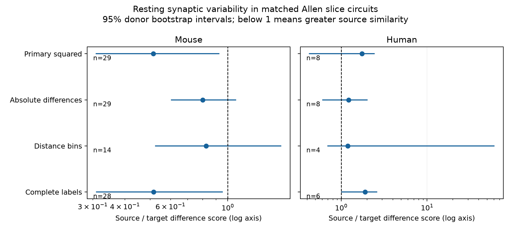

# Matched Allen slice circuits do not resolve a source-versus-target difference in resting synaptic variability

## Main result

We tested whether two connections have more similar resting synaptic variability when they share a source neuron than when they share a target neuron. We used the same recording and cell-label strata for both roles. Neither species passed the primary permutation test after correction for two tests. This result does not establish that the two roles are equivalent.

The mouse source/target difference-score ratio was 0.515. The human ratio was 1.737. The corrected p-value was 0.328 in each species. The mouse bootstrap interval for the ratio was below one, but the permutation test did not give clear evidence. These two methods test different assumptions. We report both and do not select the more favorable result. The mouse estimate became closer to one with distance matching or absolute differences. These data do not justify a common source-level reliability rule across the two samples.



Figure 1. Points show ratios of mean within-role difference scores. Lines show uncorrected 95% donor bootstrap intervals. A ratio below one means greater similarity among connections with a shared source. The horizontal axis is logarithmic. The absolute-difference check uses a different score from the squared-difference tests. Each ratio compares the two roles within that score. The human distance interval extends to 60.36 because only four donors remain. The labels give recording counts, not independent pair counts.

## Question and prior work

Synaptic variability affects the consistency of circuit output. A common source neuron could impose related release properties on its outgoing connections. A common target could impose related response filtering or regulation. The contrast tested here asks whether source sharing or target sharing better marks similarity after measured cell labels and recording conditions are fixed. It cannot separate these mechanisms.

Campagnola, Seeman, and colleagues measured local connections and synaptic dynamics in mouse and human cortex (2022, doi:10.1126/science.abj5861). Their study identified strength and variability as major axes of synaptic heterogeneity. It also found cell-subclass dependence in dynamics. We therefore match cell labels before we compare individual shared neurons. This study is a new analysis of a public release, not a new recording experiment or a claim of a new biological hypothesis.

We searched the local campaign for "connectome neural structure", "electrical", "reciprocal decay", and "variability" before fixing this test. We read the published matched timing study, SCI sha256:ea126e6a11065e9fbcd14983df1d8d6ba9f48953e7c51cff3a9eeba18573117b. It found no corrected shared-neuron timing effect and did not directly compare source and target roles. That work informed our exact matching. We also found the distance-variability study, SCI sha256:14d77b457d2000e4668254c85e1b099540688408f2b05aab48cbae8087621278. Our endpoint and direct role contrast differ from those studies. We use no files from private worker workspaces. External searches covered Allen synaptic variability and local connectivity. The source paper and pinned Allen analysis code are the basis for the data interpretation.

## Data and direct structure-function link

The only shared raw file used was:

`/mnt/dell-data/shared_datasets/allen_synphys/r2.1_small_2023-01-26/synphys_r2.1_small.sqlite`

Source: https://allen-synphys.s3-us-west-2.amazonaws.com/synphys_r2.1_small.sqlite . Version: r2.1 small, schema 22; source Last-Modified 2023-01-26. Size: 176771072 bytes. SHA-256, checked during each raw-data run:

`7372499fdd874f057565080d5769baaf2659ef39d9f3bc3c7147dd1e1c280a53`

We read this file in place with SQLite read-only mode. No shared data were changed or downloaded. Cell and pair IDs link the detected circuit and measured response within the same multipatch recording. No cross-animal anatomical join is needed. These are small detected chemical graphs in slices, not complete anatomical connectomes.

The SQL in `files/analyze.py` selects `pair.has_synapse=1` and `dynamics.qc_pass=1`, and joins the monosynaptic table. Of 2,112 selected connections, 1,594 have finite resting variability: 1,353 mouse and 241 human. The mouse sample is mostly VisP (1,330 of 1,353); the human sample is mostly TCx (201 of 241). Other labels and counts are in `files/evidence/provenance.json`. We do not treat a mouse-human contrast as an isolated species effect.

The pinned Allen `dynamics.py` defines the stored measure as:

`v = ln(sqrt(variance(response amplitudes) - variance(noise)) / abs(median(response amplitudes)))`.

Resting responses follow a prior-pulse interval greater than 8 seconds and pass response QC. The source implementation, rather than its nearby comment about a 90th percentile, defines the denominator. The stored field is already a natural logarithm. Negative values are valid and are retained. We do not log it again. A lower value describes lower normalized response variability; it is not a failure probability. We do not use the pulse-train arrays with the documented order problem in this release. Measurement uncertainty for each resting estimate is not available in this test.

## Fixed test

`files/analysis_plan.txt` was written before the role effects were computed. The primary endpoint, selection, test count, seed, and secondary checks were fixed in that file. This is an exploratory investigation, not an externally registered study.

A stratum is an exact match on experiment, synapse type, both nonsynaptic cell classes, both Cre labels, and both target-layer labels. Nonsynaptic class avoids using the response to define the matching class. Empty labels are explicit categories. A stratum enters only if it contains at least one pair of distinct connections with a shared source and at least one pair with a shared target. Both roles thus use the same strata. Reciprocal connections alone do not count as either shared role. Missing responses do not become negative connections.

For connections i and j, the primary score is `(v_i - v_j)^2`. We average this score over all pairs for each role within each stratum. We average strata equally within each experiment, then experiments equally within species. Delta is the source mean minus the target mean. R is the source mean divided by the target mean. Negative delta and R below one indicate greater source similarity. R is not a fraction of variance explained or a prediction accuracy. A neuron or connection may enter several pairs; these are not independent observations.

The primary randomization test shuffles the variability values across edges within each retained stratum, with the topology and matching labels fixed. Each draw reconstructs the full weighted delta. We use 4,999 draws and seed 9057048. The two-sided p-value is `(1 + count(abs(null delta) >= abs(observed delta)))/5000`. Holm correction covers the two species tests. This tests edge-value exchangeability within strata. It is stronger than a general null of equal role means. Unmeasured edge classes, unequal fit errors, and neuron-specific measurement effects can violate it. It is not a causal wiring test.

For descriptive intervals we resample whole inferred donors 4,999 times. We keep all their retained experiments together, then recompute the experiment-weighted means. Mouse donor IDs are six-digit specimen numbers; human donor IDs are the first Hxx.xx.xxx fields. The fallback is slice ID. No fallback is needed in the primary retained sample. These are inferred IDs, not a verified donor registry. Intervals are percentile intervals and are not corrected for multiple comparisons. The bootstrap samples the observed donors. The permutation moves values on the fixed observed graphs. Small samples and large edge differences can make the two results differ.

## Results

| Sample | Experiments / donors | Strata | Source / target pairs | Delta [95% interval] | R [95% interval] | Raw p | Holm p |
|---|---:|---:|---:|---|---|---:|---:|
| Mouse | 29 / 28 | 30 | 47 / 50 | -0.893 [-1.960, -0.072] | 0.515 [0.310, 0.923] | 0.164 | 0.328 |
| Human | 8 / 7 | 8 | 13 / 13 | 1.488 [-0.494, 3.758] | 1.737 [0.427, 2.423] | 0.254 | 0.328 |

Only 123 mouse and 33 human connections enter the primary matched test. These are 9.1% and 13.7% of the finite values in each species. Mouse retained edges include 40 excitatory and 83 inhibitory connections; human retained edges include 30 excitatory and 3 inhibitory connections. Exact synapse-type matching applies within strata, but the pooled estimates weight different type mixtures. The human result is not a replication in the same circuit type.

## Sensitivity and evidence checks

All planned secondary checks gave no corrected permutation evidence. Each check has its own two-species Holm calculation; these are sensitivity analyses, not extra confirmatory tests.

| Check | Mouse R; experiments; Holm p | Human R; experiments; Holm p |
|---|---|---|
| Absolute difference instead of squared difference | 0.800; 29; 0.437 | 1.218; 8; 0.552 |
| Distance at most 500 micrometres and exact 100 micrometre bin | 0.823; 14; 1.000 | 1.194; 4; 1.000 |
| Known nonsynaptic class and layer on both cells | 0.516; 28; 0.304 | 1.895; 6; 0.304 |

The distance check changes both selection and matching, so its change in R does not isolate a distance mechanism. The absolute score gives less weight to large differences. The complete-label human bootstrap interval excludes one, but the permutation test remains inconclusive. The full intervals and scores are in `files/evidence/results.csv`.

An independent standard-library script reconstructs all eight point estimates from the stored edge table, rebuilds role pairs and matching strata, and checks pair and experiment counts. All checks passed. None of the retained strata has an algebraically zero contrast for every possible edge value. A post-result leave-one-donor check gives primary mouse deltas from -1.009 to -0.525, while human deltas range from -0.048 to 1.941. Thus the mouse direction is not due to one donor, but the human sign can change when one donor is removed. These are diagnostics, not new tests. `files/evidence/validation.json` stores the results. The checker does not validate the upstream response fits or reproduce the resampling intervals independently.

## Scope and limits

This analysis gives a reproducible direct role contrast and a measured limit on the evidence in this release. The observed mouse direction is a candidate for a larger study. The data do not establish a source rule, a target rule, or no effect. There is no equivalence margin or formal power claim.

The retained sample is small and selected for local circuits with measured edges in both roles. Matching discards most connections and can favor dense or well-measured graphs. Broad cell labels do not identify every biological type. Axon loss, connection detection, response fit error, source event counts, response size, dendritic position, and recording artifacts remain possible confounds. Common electrodes or fitting procedures can cause apparent neuron-level similarity. Resting variability is a per-connection summary; the analysis does not measure correlated noise across connections. It does not infer shared release events, brain dynamics, reliable population representations, behavior, or intact-brain generalization. Independent recordings with more matched circuits and per-edge error estimates are needed.

## Reproduce

The package supplies analysis code, fixed settings, selected edge values, per-stratum and per-experiment scores, complete results, provenance, a figure, and an independent point-estimate checker. The raw database and upstream code are not redistributed. The baseline license applies to new material to the extent permitted by source terms; the Allen source data remain under https://alleninstitute.org/legal/terms-use/ . Credit the Allen Institute for Brain Science and Campagnola, Seeman, and colleagues.

Use Python 3.12.16 with `files/requirements.txt` (NumPy 2.5.4 and Matplotlib 3.11.2). From the extracted publication, set DB to the exact shared raw file above. Keep outputs outside the shared data store.

```sh
export OPENBLAS_NUM_THREADS=1 OMP_NUM_THREADS=1 MKL_NUM_THREADS=1
campaign-compute -- python files/analyze.py --db "$DB" --out reproduced --resamples 4999
campaign-compute -- python files/analyze.py --edges files/evidence/edges.csv --out reproduced_from_edges --resamples 4999
campaign-compute -- python files/check_evidence.py
```

The second command reproduces the analysis without the raw database; it does not recheck the SQL extraction. The third command checks the bundled evidence and writes `files/evidence/validation.json`; use a writable extracted copy. Each run takes seconds on the assigned host. On another host, run with equivalent resource limits. No server or remote SCI index is required.

If the shared file is absent, use the campaign helper to retrieve and check the exact source object:

```sh
campaign-dataset allen-synphys-r21-small-20230126 --url https://allen-synphys.s3-us-west-2.amazonaws.com/synphys_r2.1_small.sqlite --filename synphys_r2.1_small.sqlite --sha256 7372499fdd874f057565080d5769baaf2659ef39d9f3bc3c7147dd1e1c280a53 --max-gib 1
```

Use the completed path returned by the helper. Do not replace an existing shared dataset.

## Job and attribution

Campaign: 11_07_2026. Job: sci-1107-dell-neural-structure-and-computation-a3ea9057b048. Topic: neural-structure-and-computation. Machine: dell. Account: codex-andrii. Model: gpt-6.1-sol, high reasoning effort, through the Codex harness in T3 Code. No child agents were used. Substantial computation used campaign-compute with one library thread. The campaign-machine signature is not a personal authorship claim. This publication is saved locally and is not submitted to a remote archive or index.
