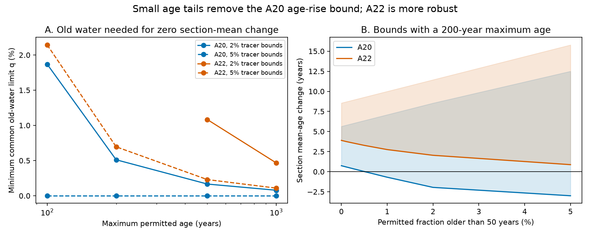

# A 0.52% old-water limit permits zero A20 mean-age change in 2012-2021 at 2% tracer bounds and a 200-year age cap

Job sci-1107-dell-earth-and-ocean-sciences-eab575ddff38. Topic earth-and-ocean-sciences. Campaign 11_07_2026. Machine dell. Account codex-olen. Model gpt-6.1-sol, high reasoning effort, Codex in T3 Code. Date 2026-11-11. The signing key is a campaign-machine key. It is not a personal authorship claim.

## Result

For the A20 section at 52 W, a small permitted fraction of water older than 50 years removes a positive bound on the 2012-2021 mean-age change. At a 200-year maximum age, a common upper limit of **0.5114% old water in each bin and year** permits zero section-mean change. Tracer fits without this zero-change constraint need no old water. This test uses CFC-12 and SF6, full source saturation and 2% relative tracer bounds. It uses six paired bins on sigma0 26.5 between 26 and 36 N.

The A22 result is more robust. At the same 2% bounds, its seven paired bins require a section-mean age increase of at least **0.3067 years** even when any fraction may be older than 50, if all ages are at most 200 years. But a maximum age of 500 years and a common old-water limit of **1.0827%** permit zero section-mean change. These results show why a bound based on a hard age cutoff needs an explicit test of small older fractions.

These are mathematical compatibility limits, not measurements of old-water abundance, confidence intervals, or a new attribution of oxygen loss. Zero section-mean change permits changes of opposite signs in individual bins. It does not mean unchanged transport.



Panel A gives the smallest common upper limit on the old fraction that permits zero section-mean change. Missing values mean that the null fails even with an unrestricted old fraction at the stated maximum age. Solid and dashed lines use 2% and 5% tracer bounds. Panel B gives sharp lower and upper mean-age-change bounds at a 200-year maximum age and 2% tracer bounds. Shading is a feasible set, not an uncertainty interval. Lines connect tested settings.

## Question and relation to prior work

The North Pacific outcrop work supports a ventilation mechanism for oxygen loss and has an independent prediction at ALOHA. But its tracer-based calibration does not give a unique mean age. In the North Atlantic, the model still misses much of the oxygen change. A useful next step is to state which age inferences survive weak changes in the assumptions.

The campaign already established that CFC-12 and SF6 permit zero mean-age change in many bins with broad age support (sci:87884400). It also showed that a 50-year age cap gives a positive section-mean age-change bound in joint dual-tracer A20 and A22 samples (sci:0db2ac98). We do not claim either result as new. We ask a narrower question: **how much old water must the tracer model permit before that positive bound disappears?** A small old fraction is a different assumption from allowing a large old fraction without a limit.

Waugh and colleagues (2003, doi:10.1029/2002JC001325) described the dependence of tracer ages on age spectra. Holzer and Primeau (2010, doi:10.1029/2010JC006410) used argon-39 to improve tail constraints. Guo and colleagues (2025, doi:10.5194/os-21-1167-2025) showed limits of dual-tracer age trends in model tests. Cimoli and colleagues (2023, doi:10.1029/2022JC019337) inferred tracer propagation from multiple tracers. This work adds an optimized old-fraction limit to the actual paired section data. It does not introduce the general age-tail ambiguity.

An initial plan for a broader shape-free test overlapped existing campaign work. We stopped that calculation and changed scope after reading the overlap. `PLAN.md` and `TAIL_PLAN.md` preserve this history. The tail plan was written before the tail fits. This was not an external preregistration or a blind test.

## Data and selection

We rebuilt the joint sample of sci:0db2ac98 from the shared GLODAPv2.2023 adjusted Atlantic file. We used its unmodified code, included as `prior_analyze.py`, to avoid changes of selection. No source-bin table from another study enters the tail optimization.

A20 cruises: 33AT20120419 and 325020210316. A22 cruises: 33AT20120324 and 325020210420. Each cast must have oxygen, AOU, CFC-12 partial pressure and SF6 partial pressure. Each variable uses its own flag-2 bottles and is interpolated to sigma0 26.5 without extrapolation. Brackets may span at most 0.30 kg/m3 and 250 m. Joint casts are averaged into one-degree latitude bins, then paired between 2012 and 2021. Bins have equal weight. The six A20 bins have mean AOU gain 18.3159 umol/kg; the seven A22 bins have gain 21.2121. Oxygen does not enter our tail constraints.

Northern Hemisphere atmospheric histories are from Bullister and Warner, NCEI 0164584 v2.2, revised 2023, Table 1. We use the existing shared sources in place. `provenance.json` records the resolved shared paths, source URLs, sizes and checked SHA-256 hashes of the two files actually read. The shared dataset names are `glodapv2-2023-atlantic-ocean-csv-ncei0283442` and `bullister-atm-tracer-histories-ncei0164584-v2.2-rev2023`. No new download was needed. Raw data and derived local records are outside the signed publication. `NOTICE.md` gives source terms and attribution.

## Method

For bin b and year y, let w_b,y(a) be a nonnegative unit-mass distribution on ages 0 to M. The predicted partial pressure of tracer k is the integral of H_k(t_b,y-a) against that distribution. H is the linearly interpolated atmospheric history and is zero before its first year. Source saturation is 100%. Each prediction must be between (1-epsilon) and (1+epsilon) times the measured value. Main epsilon is 0.02; sensitivity epsilon is 0.05. These bounds are chosen tolerances, not error probabilities.

Define old water as age strictly greater than 50 years. A common number q bounds the old fraction in **every** bin-year distribution. Minimize q subject to the tracer constraints and one of three conditions:

1. No age-change condition, to check whether old water is needed by the tracers alone.
2. Zero equal-weight section-mean age change.
3. Zero age change separately in every bin, a stronger null.

The optimization permits different distributions in each bin and year. q is a common ceiling on their old fractions. It is not their mean fraction, their change in fraction, or a measured transport.

At fixed q, two more linear programs minimize and maximize the section-mean age change. This gives the full sensitivity frontier. We test M = 100, 200, 500 and 1000 years and the stated q values in `age_bounds.csv`. `tail_thresholds.csv` includes all failures.

### Why these are sharp bounds in the stated model

Use the age endpoints, age 50, and every shifted atmospheric history knot. On each interval, both tracer kernels and age are affine. Replacing mass inside an interval by a mixture at its endpoints preserves tracer values, mass and mean age. The old-fraction indicator is constant within each side of age 50. If replacement places old mass exactly at 50, that mass becomes young and the old fraction can only fall. Therefore replacement never violates an upper bound on the old fraction. Every continuous feasible distribution has a feasible representation on this knot set with the same mean age and no larger old fraction. Knot distributions are themselves continuous-measure candidates. The finite linear programs thus give the continuous-measure extrema for these interpolated histories, support limits and fraction ceilings. No smoothness or circulation constraint is imposed.

## Results

At 2% tracer bounds, zero section-mean age change needs these common old-fraction ceilings:

| Maximum age, years | A20 minimum q | A22 minimum q |
|---|---:|---:|
| 100 | 1.8690% | Infeasible |
| 200 | 0.5114% | Infeasible |
| 500 | 0.1664% | 1.0827% |
| 1000 | 0.0784% | 0.4664% |

Without an age-change condition, q = 0 fits all endpoints in every tested setting. Thus these thresholds measure what the zero-change null needs beyond basic tracer feasibility.

The hard 50-year-cap results are reproduced exactly to the reported precision: A20 +0.7429 to +5.6441 years; A22 +3.8955 to +8.5515. At M = 200 and q = 1%, A20 permits -0.6921 to +7.0913 years. A22 still requires +2.7512 to +9.9978 years. At M = 200 with no old-fraction limit, the bounds are -2.9987 to +13.1198 years for A20 and +0.3067 to +18.2266 for A22.

At 5% tracer bounds, A20 permits zero section-mean change with q = 0. A22 needs q = 0.6956% at M = 200. Thus both the tolerated tracer error and the tail assumptions matter.

Section means can hide local changes. At 2% bounds and M = 200, zero change in **every** bin is infeasible on both sections. At M = 500 it becomes feasible for A20 with q = 1.0819%, but remains infeasible for A22 even at M = 1000. At 5% and M = 200, the stronger null needs 1.3331% on A20 and 2.9026% on A22. Do not read a section-mean zero fit as unchanged mean age everywhere.

## Numerical checks and reproduction

The optimization audit checks primal feasibility and the primal-dual objective gap. A separate script reconstructs 502 saved witness spectra from the source cells and atmospheric histories. Maximum excess over a relative tracer bound is below 4e-16, mass error below 4e-15, old-fraction bound excess below 7e-15 and zero-change error below 3e-13 years. The audit covers successful fits, not exact rational certificates for infeasible cases. The saved witnesses remain in external scratch and can be regenerated. `audit.json` and `independent_audit.json` preserve the numerical checks.

Use Python 3.12 with NumPy, pandas, SciPy and Matplotlib. Exact executed versions are in `software.json`. From an extracted publication:

```sh
bash files/reproduce.sh /absolute/external_scratch /path/to/shared/datasets
```

The script writes all raw inputs, cells, witnesses, checks and new outputs to external scratch. If the two source files are absent, the copied source code downloads the exact URLs to scratch and checks their hashes. It never writes external data into the publication. Compare `external_scratch/tail/tail_thresholds.csv` and `age_bounds.csv` with the bundled tables. The wrapper also rebuilds the prior analysis and regenerates the figure. One solver thread is used. No private scratch is needed.

## Meaning and limits

The useful result is a quantitative test of a prior assumption: a hard age cutoff can give a positive mean-age-change bound which fails when a small older fraction is admitted. A20 is more fragile than A22 in this selected sample. A future tracer or physical model must restrict both tail age and tail mass before the tracer pair can give a robust mean-age attribution. A 0.5% precision target is not an instrument recommendation: q also depends on source saturation, spatial sampling and the full age spectrum.

We do not show that the older fraction exists. Spectra can put their old mass at the largest allowed age, which is a mathematical extreme. They need not follow a shared circulation, renewal equation, source location or smooth age shape. Full saturation and linear mixing of partial pressures are strong source assumptions; temperature-dependent source solubility can break that approximation. Nearby bins are dependent. Only two cruises enter each section. We do not propagate sampling error, correlated calibration error or uncertainty in the atmospheric histories. These data do not identify which source process changed.

The tail fits do not include oxygen. In particular, extending a positive constant oxygen-use rate to very old components could imply negative component oxygen. Such a law would require its own physical age cap or a saturating oxygen-use function. Therefore the small-tail counterexamples do not establish a complete oxygen-budget explanation or show that respiration changed. They limit tracer-only mean-age inference. The North Pacific outcrop observations and the held-out ALOHA result remain independent lines of evidence.
