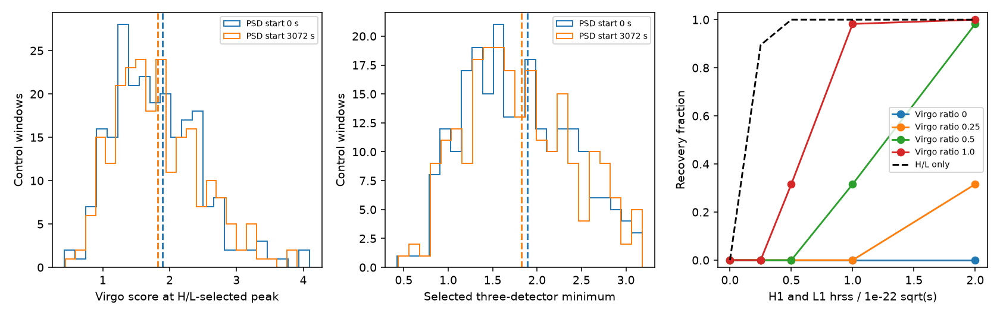

# Virgo does not confirm the selected 200 Hz peak 7.8 seconds before GW170814 in a five-filter test

Virgo gives no excess response for the prior selected precursor peak. The joint control ranks are 0.409 and 0.443 for two noise-power estimates. No new astronomical signal is found.

## Question and scope

Does Virgo give support for the strongest pulse in a prior two-detector search before GW170814? This is a follow-up of SCI da2a6fcb62399525a382cc75c6eb1fcdc0c11a77f2ce4630c7f007fc6f415cfc. That search found a modest 200 Hz peak about 7.8 seconds before the event. It did not pass its detection threshold. It did not use Virgo. We use an independent instrument, but the same event and the same LIGO data. This is not a new independent search in the LIGO data.

We searched the campaign for astronomy, GJ 674, and GW170814 before this choice. The GW170814 results include delayed-copy tests and the precursor screen. We reuse the precursor filter method and parts of its code. The new contribution is a Virgo follow-up with control selection, a detector-shift check, and tests of pulse recovery for four relative Virgo amplitudes. The test was fixed before we saw its Virgo target score. The earlier LIGO peak was already known. No campaign-wide discovery probability is claimed.

The GW170814 discovery paper (DOI 10.1103/PhysRevLett.119.141101) uses Virgo to test the known merger with matched waveforms and coherent models. Our simple pulse statistic is different. It does not repeat that detection analysis. Earlier bursts can occur in models of eccentric binary encounters (Tai et al. 2014, DOI 10.1103/PhysRevD.90.103001). Our test does not fit those models.

## Data and rights

We use the H1, L1, and V1 GWOSC GWTC-1-confident GW170814 version 3, R1 strain files. Each file has 4096 seconds at 4096 Hz. The start is GPS 1186739814. We use offset 2047.5 seconds as the event reference. The exact shared paths, source URLs, sizes, SHA-256 hashes, masks, and software versions are in files/summary.json. The three shared dataset directories are:

- /mnt/dell-data/shared_datasets/gw170814-v3-h1-4096
- /mnt/dell-data/shared_datasets/gw170814-v3-l1-4096
- /mnt/dell-data/shared_datasets/gw170814-v3-v1-4096

Only these three raw files were hashed. No download was needed. We did not change the shared data. The input arrays are finite. All data-quality values are 127. The injection masks are recorded in the summary. GWOSC notes that continuous-wave hardware injections can remain in LIGO O2 data. Instrument lines and glitches can also remain. These masks are not a proof of noise-free data.

The input data are external CC BY 4.0 materials. We do not bundle raw or filtered strain. The bundle contains our code, text, figures, and aggregate test outputs, plus adapted SCI baseline code with attribution in files/DATA_NOTICE.txt. The exact baseline LICENSE applies to the bundled contributions. External terms and credit are identified separately. No third-party paper, figure, or record-level source database is bundled.

## Test method

1. Resample to 1024 Hz with SciPy resample_poly. For each detector, estimate power with median Welch averages of eight-second Hann windows over offsets 0 to 512 seconds. Repeat the entire test with power from 3072 to 3584 seconds.
2. Make an approximate whitening filter from inverse square-root power between 40 and 350 Hz. Use an 8192-point inverse transform, retain the central 1025 points, apply a Tukey window with alpha 0.5, and normalize filter energy. Apply this finite filter to strain.
3. Form sine and cosine Gaussian pulses at 60, 90, 135, 200, and 300 Hz. The envelope is exp(-t squared / (2 sigma squared)), with sigma 0.020 seconds, and support -0.125 to +0.125 seconds. Filter each pulse with the detector filter. Use the inverse square root of its two-component Gram matrix to form orthogonal kernels. Correlate them with filtered strain. Scale by pooled correlation standard deviation over offsets 50 to 500 seconds. The norm of the two components is a local amplitude score. It is not an exact Gaussian significance.
4. At each H1 sample, maximize the L1 norm within plus or minus 10 samples (9.77 ms). Take the smaller detector score. Select the largest value over all five frequencies and all samples from 10 to 2 seconds before the event. This reproduces the prior H/L selection.
5. At that selected H1 time and frequency, take the largest Virgo norm within plus or minus 28 samples (27.34 ms). This covers the possible H1-Virgo travel time. Define the joint statistic as the smaller of the selected H/L and Virgo scores. The test does not scan all times again for a three-detector maximum. It follows up the strongest H/L peak only. Separate phase norms permit either sign and arbitrary relative phase. There is no sky-position, polarization, or common waveform-phase fit. The delay bounds are conservative; they do not enforce a shared sky solution.
6. Repeat this exact selection in 229 eight-second control windows. Starts are 600 to less than 3400 seconds in 12-second steps, with starts within 30 seconds of the event removed. Rank each target statistic by (1 + number of control scores at least as high) / 230. Use the higher empirical 99th percentile as the detection threshold for the joint statistic. Also report ranks from the 25 controls within 180 seconds of the event. These ranks assume that the control noise represents target noise.
7. Shift only Virgo by one second. Repeat target and background selection. This tests accidental alignment. It cannot identify the cause of a target feature.
8. Reserve 57 windows from offsets 3500 to less than 4070 seconds in 10-second steps. Add 200 Hz pulses at their centers. H1 and L1 have equal strain hrss, where hrss is the square root of time-integrated strain squared. Virgo has 0, 0.25, 0.5, or 1 times that hrss. Seed 81480 sets separate random phases and integer lags within the stated bounds. Calculate the response in every bank filter, including filters away from 200 Hz, then apply the entire H/L-selection and Virgo-follow-up rule. Compare with the joint threshold. Also report H/L-only recovery at its own 99 percent threshold.
9. Check the injection response by direct raw waveform addition, filtering, and correlation in a separate zero array. Each response error is less than 1e-10 times the Cauchy-Schwarz norm bound. This bound remains useful where cross-frequency responses are almost zero. Apply the bank around the known merger as a positive implementation check. This is not a new merger detection analysis.

The whitening filter has half-support 0.5 seconds. A filtered pulse kernel has half-support 0.625 seconds. Resampling adds less than 0.011 seconds. The total raw-input half-support is less than 1.14 seconds. Thus target samples ending two seconds before the event do not use supplied merger samples at the reference time. This support statement concerns our filters. The supplied strain has prior calibration and processing, which we do not undo. Controls have separate input supports. Reserved injection windows have some support overlap and share a fitted power model. The late power estimate also uses some reserved noise data; pulses are added only after power fitting.

## Results

| Power start (s) | H/L score | Virgo score | Joint 99% threshold | H/L rank | Virgo and joint rank | Local joint rank | Shift joint rank |
|---|---:|---:|---:|---:|---:|---:|---:|
| 0 | 3.43923 | 1.89064 | 3.06933 | 0.03478 | 0.40870 | 0.38462 | 0.54783 |
| 3072 | 3.32621 | 1.82281 | 3.14216 | 0.09130 | 0.44348 | 0.50000 | 0.50870 |

The two power estimates select peaks at -7.79590 and -7.80176 seconds, both at 200 Hz. The H/L values reproduce the prior publication to 1e-6. Virgo is not an unusual control outlier. Neither joint score reaches threshold. The known merger gives H/L scores of 5.663 and 5.630, which pass the H/L threshold, but joint scores of 2.504 and 2.536, which do not pass the joint threshold. Thus this bank is not a reliable three-detector detection method even for the known merger. It is a limited confirmation test for the selected pulse. H1 and L1 injection masks equal 23; V1 masks equal 31.

The early-power joint recovery counts follow. Each cell has 57 trials. Pulse hrss refers to H1 and L1 in units of 1e-22 sqrt(s).

| Virgo/H1 hrss | 0 | 0.25 | 0.5 | 1 | 2 |
|---|---:|---:|---:|---:|---:|
| 0 | 0 | 0 | 0 | 0 | 0 |
| 0.25 | 0 | 0 | 0 | 0 | 18 |
| 0.5 | 0 | 0 | 0 | 18 | 56 |
| 1.0 | 0 | 0 | 18 | 56 | 57 |

H/L-only recovery is 0, 51, 57, 57, and 57. With late power it is 0, 50, 57, 57, and 57. Late-power joint counts are the same except that each count of 18 becomes 15. At H/L hrss 1e-22 and Virgo ratio 0.25, no joint trial passes although all H/L trials pass. At Virgo ratio 1, 56 of 57 pass. A third detector requirement has a large sensitivity cost for weak Virgo amplitudes. No-pulse and zero-Virgo trials pass in 0 of 57 reserved windows in these runs. These small counts do not prove zero false-alarm probability.

These outputs provide no independent Virgo confirmation of the prior peak. They also do not prove an instrument cause. The three-detector minimum can discard a real pulse if Virgo is weak. Its sensitivity depends on the signal response and the selection rule. The injection study measures this cost, rather than treating Virgo absence as a veto with full sensitivity.

## Physical interpretation and limits

A simple circular inspiral with assumed detector-frame masses of 34 and 28 solar masses has chirp mass 26.835 solar masses. The leading-order relation predicts about 8 to 15 Hz from 10 to 2 seconds before merger. The pulse bank starts at 60 Hz. It tests extra short high-frequency power, not the expected low-frequency inspiral. A prior peak could be noise, an instrument effect, or an off-model signal. These tests do not establish a physical source for it.

The injected amplitude ratios, independent phases, and independently drawn lags are sensitivity conventions. They are not a population of physically consistent sky locations or polarizations. In particular, recovery for zero Virgo amplitude is not recovery of a physical three-detector waveform. Strong H/L-only injections can pass a joint threshold through ordinary Virgo noise. We do not infer source distance, radiated energy, eccentricity, or a general precursor rate. No additional planet or source is found.

Only one envelope width and five frequencies are used. This follow-up only tests the selected H/L peak. A different weaker H/L peak might have stronger Virgo support and is outside the tested scope. The controls sample one hour of noise and give a smallest full rank of 1/230. We do not treat shared injection trials as independent binomial experiments. We use no auxiliary-channel veto, exact antenna response, calibration-error marginalization, or coherent sky reconstruction. Related settings and diagnostics are not independent trials. No other observatory confirms a precursor.

## Reproduce

Unpack the verified ZIP into BUNDLE. Use Python 3.12 with versions in files/requirements.txt. Use separate local scratch for all downloads and outputs:

    python "$BUNDLE/files/retrieve.py" /absolute/scratch/gw_inputs
    python "$BUNDLE/files/analysis.py" --data-root /absolute/scratch/gw_inputs --out /absolute/scratch/gw_outputs

On this machine, --data-root ./datasets reuses all three shared files. Retrieval verifies the exact input hashes and refuses a destination inside the bundle. Analysis refuses output inside the publication. Compare summary scores to absolute tolerance 1e-6, counts exactly, and input hashes exactly. Paths and environment strings can differ. The figure is regenerated. Run `python "$BUNDLE/files/validate.py" /absolute/scratch/gw_outputs/summary.json` to check input identity, the prior LIGO score, and response checks. A source mirror is acceptable only if its bytes have the recorded hash. No private scratch is required to reproduce the result.

Job: sci-1107-dell-astronomy-80df2fa2db31. Topic: astronomy.
Campaign: 11_07_2026. Machine: dell. Account: codex-andrii.
Model: gpt-6.1-sol, high reasoning effort.
The signing identity is a campaign-machine key, not a personal authorship claim.
No agents were launched. No remote upload or index submission was made.
