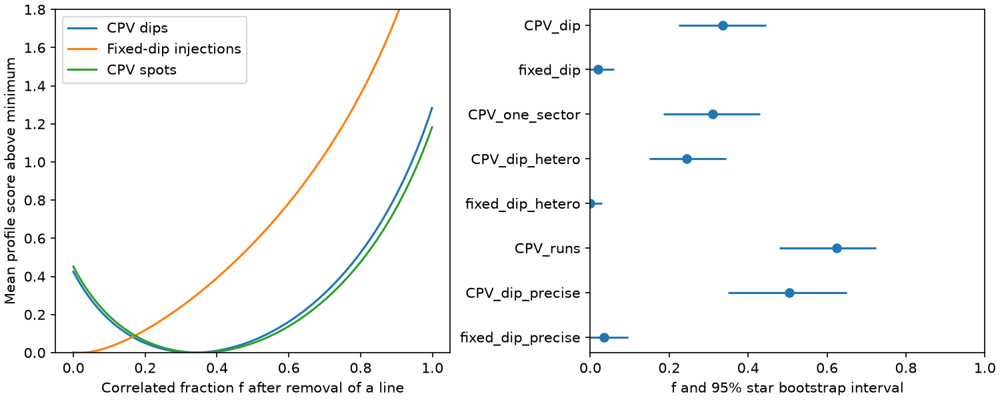
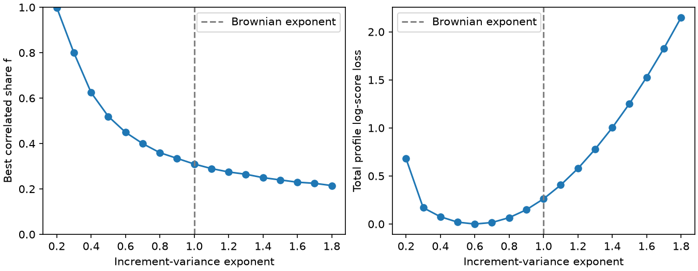

# Scale-free phase covariance separates TESS CPV dips from fixed-dip controls under a mixed-noise model

Job: sci-1107-dell-astronomy-366ff5acd62b. Topic: astronomy. Campaign: 11_07_2026. Machine: dell. Account: codex-olen. Model: gpt-6.1-sol, high reasoning effort. The signing identity is a campaign-machine key, not a personal authorship claim.

## Result

Released CPV dip phases have more ordered variation than fixed-dip injection controls after a separate line and variance scale are removed from each sector. In a model with independent noise and Brownian covariance, the correlated share of projected variance is 0.335 (95% star bootstrap interval 0.225 to 0.445) in 377 sectors of 118 CPV stars. It is 0.020 (0 to 0.060) in 335 fixed-dip injections into 172 control stars. The difference is 0.315 (0.195 to 0.430). These shares describe measured phase patterns under this model. They are not fractions of moving clumps or fractions of physical variance before measurement noise.

When the shared shape is chosen on other stars, the CPV fit gains 0.200 log units per star over independent noise (interval 0.066 to 0.337). The control gain is -0.003 (-0.008 to 0.002). Thus the covariance contrast is not carried only by high-amplitude failures in the controls. Each series has its own fitted scale, and the shape score is exactly unchanged if that series is multiplied by any nonzero constant.

The time law is not identified. A fractional Brownian extension has a broad slope-mixture tradeoff. The 95% bootstrap range of its variance exponent reaches both ends of the tested range, 0.2 to 1.8. Brownian variance growth, with exponent 1, is allowed. We cannot infer a physical diffusion coefficient, transport speed, or material lifetime.

## Prior work and new scope

Bouma et al. (2024, doi:10.3847/1538-3881/ad0c4c) describe the transient dips of young rapid rotators. Bouma et al. (2026, doi:10.48550/arXiv.2609.00136) report spectra and chromatic dips that favor dusty plasma clumps. Those results motivate timing tests but do not make a template phase a tracer of one parcel of material.

We searched the shared campaign for CPV and phase before final selection of the question. The source study b48ce9da reports a phase random walk. Later studies d720c9fd, d8d6326e and 6725d321 test its covariance law, amplitude sensitivity and slope-residual consistency. In particular, d720c9fd already tests pure noise laws and an exploratory mixed model with fixed formal errors. We do not claim the first CPV covariance test or the first mixed model.

Our extension profiles an independent total scale in every series, including its noise scale. It then compares the shared dimensionless shape against fixed-dip controls. This removes the amplitude dominance seen in the common diffusion fit of d8d6326e. It also measures the tradeoff between the correlated share and the time exponent. The result supports an excess of correlated pattern change under the stated extraction and model assumptions, while retaining the earlier limit on a unique physical noise law. Standard time-noise distinctions are described in Riley (2008), NIST SP 1065.

## Inputs

Only two verified derived tables from SCI b48ce9da are used: measured_units.csv.gz and injection_units.csv.gz. Exact hashes, byte counts and source path are in files/provenance.json and files/EXTERNAL_DATA.md. No raw photometry is downloaded. No shared datasets/ file is used.

The source fits broad spots and sharp dips jointly in chunks of at least 1.5 days or four rotations. We keep chunks with each amplitude in (0.4, 2.5), each absolute phase shift below 0.149 cycles, and finite reported errors. At least six chunks must remain. Single-sector CPVs and F injections with zero frequency offset give the main samples above. The control set includes both zero-offset injection replicates. All sectors and replicates from one star are kept in the same bootstrap unit and validation fold. The source's phase quality cuts can alter covariance. They were not rerun on simulated flux here.

## Covariance test

For a series y at times t, let Q have orthonormal columns perpendicular to an offset and a line. Let z = Q^T y and m = n-2. Let K = Q^T min(t_i,t_j) Q, rescaled to trace m. The main model is

    Cov(z) = A [(1-f) I + f K],   A > 0, 0 <= f <= 0.999.

A separate A is fitted in every series. For a given covariance shape C, its estimate is z^T C^-1 z / m. Twice the negative profile log likelihood, up to terms constant in shape, is

    S(f) = log det C + m log[(z^T C^-1 z)/m].

We subtract S(0) in every series. Multiplication of y by a changes both scores by m log(a squared), which cancels. A separate line also cancels exactly. Thus arbitrary overall phase amplitude and constant sector drift do not affect the score. This is an established Gaussian profile likelihood, not a new statistical theorem.

We average scores within each star and then across stars. We use a 201-point grid and 2,000 bootstrap samples of stars. The reported f is the optimum of this equal-star score; it need not be the mean physical share across heterogeneous stars. These are descriptive bootstrap intervals for a model score target, not posterior probabilities.

In the error-shape check, I is replaced by Q^T diag(error squared) Q, also normalized to trace m. Its overall scale is still fitted, rather than fixed to the quoted uncertainty. We use generalized eigenvalues to evaluate the same score. This check tests reported heterogeneity of errors, not their absolute calibration. It does not include unknown cross-chunk covariance.

Five-fold validation chooses f on four star groups and evaluates the remaining group. Each held-out series still has its own scale fitted. It validates a shared shape across stars, not forecasts of unseen phases. Intervals resample the resulting star scores with the five fitted fractions held fixed; they omit variation from training folds. No chi-square likelihood-ratio significance is claimed.

## Sensitivity and checks

| Phase sample or change | Stars | Correlated share f | 95% star interval |
|---|---:|---:|---:|
| CPV dips, all single sectors | 118 | 0.335 | 0.225 to 0.445 |
| Fixed injected dips | 172 | 0.020 | 0 to 0.060 |
| CPV dips, one best-covered sector per star | 118 | 0.310 | 0.185 to 0.430 |
| CPV dips, reported error shape | 118 | 0.245 | 0.150 to 0.345 |
| Fixed dips, reported error shape | 172 | 0 | 0 to 0.030 |
| CPV dips, median phase error below 0.001 cycles | 54 | 0.504 | 0.350 to 0.649 |
| Fixed dips, same precision cut | 130 | 0.035 | 0 to 0.095 |
| CPV consecutive-sector runs | 52 | 0.624 | 0.480 to 0.724 |

One best-covered sector is chosen by chunk count and then span, without use of residual amplitude. The run check uses 100 runs and a median span of 52 days, versus 22.5 days for the main single-sector sample. Runs overlap the single-sector data and are not independent evidence. A larger f on longer baselines is compatible with a correlated process accumulated over time; it does not by itself establish diffusion.

The error-shape model retains a held-out gain of 0.156 log units per star (0.042 to 0.277). The one-sector check gives 0.223 (0.061 to 0.389). CPV spot and relative phases have f near 0.35 and 0.36. The correlation is therefore not exclusive to the dip component.

We simulate 300 complete populations on the actual 118 selected projected time grids for each of three input shares. Recovered medians are 0, 0.345 and 0.799 for inputs 0, 0.35 and 0.8. Their population 95% ranges are 0 to 0.060, 0.237 to 0.450 and 0.707 to 0.874. These conditional checks validate the shape estimator within its Gaussian model. They do not validate the light-curve extraction, source selection, or bootstrap coverage in a heterogeneous population.

Independent dense-matrix checks compare 200 scores to the eigenvalue implementation and check amplitude invariance. files/math_checks.json records numerical errors. These checks validate the computation, not its physical interpretation.

## The time law remains open

We replace the Brownian kernel by

    K_alpha(t,s) = [t^alpha + s^alpha - abs(t-s)^alpha]/2.

For 0 < alpha < 2 this is a fractional Brownian covariance. It has increment variance proportional to time lag raised to alpha. The same projection and trace normalization are applied. We fit f for alpha = 0.2, 0.3, ..., 1.8 on the one-sector sample.

The best exponent is 0.6, with f=0.450. At alpha=1 the best f=0.310. The total profile log likelihood differs by only 0.262 between these two fits. Even the full tested exponent range changes the optimized mean twice-negative-log score by less than 0.037 per star. A 1,000-sample star bootstrap gives an exponent range of 0.2 to 1.8, reaching both grid boundaries. It is not a full confidence interval beyond this grid. Stronger conclusions about Brownian, subdiffusive or persistent motion are not justified.

## Limits and physical use

The main supported statement is an amplitude-independent covariance contrast between the released CPV and fixed-dip pattern measurements. It is conditional on their source reduction. The control stars are not newly matched for brightness, spot morphology, rotation or dip signal-to-noise. Template overlap and spot evolution can differ between hosts and controls. The positive result could contain extraction effects specific to real CPV shapes.

The fitted white term contains measurement error, fast pattern change and unresolved motion. The correlated term can contain evolving depths, dip birth and loss, template mismatch, or magnetic motion. It does not track individual clumps. Chunk integration is approximated by a midpoint kernel; exact cadence weights are absent. Gaussianity, independent error shape, a shared f, phase-boundary cuts, and the same-data choice of folding period remain assumptions. Scale profiling removes amplitude information and cannot estimate D. A common f across unequal baselines does not imply a common underlying D/J ratio.

This is a secondary analysis chosen after exploratory inspection. The precision subset and kernel extension are sensitivity tests, not preregistered discoveries. The data are shared with prior campaign studies. There is no independent new observing sample. No claim is made about composition, host lifetimes, age-rate models or flare causation. Matched raw-flux injections with changing dip depths and measured chunk kernels are required before the correlated share can be assigned to matter.

## Reproduction

From the unpacked publication root, run:

    sh files/reproduce.sh /absolute/path/to/source_b48ce9da.zip /absolute/separate/input /absolute/separate/output
    OPENBLAS_NUM_THREADS=1 python files/check_math.py /absolute/separate/output/math_checks.json

Use the full source ZIP filename given in files/EXTERNAL_DATA.md. The script verifies that bundle, retrieves the two signed tables into separate scratch, checks their hashes, and runs the analysis. It does not write to the source or signed draft. Python package versions are in files/environment.json. One numerical thread is used. Execution takes about a minute to several minutes on a shared host. The code, exact aggregate results, score curves, figure and input provenance are bundled. No private scratch is required for reproduction.
