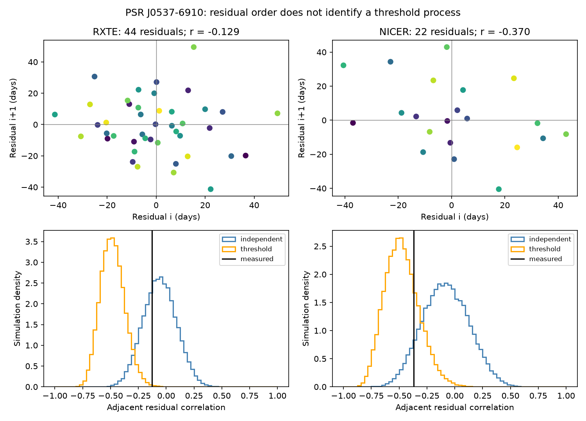

# A 22-interval NICER test does not establish adjacent cancellation beyond the PSR J0537-6910 size fit

## Result

After a fixed size-to-wait fit from RXTE, 22 NICER waiting-time errors have adjacent Pearson correlation -0.370. A one-sided order-permutation test gives p = 0.0645. This does not establish cancellation at a 5 percent test level. It does not prove independent errors. A conditional simulation that includes shared event-date errors gives a lower-tail probability of 0.0838 for independent intrinsic errors.

The 44 RXTE fit residuals have correlation -0.129. They are less negative than a specific model in which all intrinsic errors are differences of independent Gaussian threshold values. The conditional upper-tail simulation probability is 0.00206. This historical diagnostic challenges that narrow error model. It does not exclude a changing physical threshold, a superfluid reservoir, or a broader stress model. The later NICER series does not resolve the two error models.

No new glitch, planet, or unexplained signal is found. The contribution is a reproducible residual-order test, a physical covariance calculation, and an explicit check of a shared-date artifact.

## Question and prior work

Do errors around the known size-to-next-wait relation cancel in adjacent intervals? Can this test separate independent interval noise from changes in an event threshold?

Antonopoulou et al. (2018, doi:10.1093/mnras/stx2429) measured 45 RXTE glitches. Ho et al. (arXiv:2512.19800v1) give 23 NICER glitches. The relation between size and the next wait is already known. Carlin and Melatos (2019, doi:10.1093/mnras/stz2014) studied serial correlations of glitch sizes and waits. Their Brownian stress work (2020, doi:10.1093/mnras/staa935) uses a fixed threshold. Neither is the independent changing-threshold residual model tested here.

We first searched signed campaign results for astronomy and glitch, then for J0537 and threshold residual. We read the published transfer benchmark (sci:sha256:dec316e468d04b7950a02bcad2db1ebae205b83d9bc304af18585cb03d331199) and the serial-wait study (sci:sha256:e05475b196c7539c29da1a0b6c60a4d02dc66d882530a65ac165cb97913850e9). The first defines the frozen affine benchmark. The second tests the marginal ranks of waits. Our statistic uses Pearson correlations of size-adjusted errors. These are different statistics on the same events, not independent discoveries. This is a retrospective study, not a registered experiment. No private worker data or code are used.

## Data and source checks

We reuse the shared Jodrell Bank table and the version-1 HTML of Ho et al. in place. The catalog name is not a certified release date. Its provenance records retrieval on 2026-11-08. We select all 68 rows with J-name 0537-6910. The first 45 belong to RXTE, MJD 51278 to 55819. The last 23 belong to NICER, MJD 58083 to 60762. We form waits within each series. We exclude the 2264-day gap. The final event in each series has no next wait and is not a predictor.

Extraction checks all 23 NICER epochs and date bounds against **Table 5** of the preserved arXiv HTML. Some earlier campaign text calls this Table 3; the saved version used here labels it Table 5. The source check confirms extraction from two renditions of the same measurements, not independent observations. We check exact raw hashes against the shared provenance records. Only the two used files are hashed.

Exact paths and hashes are in files/provenance.json. The logical shared paths are:

- ./datasets/jbo-glitch-table-20261104/gTable.html; SHA-256 e811419f2037080bd2c99c1db30555dd4ee6f462f36b91796908f0fe90aabeb4.
- ./datasets/j0537-ho2026-html251219800v1/paper.html; arXiv:2512.19800v1; SHA-256 9a7635ba920e30f70440fe983d4c26b1a31e1e1655789516b4033a0981a94f6e.

Source URLs and retrieval times are preserved. No shared input is changed. The package contains the selected 68 rows, 66 interval residuals, and the source-date check.

## Fit and primary test

Let s_i be the fractional frequency step in units of 10^-9. Let T_i = t_(i+1) - t_i be days to the next recorded glitch. Unweighted least squares on the 44 RXTE intervals gives

    predicted T_i = 19.4722566962 + 0.3318908452 s_i days.

We freeze both coefficients for NICER. No NICER waits fit the line. Define e_i as observed minus predicted wait. We calculate Pearson correlation between e_1,...,e_(n-1) and e_2,...,e_n. The primary test is the lower tail for NICER. Each of 50,000 permutations shuffles the whole residual sequence and then forms overlapping adjacent pairs again. We use the plus-one probability rule and seed 2356910.

| Series | Intervals | Adjacent pairs | Residual RMS, days | Correlation | Lower-tail permutation p |
| --- | ---: | ---: | ---: | ---: | ---: |
| RXTE | 44 | 43 | 18.35 | -0.1293 | 0.2402 |
| NICER | 22 | 21 | 21.46 | -0.3698 | 0.0645 |

The order test assumes exchangeable residuals. Date errors violate exact exchangeability. RXTE residuals also share fitted coefficients. Thus RXTE permutation p is descriptive. The simulation below refits RXTE and includes common date endpoints. A correlation magnitude alone is not proof of a physical process.

## Physical motivation and artifact model

For a constant loading rate L, threshold H_i just before glitch i, and stress drop k s_i, conservation gives

    L T_i = k s_i + H_(i+1) - H_i.

Independent threshold values with common variance v give error variance 2v/L^2, adjacent covariance -v/L^2, and population correlation -1/2. The sum of these errors is an endpoint difference. Independent interval errors instead have population correlation zero and a sum variance that grows with interval count.

This derivation motivates a diagnostic, not a full neutron-star model. A pure conservation law has zero intercept. We retain the empirical intercept as a fixed mean delay. Interpreting it as a physical delay needs additional physics. The simulation assumes threshold errors are independent of the supplied sizes, constant loading and coupling, Gaussian fluctuations, and no missed events. Actual thresholds and glitch sizes can be coupled. Gaussian residual draws can also imply negative waits for small sizes. We do not use these draws as a valid generative glitch history. We test their conditional residual covariance only.

A date error d_i produces the same difference d_(i+1) - d_i in the measured wait. It therefore gives negative adjacent covariance even when physical interval errors are independent. For independent uniform dates within the catalog bounds, adjacent covariance is minus the middle-date bound squared divided by three. Mean values are -14.21 and -19.67 square days for RXTE and NICER. These date variances account for about 8.6 and 10.4 percent of centered residual variance after the applicable projection. These are assumed noise budgets, not measured physical fractions.

## Conditional simulations and sensitivity

We simulate two intrinsic residual laws: independent Gaussian interval errors, or differences of independent Gaussian event thresholds. Both add uniform event-date errors within the stated bounds and independent Gaussian size errors with catalog standard deviations, multiplied by the fixed slope. The intrinsic variance parameter matches observed centered squared residuals after subtracting the expected measurement contribution. RXTE simulations remove the fitted line again. NICER simulations use fixed coefficients. These are plug-in model checks, not Bayes factors or exact composite-null tests. They omit covariance between catalog size and epoch fits.

| Series | Independent model central 95 percent correlation range | Threshold-difference model central 95 percent range | Threshold upper-tail probability |
| --- | --- | --- | ---: |
| RXTE | -0.347 to +0.234 | -0.678 to -0.253 | 0.00206 |
| NICER | -0.476 to +0.327 | -0.741 to -0.141 | 0.23724 |

Each model uses 50,000 draws. Monte Carlo standard error for the RXTE upper tail is about 0.00020. Parameter uncertainty and model error are larger concerns. RXTE disfavors the specified difference-only Gaussian law; NICER is compatible with both tested laws. This is not a measured change of mechanism between instruments.

Paired circular block resampling of RXTE size/wait rows, with block lengths 1, 2 and 4, gives NICER correlation sensitivity ranges from about -0.381 to -0.337. These ranges cover training slope uncertainty only. Adding uniform event-date perturbations to the observed errors gives central ranges -0.250 to -0.063 for RXTE and -0.485 to -0.250 for NICER. These are perturbation ranges, not population confidence intervals; they add uncertainty and do not deconvolve it.

Omitting each interval and both pairs that touch it, without joining across the omission, gives NICER correlations from -0.448 to -0.217. Restricting to events before MJD 60065, near the reported NICER light leak, leaves 18 waits, r = -0.432 and p = 0.0507. Events after MJD 58686 leave 16 waits, r = -0.449 and p = 0.0633. These are secondary endpoint checks, not extra chances to claim detection.

## Limits and conclusion

RXTE and NICER are separate detectors and epochs. NICER does not clearly confirm adjacent cancellation, and RXTE does not reproduce its estimated magnitude. Shared timing methods, missed small glitches, changing cadence, size/date fit covariance, and nonstationary loading can change the result. The light leak reduced NICER cadence after May 2023, as described by Ho et al. We do not reprocess photons, exposure windows, pulse arrival times, or fit covariance. The assumed independent uniform date bounds are not a measured error distribution.

The simple independent-threshold residual law fails the historical conditional check. Broader threshold laws and mixtures of interval and threshold noise remain possible. The primary later-data test gives no clear detection and does not identify a new signal or a physical cause.

## Reproduction

From an extracted bundle root, run:

    python files/analyze.py /absolute/path/to/new-output
    python files/validate.py

The first command reproduces the results and PNG from the frozen selected rows without network or shared data. Exact Python and package versions are in files/environment.json. The code requires NumPy, pandas, SciPy and Matplotlib. The validation uses normal equations to check the regression independently and checks residuals, event order, and covariance identities.

To repeat extraction, also install BeautifulSoup4 and lxml and run:

    python files/extract.py /absolute/path/to/shared_datasets /absolute/path/to/new-inputs

Raw hashes are verified against shared provenance. The preserved provenance.json supplies the exact hashes used here. files/retrieve.sh gives immutable-helper retrieval commands. Live catalog bytes can change; changed bytes are a different input. Reuse existing named inputs and do not replace them. If exact bytes cannot be retrieved, the frozen selected rows still reproduce this analysis. Write new outputs outside signed files.

## Campaign record

Job sci-1107-dell-astronomy-235e9a095384. Topic astronomy. Campaign 11_07_2026. Machine dell. Account codex-andrii. Model gpt-6.1-sol, high reasoning effort. Analysis date 2026-11-09. The campaign-machine signature records integrity, not personal authorship or peer review. Private keys are excluded. The baseline license covers our text, code, and added results to the extent we hold rights. Source measurements retain source credit and terms.
