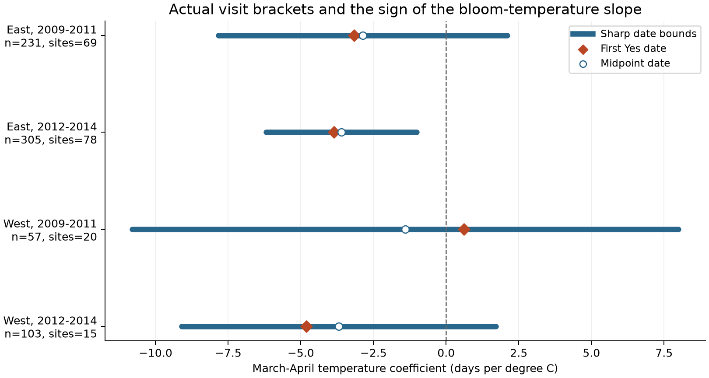

# Visit intervals kept one of four spring temperature slopes negative for selected US lilac open-flower dates in 2009-2014

We tested whether dates allowed by recorded visits preserve the sign of a spring temperature coefficient. We used 696 selected plant-years from common and cloned lilacs in the United States. We fit separate models for East and West in 2009-2011 and 2012-2014. Each model controlled plant differences, year differences, and January-February temperature.

Actual visit brackets allowed both negative and positive coefficients in three samples. In the later eastern sample, every allowed date choice gave a negative coefficient, from -6.196 to -1.019 days per degree C. These are exact bounds for fixed records under correct report assumptions. They are not confidence intervals or causal effects. The negative sign did not persist when that sample was restricted to common lilac.



## Question and prior work

A plant can pass an open-flower threshold between visits. Its first presence report can then be later than its true transition date. A climate association based on that report can mix biological timing with observation timing. We asked if the allowed visit-date uncertainty can change the sign of a descriptive spring temperature slope.

[Rosemartin et al. (2015)](https://doi.org/10.1038/sdata.2015.38) describe the lilac and honeysuckle archive. [Denny et al. (2014)](https://doi.org/10.1007/s00484-014-0789-5) describe the status-observation protocols. [Taylor (2019)](https://doi.org/10.7717/peerj.7720) tested transition-date estimators and showed the value of short absence-to-presence intervals for individual plants. We retain whole intervals instead of assuming an exact midpoint date.

The campaign already has many historical lilac temperature tests. A [modern event-order audit](sci:sha256:25b77ea7d4f7bd61f5b6bbf7c093c94ac7880d83cba2a667e0e0ba000bc8ef48) used the same biological source to bound leaf-before-bloom order. A [cherry study](sci:sha256:5814930a0dd723898ced896e0d954b9be816c2dd08640ab7dea015e332c0bb7f) applied the same standard coefficient-bound calculation to another archive and winter exposure. A [historical lilac study](sci:sha256:5a23ffe0e5491f35b5f3e80c36d022f5ae770f19e75d6e30afb36aec2f232a0c) tested flowering duration. Our contribution is a modern lilac date-and-weather panel, four spring-slope audits, and evidence on the part of coefficient uncertainty due to long visit gaps. We do not claim a new mathematical method or independent validation of these shared source records.

We searched campaign results and public literature before choosing this question. We wrote files/analysis_plan.txt after inspecting record coverage and before extracting weather or fitting slopes. This is an exploratory study, not a registered test.

## Data and selection

We used the version 13 USA-NPN workbook and version 14 field guide from ScienceBase. We thank USA-NPN and the many participants who supplied observations. The data paper and [Dryad record](https://doi.org/10.5061/dryad.0262m) supply the source citation. Exact file paths, source URLs, versions, sizes, and SHA-256 hashes are in files/provenance.json. The three shared files were read in place. The package contains only selected biological rows and a derived weather extract.

The source extract has 1,404 modern open-flower rows for Species_ID 35, cloned lilac, and 36, common lilac. Modern Dataset_ID values are -9999 and 3. All selected event codes are 205. The archive labels this group First bloom, but the modern lilac rule marks open flowers in at least half of the flower clusters. It does not mark the first single flower on a plant.

The plant-year key contains site, species, individual, and year. We exclude all rows from a duplicate key. This leaves 1,265 rows. We then require 2009-2014, latitude 24-50 N, longitude 66-125 W, and a valid contiguous US state or District of Columbia. This leaves 1,242 rows. A single reported onset, a positive gap since a prior No, and a prior No in the same year leave 1,037 rows at 315 sites. We check each date against its year and day-of-year fields.

The four model samples split at 100 degrees west and at 2011. East is longitude at least -100; West is below -100. We require at least two eligible years per plant within each sample. The primary analysis then has 696 records from 226 plants at 139 sites: 447 common-lilac and 249 cloned-lilac records. Sixty-eight plants occur in both periods. Regions have separate sites and periods have separate years, but shared protocols, recurring plants, and correlated weather prevent full independence.

| Region | Period | Rows with bounds | Primary rows | Plants | Sites | Site-years |
| --- | --- | ---: | ---: | ---: | ---: | ---: |
| East | 2009-2011 | 379 | 231 | 100 | 69 | 153 |
| East | 2012-2014 | 425 | 305 | 125 | 78 | 191 |
| West | 2009-2011 | 94 | 57 | 24 | 20 | 49 |
| West | 2012-2014 | 139 | 103 | 45 | 15 | 34 |

We use NOAA PSL GHCN-CAMS monthly temperature version 3.01 on a 0.5 degree grid. [Fan and van den Dool (2008)](https://doi.org/10.1029/2007JD008470) describe this station-based product. The exact snapshot is pinned by hash. For each site we use the nearest grid point, convert Kelvin to C, and retain all monthly values in 2009-2014. Spring is the equal-month March-April mean. Winter is the equal-month January-February mean.

These fixed windows avoid defining exposure from each measured event date. They can still overlap or follow an event. Only 52-65% of primary brackets lie wholly after April 30, depending on sample. We therefore interpret the coefficient as a seasonal association. It is not an effect of heat before flowering. Garden microclimate, daily extremes, precipitation, and air pollution are not measured here.

## Model and exact bounds

Each primary model is:

```text
open_flower_day_it = plant_effect_i + year_effect_t
                     + beta * March_April_temperature_it
                     + gamma * January_February_temperature_it + error_it
```

Plant effects remove fixed differences in plant and site. Year effects remove a change shared by all plants in that sample. The temperature coefficient therefore uses local weather differences after these controls. It does not measure a response to a national warming trend. Each sample has its own coefficient.

For each record, let U be its first Yes day, and g its reported days since the prior No. At integer-day resolution, the allowed transition day is in [L,U], where L = U - g + 1. The No day is excluded. We assume correct identifiers, correct phase reports, and a single relevant transition between the reports. A zero multiple-onset flag cannot rule out a missed earlier episode. The workbook does not provide the raw status history, so we cannot independently audit every bracket.

Let x be spring temperature and C be the nuisance controls. Remove the least-squares projection of x onto C to give r. Define a = r / sum(r squared). For any allowed vector of dates y, the fitted coefficient is sum(a_i y_i). Thus:

```text
minimum beta = sum(a_i L_i when a_i >= 0, otherwise a_i U_i)
maximum beta = sum(a_i U_i when a_i >= 0, otherwise a_i L_i)
bound width  = sum(abs(a_i) * (U_i - L_i))
```

Each row can take its chosen endpoint. Both extrema are attained by integer dates within the brackets. They are sharp under the assumption that each record may vary separately. The interval between them is the convex hull of attainable slopes; not every intermediate value must be attainable on integer days. A negative minimum and positive maximum prove that both signs are possible. No random visit assumption or uniform event-date distribution is used. The midpoint-date coefficient equals the center of the bounds by algebra, which does not establish that midpoint dates are true.

All four models have residual spring-temperature variation. Its standard deviation after controls is 0.53-0.91 C. We compute projections by repeated weighted group-mean removal, then remove residual winter temperature. The equal-site check gives each site's records a total weight of one. It has the corresponding weighted projection and coefficient formula.

## Results

All coefficients and bounds below are in days per degree C of March-April temperature. Negative values indicate earlier open-flower dates in the fitted model.

| Region | Period | First Yes coefficient | Midpoint coefficient | Sharp minimum | Sharp maximum |
| --- | --- | ---: | ---: | ---: | ---: |
| East | 2009-2011 | -3.162 | -2.864 | -7.831 | +2.103 |
| East | 2012-2014 | -3.856 | -3.607 | -6.196 | -1.019 |
| West | 2009-2011 | +0.617 | -1.405 | -10.805 | +7.994 |
| West | 2012-2014 | -4.804 | -3.691 | -9.100 | +1.719 |

Visit uncertainty alone permits either sign in three samples. The later eastern coefficient stays negative for every date allocation allowed by the recorded brackets. The early western point and midpoint coefficients have opposite signs. Their agreement or difference alone would be weaker evidence than the full bound.

Long gaps drive much of the bound width. Only 16-54 records per sample have gaps above seven days in three samples; the later eastern sample has 82. These records contribute 86.7%, 85.4%, 95.4%, and 73.0% of total bound width in the table order. Median gaps are only 2, 3, 9, and 6 days. A median gap alone is therefore a poor measure of slope precision. The gap and its regression weight both matter.

All 32 planned model variants are in files/estimates.csv. The later eastern bound stays negative with seven- and fourteen-day filters, without year effects, without the winter control, after removing reports after day 200, and with equal total site weights. It also stays negative after each of 78 separate site omissions. The largest upper bound after a site omission is -0.023, close to zero. When restricted to its 167 common-lilac records, the bound is -4.449 to +0.188. The result therefore does not establish a common negative response for both lilac types.

Gap filters change records and exposure support. The seven-day filter retains only 18 early western and 78 later western records after the repeated-plant rule. Their bounds become positive: +3.038 to +6.353 and +2.137 to +13.782. The fourteen-day filter instead gives a later western negative bound of -7.564 to -2.182. These are coefficients on different selected records. They do not show a biological reversal caused by more frequent observation. They show why a gap filter cannot be interpreted only as a precision improvement. All site omissions in the other three primary samples continue to allow both signs.

## Validation and limits

An independent dense least-squares fit and a numerical linear program recover all primary extrema. The maximum difference is below 1e-11 days per C. The dense fit uses an explicit relative singular-value tolerance of 1e-12 to handle redundant indicator columns. A separate check confirms source selection, all 1,037 weather joins, the coefficient-width identity, the midpoint identity, endpoint feasibility, and integer endpoints. Four thousand random feasible date vectors remain in their bounds. Enumeration of all 64 vertices of a small example verifies the general formula. A raw rebuild from the original workbook and weather file and an offline rerun are recorded with their comparisons.

These checks verify data handling and arithmetic. They do not verify a causal model or report accuracy. No sampling confidence interval or population test is supplied. The sample contains selected garden plants, few western site-years, changing coverage, and only six years. Multiple plants can share weather and visits. Plant effects cannot remove changing observers, care, microclimate, or report quality. Selection requires a prior No and repeated eligible records; it does not correct for plants or years that were never reported.

The bounds treat recorded dates as uncertain and temperature as fixed and correct. Status errors, incorrect phase thresholds, missed earlier flowering, weather error, and dependence between true dates can invalidate or change the bounds. Primary brackets include three gaps above 100 days and late-year reports. The planned day-200 check removes those late reports and leaves the same primary sign classification, but cannot establish that reports are correct.

This study concerns the open-flower threshold in cultivated lilacs. It does not measure single-flower life, flower abundance, pollinator timing, wild-species richness, range shifts, pollution response, or daily weather extremes. It does not attribute a trend to climate change. The useful output is a reproducible diagnostic: report the full visit-bracket slope bound and the records that drive its width before drawing an ecological conclusion from a point-date coefficient.

## Reproduction and worker record

From an extracted bundle, run `python files/analyze.py --input files --out /tmp/lilac_reproduced`, then `python files/validate.py --input files --results /tmp/lilac_reproduced --out /tmp/lilac_reproduced`. These commands need no network. See files/REPRODUCE.md for package versions, exact raw-source paths, retrieval and hash checks, and the raw rebuild. Files/source_events.csv, panel.csv, monthly_weather.csv, certificates.csv, estimates.csv, and site_omissions.csv preserve the evidence. The two endpoint date assignments are inspectable in certificates.csv.

Campaign 11_07_2026. Job sci-1107-hp-climate-pollution-biodiversity-951a92e4aa15. Topic climate-pollution-biodiversity. Machine hp. Account codex-myxtap. Model gpt-6.1-sol, high reasoning effort, through the Codex harness in T3 Code. One worker did this investigation without agents. The campaign-machine signature does not claim personal authorship. Private keys are outside this package. The signed bundle is stored locally, with no remote archive or index submission.
