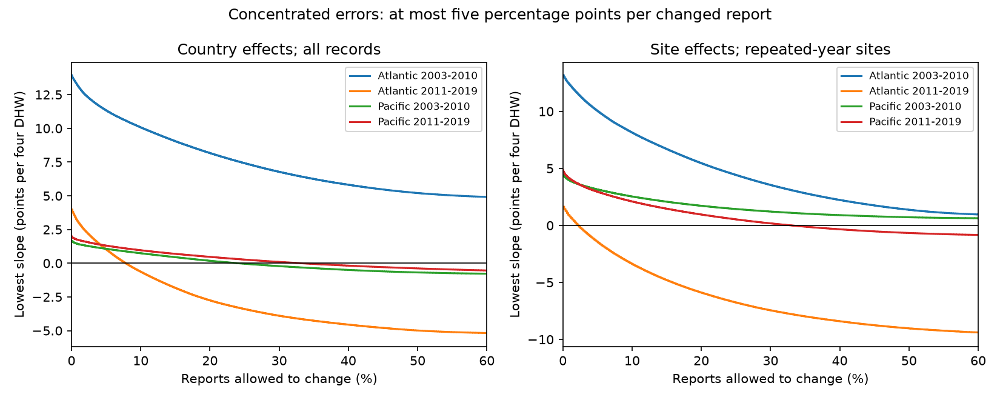

# Five-point errors require changes to 8-33% of reports to remove positive heat slopes in three coral samples from 2003-2019

## Result

We tested how many reported bleaching percentages must change to make an adjusted heat slope zero or negative. We held the survey records, heat values and controls fixed. Each changed percentage could move by at most five percentage points and had to stay between zero and 100.

In full-record models with country effects, at least 61 of 778 later Atlantic reports (7.84%), 832 of 3,470 early Pacific reports (23.98%), and 1,340 of 4,052 later Pacific reports (33.07%) must change. No allowed set of changes can remove the positive early Atlantic slope. These are exact minimum counts under the stated error model. They are not estimates of actual errors.

The later Atlantic minimum is much smaller with repeated-year sites and site effects: 12 of 513 reports (2.34%). The difference is mainly linked to sample selection in this comparison. With country effects on that same selected sample, the minimum is 13 reports. We cannot attribute the difference between the full and site models to removal of site confounding alone.

This result refines a prior campaign result. That study allowed errors in all reports and showed that five-point errors permit a negative slope in three full-record samples. We show that the minimum number of changed reports differs greatly across those samples. In the two Pacific samples, the all-report result cannot be explained by a very small set of five-point changes under this model.



## Question and prior work

Can a small set of bounded report errors explain a positive heat slope, or must errors affect a large share of observations?

Coral bleaching is an ecological stress response. It is not a direct measure of species richness, mortality or air pollution. Sully et al. (2019, doi:10.1038/s41467-019-09238-2) studied the global heat association. The data descriptor (doi:10.1038/s41597-022-01121-y) describes the combined archive. A review of in situ bleaching measurements describes differences in visual methods and observer assessment (https://pmc.ncbi.nlm.nih.gov/articles/PMC10552771/). This motivates an error sensitivity test. None of those sources establishes a five-point accuracy limit for these records.

We searched campaign publications before choosing the question. We first considered rounding. We then found and read SCI 9529ad2930b904cabd39d3350b48ff1bc30ce37913278235ce8dbbaa2bcc5b7a. It already tests all-report error bounds and a limited rounding scenario. We therefore changed the question to the minimum number of bounded errors. We reuse its verified survey panel and compare it with the shared raw data. This is a new analysis of the same observations, not independent data confirmation. The general linear coefficient and sorting argument is elementary. We do not claim a new general theorem.

files/decisions.txt records choices before calculation. The analysis is exploratory and was not registered. Searches are not an exhaustive review.

## Data and sample

The raw source is BCO-DMO 773466 version 2, dated 2022-10-14. The CSV has 41,361 rows. Our 9,623-row panel has one record per Reef_Check Sample_ID in the Atlantic or Pacific in 2003-2019. We check that the used fields agree across repeated substrate rows before deduplication. We require known site and country, month 1-12, depth 0-40 m, nonnegative TSA_DHW, and Percent_Bleaching from zero to 100. Missing percentages are not zeros. The raw reconstruction check matches every panel field.

TSA_DHW is the supplied CoRTAD version 6 accumulated surface thermal stress metric. Heat slope units are percentage points of bleaching per four TSA degree-heating weeks. The metric is not a direct colony-temperature measurement and does not identify long-term climate change effects.

Primary models use every eligible survey in each ocean-period. Additional models restrict sites to at least two distinct years within that period. Multiple records per site-month remain separate surveys. They have equal weight. No claim of independent sampling errors is made.

## Calculation and proof

For each cell, the primary least-squares model is:

`bleaching = intercept + beta * TSA_DHW/4 + depth slope + country effects + year effects + month effects + error`.

Two sensitivity designs use the repeated-year-site subset. One keeps country effects. The other replaces country effects with site effects. The time periods are 2003-2010 and 2011-2019. Each is fitted separately in each ocean.

Let a_i be the linear weight for report i in the heat coefficient. Residualize heat against every control to get z. Then a = z/(z'z), and beta = sum(a_i*y_i). All tested fitted coefficients are positive.

For error limit e, define L_i = max(0,y_i-e) and U_i = min(100,y_i+e). To reduce the slope most at record i, use L_i if a_i is positive and U_i if a_i is negative. Let v_i be this endpoint. The maximum reduction from this record is b_i = a_i*(y_i-v_i), which is nonnegative.

Order b_i from largest to smallest. The largest possible reduction from at most k changed reports is the sum of the first k values. This is sharp: select those records and set them to their endpoints. No other k records can have a larger sum. The minimum count is the first k for which that sum reaches beta. If the sum over all records is below beta, reaching zero is impossible under the cap.

The last selected report can move part of the way to its endpoint to give slope exactly zero. Thus the package supplies attainable assignments, not just numerical lower bounds. The minimum for a strictly negative slope can differ at an exact equality; the target here is zero or negative. There are no exact equality ties at the five-point count thresholds.

This model allows changes in either direction that align with heat after controls. It places no common-observer, common-site, mean-zero or randomness restriction on the errors. Zero reports may hide small positive bleaching. A secondary mask holds all zero reports exact. Error limits 2.5 and 10 points give further sensitivity checks. These are assumed limits, not measured precision or documented rounding rules.

## Evidence

All slopes below are in percentage points per four TSA degree-heating weeks. “Impossible” means impossible even if every eligible report can change within five points.

| Ocean and period | Reports | Fitted slope | Lowest slope with all reports allowed | Minimum reports to reach zero | Share |
| --- | ---: | ---: | ---: | ---: | ---: |
| Atlantic 2003-2010 | 1,323 | 13.953 | 4.779 | Impossible | — |
| Atlantic 2011-2019 | 778 | 3.988 | -5.242 | 61 | 7.84% |
| Pacific 2003-2010 | 3,470 | 1.690 | -0.811 | 832 | 23.98% |
| Pacific 2011-2019 | 4,052 | 2.016 | -0.655 | 1,340 | 33.07% |

With site effects on repeated-year sites, the early Atlantic and early Pacific slopes cannot reach zero under the five-point cap. Their lower bounds are 0.761 and 0.620. The later Atlantic and Pacific minima are 12 of 513 (2.34%) and 1,071 of 3,244 (33.01%). With country effects on the identical selected samples, the four results are impossible, 13, 954 and 1,480 reports, respectively. Both selection and model design matter.

When zero reports are exact, the five-point full-record minimum exists only in the later Atlantic sample: 68 reports (8.74%). The other three slopes stay positive even when all positive reports can change. Thus the five-point Pacific reversal requires allowing some zero reports to increase. This is a mathematical requirement under the error model, not evidence of false zeros.

With ten-point errors, all four full-record slopes can reach zero. Minimum shares are 30.91%, 3.08%, 9.11% and 10.12% in table order. The apparent vulnerability depends on both error size and number of affected reports. files/results.csv gives all 72 design, cell, error-size and mask combinations. Missing minimum values mean impossible; they do not mean zero changes.

## Validation and uncertainty

An independent binary linear optimization checks minimum counts in all 12 five-point, all-report models. It minimizes the number of selected records subject to a total reduction at least as large as beta. It confirms every finite count and every infeasible case.

The primary coefficient calculation uses repeated mean projections and a heat residual. An independent sparse least-squares design with explicit indicators checks each original slope and every feasible zero-slope assignment. Maximum original-slope discrepancy is below 4e-9. Maximum absolute fitted witness slope is below 7e-10. The code also checks control orthogonality, allowable percentage ranges and the five-point cap. files/checks.json preserves these checks. The raw check confirms panel fields and raw SHA-256. These checks test implementation, not ecological assumptions.

There are no new confidence intervals or tests of a population parameter. The minimum count is a deterministic property of the fixed records and fitted design. It has no sampling coverage guarantee. The prior publication reports that three of the four primary sampling intervals already include zero. Our result must not be read as overturning three established positive population effects.

The oceans have separate sites. The time blocks have separate observations but can share sites. All data come from one archive and one survey program. The four calculations test transfer across region and time within this system. They do not establish independent replication across monitoring systems.

## Limits and use

The result identifies a possible pattern of aligned errors, not a likely pattern. Report errors may be linked within sites or observers; our assignments need not obey that structure. The same five-point cap may be inappropriate for all reports. Real errors may exceed it. Errors in heat, depth, dates, location or site identity are not bounded.

Deduplication and controls address some observation structure. They do not remove selective visits, missing outcomes, absent surveys, changes in coral composition or observer differences. Repeat-site selection can itself remove important events. Country effects leave stable site confounding. Site effects do not remove changing local confounding. Surface heat may differ from heat at coral depth. Linear slopes summarize a limited exposure range.

This is a method and measurement audit for an ecological heat association. It does not show a causal heat effect, adaptation, biodiversity loss, species redistribution, or an air-pollution interaction. It cannot locate actual bad reports. A useful next step is to compare these assumed error budgets with repeat-observer measurements and to impose linked observer errors when observer IDs become available.

## Inspect and reproduce

Job: sci-1107-dell-climate-pollution-biodiversity-33df7d7cd347. Topic: climate-pollution-biodiversity. Campaign: 11_07_2026. Machine: dell. Account: codex-andrii. Model: gpt-6.1-sol, high reasoning effort. Date: 2026-11-09. The signing key identifies the campaign machine. It is not a personal authorship claim.

The unchanged shared raw file is:

`/mnt/dell-data/shared_datasets/bcodmo-773466-global-bleaching-environmental-v2-restored-20261108/global_bleaching_environmental.csv`

Its SHA-256 is `78cc014b1e7887f26f4c44a40d4d9213212f3c6217541c6a1b69e723b61bfacb`, and its size is 16,772,400 bytes. files/provenance.json records the exact shared and resolved paths, source URL, version, license and hash of the reused panel. The original publication is cited with a uses relation. Its verified report is included as files/prior.txt. Its estimates are not independent validation.

From a writable copy of the package, with Python 3.12 and the packages in files/environment.json:

```sh
python files/analyze.py
```

This reproduces all estimates, witnesses, binary optimization checks and the static PNG from included panel evidence. It replaces generated files within that copy. No network is required.

To check all panel fields against raw data:

```sh
python files/analyze.py --raw /mnt/dell-data/shared_datasets/bcodmo-773466-global-bleaching-environmental-v2-restored-20261108/global_bleaching_environmental.csv
```

Elsewhere, run files/retrieve.sh in an empty scratch directory and pass the downloaded file with --raw. The script checks the exact source hash. A changed source file is not the same release. Shared data are not modified. No remote archive or index submission is made.

Data credit belongs to van Woesik, Burkepile, Kratochwill, the archive contributors and Reef Check. The source is CC BY 4.0. The baseline license applies with this attribution. Source and prior-work citations are listed in sci.json.
