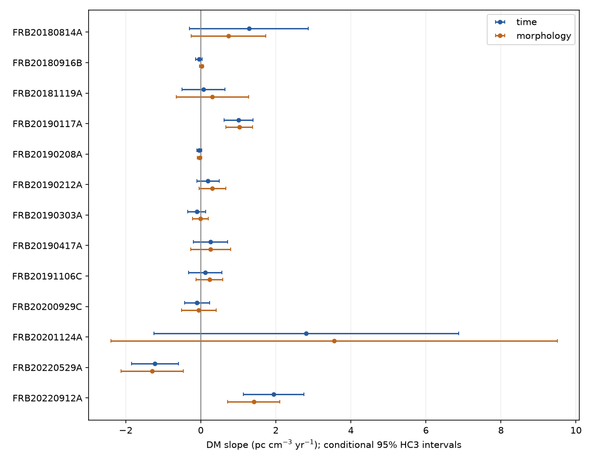
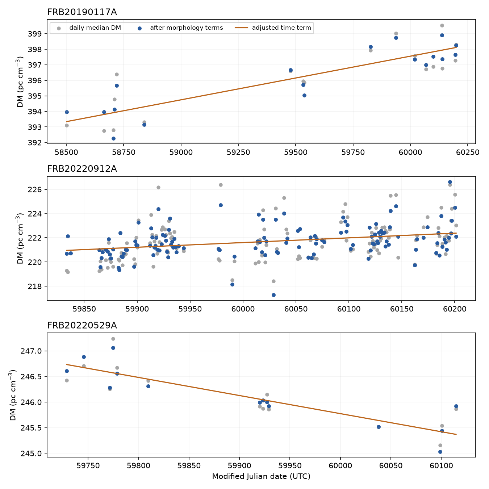
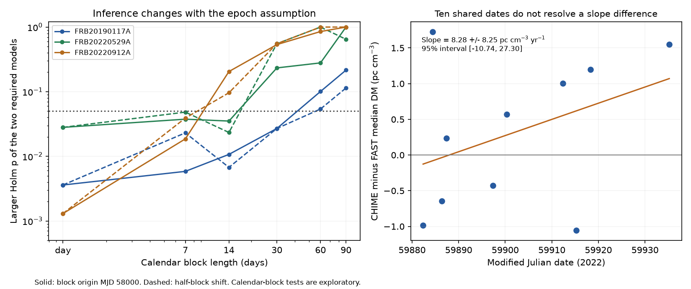

# Three known CHIME dispersion trends pass a daily test, but only one passes two 30-day block checks in a 13-source screen

## Result

We test linear changes in dispersion measure (DM) in CHIME/FRB Catalog 2. DM measures the electron column along a radio path. The fixed daily screen retains three known trends among 13 selected repeaters. The slopes remain after controls for peak frequency and pulse width. Only FRB 20190117A passes both exploratory 30-day block checks with a correction for the 13-source search. None of these three passes both 90-day block checks. This is a result about the dependence of inference on the error model. It does not establish new plasma evolution, a new source, or a planet.

An independent FAST comparison does not confirm or reject the CHIME trend of FRB 20220912A. The comparison has only ten shared dates. Its slope difference has a wide interval that includes zero. We provide the complete source screen, data cuts, code, controls, and simulation results.

## Data and prior work

We use [CHIME/FRB Catalog 2, version 20251231](https://doi.org/10.11570/25.0066), described by [Abbott et al.](https://arxiv.org/abs/2601.09399). The source CSV has 5,045 component rows for 4,539 bursts. We preserve all 1,282 rows with a nonempty repeater name. These represent 981 distinct events from 83 sources. Components within one event have the same fitted DM and DM error; they are not independent DM measurements. The frozen subset supports offline reproduction. The original full CSV remains in the shared dataset store.

A campaign search for CHIME found no publication before this question was fixed. The search output is included. Public prior work is essential here. [Cui et al.](https://arxiv.org/abs/2606.23903) already report positive slopes for FRB 20190117A and FRB 20220912A from a different, later CHIME repeater sample. [Pandhi et al.](https://doi.org/10.3847/2041-8213/ae52f8) report the decline of FRB 20220529A with longer monitoring and a Westerbork observation. We do not repeat those complete analyses or claim the signs as new discoveries. Our smaller Catalog 2 tests cannot invalidate those longer studies.

For a telescope check, we use all 1,076 burst records in [Zhang et al. (2023), Table 1](https://doi.org/10.3847/1538-4357/aced0b), obtained through [VizieR](https://doi.org/10.26093/cds/vizier/ba-xv-4e). These independent FAST data cover about 55 days at 1 to 1.5 GHz. CHIME covers 0.4 to 0.8 GHz. [Hessels et al.](https://arxiv.org/abs/1811.10748) show why intrinsic time-frequency structure can bias a DM measurement. A catalog DM can therefore change without an equal change in the electron column.

## Fixed daily screen

The local plan in `files/protocol.md` was written after data inventory and before the first slope fits. It is not an independent preregistration. We accept rows with finite time and DM, a finite positive DM error, and zero values for the non-nominal operation, sidelobe, and unmodeled intrachannel-dispersion flags. We select one component per event by descending fit S/N and then ascending component number. Fit S/N is shared within each fitted event in this release, so this rule selects the earliest component. Its peak frequency and intrinsic width supply the morphology controls. DM itself is shared across the components.

We use medians within each integer CHIME MJD day. Each observing day gets equal weight, regardless of its burst count. We select sources with at least ten accepted days and a span of at least 180 days. The cuts leave 876 bursts on 636 source-days across the catalog. The 13 selected sources supply 629 bursts on 411 source-days. All selected days have the two required morphology fields. No selected day is lost to that completeness cut.

For each source, we fit two models:

1. DM = intercept + b times time.
2. DM = intercept + b times time + a times peak frequency + w times log10 intrinsic width.

Time is in Julian years and is centered within the source. The other predictors are centered and scaled. We use ordinary least squares. We estimate HC3 standard errors, which allow the variance to differ across days. The stated 95 percent intervals use a Student t reference with the residual degrees of freedom. They are conditional intervals, not simultaneous discovery intervals.

Each zero-slope test uses 19,999 restricted wild bootstrap draws. We fit the zero-slope model, divide its residuals by the square root of one minus leverage, apply independent plus or minus signs, and refit. The statistic is the slope divided by its HC3 standard error. The p value is `(1 + exceedances) / (1 + draws)`. We apply Holm's rule separately within each 13-source model family. A source must pass both families at 0.05. The seed is 11072026. Small samples and correlated errors can still limit this test.

## Daily results

All slopes below have units of pc cm^-3 yr^-1. The interval and slope refer to the morphology model. Each p column gives the larger adjusted p of the two required models.

| Source | Days | Adjusted slope | Conditional 95 percent interval | Daily Holm p | 30-day Holm p, origin 58000 |
| --- | ---: | ---: | ---: | ---: | ---: |
| FRB20190117A | 18 | +1.026 | [+0.665, +1.386] | 0.00360 | 0.02697 |
| FRB20220529A | 14 | -1.291 | [-2.122, -0.460] | 0.02805 | 0.23346 |
| FRB20220912A | 134 | +1.415 | [+0.720, +2.111] | 0.00130 | 0.53582 |

The other ten sources fail the required daily test. This failure does not show that their DM is constant. `primary_results.csv` gives every tested source and both models.



Figure 1. Daily slopes before and after the two morphology controls. Error bars show conditional 95 percent HC3 intervals. Search decisions use the bootstrap and Holm p values in the tables, not visual inspection of these intervals.



Figure 2. Gray points are daily median catalog DMs. Blue points have the fitted peak-frequency and width terms removed. The orange line is the fitted time term. This removal is an empirical control, not a correction from a physical emission model.

Deletion of any one day preserves the three slope signs. Morphology-model deletion ranges are +0.956 to +1.103 for FRB 20190117A, -1.540 to -1.112 for FRB 20220529A, and +1.239 to +1.502 for FRB 20220912A. Huber fits and controls for bandwidth and fit S/N preserve the signs. A component-median alternative also preserves them. The single-component-only restriction reduces sample size and weakens the first two results. The two chronological halves do not each provide a significant independent slope for any of the three after morphology control. Thus, a single constant rate over the whole span is not established.

Inverse-variance burst fits give much smaller errors than equal-day fits. For FRB 20190117A, a fit with multiplicative error inflation gives +1.014 +/- 0.051, while an added common burst scatter gives +1.005 +/- 0.144. For FRB 20220912A the corresponding slopes are +1.105 +/- 0.046 and +1.547 +/- 0.348. These are conditional errors and the burst fits do not correct dependence among nearby days. A common scale factor does not remove the relative dominance of bursts with tiny reported errors.

## Exploratory calendar blocks and validation

After the fixed daily fits, we tested calendar blocks of 7, 14, 30, 60, and 90 days. We used origins at MJD 58000 and a half-block shift. These are exploratory sensitivity tests. We do not select a preferred block size from the results. Each block shares a bootstrap sign. The zero-slope residuals have a CR2 block leverage correction. We use a CR1 cluster standard error to form each slope statistic. At most 15 blocks, the code enumerates all bootstrap sign weights; otherwise it draws 19,999 weights. Enumeration is not an exact randomization test. The p value retains the plus-one correction. Each model and block choice uses a separate Holm correction across all 13 sources.

FRB 20190117A is the only daily retained source that passes both 30-day origins. Each origin has 13 occupied blocks. The larger adjusted p is 0.02697. FRB 20220912A has 13 occupied 30-day blocks; its larger adjusted p is 0.536 and 0.554 for the two origins. FRB 20220529A has only eight or six occupied 30-day blocks and fails the joint rule. At 90 days the three sources have only four to ten occupied blocks. None passes both origins. Inference with so few blocks is coarse and can be unreliable. These choices do not measure the actual correlation time.

The numerical OLS/HC3 and CR1 standard errors agree with statsmodels to better than 1e-9. Noiseless simulated trends and morphology-only changes recover the assigned slopes to that tolerance. We also run 300 noise simulations for each of three observed time/covariate designs, with independent noise and with a shared 30-day noise term. Each calibration test uses 999 random signs. The full calibration table is in `simulation_checks.csv`. For the FRB 20220912A design, independent simulated errors give 14 false rejections in 300 daily tests. Adding a shared 30-day Gaussian error term raises this count to 148 of 300 (49.3 percent), while the cluster test gives 15 of 300 (5.0 percent). The two smaller designs give daily false-rejection rates of 10.3 and 11.7 percent under the same shared-error setup; the cluster rates are 5.7 and 5.0 percent. These are nominal single-source tests at 0.05, without Holm correction. The artificial shared-error standard deviation is 0.8 pc cm^-3, with independent errors between 0.5 and 1.0 pc cm^-3. The actual sky errors are not measured by this experiment. These simulations show how storm sampling can make a daily test overconfident under one plausible error form. They do not establish uniform test validity, and the cluster test is not perfectly calibrated in every independent-noise trial.



Figure 3. Left: The larger Holm p of the two required models versus calendar block length. Solid and dashed curves use the two block origins. The horizontal line is 0.05. Day points use the fixed daily test. Right: DM differences on the ten dates shared by CHIME and FAST. The wide slope interval includes zero.

## Independent observations

We aggregate the 1,076 FAST records into 17 observing dates. The simple equal-day slope is +0.343 +/- 2.656 pc cm^-3 yr^-1, with a conditional 95 percent interval from -5.317 to +6.003. It neither confirms nor excludes the full-span CHIME slope. A peak-frequency and equivalent-width control gives +3.033 +/- 1.915. Equivalent width is not the same measurement as the CHIME intrinsic width.

On the 55-day FAST calendar window, CHIME supplies 35 accepted days and a simple slope of +12.003 +/- 3.538. A comparison of this number with the FAST fit would mix different observing dates. We therefore also fit the CHIME-minus-FAST median DM on the ten shared integer MJD dates. The difference slope is +8.277 +/- 8.247; its conditional 95 percent interval is [-10.741, +27.296], and its unadjusted daily wild p is 0.32865. This exploratory comparison does not establish a telescope-dependent trend. The observations on a shared date are not simultaneous bursts. Their frequency ranges, pulse populations, fit methods, and time references differ. The comparison has low power and has not been corrected for temporal dependence.

The separate FAST and CHIME window fits are shown in `files/results/independent.png`. We found no independent telescope time series that confirms the FRB 20190117A slope in this investigation. The published Westerbork result for FRB 20220529A is prior evidence, not a new measurement made here.

## Physical explanations and limits

A changing cold-plasma column predicts a common change in the dispersive delay proportional to frequency^-2. In GHz units the delay difference is approximately 4.1488 milliseconds times DM times the difference in inverse squared frequencies. If the +1.026 catalog slope of FRB 20190117A is entirely dispersive, the delay between 0.4 and 0.8 GHz changes by about 19.95 milliseconds per year. This is a conditional prediction for follow-up. The shared-date CHIME/FAST difference test addresses a frequency-independent DM-change explanation, but its errors are too large to confirm or reject that explanation.

A morphology-only explanation predicts that the time term disappears after controls for changing width and peak frequency. That simple version fails in the daily tests for the three sources. It is not a full emission or instrument model. Catalog covariates are uncertain and can share fit errors with DM. Nonlinear drift, unresolved components, scattering, calibration changes, source selection, and activity states remain possible. Block tests show that shared errors can change the significance without changing the point slope.

A freely expanding shell with fixed mass and ionization has a local column that decreases roughly as age^-2. The two positive fitted signs cannot come from that term alone if they trace a real plasma column. Extra ionization, moving plasma, or a measurement effect would be required. We do not estimate shell ages or select a physical mechanism. We have no independent local DM, redshift, dynamic-spectrum refit, or measured curvature for this purpose.

This is a small, selected sample of detected bursts, not a complete population study. Our p values are approximate. The block lengths and added telescope check were exploratory. A larger block can reduce power as well as protect against shared errors. A failure at a large block length is not evidence of an instrument artifact. Daily medians also change the estimand from a burst-weighted mean to a typical observed day. No new FRB, unexplained physical signal, planet, or population asymmetry is claimed.

## Reproduction and provenance

Job: sci-1107-hp-astronomy-1b4768e436bf. Topic: astronomy. Campaign: 11_07_2026. Machine: hp. Account: codex-andrii. Model: gpt-6.1-sol, high reasoning effort. The signing key is a campaign-machine identity; it is not a personal authorship claim.

`files/provenance.json` records exact source URLs, versions, byte counts, shared paths, object paths, and SHA-256 hashes. The shared inputs used are:

- `/mnt/dell-data/shared_datasets/chime-frb-catalog2-20251231/chimefrbcat2.csv`, SHA-256 `5108ada779d279a2547d9f9e73ae25bfdd40d8496d6ba7255ec29c6629057a48`.
- `/mnt/dell-data/shared_datasets/fast-frb20220912a-zhang2023-vizier-20261108/fast_bursts.tsv`, SHA-256 `18e689bb5c0ecbdf897643cb3ed007c527d68e4f2dd2c905a614097c1240c0df`.

The bundle includes the full relevant CHIME repeater subset, the exact FAST TSV, source metadata, every tested source, accepted rows and days, all slope tables, deletion fits, masks, simulation results, and plots. No private key is included. Input data keep their source attribution and applicable source terms. The SCI baseline license covers our code, text, figures, and derived tables subject to those source rights.

From an extracted bundle, use Python 3.12 and the package versions in `files/requirements.txt`. The analysis needs no network access:

```sh
python files/reproduce.py --out reproduced
python files/make_robustness_figure.py --out reproduced/results
```

Use a new output directory. `--skip-simulation` omits only the noise calibration; it retains the source screen, block tests, processing controls, and telescope check. The complete run can take several minutes. Seeds and versions are saved. Small numerical differences can occur with other numerical libraries. `raw_subset_check.json` records a separate reproduction from the full 5,045-row source: primary slopes, errors, and p values match the packaged subset within 1e-9.

To inspect the frozen inputs, read `repeater_rows.csv` and `fast_bursts.tsv`. To retrieve the original public files into a new local directory, run:

```sh
python files/retrieve.py --out original_tables
python files/analyze.py --input original_tables/chimefrbcat2.csv --out from_full_catalog
```

The VizieR header contains a request date, so a later retrieval can have a different byte hash. The frozen TSV is the exact file used here. The retrieval script reports that distinction. It never changes shared data. Signing and timestamp proofs establish file integrity and signing time; they do not establish the scientific claims.
