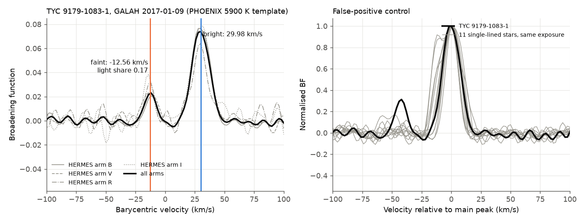
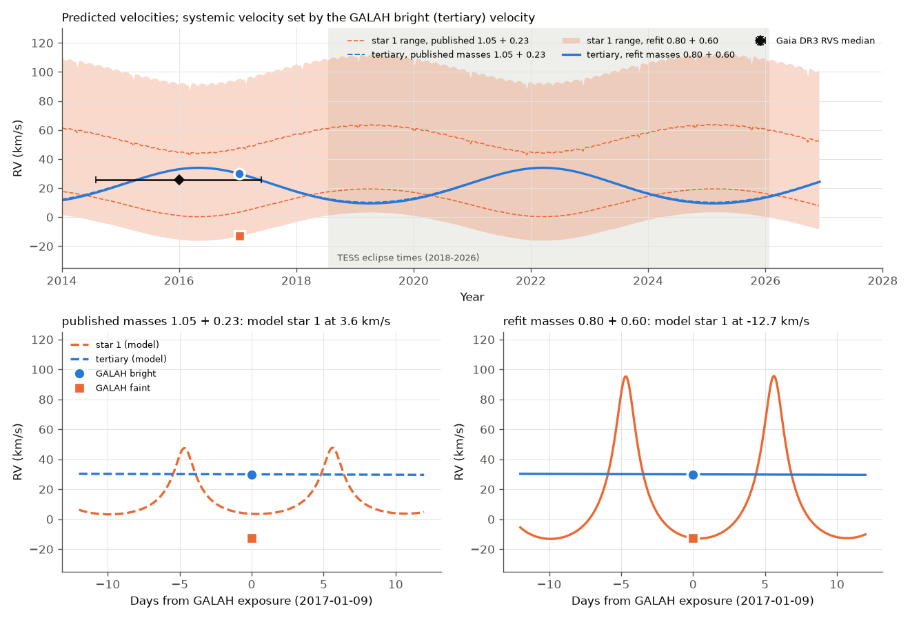
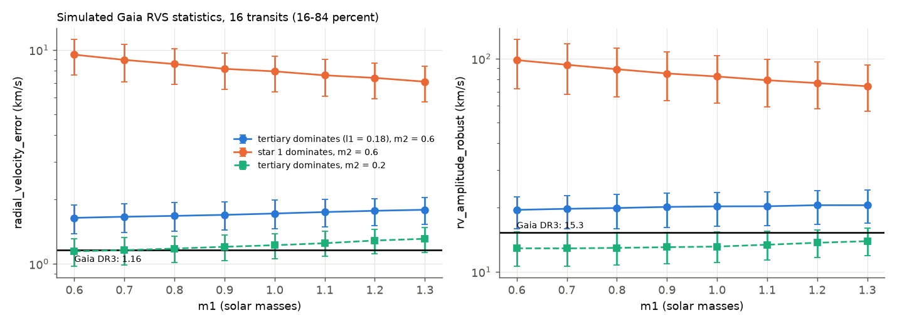

# A 2017 GALAH spectrum of TYC 9179-1083-1 shows two stars 42.5 km/s apart; with the timing orbit, the tertiary is brightest and the eclipsing secondary has 0.54-0.70 solar masses, not 0.23

Job: sci-1107-dell-astronomy-35faef05e2db. Topic: astronomy. Campaign: 11_07_2026. Machine: dell. Account: claude-sci.
Model: Claude Opus 5.5 (claude-opus-5-5), working as an automated research agent. Date: 2026-11-10/11.
The signing key is a campaign-machine key. It is not a claim of personal authorship.

## Summary

TYC 9179-1083-1 (TIC 300560295) is an eccentric 10.29-day eclipsing binary with deepening eclipses. A campaign timing study (SCI bbb8cb3a) found a third star on a 5.9-year orbit from TESS eclipse times (2018-2026). That study fixed the inner masses at 1.05 + 0.23 solar masses. A later Gaia DR3 astrometry study (SCI 0a886db8) found two branches: a faint tertiary or a tertiary that gives most of the light. A third study (SCI 158b62ef) found that a high third-light fit improves the TESS eclipse shapes. No study used spectra or measured velocities.

We found one independent spectrum: the GALAH DR3/DR4 HERMES spectrum of 2017-01-09 (TESS-HERMES programme, R = 28,000, four arms). We also used the Gaia DR3 RVS summary statistics (2014.6-2017.4). Main results:

1. **The spectrum has two stellar components.** Broadening functions (BF) against PHOENIX templates show a bright component at **+29.98 +- 0.15 km/s** and a faint component at **-12.56 +- 0.34 km/s** (barycentric). All four HERMES arms show the faint component independently (-12.0 to -14.2 km/s). Its BF area is **0.173 +- 0.018** of the total (0.16-0.19 for five templates). Eleven single-lined stars of similar type from the same exposure have no such peak: their largest side peak is 0.03-0.17 of the main peak; the target has 0.31 (Figure 1). The GALAH DR4 pipeline reports one component (vsini 14.3 km/s), so this detection is new.
2. **Only one assignment agrees with the timing orbit.** At the GALAH epoch, every refitted three-body timing model puts the eclipsed star (star 1) 25-55 km/s below the tertiary. Thus the bright component is the tertiary and the faint component is star 1. The opposite assignment needs the opposite sign. The secondary star (star 2) cannot give 17 percent of the light. Any other narrow component between -30 and +10 km/s has less than 4.4 percent of the light (approximate 3-sigma limit). The 2025-26 primary eclipse depth (4.43 percent) needs star 1 to give more light than that. So star 1 cannot hide elsewhere in the BF.
3. **The published masses fail this test.** The published model (1.05 + 0.23 solar masses) predicts a split of 26.4 km/s (25.2-27.6 for 40 covariance draws). The measured split is **42.53 +- 0.77 km/s** (jackknife, template and model terms). The difference is 21 sigma (Figure 3).
4. **The split measures the inner mass ratio.** We refitted the published timing model on 65 fixed inner-mass pairs (m1 = 0.6-1.3, m2 = 0.2-0.9 solar masses). All refits fit the 153 eclipse times about equally well (chi-square 194.7-202.6). So the timing alone does not fix the masses. The measured split requires **m2 = 0.54-0.70 solar masses** for every m1 in 0.6-1.3 (68 percent band +-0.02; Figure 2). The tertiary mass from the timing then is 0.99-1.38 solar masses.
5. **A main-sequence light ratio selects m1 = 0.70-0.88, m2 = 0.57-0.62 and m3 = 1.05-1.16 solar masses.** This uses a light ratio of star 1 to tertiary near 0.2 and L ~ M^4.5 (m1/m3 = 0.67-0.76). The template fits agree in direction: the tertiary is hotter (best 6200-6500 K, vsini 13.5-15 km/s) and star 1 is cooler (best 4600-5300 K, vsini 9-11.5 km/s). The light share of star 1 increases towards the red arms.
6. **Gaia DR3 RVS agrees with a dominant tertiary.** Forward models of 16 RVS transits from the Gaia scan law give a median velocity of 24.8-28.5 km/s (16-84 percent, m2 = 0.5-0.7) if the tertiary dominates (Gaia: 25.76 km/s). The systemic velocity comes from the GALAH tertiary velocity; it is not fitted to Gaia. If star 1 dominates, the median predicted radial_velocity_error is 3.1-12.1 km/s and the median rv_amplitude_robust is 33-125 km/s over all 65 mass pairs (Gaia: 1.16 and 15.3 km/s); at most 3 of 4,000 draws reach the Gaia error. There is a remaining mild tension: for m2 = 0.6 the dominant-tertiary model gives radial_velocity_error 1.42-1.93 km/s (16-84 percent), and only 1-5 percent of draws (m2 = 0.5-0.7) are at or below 1.16 km/s (Figure 4).

Consequences: the tertiary is the brightest star of the system (about 80 percent of the optical light). This selects the bright branch of the Gaia DR3 astrometric study (tertiary G-band light 0.78-0.87) and supports the high-dilution eclipse fits. The eclipsing pair is a pair of K and late-K/early-M dwarfs, not a solar-mass star with a 0.23 solar-mass companion. We give velocity forecasts for 2027-2029: star 1 should move between about -16 and +113 km/s (published masses: +2 to +57 km/s), and the tertiary between 14 and 34 km/s.

## Question and prior work

Question: does an independent spectrum detect the stars of the proposed TYC 9179-1083-1 triple, and do the measured velocities agree with the timing orbit and its assumed masses?

Campaign prior work (all cited in `sci.json`): SCI 0f548fc8 found the deepening eclipses and the Gaia acceleration. SCI bbb8cb3a measured 86 primary and 67 secondary eclipse times and fitted a three-body model (P2 = 2,147 d, mutual inclination 55 deg, m3 = 1.03 solar masses for inner masses 1.05 + 0.23). SCI 0a886db8 tested Gaia acceleration and jerk and found faint and bright tertiary-light branches. SCI 158b62ef found that high third light improves the eclipse shapes. We searched the campaign (`sci search` for TYC 9179-1083-1, HD 93683, HD 303514, TOI-682, vanishing eclipses) and the ESO archive (no data for this star). We checked SIMBAD, GALAH DR3/DR4, RAVE DR6 (no entry) and Gaia DR3. We did not find a published spectroscopic analysis of this star.

We first considered the other systems in the objective. The ESO archive has no spectra of HD 303514 and only one UVES spectrum of TOI-682; TESS has no new sectors for any of the four systems after sector 100. So the GALAH spectrum of TYC 9179-1083-1 was the most direct new independent test available.

## Data

| Data | Source | Use |
| --- | --- | --- |
| GALAH DR3 HERMES spectrum, sobject 170109003801395, 2017-01-09, mid-exposure MJD 57762.65396 (UTC), 3 x 600 s, four arms; observed-frame (IDX=1) and normalised (IDX=0) files | AAO Data Central SSA/DataLink | BF, two-component fits |
| 11 GALAH DR3 spectra of single-lined stars from the same exposure (Teff 5800-6500 K, vsini 10-19 km/s, GALAH flag_sp = 0) | AAO Data Central | false-positive control |
| GALAH DR3 and DR4 catalogue values (rv_galah 29.54 km/s; DR4 rv_comp_nr 1, vsini 14.26) | VizieR J/MNRAS/506/150; Data Central TAP galah_dr4.mainspectable | context (quoted only) |
| Gaia DR3 gaia_source RVS columns of source 5268829762908402560 | AIP Gaia TAP | Gaia RVS test (quoted values) |
| Gaia DR3 commanded scan law | shared dataset `gaia-dr3-commanded-scan-law-001` (SHA-256 c0c55b1d...) | RVS transit epochs |
| PHOENIX-ACES-AGSS-COND-2011 HiRes spectra, [M/H] = 0 (Husser et al. 2013) | ftp.gwdg.de mirror of phoenix.astro.physik.uni-goettingen.de | templates |
| Three-body timing model, eclipse times, covariance draws and code | SCI bbb8cb3a (baseline licence) | velocity predictions, refits |

External raw data are not in this bundle. `files/provenance.json` gives the SHA-256 of every external file that we used, the URLs and all quoted catalogue values. `files/code/fetch_inputs.sh` downloads them into a separate scratch folder. See `files/EXTERNAL_DATA_NOTICE.md`.

The GALAH observed-frame spectra are barycentric. Evidence: our CCF peak of the bright component (30.0 km/s) agrees with the catalogue barycentric RV (29.3-29.5 km/s), and the barycentric correction at this epoch is +4.64 km/s. The velocity split does not depend on this frame.

## Method

**Velocity predictions** (`rv_predict.py`, `rv_at_scans.py`). We rebuilt the published REBOUND (WHFast) model with the published parameter vectors and integrated back from the reference time to the GALAH epoch and to the Gaia scan epochs. The observer is on +z in that model (observed time = t - z/c), so the radial velocity is -v_z. We used the best model, three robustness models and 40 covariance draws.

**Broadening functions** (`bf_reg.py`). For each arm we normalised the observed spectrum with a running 90th percentile, masked H-alpha and H-beta, and solved a linear least-squares deconvolution with a second-difference regularisation (velocity grid -110 to +150 km/s, step 2 km/s). Templates: PHOENIX 5900 K, log g 4.5, broadened to R = 28,000; also 5300, 6200, 6500 K and log g 4.0 as tests. We fitted two Gaussians to the BF. Errors come from a 20-chunk jackknife (5 chunks per arm). A first cross-correlation (`ccf_quick.py`) and a template autocorrelation (`acf_check.py`) showed that the second peak is not a template side lobe.

**Two-component spectral fits** (`twocomp.py`). Model = quadratic continuum x [(1 - l) S_a + l S_b], with rotational and instrumental broadening, one light fraction per arm and a grid of 10 x 10 template pairs plus 10 single-star fits.

**Controls** (`bf_controls.py`). The same BF for 11 single-lined stars from the same 2dF/HERMES exposure. Metric: the largest BF value more than 20 km/s from the main peak, relative to the main peak.

**Timing refits** (`refit_one.sh`, the unchanged `fit_triple.py polish` of SCI bbb8cb3a). We polished the published best solution with fixed inner masses on a grid m1 = 0.6-1.3 and m2 = 0.2-0.9 (step 0.1) and at (1.0, 0.65), with the published data, weights and settings (NFEV = 150). For each refit (`grid_velocities.py`) we computed the velocities at the GALAH epoch and the Gaia scan epochs.

**Mass constraint** (`mass_constraint.py`). We interpolated the predicted split v3 - v1 over (m1, m2) (cubic; check at an off-grid refit: 0.0003 km/s) and found the m2 values that match the measured split. Total error: jackknife 0.37, template 0.35 (spread of the 15 best two-component fits; the BF templates differ by 0.1) and model 0.57 km/s (40 covariance draws), in quadrature 0.77 km/s. The same script gives the BF upper limit for a narrow (sigma 4.8 km/s) component at any velocity, with the residual rms scaled by sqrt(4) for correlated BF pixels. This scale is approximate.

**Gaia RVS forward model** (`rvs_blend.py`, `gaia_rvs_sim.py`). We built the blend of the tertiary (6200 K, vsini 14) and star 1 (5000 K, vsini 10) at R = 11,500 in 846-870 nm, and measured the cross-correlation peak against a 5300 K template (Gaia used a 5250 K template). This gives the shift of the measured velocity for a given split and light fraction. We drew 4,000 random sets of 16 transits from the 40 scan crossings within 0.35 deg across-scan in the DR3 window, added 1.5 or 2.5 km/s noise, and computed the median, radial_velocity_error = sqrt(pi/(2N) sigma^2 + 0.11^2) and max-min amplitude. Hypothesis A: the tertiary dominates (star-1 light fraction 0.12, 0.18 or 0.25); the systemic velocity is the GALAH tertiary velocity minus the model tertiary velocity. Hypothesis B: star 1 dominates (only the scatter statistics are used).

## Results

**Figure 1.** Left: BF of the GALAH spectrum in each HERMES arm (grey) and for all arms (black). The bright and faint components are at +29.98 and -12.56 km/s. Right: normalised BF of the target (black) and of 11 single-lined stars from the same exposure (grey), relative to the main peak.

Table 1. BF results (all arms; jackknife errors for the 5900 K template).

| Template | v bright (km/s) | v faint (km/s) | Split (km/s) | Faint BF share |
| --- | --- | --- | --- | --- |
| 5900 K, log g 4.5 | 29.98 +- 0.15 | -12.56 +- 0.34 | 42.53 +- 0.37 | 0.173 +- 0.018 |
| 5300 K, log g 4.5 | 30.00 | -12.50 | 42.50 | 0.186 |
| 6200 K, log g 4.5 | 29.96 | -12.54 | 42.49 | 0.166 |
| 6500 K, log g 4.5 | 29.94 | -12.50 | 42.44 | 0.159 |
| 5900 K, log g 4.0 | 29.99 | -12.55 | 42.54 | 0.171 |
| Two-component fits (15 best pairs) | 29.6-30.1 | -12.0 to -13.1 | 41.8-43.1 | 0.09-0.32 per arm |

The best two-component fit lowers the sum of squared residuals by 16 percent relative to the best single-star fit. In single-star fits the rotational width goes up to 15-23 km/s (5600-6500 K templates) and to 30-58 km/s (cooler templates) to absorb the second component.

**Figure 2.** Left: predicted tertiary minus star-1 velocity at the GALAH epoch for 64 timing refits (grey contours). Orange: the measured split and its 2-sigma band. Blue: the part of the band that also has a main-sequence light ratio m1/m3 = 0.67-0.76. Open circle: the published masses. Right: tertiary mass from the timing refits along the solution band.

Table 2. Solutions along the measured split (m2 at 1 and 2 sigma; m3 from the refits).

| m1 | m2 (1 sigma) | m2 (2 sigma) | m3 | m1/m3 |
| --- | --- | --- | --- | --- |
| 0.6 | 0.525-0.563 | 0.507-0.584 | 0.99 | 0.61 |
| 0.7 | 0.552-0.592 | 0.532-0.613 | 1.05 | 0.67 |
| 0.8 | 0.576-0.618 | 0.555-0.640 | 1.11 | 0.72 |
| 0.9 | 0.598-0.642 | 0.577-0.665 | 1.17 | 0.77 |
| 1.0 | 0.619-0.664 | 0.596-0.688 | 1.23 | 0.82 |
| 1.1 | 0.638-0.685 | 0.615-0.710 | 1.28 | 0.86 |
| 1.3 | 0.673-0.724 | 0.648-0.750 | 1.38 | 0.94 |

**Figure 3.** Top: predicted tertiary velocity (blue) and the range of star-1 velocity (orange; dashed lines for the published masses) for 2014-2028. The systemic velocity comes from the GALAH tertiary velocity (21.3 and 21.0 km/s in the two models shown; 18.7-23.3 km/s over all refits). The black diamond is the Gaia DR3 RVS median over 2014.6-2017.4. Bottom: 24 days around the GALAH exposure. The published masses put star 1 at +3.6 km/s; the 0.80 + 0.60 refit puts it at -12.7 km/s, where the faint component is. Star 1 is near its velocity minimum at this epoch, so the result is not sensitive to small timing errors.

**Figure 4.** Simulated Gaia DR3 RVS statistics (median and 16-84 percent of 4,000 transit sets) for m2 = 0.6 with a dominant tertiary (blue), for m2 = 0.6 with a dominant star 1 (orange), and for m2 = 0.2 with a dominant tertiary (green). Black lines: Gaia DR3 values.

Table 3. Gaia RVS forward model, m1 = 0.8 (other m1 values are similar; `files/results/gaia_rvs_sim.csv`).

| Case | Median RV (km/s) | radial_velocity_error (km/s) | rv_amplitude_robust (km/s) | Fraction of draws with error <= 1.16 |
| --- | --- | --- | --- | --- |
| Gaia DR3 | 25.76 | 1.16 | 15.3 | - |
| A, m2 = 0.6, l1 = 0.18 | 25.7-28.4 | 1.42-1.93 | 16.0-23.1 | 0.02 |
| A, m2 = 0.6, l1 = 0.12 | 26.6-29.5 | 1.39-1.83 | 15.2-20.5 | 0.02 |
| A, m2 = 0.6, l1 = 0.25 | 24.4-26.9 | 1.55-2.20 | 18.3-27.1 | 0.01 |
| A, m2 = 0.2, l1 = 0.18 | 25.9-28.0 | 1.01-1.34 | 10.8-15.3 | 0.47 |
| B, m2 = 0.6 (star 1 dominates) | - | 6.9-10.2 | 66-112 | 0.00 |
| B, m2 = 0.2 | - | 3.1-4.5 | 33-51 | 0.00 |

The Gaia statistics reject hypothesis B for all masses. They agree with hypothesis A in the median velocity. The Gaia scatter is smaller than our model predicts for m2 = 0.6. The m2 = 0.2 case agrees better with the Gaia scatter, but the GALAH split excludes it by 21 sigma. We think that the simple blend model is the most likely cause: it uses PHOENIX templates at solar metallicity, one fixed light fraction, a uniform random choice of transits, and no Gaia deblending (3 of 16 transits were deblended). We do not claim that the Gaia scatter measures m2.

## Interpretation

The 2017 GALAH spectrum is a direct, independent detection of two stars of the triple. The timing orbit, which used only 2018-2026 TESS data, predicts the sign of the split correctly and the systemic velocity agrees with Gaia DR3. The measured size of the split then needs a massive eclipsing secondary. This also explains why the spectrum is dominated by the tertiary: for m1 = 0.7-0.9 solar masses the tertiary (1.05-1.17 solar masses) is the most massive and most luminous star. The total light of such stars agrees in order of magnitude with the TIC luminosity of 1.78 solar luminosities at 251 pc. The faint component is narrower than the tertiary (vsini 9-11.5 against 13.5-15 km/s). Pseudo-synchronous rotation at e = 0.51 and P = 10.29 d gives about 14 x R km/s, which is about 11 km/s for R = 0.8 solar radii. This agrees with the faint component being star 1.

With star-1 light of about 0.15-0.2 in the optical, the intrinsic eclipses are about five times deeper than the TESS depths. The eclipse-shape study that found a better fit with high third light (SCI 158b62ef) and the bright Gaia astrometric branch (SCI 0a886db8) both agree with this. The faint-tertiary branch (white dwarf or dark tertiary) is excluded, because the bright velocity component cannot be star 1.

## Limitations

- There is only one spectral epoch. The component assignment depends on the published three-body orbit, extrapolated 1.5 years before the first TESS data. The 40 covariance draws change the split by only 0.6 km/s, but the draws are local.
- An alternative with a fourth star (a companion of the tertiary that is the faint component) is not excluded by one epoch. It needs star 1 to be hidden with less than 4.4 percent of the optical light. The 4.43 percent deep 2025-26 eclipses make this unlikely, because a grazing eclipse removes only a part of the light of star 1, and the TESS and HERMES bands differ only modestly. A second spectrum will test it directly: the faint component must follow the 10.29-day orbit.
- Star 2 is predicted near +49 km/s for the 0.80 + 0.60 solution. We do not see it (fitted share -0.4 percent, 3-sigma limit 4.4 percent). A 0.6 solar-mass main-sequence star gives a few percent of the light, so this limit is not a strong test.
- The mass ratio m1/m3 from the light ratio uses a simple main-sequence relation, solar metallicity templates (GALAH gives [Fe/H] = -0.19) and the BF area as a light share. Different line strengths of the two stars make this share approximate. The Teff values of the two-component fits are weakly constrained.
- The refits are local polishes of the published solution (150 evaluations) with the published data, error scales and geometry terms. We did not refit the light curves or the eclipse geometry with the new third light.
- The Gaia RVS model is approximate (see Results) and leaves a mild tension in the epoch scatter.
- The BF upper limits use an approximate correction for correlated pixels.

## Predictions on record

`files/results/rv_forecast_2027_2029.csv` gives the predicted barycentric RVs of star 1, star 2 and the tertiary every 1.0 day from 2027-01-01 to 2029-12-31 for five refits (four consistent solutions and the 1.0 + 0.2 comparison). For the consistent solutions, star 1 should reach about +95 to +113 km/s near periastron and about -16 km/s near its minimum, and the systemic velocity is 20.2-21.3 km/s (same GALAH zero point). Two or three high-resolution spectra near the star-1 velocity extremes will measure K1 directly and separate the solutions.

## Files

- `files/results/bf_reg_T*.json`: BFs per arm and combined, two-Gaussian fits and jackknife values for five templates.
- `files/results/twocomp_grid.json`: all one- and two-component spectral fits.
- `files/results/controls.csv`, `controls_bf.json`: control metrics and BFs.
- `files/results/rv_pred_galah_epoch.csv`: velocities of the published models and 40 covariance draws at the GALAH epoch.
- `files/results/refit_states.csv`: 65 refitted parameter vectors (m1, m2, chi-square, x as in bbb8cb3a `triple_model.py`).
- `files/results/grid_galah_epoch.csv`: velocities, m3, i2 and mass function of each refit at the GALAH epoch.
- `files/results/mass_solutions.csv`, `summary.json`, `bf_upper_limits.csv`: the mass constraint and error budget.
- `files/results/rvs_blend.npz`, `gaia_rvs_sim.csv`: Gaia RVS blend table and forward-model statistics.
- `files/results/rv_forecast_2027_2029.csv`: velocity forecasts.
- `files/code/`: all scripts. `extract_scans_0a88.py` is the unchanged scan-crossing script of SCI 0a886db8.

## Reproduction

Python 3.12 with numpy 2.5.4, scipy 1.18.1, pandas 3.1.1, astropy 8.0.2, matplotlib 3.11.2 and REBOUND 5.2.2 (`files/code/requirements.txt`).

1. `bash files/code/fetch_inputs.sh WORK` downloads the GALAH spectra, PHOENIX templates and REBOUND, and extracts the verified SCI bundle bbb8cb3a into `WORK` (not into this bundle). Compare the files with `files/provenance.json`.
2. `cd WORK && bash /path/to/files/code/run_all.sh /path/to/files/code [SCANLAW]` runs all steps. The default scan-law path is the shared campaign dataset; elsewhere, download `CommandedScanLaw_001.csv.gz` (SHA-256 c0c55b1dad49a19b182955ade5693c7c74d8c313725f6679f48a3f6bfe157bf4) from the Gaia CDN. The 65 timing refits take about 10 minutes with 10 processes; the two-component grid takes about 15 minutes.

## References

- Buder, S., et al. 2021, MNRAS 506, 150 (GALAH DR3); Buder, S., et al. 2025, PASA (GALAH DR4); De Silva, G. M., et al. 2015, MNRAS 449, 2604 (GALAH); Sharma, S., et al. 2018, MNRAS 473, 2004 (TESS-HERMES).
- Husser, T.-O., et al. 2013, A&A 553, A6 (PHOENIX).
- Rucinski, S. M. 1992, AJ 104, 1968; Rucinski, S. M. 2002, AJ 124, 1746 (broadening functions).
- Katz, D., et al. 2023, A&A 674, A5 (Gaia DR3 radial velocities); Gaia Collaboration, Vallenari, A., et al. 2023, A&A 674, A1.
- Rein, H., & Liu, S.-F. 2012, A&A 537, A128 (REBOUND); Rein, H., & Tamayo, D. 2015, MNRAS 452, 376 (WHFast).
- Hut, P. 1981, A&A 99, 126 (pseudo-synchronous rotation).
