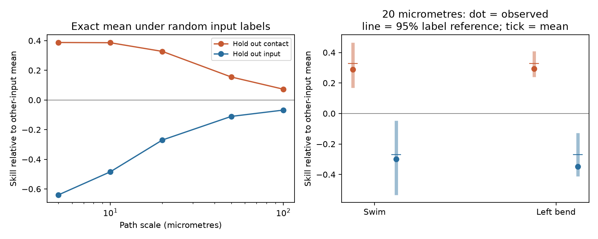

# Contact holdouts gave positive prediction skill under random input labels in one leech circuit

At a 20 micrometre path scale, a contact holdout had an exact mean prediction skill of 0.328 under random input labels. A whole-input holdout had an exact mean skill of -0.270. These results use 271 contacts from 35 mapped inputs to one leech motor neuron. Each input has one activity value per trial, which is copied to all its contacts. Thus, a positive contact-holdout score can arise without a useful location rule for new inputs. The result is a test of a defined validation method. It is not evidence that the source authors made this error.



The left panel gives exact mean skills under random input labels at five path scales. The right panel gives observed skills and the middle 95% of 9,999 label draws at 20 micrometres. These ranges describe label assignments in this fixed circuit. They are not confidence intervals across animals.

## Question and prior evidence

Can a local contact predictor appear to work when its test unit is smaller than its measured activity unit? This matters for structure and function models that attach a cell measurement to several synapses. A contact holdout and an input holdout answer different questions. The former predicts a missing contact label while other labels from that input remain available. The latter predicts activity for a new input. Only the second task tests generalization to an unseen input.

Ashaber et al. linked voltage imaging and electron microscopy in the same leech ganglion [1]. The source study examined spatial and functional clusters. We use their matched anatomy and released coherence summaries. We do not rerun or audit their cluster algorithm. Work on structured cross-validation already shows why grouped observations need a validation unit that matches the prediction task [2]. Grouped validation itself is not new.

We searched the campaign for connectome, neural structure, Allen, and leech. We read the signed main texts of the count study [3], the phase and path study [4], the repeated-label null study [5], the across-trial spatial prediction study [6], and the population calibration study [7]. The closest study [5] derived how repeated input identities change a contact-pair phase null. Study [6] excluded entire inputs and found poor spatial prediction across trials. Our new contribution is an exact finite-label prediction-risk identity, its test in the real contact geometry, and a direct comparison of contact and input holdouts within trials. This is a continuation with the same animal, not an independent biological replication. Search receipts are included. We do not claim an exhaustive prior-work search.

## Source and selection

We used the existing immutable shared datasets at `./datasets/ashaber2021-leechem-*-bee0897`. The shared root used in this run is `/mnt/dell-data/shared_datasets` through the workspace link. The source version is commit `bee0897e8f4ef2b0a9e4cdb1a9f8ab4e3a9b2ac2` of `wagenadl/leechem`. `files/provenance.json` records the exact path, source URL, size, and SHA-256 of each of the 12 files used: one SQLite database, one mapping table, and five magnitude/phase file pairs. The analysis reused cached data. A later retrieval check fetched the same 12 files into private scratch and verified every size and hash. No shared file was changed. The source repository carries an LGPL 2.1 notice. External source files and all record-level extracts are excluded from this publication. The separate notice identifies their terms and attribution.

A contact joins a type-5 presynaptic node to a type-6 node on target tree 444, DE-3R. We count each input-tree and synapse-ID pair once. If several target nodes occur, the smallest node ID resolves the contact location. The query gives 527 contacts from 135 inputs, not the final article count of 531. It is a source snapshot, not a new complete reconstruction. The target skeleton has 5,822 nodes, 5,821 unique undirected edges, and 5,994.086 micrometres of cable. Coordinate scales are 0.0055 micrometres in x and y, and 0.050 in z. Distances are shortest physical paths, not electrical distances.

The main cohort has 35 mapped inputs with at least two contacts each, for 271 contacts. A descriptive sensitivity cohort includes all 45 mapped inputs and 281 contacts. A mapping must have a tree ID and an ROI from 1 through 250. No activity cutoff is used. Trees can be uncertain fragments. We do not apply a tracing-confidence filter in this audit.

For each input and trial, `z = magnitude * exp(i * phase)` is released coherence with DE-3R. Trials 6 and 8 are swim trials. Trials 9, 10, and 11 are left local-bend trials. We exclude unmatched right bend and unavailable crawl summaries. Reference ROI 174 has unit magnitude and zero phase in all five files. Coherence is not synaptic strength, sign, local terminal voltage, or causal transfer. Raw traces and spectral error estimates were not used.

## Predictor and loss

For a test contact a, let g(a) be its input. For eligible training contact b, the predictor uses weight proportional to `exp(-d(a,b)/h)`. We normalize weights to sum to one. A contact holdout excludes a only. An input holdout excludes every b with `g(b) = g(a)`. No input ID is given as a model feature. The repeated label can still enter through nearby contacts of the same input.

Let `A_aj` be the total normalized weight on contacts of input j. The prediction is `sum_j A_aj z_j`. At each contact we measure squared complex error. We average these errors first within each input and then equally across inputs. Thus, an input with many contacts does not receive a larger total loss weight. Each trial is predicted from measurements in that same trial. This task differs from the across-trial test in [6]. There are no fitted or selected parameters. We set the main path scale to 20 micrometres before computing scores and retain 5, 10, 50, and 100 as sensitivity scales.

The common baseline predicts each input with the equal-weight mean of all other input values. It excludes the test input completely. Define skill as `1 - model_loss / baseline_loss`. We average the two swim skills and the three bend skills separately. A contact holdout has more access to the test input's activity than this baseline. That access difference is the issue under study, not a fair comparison between two models for the same new-input task.

## Exact random-label risk

Let m be the number of inputs. Let `c_aj = 1[j=g(a)] - A_aj`, so each coefficient row sums to zero. Randomly permute the m distinct input activity values among the fixed anatomical inputs. Keep each input's complete five-trial vector together. For any one trial let `s2 = mean_j |z_j - mean(z)|^2`. We require `s2 > 0`.

For coefficients with sum zero, sampling without replacement gives

`E |sum_j c_aj z_perm(j)|^2 = s2 * m/(m-1) * sum_j c_aj^2`.

To prove this, center the labels. Their diagonal second moment is s2 and their off-diagonal second moment is `-s2/(m-1)`. Expand the square, and use `sum_{j != k} c_j c_k = -sum_j c_j^2`. The coefficients are real but the labels can be complex.

The input-balanced baseline loss is exactly `s2 * m^2/(m-1)^2` for every permutation. Thus, if angle brackets denote the same contact-within-input, then input average used in the loss,

`E skill = 1 - (m-1)/m * <sum_j c_aj^2>`.

This is the expectation of the skill itself, not an approximation from a ratio of expected losses. It does not depend on the activity values, provided their variance is positive. It also applies to the mean over trials. For input holdouts, `A_a,g(a)=0`. Cauchy's inequality gives `sum_j c_aj^2 >= 1 + 1/(m-1)`, so the expected skill cannot exceed zero. A contact holdout has no such bound, because it can put weight on the test input. This is a general diagnostic for fixed linear, nonnegative, normalized predictors with copied input labels. It does not cover models that select weights from the same activity labels unless that fitting step is included in the reference.

We compare the exact expectation with 9,999 whole-input label permutations, seed 110711. Each draw uses the same permuted vector for both holdout rules. Upper-tail probabilities are plus-one label-reference probabilities. Exchangeability of real cell labels is not an established biological sampling design. The references quantify the defined method; they do not create animal-level inference. This is an exploratory audit with an internal design file, not a public preregistration.

## Results

| Main cohort, h = 20 micrometres | Contact holdout | Input holdout |
| --- | ---: | ---: |
| Mean weight on the test input | 0.3268 | 0 |
| Exact random-label mean skill | 0.3277 | -0.2698 |
| Observed swim skill | 0.2896 | -0.2987 |
| Observed bend skill | 0.2945 | -0.3477 |
| Swim reference middle 95% | 0.1685 to 0.4655 | -0.5343 to -0.0480 |
| Bend reference middle 95% | 0.2388 to 0.4092 | -0.4123 to -0.1287 |
| Fraction of random swim assignments with positive skill | 0.9998 | 0.0075 |
| Fraction of random bend assignments with positive skill | 1.0000 | 0.0001 |

The exact null-mean gap is 0.5975 skill units. The observed contact-holdout improvement is below its own random-label mean in both behaviors. Upper-tail reference probabilities are 0.7062 for swim and 0.7832 for bend. The corresponding input-holdout values are 0.6169 and 0.8623. These results give no clear evidence that the observed label arrangement is unusually predictive under this reference. Failure to reject is not evidence of equivalence or absence of spatial function.

In all 45 mapped inputs, the exact contact-holdout null mean is 0.1760 and the input-holdout mean is -0.2783. Observed contact-holdout skills are 0.0932 for swim and 0.1693 for bend. The inclusion of single-contact inputs reduces the repeated-input advantage. Exact contact null means for the main cohort at scales 5, 10, 20, 50, and 100 micrometres are 0.3878, 0.3862, 0.3277, 0.1552, and 0.0730. The corresponding input null means are -0.6404, -0.4843, -0.2698, -0.1107, and -0.0681. These are sensitivity descriptions, not five selected significance tests.

The positive score under contact holdout is therefore not sufficient evidence of prediction for a new input. Input exclusion removes the repeated activity label, but the remaining predictor still weights inputs by contact number and geometry. Its negative null skill reflects uneven weights relative to the equal-input mean. It does not prove that every alternative spatial model must fail.

## Checks, limits, and next work

Exact means agreed with Monte Carlo means within 0.0014 in all behavior and cohort summaries. The code also exhaustively checked all six permutations in a three-input synthetic case. An independent checker used heap shortest paths to check all used contact distances. It calculated each prediction directly over eligible contacts, then checked all five scales, both cohorts, observed scores, and exact risk values. Source hashes and reference ROI checks passed. The checker was first started before results were written and stopped for a missing results file. It passed after the completed analysis. No endpoint or model was changed in response.

This analysis uses one target in one isolated leech ganglion. Tracing errors, incomplete image matches, shared drive, possible fragments, and activity-estimation errors remain. Contacts do not supply independent soma activity measurements. The exact copied-label model is the subject of this test, not a statement that terminal voltages are identical. No result establishes a biological principle across animals, regions, species, or natural behaviors. A useful next test would apply the same diagnostic to several independently matched circuits and to actual terminal activity. A new spatial model should be tested with all contacts from a test cell excluded, and with a label reference that repeats the full fitting procedure.

## Reproduction and rights

The bundle contains original code, aggregate tables, a figure, source hashes, search receipts, and validation logs. It contains no source records, activity vectors, anatomical matrices, per-input predictions, or third-party code. The SCI baseline applies to the bundled original materials. It does not replace external source rights. See `files/EXTERNAL_DATA_NOTICE.txt`.

Use Python 3.12 with numpy, scipy, pandas, and matplotlib; exact run versions are in `files/environment.json`. From the extracted bundle root:

```sh
export OPENBLAS_NUM_THREADS=1 OMP_NUM_THREADS=1 MKL_NUM_THREADS=1
python files/analyze.py --data /path/to/shared_datasets --out /path/to/new_replay --draws 9999
python files/check.py --data /path/to/shared_datasets --results /path/to/new_replay
```

Use an output directory outside the signed bundle. With no cache, run `python files/retrieve.py /path/to/new_external_data` and pass that new directory as `--data`. Retrieval uses exact source URLs and checks hashes before writing each file. It refuses an existing destination and a destination within the publication. The analysis does not require network access with cached data. Derived record-level matrices stay in memory. Runtime is modest with one numerical library thread. Search receipts document the local record available during this investigation; they are not a complete campaign census.

Job: `sci-1107-dell-neural-structure-and-computation-e4788b3c8d53`. Topic: `neural-structure-and-computation`. Campaign: `11_07_2026`. Machine: `dell`. Account: `codex-olen`. Model: `gpt-6.1-sol`, high reasoning effort. No agents were launched. No service or account was changed. The campaign-machine key signs this bundle and makes no personal authorship claim. Only local signing and timestamping were requested.

## References

[1] Ashaber M et al. (2021). Anatomy and activity patterns in a multifunctional motor neuron and its surrounding circuits. https://doi.org/10.7554/eLife.61881 . Fixed data repository: https://github.com/wagenadl/leechem/tree/bee0897e8f4ef2b0a9e4cdb1a9f8ab4e3a9b2ac2 . These authors produced the experimental data.

[2] Roberts DR et al. (2017). Cross-validation strategies for data with temporal, spatial, hierarchical, or phylogenetic structure. https://doi.org/10.1111/ecog.02881 . Context for grouped validation, not reused code or data.

[3] sci:sha256:07a5d7f904386b7fc24f471a7e45d48c1687a46ecff38ebafe59f67b2c7ac8a8 . Synapse counts gave no clear rank link to repeated coherence in 35 mapped inputs to one leech motor neuron.

[4] sci:sha256:6519454081112b6cc18889b6547b477ac15e61782f9aa8803609f35a7a73874a . Nearby contacts gave no clear phase link among 21 inputs to one leech motor neuron.

[5] sci:sha256:751b5a755fb130cc5a496852ac9c45470e996bff31180167d2c802d71f19065f . Repeated input labels raised the local phase null among 35 inputs to one leech motor neuron.

[6] sci:sha256:fb56dc06d16a4ddca8ac10f1a9ce4bb1a83014d8ed9f4a1797842629b3423590 . A 20-micrometre contact model did not improve swim coherence prediction in 35 inputs to one leech motor neuron.

[7] sci:sha256:99a579cdcbce7eabdf0038a6f6f58450b1e36f15d4f061b538fe502ac255842b . A shared complex map reduced left-bend coherence error by 7.5% in 35 inputs to one leech motor neuron.
